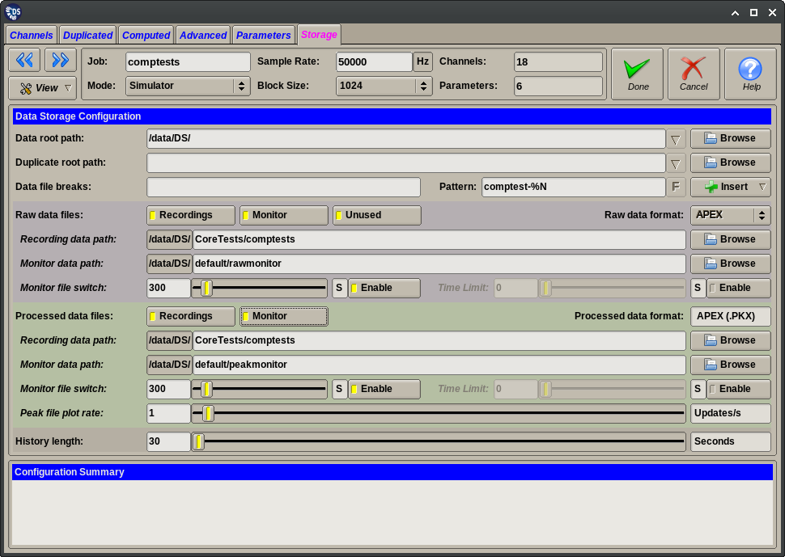

# Storage Tab

The Setup Editor Storage tab is used to configure storage options for the data
acquisition project. It allows configuring data storage paths (folders) and
recording conditions.

*Example Setup Editor Storage tab*

Recording options are independently configurable for raw input an processed data. For both formats two differrent
data storage targets are available:

> - **Monitor** mode recordings start as soon as data monitoring is started.
> - **Data Point** recordings start upon user input, whenever a recording is
>   triggered in the APEX DS application (or a client controlling it). When
>   started, these suspend monitor mode recordings, and resume them when the data
>   point ends.

The following storage options cane be configured on this panel:

<table>
  <thead>
    <tr>
      <th>Storage item</th>
      <th>Description</th>
    </tr>
  </thead>
  <tbody>
    <tr>
      <td>Data root path:</td>
      <td>Base path prepended to all directories on this panel</td>
    </tr>
    <tr>
      <td>Duplicate root path:</td>
      <td>If present, duplicate recorded files to duplicate path (parallel write)</td>
    </tr>
    <tr>
      <td>Data file breaks:</td>
      <td>Create separate file based on channel number</td>
    </tr>
    <tr>
      <td>Pattern:</td>
      <td>File pattern to create recorded file names</td>
    </tr>
    <tr>
      <td colspan="2"><strong>Raw  files</strong></td>
    </tr>
    <tr>
      <td>Recordings:</td>
      <td>Enable or Disable recording of raw data files</td>
    </tr>
    <tr>
      <td>Monitor:</td>
      <td>Enable or Disable monitoring raw data files</td>
    </tr>
    <tr>
      <td>Raw data format:</td>
      <td>Raw data file format either datx or rwx</td>
    </tr>
    <tr>
      <td>Recording data path:</td>
      <td>Relative path for storing recorded raw data files</td>
    </tr>
    <tr>
      <td>Monitor data path:</td>
      <td>Relative path for storing monitor raw data files</td>
    </tr>
    <tr>
      <td>Monitor file switch:</td>
      <td>Create new raw monitor data file every N seconds</td>
    </tr>
    <tr>
      <td>Time limit:</td>
      <td>For monitor files only, remove raw monitor files older than N seconds</td>
    </tr>
    <tr>
      <td colspan="2"><strong>Processed  files</strong></td>
    </tr>
    <tr>
      <td>Recordings:</td>
      <td>Enable or Disable recording of processed data files</td>
    </tr>
    <tr>
      <td>Monitor:</td>
      <td>Enable or Disable monitoring processed data files</td>
    </tr>
    <tr>
      <td>Processed data format:</td>
      <td>Not adjustable, always is pkx</td>
    </tr>
    <tr>
      <td>Recording data path:</td>
      <td>Relative path to storing record processed data files</td>
    </tr>
    <tr>
      <td>Monitor data path:</td>
      <td>Relative path to storing monitored processed data files</td>
    </tr>
    <tr>
      <td>Monitor file switch:</td>
      <td>Create new processed monitor data file every N seconds</td>
    </tr>
    <tr>
      <td>Peak file plot rate:</td>
      <td>Include a time domain block in the processed file at a rate of N times second</td>
    </tr>
    <tr>
      <td>History length:</td>
      <td>Length in seconds of history storage of parameter type values</td>
    </tr>
  </tbody>
</table>

**Event Marker Recording Mode**

The event marker recording mode records all data into a single monitor file.
Upon all recording events markers are placed in the file to indicate the start
or stop of a recording. In order to enter this mode enable only monitoring in
the storage panel and turn off monitor file switch. These settings are
independent for processed data and raw data.
