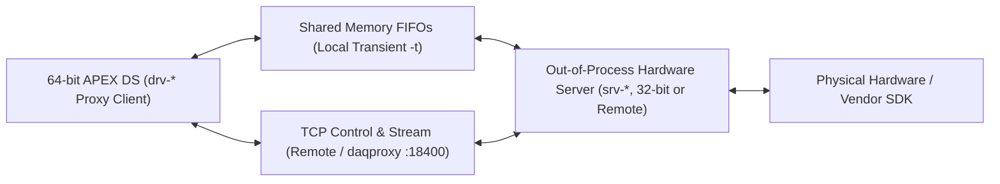

# Driver Architecture, `ProxyDev` IPC & Licensing

## Dynamic Plugin Discovery & Loading (`PluginDev`)

**APEX DS** discovers and loads acquisition hardware modules dynamically at runtime rather than hard-linking vendor SDKs into the main server binary:

- **Binary Naming & ABI:** Each hardware plugin compiles as a shared library named `drv-<name>.dll` (Windows) or `drv-<name>.so` (Linux) exporting `EDASpluginTable()`.
- **Plugin Headers & Versioning (`PluginDev.h`):**
  - Magic identifier: `PLUGIN_DEVICE = 0xEDA5A2DC`
  - Interface version: `PLUGIN_VERSION | PLUGINDEV_VERSION` (`0x02000300`)
  - Hardware class tags (`PluginDevType`): `ADC`, `AMP`, `COMB` (combo ADC+AMP), and `PARM` (parameter-only scanner/bridge).
  - Emitted sample formats: `INT16`, `INT32`, `FLOAT32`, and `TACH`.
- **Two Acquisition Load Paths:** `DsDevice` (`DsDeviceLoader.cxx` / `DsDevice.cxx`) handles UI setup, device options, and channel/calibration inspection, while `DspStageDaq::createShared()` instantiates the real-time acquisition pipeline stage. *(Note: Signal processing plugins under `DS/dsp/plugins/` separately use `DspPlugin` / `getPlugin(int)` and are not hardware device drivers.)*

### Plugin Search Order
DS searches for `drv-*` libraries in the following directories:
1. Application executable directory
2. `plugins/` and `../plugins/` relative to the executable
3. `EDASPLUGINS` environment variable path
4. `$EDASTOOLS/plugins` environment variable path
5. Per-user application plugin directory (`~/.apex/plugins` / `~/.edas/plugins` on Linux; `Application Data/APEX/plugins` on Windows)

---

## Out-of-Process `ProxyDev` Architecture

Some vendor SDKs ship strictly as **32-bit binaries**, install conflicting runtime libraries, or must run directly on a **real-time / remote chassis host** (such as LabVIEW RT or dedicated Linux serial/PCI appliances). The **`ProxyDev`** framework isolates those dependencies behind a lightweight server process (`srv-<name>`):

### Proxy Operating Modes

| Mode | Trigger Flag / Mechanism | Data Transport | Typical Usage |
| :--- | :--- | :--- | :--- |
| **Local Transient** | `srv-<name> -t <port>` (spawned automatically by `drv-*`) | Control via TCP loop, bulk sample blocks via shared-memory FIFOs (`mapFifos()`) | 64-bit Windows DS driving 32-bit General Standards DLLs (`bin32/srv-*.exe`) or `nsimul` |
| **Local Permanent** | `srv-<name> -p <port>` | Pre-started persistent hardware server | Dedicated host daemons keeping kernel/hardware handles open |
| **Remote Daemon (`daqproxy`)** | `proxydevdaemon` / `srv-* -r <host> <port>` (default TCP port **`18400`** `PXD_PORT`) | Control and sample frames streamed over TCP sockets | Running `nni449x`, `nni4353`, `nni6124`, or `rni44xx` across separate OS hosts |

---

## Hardware Licensing & Serial Validation

Individual `drv-*` shared libraries are not licensed standalone. Instead, licensing is enforced centrally by **APEX DS** (and optionally validated per hardware serial in **ApexLM**):

### 1. Per-Vendor Channel Pools (`<VENDOR>_CHANNELS` -> `ANY_CHANNELS`)
Every active plugin reports its vendor class via `PLUGINDEV_ATTRIB_DEVCLASS`. During acquisition startup on real hardware (`INPUT_ADCDEVICE`):
1. DS sums requested channel counts per vendor class (`<vendor>`) and requests **`<VENDOR>_CHANNELS`** from ApexLM (or `APEXDS_CHANNELS_<vendor>` in legacy FlexNet).
2. If any vendor-specific pool returns fewer seats than needed, DS immediately releases those vendor checkouts and attempts to check out the total active channel count from **`ANY_CHANNELS`** (legacy `APEXDS_CHANNELS_ANY`).
3. If both vendor-specific and `ANY_CHANNELS` pools lack sufficient seats, acquisition fails to arm and DS alerts the operator.

| `DEVCLASS` Key | ApexLM Feature Pool | Hardware Scope |
| :--- | :--- | :--- |
| `advtech` | `ADVTECH_CHANNELS` | Advantech (`adv17x4`) |
| `astech` | `ASTECH_CHANNELS` | Astech DSR (`astechdsr`) |
| `btt` | `BTT_CHANNELS` | Blade tip-timing file replay (`bttfile`) |
| `caddmas` | `CADDMAS_CHANNELS` | Caddmas USB (`caddmas3x8`, `caddmas8x4`) |
| `cc` | `CC_CHANNELS` | Concurrent DSCC (`ccurdscc`) |
| `datatel` | `DATATEL_CHANNELS` | Datatel telemetry (`datatel`) |
| `gs` | `GS_CHANNELS` | General Standards (`gsdaq`) |
| `imc` | `IMC_CHANNELS` | IMC Cronos (`imcdevice`) |
| `ltt` | `LTT_CHANNELS` | Tasler LTT24 (`lttdevice`) |
| `mecalc` | `MECALC_CHANNELS` | MeCalc Quantus (`mecalc`) |
| `ni` | `NI_CHANNELS` | National Instruments (`ni*`, `rni44xx`) |
| `other` | `OTHER_CHANNELS` | `datafile`, `param`, `sndcard`, generic devices |
| `pacific` | `PACIFIC_CHANNELS` | Pacific Instruments (`pi7000`) |
| `psi` | `PSI_CHANNELS` | PSI `9016`/`9021` (`psi9016`) |
| `scani` | `SCANI_CHANNELS` | Scanivalve `DSA`/`MPS` (`scani*`) |
| `teac` | `TEAC_CHANNELS` | TEAC `WX-7000` (`wx7000`) |
| `vti` | `VTI_CHANNELS` | VTI Instruments (`vtex`, `vtitc`) |

### 2. Simulator Evaluation Mode
When **APEX DS** is running with simulated input (`simul`, `INPUT_SIMULATOR`), channel pool and DS optional feature checkouts are skipped so users can test project setups without consuming hardware licenses.

### 3. Hardware Serial Whitelisting (`ApexLmLic`)
ApexLM Format v2 license documents support per-application `licenses[].hardware` bindings associating vendor IDs (`mecalc`, `scanivalve`, `datatel`, `hgl`, `pacific`, `ni`, `dewesoft`, `ps9016`, `vti`) with permitted device serial numbers (or `"*"` wildcard, matched case-insensitively). Clients invoking `ApexLmLic::checkoutHardware(vendor, serial)` validate physical chassis/module serial numbers against installed license records.

See also: [Driver Matrix Overview](README.md) · [APEX DS Licensing](../DS/installation/licensing.md)
