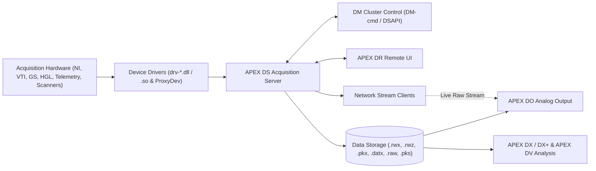

# APEX Data Acquisition & Telemetry Suite (`DS`)

The **APEX DS** suite provides synchronized multi-chassis dynamic data acquisition, real-time display, distributed cluster automation, analog waveform replay, and hardware-accelerated post-processing for turbomachinery, structural dynamics, acoustics, and high-speed test cells.

> [!TIP]
> New to APEX DS? Start with the **[APEX DS Quick Start Guide](quick-start.md)** to configure a simulated or hardware run, view plots, and record `.rwx` / `.pkx` files in minutes.

## Suite Components

| Component | Role | Documentation |
| :--- | :--- | :--- |
| **APEX DS** | Primary data acquisition server and local engineering/configuration workstation (`ds` / `SR` stream recorder). | [APEX DS Manual](DS/README.md) |
| **APEX DR** | Remote network display client for live time-domain, FFT, Campbell, orbit, and parameter plots with multi-page layouts. | [APEX DR Manual](DR/README.md) |
| **APEX DM** | Distributed cluster manager, batch automation controller (`DM-cmd`, `DM-api`), and `DSAPI` command-line utilities (`dsdiscoverapp`, `dscalapp`, `dsrecordapp`, `dscontrolapp`). | [APEX Data Manager](DM/README.md) |
| **APEX DO** | Real-time Digital-to-Analog (D2A) waveform replay and live stream output utility for NI PXI/PXIe and Linux Contec cards. | [APEX Data Output](DO/README.md) |
| **Device Drivers** | Modular `drv-*` acquisition plugin architecture, `ProxyDev` 32/64-bit IPC bridge, and per-vendor hardware manuals. | [Hardware Device Drivers](Drivers/README.md) |

> [!NOTE]
> **APEX DV & APEX DX / DX+**
> **APEX DV (Data Viewer)** uses the APEX file-playback and plot visualization model for reviewing recorded `.rwx`, `.pkx`, `.raw`, and `.pks` runs offline (without live hardware acquisition). For full offline dynamic signal analysis, aeromechanics, rotating machinery, acoustics, parameter merging, and batch automation, see the **[APEX DX Documentation](../DX/README.md)**.

## System Architecture

- **Acquisition Layer ([Drivers](Drivers/README.md)):** DS dynamically loads vendor `PluginDev` modules (`drv-*.dll` / `drv-*.so`). Legacy 32-bit vendor SDKs and isolated chassis servers run out-of-process through `ProxyDev` (`srv-*`) over shared-memory FIFOs or TCP (`daqproxy` port `18400`).
- **Control & Remote Display ([DM](DM/README.md) & [DR](DR/README.md)):** Clients discover DS instances via UDP/TCP (`10995`–`11004`), subscribe to raw/peak telemetry, or orchestrate synchronized multi-node `N:M` clusters.
- **Analog Output & Post-Processing ([DO](DO/README.md) & [DX](../DX/README.md)):** Recorded runs and live DS streams drive precision DAC hardware via **DO** or feed offline engineering toolkits in **APEX DX / DX+**.

## Data File Formats

| Format | Extension | Contents & Capabilities | Primary Writers / Readers |
| :--- | :--- | :--- | :--- |
| **APEX 3.0 Raw** | `.rwx` | 512-byte header, full DS setup/DP text, raw time-series packets (`0xbaf1`–`0xbaf3`), tachometer (`0xbaf6`), low-speed parameters (`0xbaf7`), optional seek index. | Written by `DS` / `SR`; read by `DO`, `DV`, `DX`, `DX+`, `DSAPI`, `datafile` |
| **APEX 3.0 Compressed Raw** | `.rwz` | Compressed variant of `.rwx` (requires `RWX_COMPRESSION` license flag). | Written by `DS`; read by `DO`, `DV`, `DX`, `DX+` |
| **APEX 3.0 Processed / Peak** | `.pkx` | Setup metadata, block peak/RMS statistics (`0xbaf6`), decimated time (`0xbaf4`), magnitude (`0xbaf5`), and FFT (`0xbaf8`) data. | Written by `DS`; read by `DV`, `DX`, `DX+`, `DSAPI` |
| **Legacy EDAS Raw** | `.raw` | Legacy APEX/EDAS 2.x unindexed binary raw time-domain format. | Legacy EDAS-DS; read by `DO`, `DV`, `DX` |
| **Legacy EDAS Peak** | `.pks` | Legacy APEX/EDAS 2.x processed peak/statistics format. | Legacy EDAS-DS; read by `DV`, `DX` |
| **DspCON DATX** | `.datx` / `.datx_index` | Brick time-domain data and index files without full DS project setup or low-speed external parameters. | Imported/replayed by `DO`, `DX`, `datxfile` |
| **Project Configuration** | `.dspro` / `.drpro` / `.srpro` | ASCII project definitions storing hardware setup, calibration, display layouts, and recording rules for DS, DR, and SR. | Saved and loaded by `DS`, `DR`, `SR`, and `DM-cmd` |

## Licensing Overview

Current releases of the APEX suite support the modern **APEX License Manager (ApexLM)** alongside **Legacy FlexNet (`27000@host`)** for backward-compatible deployments:

- **APEX License Manager (ApexLM):**
  - Runs as a local or floating ZeroMQ CurveZMQ service (`ApexLMService` / `apexlm.service`), exposing client registration on TCP port `27884` (`27885`/`27886` for floating servers) and a local Web Administration UI at **`http://127.0.0.1:27887/`**.
  - Supports **Local** (node-locked Ed25519 JSON license), **Passthrough** (forwards to a central ApexLM Server with offline borrowing up to **30 days**), and **Server** (floating pool) modes.
  - Licenses cover applications (`DS`, `DR`, `DM`, `DSAPI`, `DV`, `DX`, `DX+`), per-vendor counted channel pools (`<VENDOR>_CHANNELS` with fallback to `ANY_CHANNELS`), shared `AEROPLOTS` display tokens, feature flags (`PARAMETER_SERVER`, `RWX_COMPRESSION`, `DS_MANAGER`), and `ANALYSIS` analysis tokens.
  - **Simulator Mode:** Running **APEX DS** in simulated input mode (`simul`) waives device channel and feature checkouts for evaluation and configuration testing.
- **Legacy FlexNet:** Uses `lmgrd` / vendor daemon on port `27000@host`, node-locked `.lic` files, or APEX OpenCode trusted storage.

For step-by-step installation and configuration details, see:
- [APEX DS Installation Licensing](DS/installation/licensing.md) & [APEX DS Licensing Dialog](DS/interface/licensing.md)
- [APEX DR Installation Licensing](DR/installation/licensing.md) & [APEX DR Licensing Dialog](DR/interface/licensing.md)
- [APEX DM & DSAPI Licensing](DM/README.md#licensing)
- [APEX DX Licensing](../DX/licensing.md)
