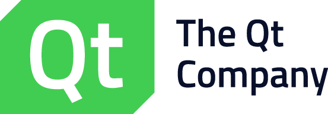
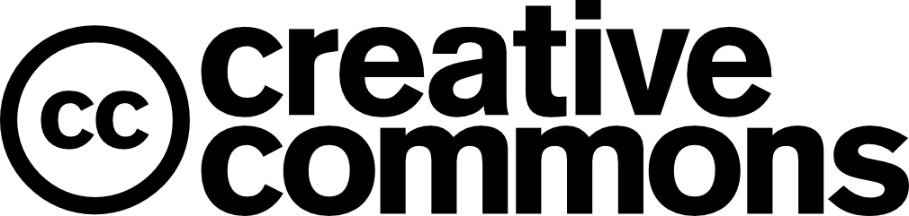

# DX Attribution

## Qt

A cross-platform application framework [http://www.qt.io](http://www.qt.io)

Licensed under the [GNU Lesser General Public License.](http://www.gnu.org/copyleft/lesser.html)

## Qwt

Qt Widgets for Technical Applications [http://qwt.sf.net/](http://qwt.sf.net/)

DX is based in part on the work of the Qwt project

Licensed under the [Qwt License Version 1.0](http://qwt.sourceforge.net/qwtlicense.html)

## QtitanRibbon

Implementation of the concept of Microsoft Ribbon for Qt.C++

[http://www.devmachines.com/qtitanribbon-overview.html](http://www.devmachines.com/qtitanribbon-overview.html)

## zlib

A Massively Spiffy Yet Delicately Unobtrusive Compression Library

Licensed under the [ZLib License.](http://www.zlib.net/zlib_license.html)

## TinyXML-2

TinyXML-2 is a simple, small, efficient, C++ XML parser. [http://www.grinninglizard.com/tinyxml2/](http://www.grinninglizard.com/tinyxml2/)

Licensed under the [ZLib License.](http://www.zlib.net/zlib_license.html)

## bzip2

bzip2 is a freely available, patent free, high-quality data compressor.

Copyright © 1996-2007 Julian Seward [http://www.bzip.org/1.0.5/bzip2-manual-1.0.5.html](http://www.bzip.org/1.0.5/bzip2-manual-1.0.5.html)

## csv2

Fast CSV parser and writer for Modern C++ (MIT License)

[https://github.com/p-ranav/csv2](https://github.com/p-ranav/csv2)

## Unicode

Unicode and Globalization support for software applications.

Distributed under the Terms of Use [http://www.unicode.org/copyright.html](http://www.unicode.org/copyright.html).

## LAPACK

Routines for solving systems of simultaneous linear equations, least-squares solutions of linear systems of equations, eigenvalue problems, and singular value problems.

[http://www.netlib.org/lapack/](http://www.netlib.org/lapack/)

## BLAS

Basic Linear Algebra Subprograms

[http://www.netlib.org/blas/](http://www.netlib.org/blas/)

## SLATEC

SLATEC Common Mathematical Library

[http://www.netlib.org/slatec/](http://www.netlib.org/slatec/)

## FFTPACK

FFTPACK is a package of Fortran subprograms for the fast Fourier transform of periodic and other symmetric sequences.

[http://www.netlib.org/fftpack/](http://www.netlib.org/fftpack/)

## FreeType

FreeType is a freely available software library to render fonts.

Licensed under the [The FreeType Project LICENSE](http://git.savannah.gnu.org/cgit/freetype/freetype2.git/tree/docs/FTL.TXT)

## Harfbuzz

HarfBuzz is an OpenType text shaping engine.

HarfBuzz is licensed under the so-called ["Old MIT" license](https://github.com/behdad/harfbuzz/blob/master/COPYING)

## TinyExpr

TinyExpr is a very small recursive descent parser and evaluation engine for math expressions.

[https://github.com/codeplea/tinyexpr/](https://github.com/codeplea/tinyexpr/)

Licensed under the [ZLib License.](http://www.zlib.net/zlib_license.html)

## QR-Code-generator

QR Code generator library

Copyright © 2019 Project Nayuki. (MIT License)

[https://www.nayuki.io/page/qr-code-generator-library](https://www.nayuki.io/page/qr-code-generator-library)

## HDF5 (Hierarchical Data Format 5)

HDF5 (Hierarchical Data Format 5) Software Library and Utilities
Copyright (c) 2006, The HDF Group.

Limited portions of HDF5 were developed by Lawrence Berkeley National Laboratory (LBNL).
LBNL's Copyright Notice and Licensing Terms can be found here: COPYING_LBNL_HDF5 file in
this directory or at [http://support.hdfgroup.org/ftp/HDF5/releases/COPYING_LBNL_HDF5](http://support.hdfgroup.org/ftp/HDF5/releases/COPYING_LBNL_HDF5).
