# Designer Connections Guide

## All Connections

The DX deisgner connections guide is found below. It details what elements can be connected to and from every other element. Use this guide to help with design creation. Listed by order of appearance in the "Elements" section of the Designer.

| Element Type | Connections |
| --- | --- |
| Signals and Signals* | 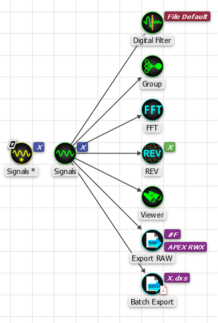 |
| Parameters and Parameters* | 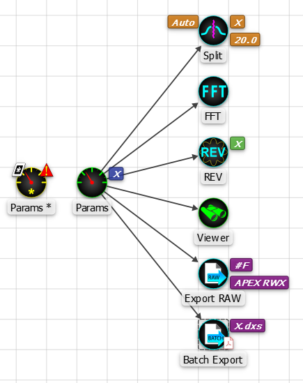 |
| Parameter Math | 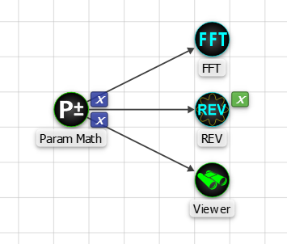 |
| Group | 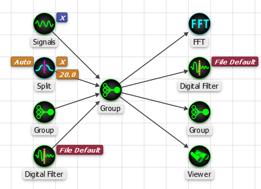 |
| FFT | 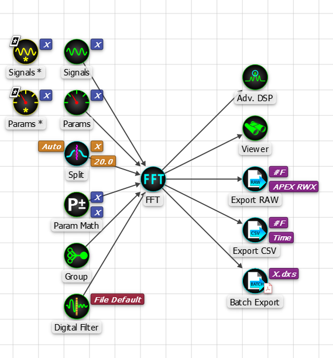 |
| Advanced DSP | 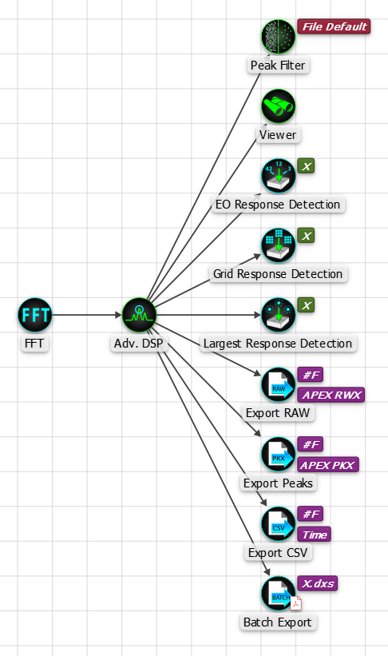 |
| Digital Filter | 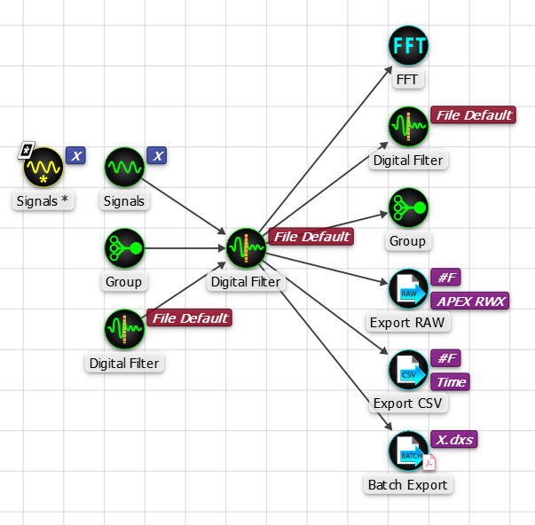 |
| Peak Filter | 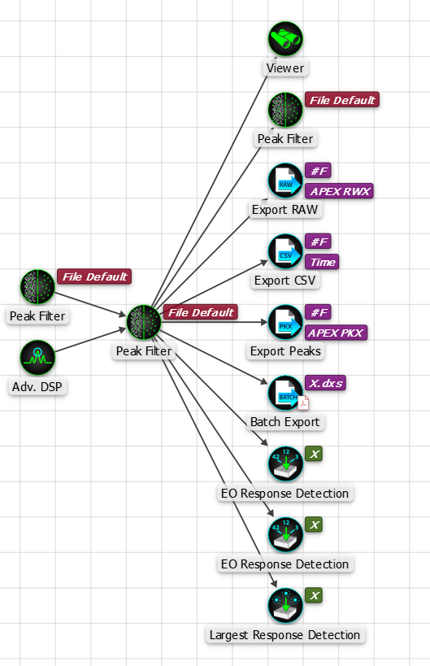 |
| Viewer | 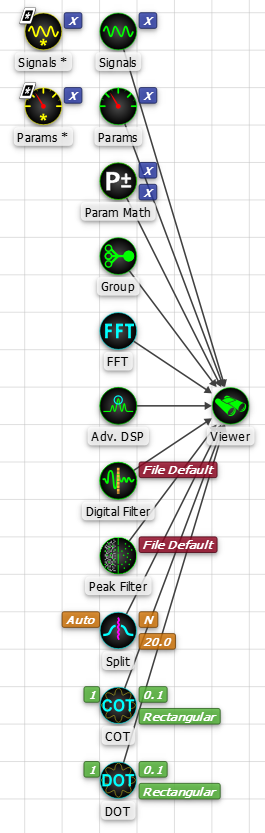 |
| Split | 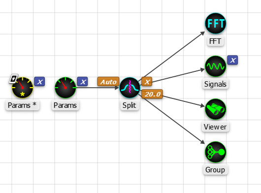 |
| REV | 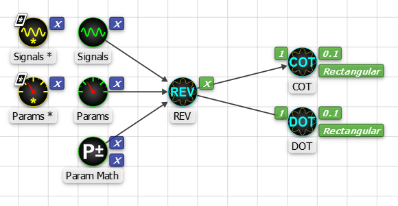 |
| COT | 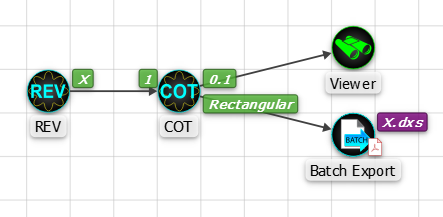 |
| DOT | 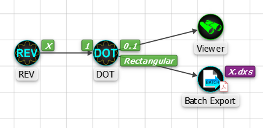 |
| Auto Response Detections | 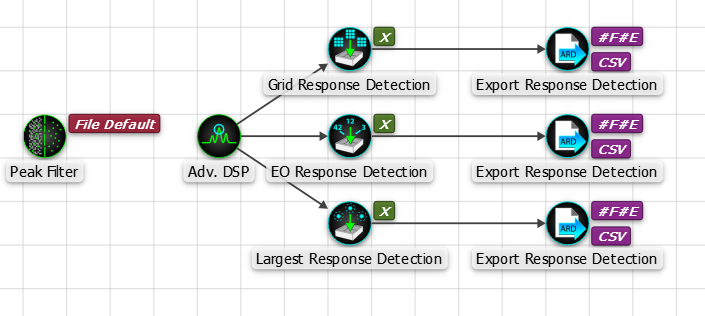 |
| Export RAW | 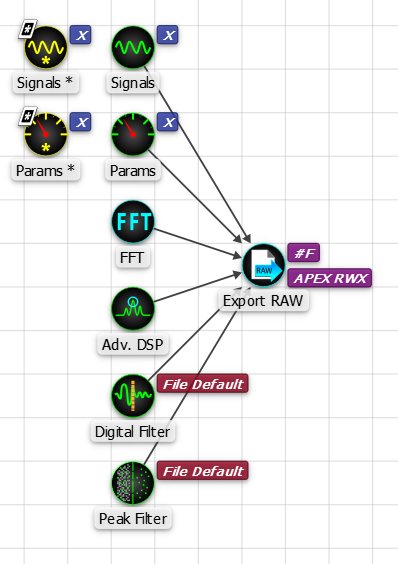 |
| Export PKX | 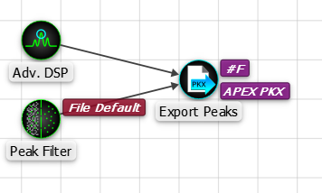 |
| Export ARD | 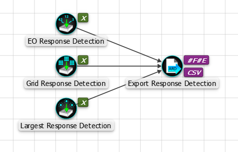 |
| Batch Export | 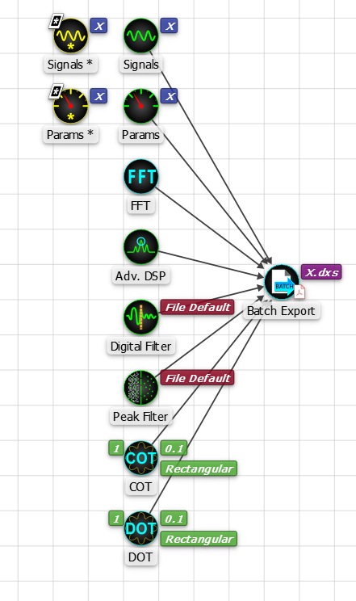 |

## Connection Rules // Limitations

- Signals and parameters can not be duplicated within a design. If a signal or parameter has been duplicated by creating a loop in a signal chain, DX will dissallow duplicated connections and display a warning.
- Only 1 FFT Element can be connected (directly or indirectly) to each Veiwer Element.
- Parameters elements should connect to the FFT before the Viewer Element. No processing will be run on any parameter, as it is throughput directly into the viewer. We reccomend using only 1 parameter element per design if the whole design shares the same parameters and settings. ie. if signals are put through multiple signal paths are processed with multiple FFTs in a design, connect the same parameters element to each FFT in the design. If multiple parameters elements exist with the same settings, they will appear as the same parameter within the viewer.

  > 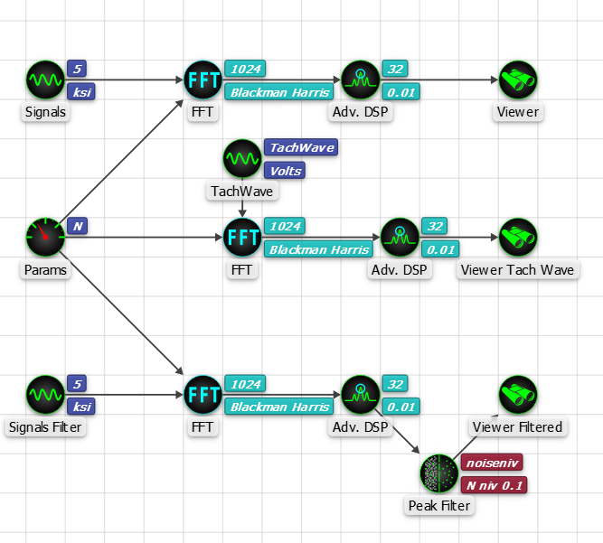
- RM elements (REV, COT, DOT) may not be processed at the same time as an FFT.
- All filters must be run in series, and will be performed in the order in which they are connected.
- The Split element must have a parameters element including the parameter the split is using connected to it.
