# DX Designer

## Introduction

The first thing that opens when APEX DX is launched is the **Designer Workspace.** This workspace is where analysis is performed. Design elements are dragged and dropped onto the canvas and linked together to create process chains that are then sent to the viewer where plots and reports are created.

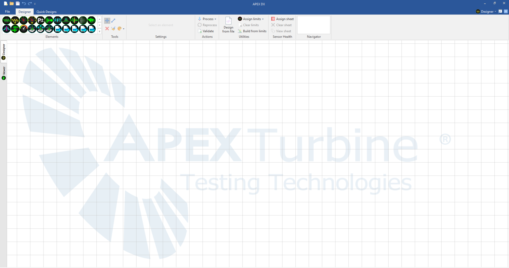

## Hotbar

Located in the top left of the ribbon is the **DX Hotbar**, which includes:

- New Design
- Load Design
- Save Design
- Undo Last Step
- Redo Last Undone Step
- File Menu
- Design Tools
- Quick Designs

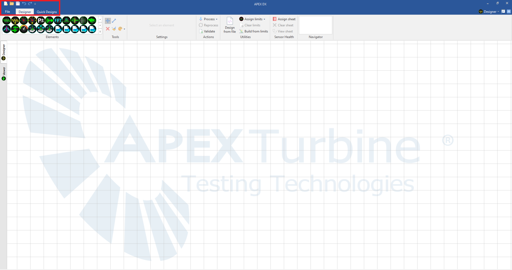

### File Menu

Inside of the file menu, a number of standard options and settings are available, in addition to a few features.

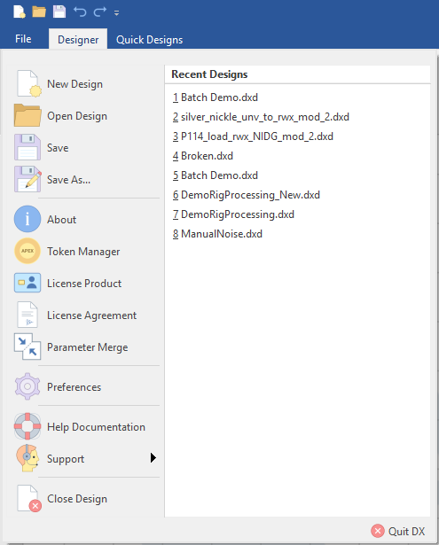

- In addition to the smaller quick access buttons on top of the toolbar; new file, save file, and open file are available in the file menu. "Save As" is also available here to save changes made to a design to another file name.
- "About" contains information like license, version, and computer pertinent information.
- "Token Manager" is used to add or remove features from DX. See the [licensing section](licensing.md) for more information on Tokens.
- "Licensing" is also available under the file menu. Licensing allows the user to select either a node locked license or type in a host server name. This is where the computer "Host ID" for creating node-locked licenses is found.
- The ["Parameter Merge"](parametermerge.md) function takes a dynamic data file and merges it with a low-speed parameter file to be processed at the same time.
- [Preferences](prefs.md) contain useful settings and DX cosmetic changes, along with export Environment, Plugin, Export, and other settings.
- *Looks like you already found the help documentation!*
- Support contains email support as well as a portal to our User Site <https://www.apexturbine.com/users>, bug reports, feature requests and questions can be submitted. The user site is the best way to keep in contact with APEX.
- Close design and quit program are located on the bottom of the file menu.
- On the right side of the menu, a list of all recent designs is displayed for quick access when returning to an analysis project.

## Quick Designs

In the **Quick Designs** tab, APEX has created a range of easy-to-use pre-made designs ready to be dragged and dropped on the canvas for immediate data processing. These designs will usually use all signals present within a data file and process them in a short template design that can be tweaked later. Multiple quick designs can be dragged and dropped onto the canvas at the same time for quick comparative analysis (RM elements cannot be processed at the same time as a regular FFT element). Most of the APEX pre-made designs should work with most files, but running a [validation check](#validate) before processing may save time before processing a large file that doesn't match the design.

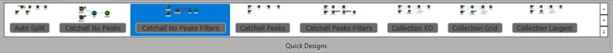

Quick designs can also be user generated! To create a quick design using an analysis chain, select the design on the canvas using the [move tool](#move-tool-a), and "Right Click --> Create Quick Design." Once saved, the personalized quick design will appear next to the default ones in the quick designs tab.

## Building Designs from Files / Limits

One powerful feature of APEX DX is its ability to create a simple process chain based only on a data file or an APEX limits file. **"Design from File," "Assign Limits," "Clear Limits," and "Build from Limits"** buttons are available under the "Utilities" Section of the designer ribbon.

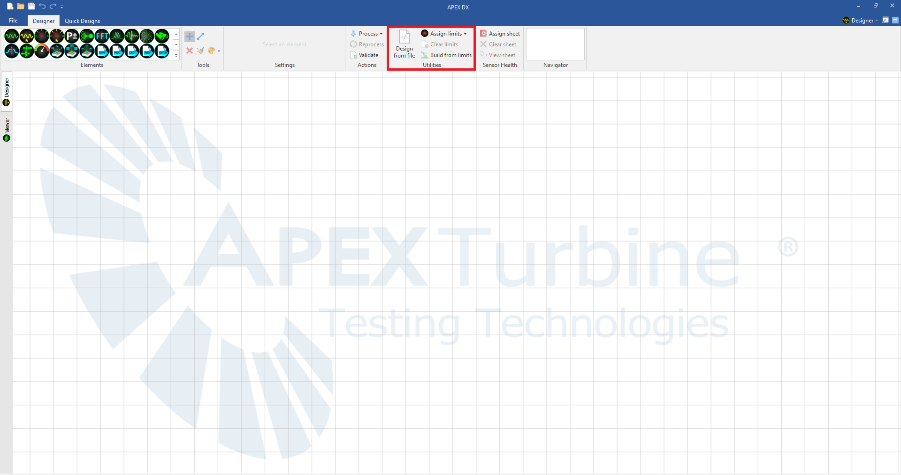

### Design from File

To create a design from a dynamic data file, click the **"Design from File"** button, navigate to the data file, and select the file. Using the settings found in the data, DX will create a simple design (containing our [Advanced Digital Signal Processer](#pke-advanced-digital-signal-processor-element)) to view the data. From there, the design may be edited or simply processed to view the analyzed peak data. If a design from a file has been created, DX will automatically navigate to that file location in the "Process" file browser.

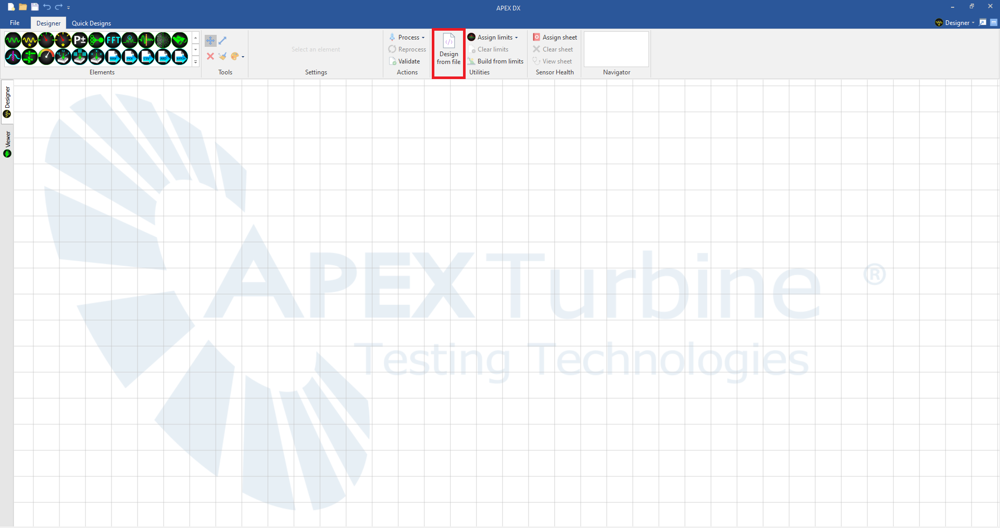

If multiple unit types are present in the data file, DX will automatically split them into individual [signals elements](#signals-elements) for correct and consistent unit integration. In the example below, the data file used contains 5 signals that have ips units, 3 that are g, 4 that are mils and 3 that are ksi.

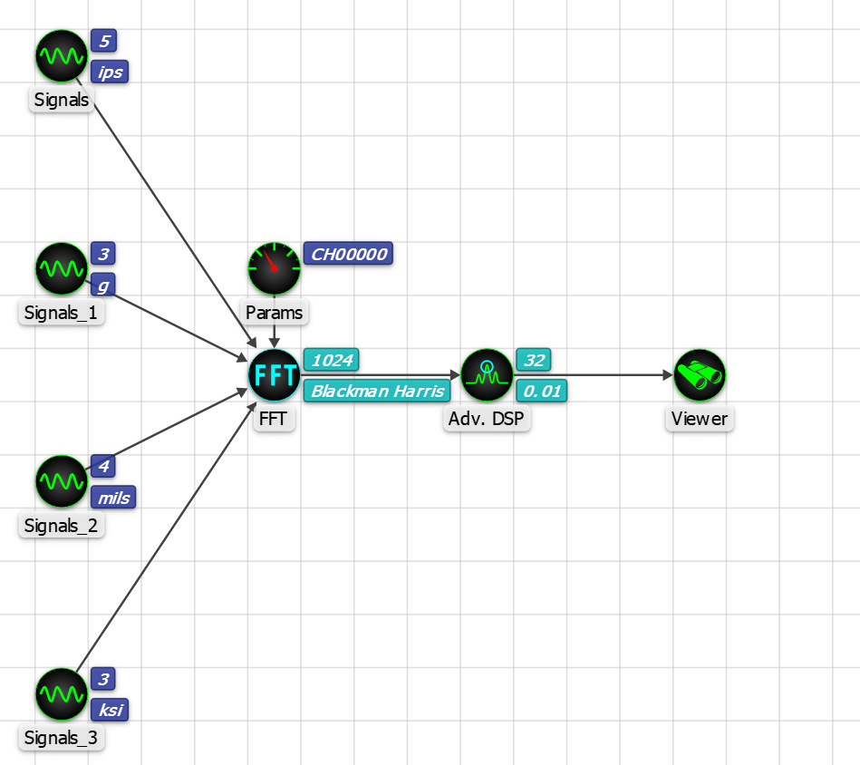

These same designs can be created and processed with the data in one move by simply navigating to the file in a file explorer and dragging the file directly onto the canvas.

### Limits

In addition to building designs from files, designs may also be built from [APEX limits files.](limits.md) Limits files are created with our limits utility and integrate directly with all of our APEX software products. If the limits file contains multiple parts, DX will parse out the signals into multiple [signals elements](#signals-elements) for each part depending on its settings. The example below shows a design built from limits that has 12 separate parts denoted by the limits file. All of the parts from the specific component (in this case IGV) are grouped together and then put into further into a "limits" group for clarity. From this, an analysis chain can be connected from the limits group to send to the viewer for analysis.

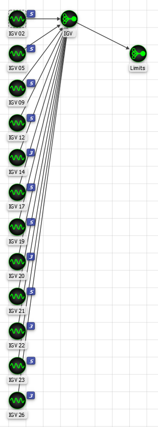

Limits can also be assigned directly to any design without having to build from limits.  When limits are assigned to a file, they will appear in the bottom left hand of the DX designer. Read more about limits and how they influence plots in the viewer in the [Data Viewer Section.](view.md#limits)

### Designing from Data and Limits Simultaneously

To create a design that is both built from both a data file and limits file, put both the data file and limits file in the same folder and drag them onto the canvas simultaneously. This will create a design that separates the engine parts from the limits file and attaches a simple viewing process based on the rest of the dynamic data.

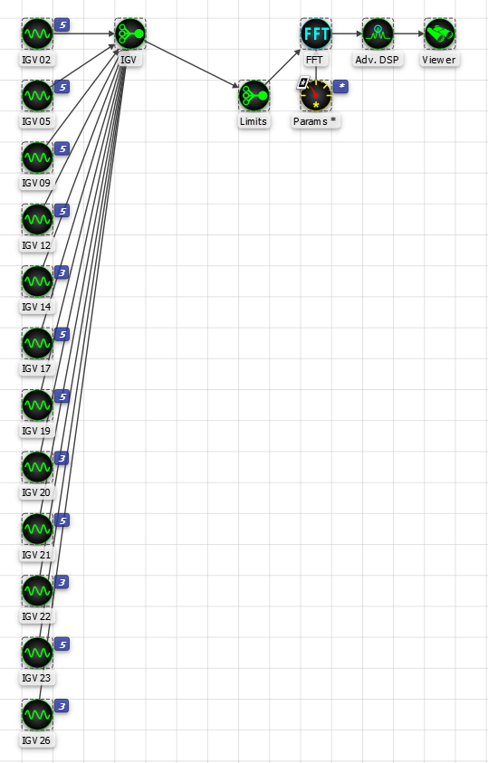

## Design Tools

As elements are added to a design, they are connected together, moved around, or removed using the **Designer Tools** located in the top left side of the ribbon.

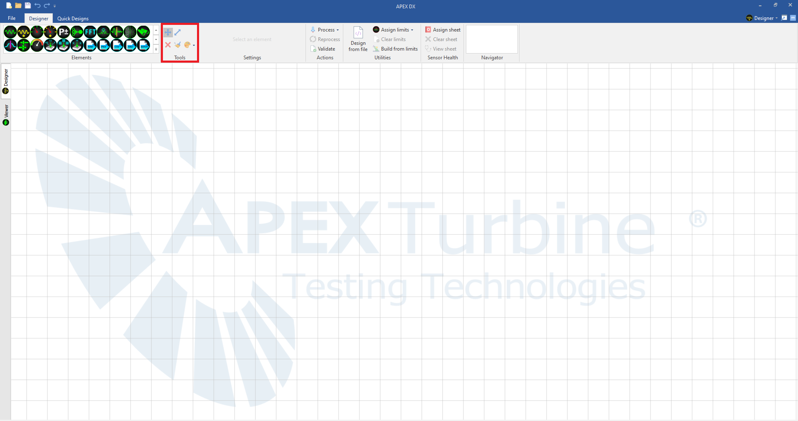

### Move Tool (A)

Once an element has been placed within a design, it can be moved around within the design with the **Move Tool.** The move tool can also be used to select and move multiple signals at a time by clicking and dragging on the canvas.

### Link Tool (S)

As a design is created, elements must be linked together using the **Link Tool.** Click and drag from one element to another while using the link tool to connect them together. DX will disallow illogical connections to ensure that process chains are valid when processed. See the [Connections Guide](connect.md) for a list of what elements can connect to each other.

### Delete selected (Del)

This will remove the selected element(s) from the designer.

### Clear All (Ctrl+Del)

This will remove all elements from the design canvas. This action cannot be undone.

## Processing and Validating

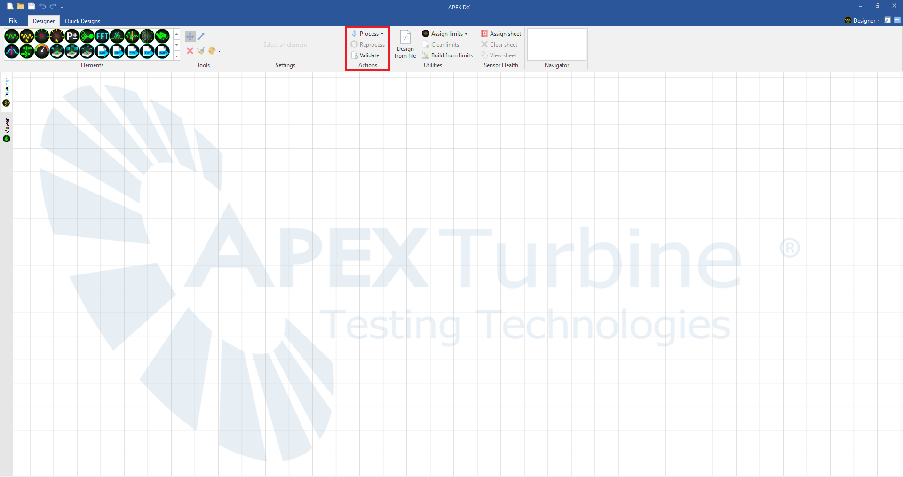

Once a design has been created, clicking the **Process** button will send the process chain to the [Viewer.](view.md) For a design to be processed, it must have a valid signal chain that leads to a viewer element or an export element. In the below example, signals are defined with the signals element, parameters are defined with the parameters element, they are both sent through the FFT and into the Advanced Digital Signal processor (parameter data will not be processed by FFT or Adv. DSP) and finally output to the viewer with the viewer element.

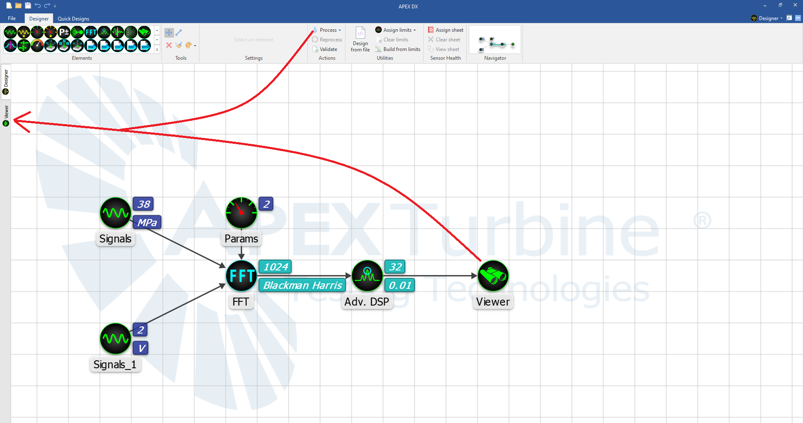

### Process

Selecting "Process" will open a dialogue box where dynamic data files can be selected to process using the design created on the designer canvas. Multiple files may be selected for processing at one time and compared and overlaid in the viewer. Each time a file is processed a validation check is run to ensure that the design is valid with the selected data file(s). If validation fails, a report will be shown. Otherwise, the file will process. Once processing is complete, DX will automatically navigate to the data viewer.

### Reprocess

Clicking **Reprocess** will process the last file or files processed. The plots in the viewer will be refreshed with new data every time a file is reprocessed.

### Validate

Clicking **Validate** will run a validation on the design against a selected file. If validation passes, a validation report showing information about the data file and the design will be created.

## Sensor Health Sheet

The **Sensor Health Sheet** noise option utilizes an imported file (comma-separated ascii) comprised of a sensor / data point matrix to specify the sensor noise state.

The file format for the Sensor Health Sheet is:

- The first character in the first row must be a comma, ",".
- The remaining entries in the first row contain the concatenation of DP# and DP Flags for which the sensor health condition applies to. The resulting concatenation should be unique for all files for which the health sheet applies to. If it is not unique or appropriately descriptive, use the File Information task to make the appropriate changes.
- The first column contains the names of each of the channels for which the health condition applies to. Any channels not entered are considered "healthy" or valid for the file.
- The remaining rows and columns either contain a 0 or 1, specifying the health status for each sensor listed. A 1 indicates the sensor is "healthy" and valid (non-noise) and a 0 indicates the sensor is invalid and 100% noise.

Example Sensor Health file:

Table:

|  |  |  |  |  |  |
| --- | --- | --- | --- | --- | --- |
|  | 1A | 2A | 3A | 4A | 4D |
| SG01A | 1 | 1 | 1 | 1 | 1 |
| SG01B | 0 | 1 | 1 | 0 | 0 |
| SG01C | 1 | 1 | 1 | 1 | 1 |
| SG05A | 1 | 1 | 1 | 0 | 0 |
| SG05B | 0 | 1 | 0 | 1 | 1 |
| SG05D | 0 | 1 | 1 | 0 | 0 |

CSV:

```
,1A,2A,3A,4A,4D
SG01A,1,1,1,1,1
SG01B,0,1,1,0,0
SG01C,1,1,1,1,1
SG05A,1,1,1,0,0
SG05B,0,1,0,1,1
SG05D,0,1,1,0,0
```

Any sensors not in the Sensor Health Sheet but in the file are considered valid, which is the default sensor state.

## Elements Overview

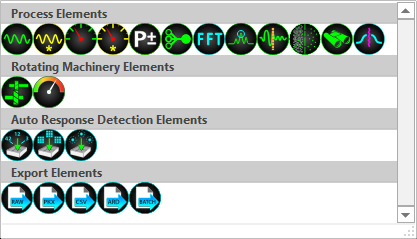

The main engine for running analysis in APEX DX are called **Elements.** Elements are linked together to create process chains that analyze data. There are 12 powerful and multi-functional Processing elements, 3 specialized Rotating Machinery Elements, 3 Automatic Response Detection elements, and 5 Export elements. Using these elements, data can be analyzed and filtered quickly and clearly. All designs created with these elements can be saved and used repeatedly. Elements are dragged and dropped onto the canvas from the top left area of the designer.

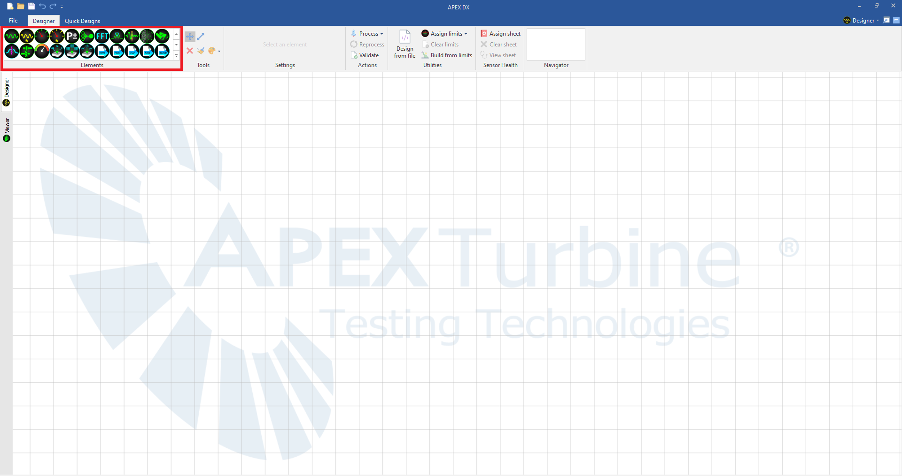

All element connections are shown in the [Connections Guide](connect.md) section of this help document.

### Element Settings

Each element has a number of unique settings to adjust their function to streamline the analysis process. All element settings will be covered in this help document. By default, the element settings dialogue will open whenever an element is created. This can be turned off with a checkbox at the bottom of the element settings dialogue. A more condensed version of the settings for the selected element is also available in the "Settings" section of the ribbon.

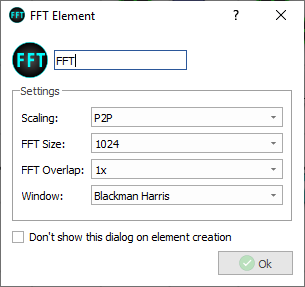

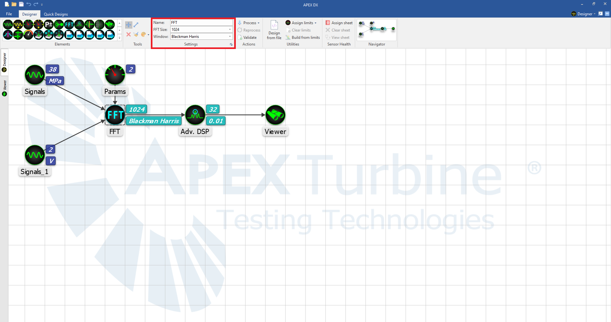

Many elements contain "badges" that also show 1 or 2 settings for the element at a glance. For instance, the FFT element looks like this when it is first placed in a design:


After the element has been created and the settings have been changed, the element badges are attached to the element to reflect those settings. Badges can be turned off in the settings menu.

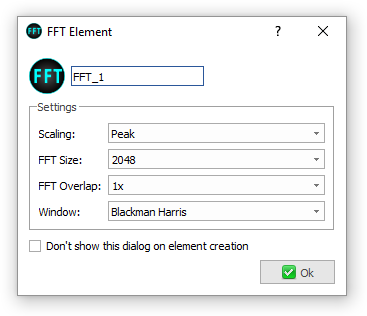


Some additional settings are available at a glance through tooltips when the cursor is hovered over the element.

### Notes

If specific notes must be added to an element, a notes dialogue is available in the right click menu. When a note is attached to an element, an icon in the bottom left corner will appear that indicates that the element has a note attached to it. To see the note, either mouse over the icon to see the note in a tooltip or right click-->"Notes" to read and edit the note.

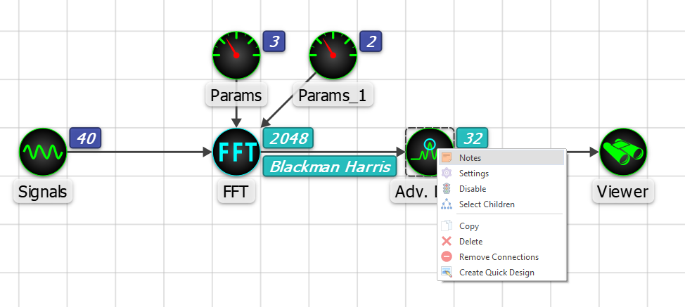

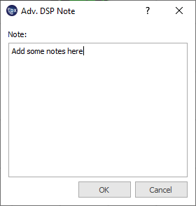

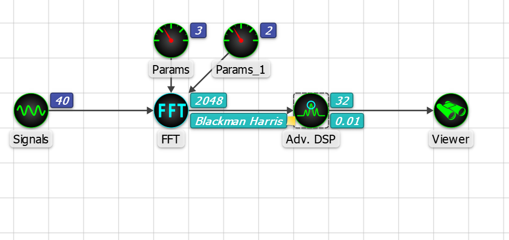

##   Signals and Signals* Elements

The **Signals Element** is the beginning of most process chains. This is where the set of channels to process are defined. Only the channels that match the names of the channels in the dynamic data file and in the signals element will be processed. If a channel is found in a file that is not found in a signals element, it is ignored during processing and will not appear in the [viewer signal tree.](view.md#the-signal-tree) Removing and adding signals from the signals element allows for a more focused workflow and faster processing.

###  Signals

The signals element settings dialogue has three tabs. The first is the signals tab. This is where signals are selected to be processed in a design. The "Add" button will bring up another dialogue box where new signals can be added to the list by name. "Remove" will remove the selected signal from consideration when processing. Double clicking on a signal name within the box allows the signal to be renamed. Clicking the "Load" button opens a dialog where signals can be loaded from a file.

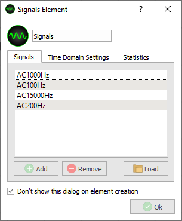

The second tab is the time domain settings. Here the signal type, coefficient, and EU Scalar can be changed depending on the unit type. As mentioned above, when loading a design from a file, signals units are automatically broken out into individual units. Channel units are also visible when loading from a file within the signals element. If units within a signals element are consistent and integratable or differentiable, the options to single and double integrate, or differentiate become available in the "Type" dropdown. From there, the "Coefficient" can be changed, and the units are automatically integrated or differentiated by the correct values. All integration or differentiation changes apply to the signal units throughout DX and are reflected in plotting and reporting.

- Type - Select the signal Type or use File Default. Available options (depending on the signal type) include:

  > - Unused - Channel is disabled and not available for further processing options or downstream tasks.
  > - DC - DC coupled, permits both AC (alternating) and DC (steady-state) signals through.
  > - AC - AC coupled, permits only the alternating portion of the signal through. DC portion is zero.
  > - AC 1xInt - Removes the DC portion of the signal and then performs time domain integration, i.e., conversion of g's to velocity.
  > - AC 2xInt - Removes the DC portion of the signal and then performs time domain integration twice, i.e., conversion of g's to displacement.
  > - - **AC Diff - Removes the DC portion and performs time domain differentiation.**: - Other - Set custom unit conversion factor
- Coefficient -  If a channel's type is changed to either AC 1xInt, AC 2xInt, or AC Diff the integration/differentiation coefficient will be supplied to account for the change in units. For example, changing from AC (g’s) to AC 1xInt (velocity, inches/second) or AC 2xInt (inches) the integration coefficient would be ~386.4. To change from g’s to mm/second or mm, the integration coefficient would be ~9810. This coefficient is applied prior to conversion to engineering units. The Coefficient drop down box lists available conversions. The coefficient value (EU Scalar) is automatically selected based on the coefficient conversion unless the "Other" coefficient is selected. Changes within a domain are supported (inches to millimeters, for example).
- EU Scalar - An EU Scalar value greater than zero can be specified and will be applied to both EU A and EU B values
- Units - Can not be changed. This box shows original units loaded with the file or converted units after integration or differentiation.

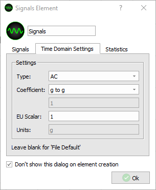

To use the "Other" Coefficient, first enter the EU scalar value into the "EU Scalar" box, followed by the target units "/" the destination units. After entering the correct values, enter a period (.) to finish the operation. This will disable and auto-fill the EU Scalar, EU Offset and Units sections to reflect changes made. All units that have been changed in this way will appear with an asterisk following the unit to indicate that it is a user-specified conversion. Custom coefficients are available as both AC and DC signal types.

Example:
- 7.0 ksi/mm.

The last tab is the plugins tab. Here, a built in "fftoverall" statistic that adds oaRMS, oaPK, oaAVG, MaxPeakAmp and MaxPeakFreq to the signal statistics can be selected. Statistics can also be added to signals through DX plugins or DLLs. Statistics can be plotted in the viewer by selecting the drop down next to the signal and dragging a given statistic to the canvas. Additionally, any statistic can be plotted when creating a [history plot](view.md#history-plots) of a signal in the viewer.

FFT Overall:

1. Calculate RMS level by summing the related frequency component corresponding to specified frequency band

  > 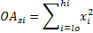
  >
  > Where lo and hi is the frequency band and xi is the particular spectrum point in that band.
2. Apply root square

  > 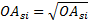
3. Multiply by rms/peak/average factor

  > 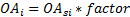
  >
  > Where rms factor is 1, peak factor is 1.414, and average factor is 0.9003

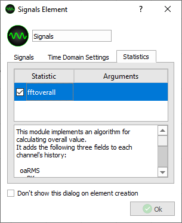

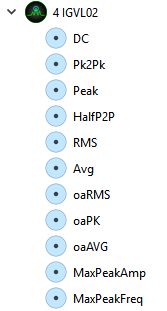

Also in the plugins tab, the thermocouple (TC) plugin provides voltage to temperature conversions using the standard NIST tables. The plugin supports the following TC types: B, E, J, K, N, R, S, T. The plugin performs the junction compensation using the user input junction temperature. Temperature units can be specified in either Kelvin, Celsius or Fahrenheit.

###  Signals*

The Signals* Element defines a Wildcard or [Regular Expression](regexp.md) pattern to match a set of channels to be included for processing. Only the channel names in the file that match the specified pattern will be used. In the example below, "SG0*" is entered in the pattern section, meaning all signals that being with "SG0" will be considered. The test string is used to ensure that a signal matching the criteria specified will appear in the analysis. In the example below, SG08 would be included for analysis.

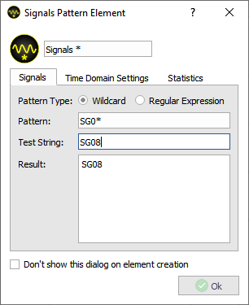

Integration is not available for the Signals* element, as consistent units cannot be guaranteed. The Statistics Tab is the same as above.

##  Signal Math

The **Signal Math** element is used to create new virtual signals that perform various calculations to existing signals.

### Math Evaluator

The Math Evaluator supports addition (+), subtraction/negation (-), multiplication (*), division (/), and exponentiation (^) with the normal operator precedence (the one exception being that exponentiation is evaluated left-to-right).

The following math functions are also supported: "abs", "sqr", "sqrt", "sin", "cos", "tan", "asin", "acos", "atan", "exp", "log", "exp10", "log10", "ceil", "floor", "round", "trunc", "fract", "min(A, B)", "max(A, B)"

> [!NOTE]
> Signal names in the formula that contain any supported operators or spaces must be wrapped in curly braces "{ }".


##   Parameters and Parameters* Elements

Similarly to the [Signals and Signals* elements,](#signals-elements) the Parameters and Parameter* elements specify low speed parameters to be considered in analysis. If a parameter name does not appear in the file or element name, it will be ignored during processing. Parameters are used by other elements like the Split Element and Automatic Response Detection Elements and must be listed in either a Parameters or Parameters* element to be available to them.

###  Parameters

Parameters can be entered into the element in the same way as the signals element receives signals. Click the "Add" button and specify a parameter name to add a parameter, the "Remove" button to remove a parameter from processing and click the "Load" button to extract parameters from a data file.

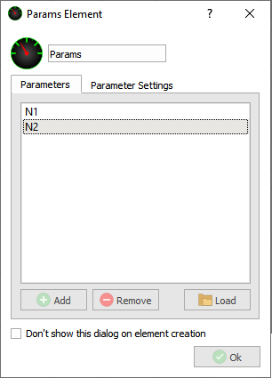

The second tab of the parameter element includes the settings; Min / Max Value, Type, Tach Ratio, Trigger Threshold, Trigger Edge, Minimum P2P Level, Average Time, and Units.

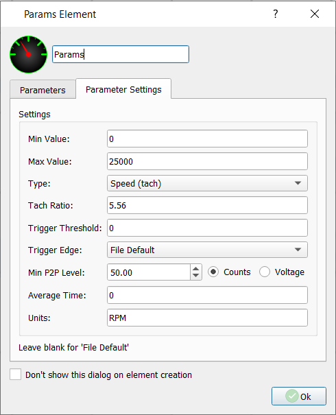

In addition, the Parameters Element also allows certain channels to be used as parameters (if appropriate). If a channel name is entered instead of a parameter the channel type must be changed, along with any other settings that are appropriate.

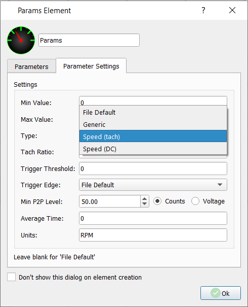

###  Parameter*

The Parameter* Element works the same way the [Signals*](#signal_star-signals) element does. Only the parameter names in the file that match the specified pattern will be used. In the example below, "N*" is entered in the pattern section, meaning all signals that being with N will be considered. The test string is used to ensure that a signal matching the criteria specified will appear in the analysis. In the example below, N1 would be included for analysis.

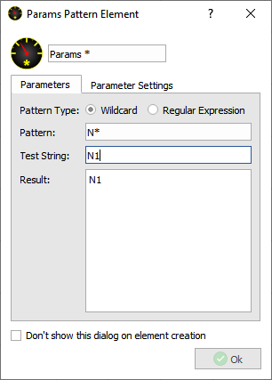

See the section on regular expressions [here.](regexp.md)

Unlike the Parameters element, only *parameters* defined in the file will match the pattern - this element cannot be used to convert a set of channels to parameters.

##  Parameter Math

The **Parameter Math** element is used to create new virtual parameters that perform various calculations to existing parameters. This module implements standard math expressions for 1/block parameter values.

The custom parameter calculations performed by this module are executed in increasing parameter index order, after all measured parameters have been decoded from their assigned channels' raw input data, and all non-parameter channel statistics have been computed. Therefore, computed parameters should be ordered such that all of their dependencies precede them in the parameter list.

### Math Evaluator

The Math Evaluator supports addition (+), subtraction/negation (-), multiplication (*), division (/), and exponentiation (^) with the normal operator precedence (the one exception being that exponentiation is evaluated left-to-right).

The following math functions are also supported: "abs", "sqr", "sqrt", "sin", "cos", "tan", "asin", "acos", "atan", "exp", "log", "exp10", "log10", "ceil", "floor", "round", "trunc", "fract", "min(A, B)", "max(A, B)"

> [!NOTE]
> Parameter names in the formula that contain any supported operators or spaces must be wrapped in curly braces "{ }".


### Average, Average Ratio, and Sum

Average, Average Ratio and Sum types are also included to support legacy Parameter Math designs.

- **Average Module:**: - Input1 [Input2 [ Input3 ... ]]

Calculates the average value of all given inputs and assign it as the value of the output.

- **Average Ratio Module:**: - averageratio Input1 [Input2 [ Input3 ... ]]]

Calculates the average of all but the last inputs, divide this with the last input, and then assign the result as the value of the output.

- **Sum module:**: - Input1 Weight1 [ Input2 Weight2 [ Input3 Weight3 ... ]]
- Offset Input1 Weight1 [ Input2 Weight2 [ Input3 Weight3 ... ]]

The first will calculate the weighted sum of the given parameters multiplied with their respective weights. The second form is similar but adds a constant term.

- **Input values can be either:**: - 1/block parameters identified by their names. (i.e. N1, P25, etc..)
- 1/block channel statistics values identified by the channel name and the statistics field name, joined by '::'. (i.e. SG23::P2P, etc..)
- Numerical constants (i.e. 12.34, etc..)

##  Group Element

The **Group Element** is an organizational element that will separate signals elements in the viewer tree to add clarity to more complicated analysis chains. When signals are put into groups, DX will organize them by group under the viewer name in the viewer tree. The group element is especially useful for splitting up signals elements by units or some other setting to help stay organized within the viewer.

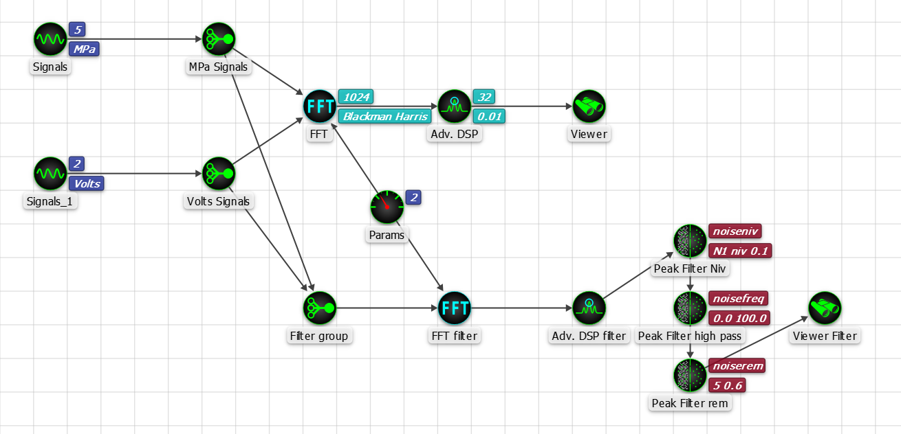

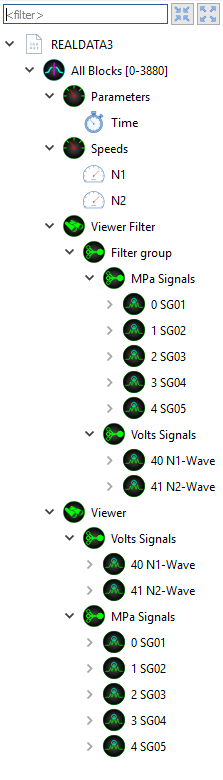

##  Split Element

The **Split Element** is used to split a data file into 2 or more virtual files within the DX viewer tree based on a parameter. Because the file split is based on a parameter, and everything in the file is split along the specified block or time ranges, including signals. So, once a file has been split, subsets of all data in the file can be viewed. There are 2 different ways to split files within the split element; the **Auto Split** - which will split the data file based on the parameter element connected to the split element, and the **Manual Split** - which can split the file along any user-defined time range.

### Auto Split

The **Auto Split** will automatically split data depending on a number of user-defined settings and the parameter connected to the element. In the below example, a sample data file has been processed that has a steady accel / decel curve from 0-10800 RPM over 240 seconds.

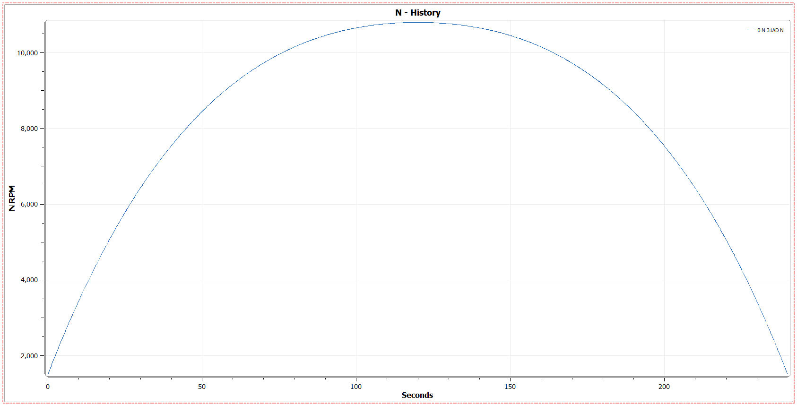

To split the file along the accel / decel, we have created the following design:

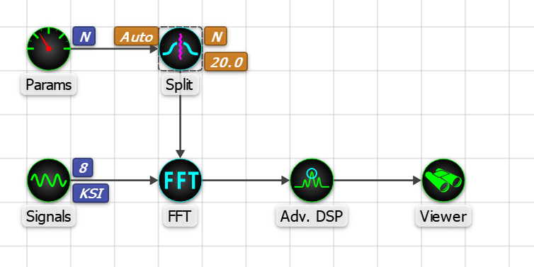

> [!NOTE]
> - The Parameter Element including the Speed (N) Accel / Decel must be connected to the auto split element
> - Split element is connected to FFT
> - FFT is connected to Advanced DSP
> - Advanced DSP is connected to Viewer

The Auto Split Element is set up as follows:

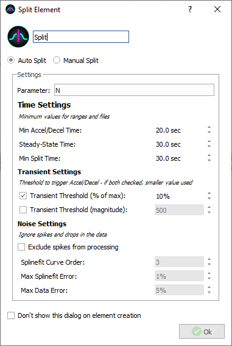

We have entered "N" as the parameter to split by. In addition to this entry, a parameters element that includes "N" must be attached to the split element.

- **Time settings**: - Min Accel / Decel Time: 20 seconds. This is the minimum time threshold for our Accel/ Decel range.  We won't have any splits that start before 20 seconds, so we can leave this setting.
- Steady-State Time: 30 seconds. This sets the minimum time required with no large change in the parameter to be considered steady-state. Because there are no sections of our Accel/Decel without large change for longer than 30 seconds, there will be no "Steady" splits in our data.
- Min Split Time: 30 seconds. This sets the minimum length of the input file. Because our file is longer than 30 seconds, it will be split. If our file were shorter than the entered 30 seconds, it would be marked "X" - Not split.
- **Transient Settings**: - Transient Threshold (% of max): 10%. This sets the minimum change (as percent of largest data value) required to trigger an accel/decel. This number would need to be higher if the data had many large jumps and drops. Because our data is a stead accel/decel 10% is more than enough to trigger the accel/decel.
- Transient Threshold (Magnitude): Unchecked. This sets the minimum change in data value required to trigger an accel/decel. If both "% max" and "Magnitude" are checked, DX will use the smaller value to trigger the accel/decel.
- **Noise Settings**: - Exclude spikes from processing: Unchecked.  Activating this will allow the split element to ignore spikes and drops in the data to better determine Accel/Decel ranges.  When enabled, the split element will compare data with a spline curve to determine erroneous samples. Because there are no spikes or drops in data in our file, we can leave this unchecked.
- Splinefit Curve Order: This is the Degree of polynomials used for the spline (default = 3)
- Max Splinefit Error: This sets the max error permitted between data and spline fit of data. Points that exceed this value will be removed from processing.
- Max Data Error: This sets the max error permitted of invalid samples relative to total samples. If percent of invalid samples exceeds this value, file is marked as Not-Split (‘X’).

Once this design and split has been run, the 2 files will appear in the viewer as follows:

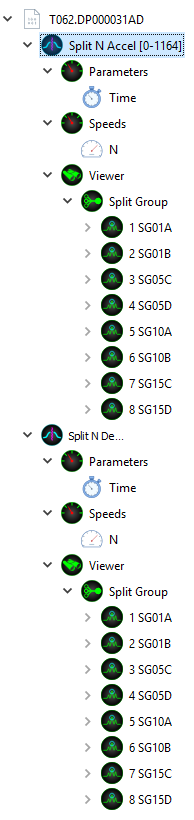

Once the trace for N has been plotted, the 2 halves of the file appear as follows:

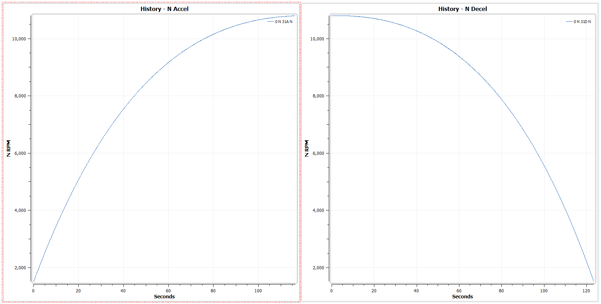

All signals and parameters are split along this time range.

### Manual Split

The **Manual Split** allows the user to enter specific splits and ranges based on time. In the below example, we will split the same file that was used in the auto split example into 5 separate splits to demonstrate the use of different DP flags and custom split naming.

We will split the file along the following points:

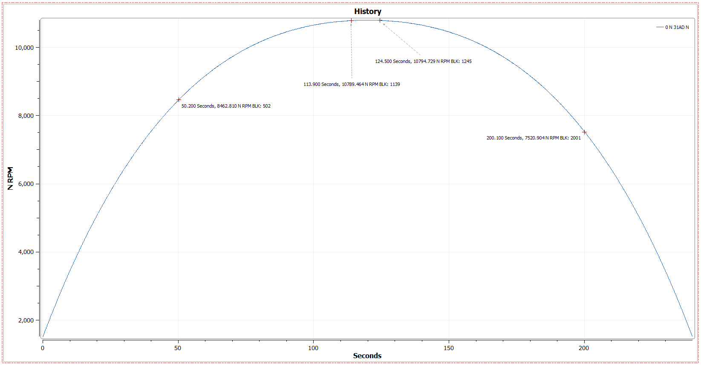

- 0-50 seconds (DP Flag A1)
- 50-114 seconds (DP Flag A2)
- 114-124 seconds (DP Flag Steady)
- 124-200 seconds (DP Flag D1)
- 200-240 seconds (DP Flag D2)

Using the same design as the auto split example, we will switch the split element over to the Manual Split mode. Unlike the auto split setting, the manual split does not need a parameter specified in order to work. However, it must still be connected from a parameter element.

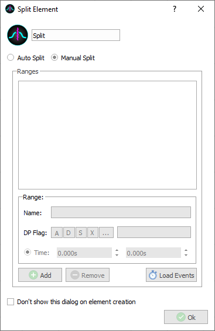

To add a split range, click the +Add button. Once a split has been added, specify the Name, DP flag and range of the split. Do this as many times as is needed. Each split may be named, and custom DP flags may be chosen.

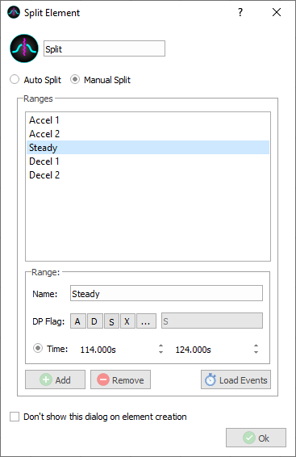

Once processed, the data will appear in the viewer tree categorized by block number and split name. The DP flag will also appear next to the split name.

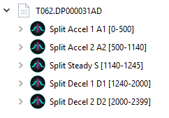

Data from the split can then be overlaid in the viewer and plotted against signals.

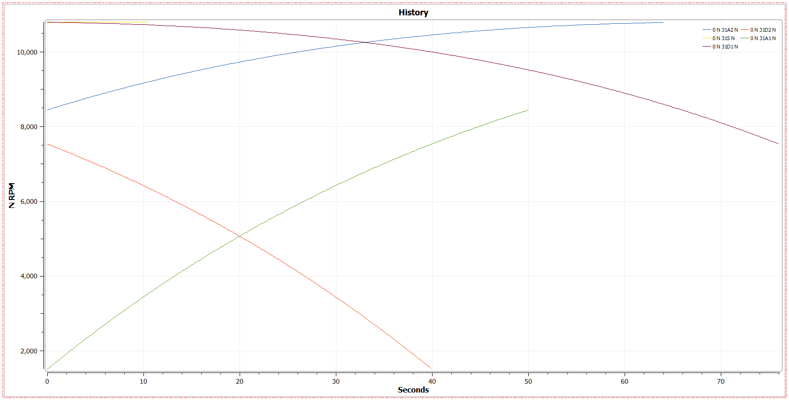

All split data maintains IRIG or other timestamps, so enabling absolute time on a plot with all splits overlaid will show the original trace.

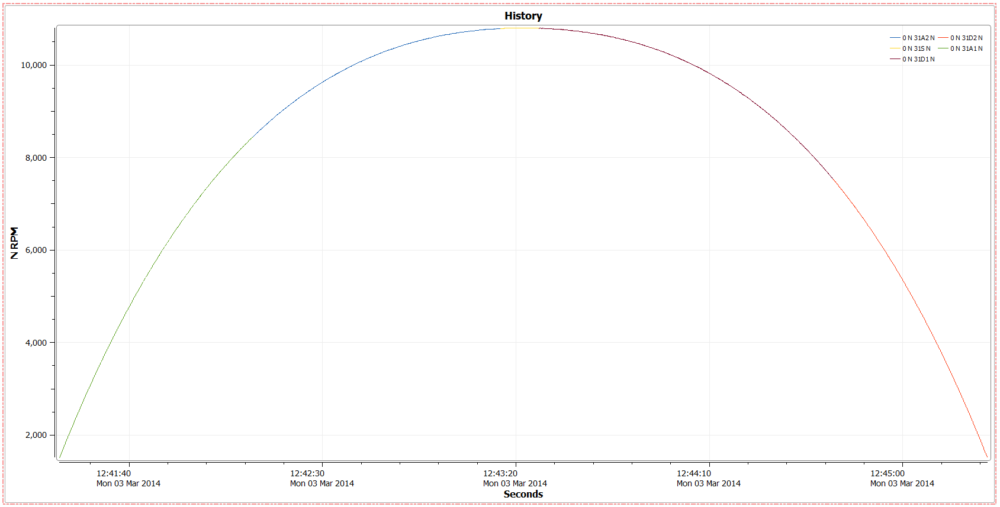

##  FFT Element

The **FFT Element** performs a specified Fast Fourier Transform algorithm on frequency domain data. The FFT element contains several different windows and types to use to better understand the data.


The FFT Element dialog (shown above) contains the following settings:
- Scaling - This option is used to set the FFT scaling upon transformation to the frequency domain. Settings available are: Single Peak (Pk), Peak to Peak (P2P) and Root Mean Square (RMS).
- FFT Size - This specifies the data block size upon which FFT processing is performed. Supported values are powers of two between 128 and 131072
- FFT Overlap - See below.
- Window - Sets the windowing used on the time domain value prior to performing the FFT. This is used to reduce the spectral leakage between the lines of resolution. The available window types are:

> - File Default
> - Rectangular (no window)
> - Blackman Harris (4 term)
> - Hamming
> - Hanning
> - Gaussian
> - Flat Top

### FFT Overlap

FFT overlap is the ratio of FFT size to block size. When the FFT size is greater than the base block size, multiple blocks are chained together to perform a higher resolution FFT. This increases overall signal FFT resolution and reduces averaging.

The FFT uses center windowing, where the FFT window is centered about the block being reported. This means it uses half the overlap size from previous block(s) and half from next block(s). This center windowing approach provides better representation of the data at the reported block time.

The graphic below demonstrates how overlap works on 1X, 2X, and 4X overlap.

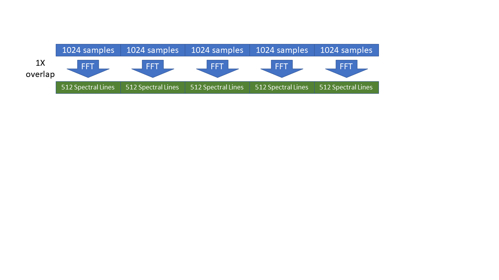

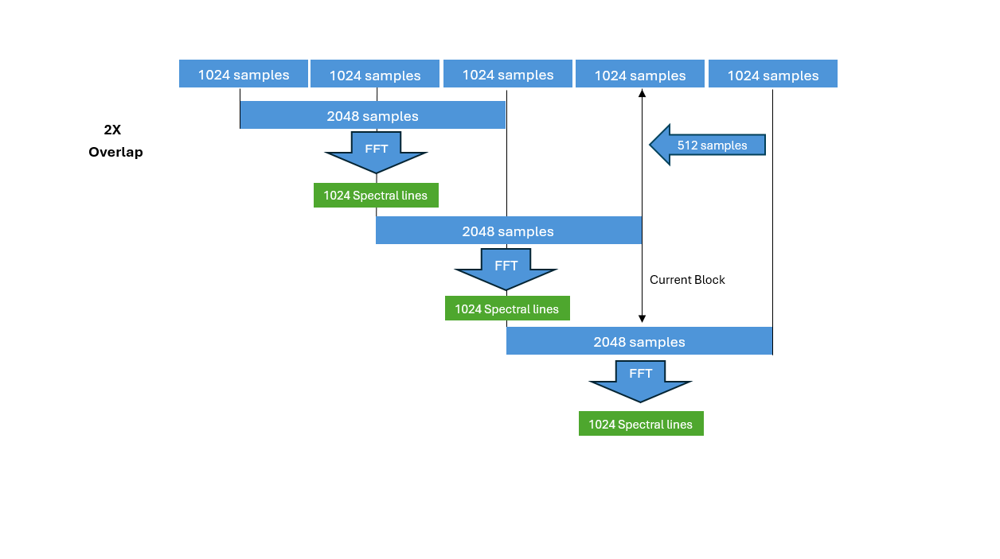

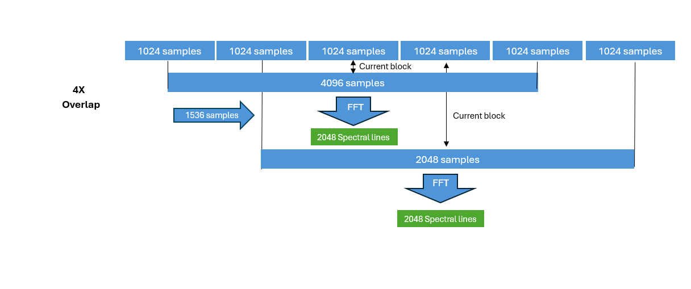

##  Advanced Digital Signal Processor Element

One of the main processing features of DX, the **Advanced Digital Signal Processor** (or **Adv. DSP**) uses APEX proprietary methods to parabolically interpolate engine data and extract the peaks from the FFT data. The Adv. DSP is included in all designs created from files. This processing yields clearer and more accurate data.

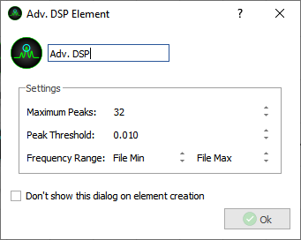

- **The Advanced Digital Signal Processor Element dialogue (shown above) contains the following settings:**: - Maximum Peaks - The maximum number of peaks saved on a per-block basis.
- Peak Threshold - Minimum value for peak extraction (i.e. no peaks will be extracted below this level). Values greater than 0 may result in fewer peaks than requested.
- Frequency Range - Peaks will only be collected for frequencies that fall within the provided range.

### Examples of Processed Data

Below are some examples of how the Advanced Digital Signal Processing Element collects and displays peak data.

- **Example 1 - Magnitude+Envelope Plots**: - In this example, we have zoomed in on a small section of a Magnitude+Envelope plot with each datapoint marked with a dot.
- On the top plot is the processed data, on the bottom plot is the straight FFT data.
- Note the extra points drawn between the spectral lines on the processed plot. These points are where a peak occurred between the spectral lines.

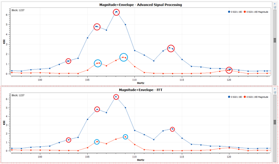

- Below is a gif of the file to demonstrate this more clearly.

#.. image:: sam/designer_peaksdemo.gif

- **Example 2 - Campbell Plots**: - In this example we have compared FFT data with Advanced Digital Signal Processed data on two Campbell plots. On the right is the FFT data, on the left is the peak data.
- Campbell plots display only peak data when processing has been applied to the file, so this yields much more accurate - but less - data on the plot.


- **Example 3 - Z-mod Plots**: - On the left is a Z-mod plot of the FFT data for a signal, on the right is the processed data of the same plot.
- As with Campbell plots, Z-mod plots will show only the peak data on processed files, so spectral lines will be eliminated from the plots, revealing much cleaner data.


##   Filter Elements

DX provides a number of different digital and noise filters to help eliminate noise and unneeded data, while leaving data that is important available and easy to view. DX filters are plugin based, so whenever a filter is used, the element will process using a specific file within the DX bin directory.

### "File Default" Filter Settings

DX supports two types of filters: **Digital Filters** which operate on time domain data, and **Peak Filters** which operate on peaks (data process by the [Advanced Digital Signal Processor](#pke-advanced-digital-signal-processor-element)). Filtered peaks are flagged as noise. Both types accept "File Default" as the Plugin/Filter name which will keep all digital and/or peak filters already specified in the file's setup.

> [!NOTE]
> Only filters included in a design are processed - when using a file format that supports filter specification (like APEX RWX files) they will be ignored if a Digital and/or a Peak filter with "File Default" as the Plugin/Filter name is not included.


*A design with 3 output paths, 1 with the spike filter setup in the file, 1 with the signal without filtering, and 1 with "file default" selected on the digital filter*


- Those 3 signals as DC History plots. On the top plot is the signal chain without filtering, the middle plot is the Spike Filter chain with a setup that matches the file, and the bottom plot is the "file default" digital filter chain.

When "Design from File" is used on a file that contains a filtered signal, the filter will appear in the design.

###  Digital Filters

The **Digital Filter** element applies specialized filtering plugins to specific signals for a selected set of files. The digital filter element includes the following filters:

- [Spike Filter (spikefilter)](#task_digital_filtering_spike)
- [Finite Impulse Response (firfilter)](#task_digital_filtering_fir)
- [High Pass Infinite Impulse Response (Butterworth) (iirfilter)](#task_digital_filtering_iir)
- [Half Power Noise Filter (halfpower)](#task_halfpower)
- [Windowed Stats Plugin (windowstats)](#task_windowstats)
- [Thermocouple Plugin (thermocouple)](#task_thermocouple)


> [!NOTE]
> Digital filtering can only be applied to unprocessed files. APEX PKX (Peak) files will not be affected by the filter.

A detailed description of each filter plugin is available in the description section of the element dialogue. Expand the element by grabbing the corners for easier reading. Every plugin requires a different set of arguments.

> [!NOTE]
> Filter elements may be chained together in any order desired. Because filters are applied in series, they can stack and affect each other.

The FIR & IIR filters that are included with the DX distribution are located in <DX Installation Folder>/bin/filters. The FIR filters begin with FIR and the IIR filters begin with IIR. Custom filters may be designed and used as long as the filter file is provided in this location. The filter files are text files and should be viewed to understand the format required. An example of generating a high-performance FIR filter is provided in the FIR filter section below.

#### Spike Filter

The **Spike Filter** identifies periodic random high amplitude events and, depending upon user defined options, either flags spectral peaks within the block as noise or replaces the spike with an estimated amplitude. The spike filter operates on time domain data using a block-by-block basis. The spike filter uses the block size found in the FFT settings, and the result applies to all peaks within the block after FFT processing. Because the spike filter requires time domain data as input, it will not function on processed (spectral domain) data.

The filter has the following inputs:

CFL MAXN MAXW CSAT

*Where:*

> - CFL: Crest Factor Limit, samples above this limit are considered noise. The
>   crest factor is the ratio of a sample's deviation from the data block's mean
>   value versus the data block's RMS average. [Default = 4]
> - MAXN: Maximum number of noise spikes the filter will remove from a data
>   block. [Default = 4]
> - MAXW: Maximum permitted width of a noise spike the filter will remove from a
>   data block. [Default = 6]
> - CSAT: When non-zero then re-check the data for saturation if it was flagged
>   as saturated, and if this filter removed any spikes. [Default = 0]

If the input data block contains more spikes or wider spike(s) than the
specified limits, the data is not modified at all. If the count and width(s) of
the detected spikes are within the specified limits then all found spikes are
removed via linear interpolation using samples on the sides of each spike.

This filter adds the number of spikes as a 1/block statistics value to the
channel's stats.

The filter operates as follows:

> 1. Segregate the time domain data into blocks of equal size as defined by the FFT.
> 2. If possible, pad block beginning, and add 2*MAXW samples to the block end to accommodate spikes at either the beginning or end of a block.
> 3. Compute block mean value:
>
> 1. Compute block RMS value:
>
> 1. Compute upper and lower limits:
>
> 1. Identify any samples that exceed either upper or lower limit.
> 2. If any samples exceed limits:
>
>   > 1. Categorize samples into spikes. Consecutive samples equals a single spike.
>   > 2. Count the number of spikes. If the number of spikes exceeds MAXN then flag the entire block of data as noise.
>   > 3. If the number of samples in any  individual spike exceeds MAXW then flag the entire block of data as noise.
>   > 4. If either MAXN or MAXW are exceeded, proceed to next block. #2 above.
>   > 5. Replace spike with linearly interpolated value and do NOT flag the block as noisy.
> 3. Repeat from #2 above for next block.

> [!NOTE]
> Spikes are linearly interpolated over the range of the spike width (in samples) +- spike width.

> [!NOTE]
> The Spike filter comes in two parts - a digital filter and a peak filter. As the spike filter is applied to blocked time domain data, any blocks identified as noise and used during spectral processing result in the spectral blocks also being flagged as noise if the noisespikes plugin is implemented. The time domain block size and the spectral domain block size may be different if an overlap is used to obtain the requested resolution and bandwidth. This means that a **Digital** filter to flag candidates and a **Peak** filter must be used to change the flagged candidates to noise.

#### FIR Filter

### FIR Filter Plugin

This plugin implements an FIR (Finite Impulse Response) digital filter. These
filters execute at the *raw plugin* stage of the data processing. This module
is activated by entering a line with one of the following two forms in the
processing configuration:

```
*Type Proto Order Fmin [Fmax [Ripple [Atten]]]*
```


*Where:*

> - Type: L, H, N, B.
>
>   > - L = Low pass
>   > - H = High pass
>   > - N = Notch
>   > - B = Band pass
> - Proto: PM, HN, HM, NU, BL, BH, BN, GA.
>
>   > - PM = Parks-McClellan optimal filter design (recommended).
>   > - HN = DFT generated filter with Hanning Window.
>   > - HM = DFT generated filter with Hamming Window.
>   > - NU = DFT generated filter with Nuttall Window.
>   > - BL = DFT generated filter with Blackman Window.
>   > - BH = DFT generated filter with Blackman-Harris Window.
>   > - BN = DFT generated filter with Blackman-Nuttall Window.
>   > - GA = DFT generated filter with Gaussian Window.
> - Order: Filter order (number of 'taps').
> - Fmin: Filter frequency (Low end value for notch and band pass).
> - Fmax: High end frequency value for notch and band pass.
> - Tune: Tuning parameter for 'PM' filters.
> - File: Filter coefficient file to use. See below.

**Synthesized Filters**

All frequency specifications are for the cutoff frequency (or 3dB point)
of the filter. The built-in synthesizer will accept the 1..99% range of the
channel's Nyquist rate for the filter frequencies. The accepted order range is
5...253 for the FFT-based filters and 9..127 for the Parks-McClellan filter.

The optional tuning parameter for the Parks-McClellan filter has a
practical range of 0.5..2.0. It can be used to adjust the width of the filter's
transition band. In general, a narrower transition band will mean more
ripples and vice-versa. The default transition band size is determined based on
the filter's order, and results in approximately 0.1dB pass-band ripple.

**Filters Created from Data Files**

This module supports loading FIR filter coefficients from a custom APEX defined
CSV file format. Several such files have been included with this distribution,
consult any of them for the supported syntax.

> - Filter types L and H require only one additional argument: The filter file name.
> - Filter types N and B require two filter file name arguments: These are used to
>   define the lower and upper frequencies of the resulting notch or band filter.

All included filter files are defined as low pass filters with inversion and
concatenation taking place within the plugin as necessary for H, N and B filter
types. All files contain zero phase filters meaning that there will be no phase
shift as a function of frequency when using them.

| Name | Pass Band (%SR) | Stop Band (%SR) |
| --- | --- | --- |
| FIR-LP-000175.csv | 0.175 | 3.1 |
| FIR-LP-000175L.csv | 0.175 | 1.925 |
| FIR-LP-00035.csv | 0.35 | 3.85 |
| FIR-LP-00035L.csv | 0.35 | 2.3 |
| FIR-LP-000525.csv | 0.525 | 4.5 |
| FIR-LP-000525L.csv | 0.525 | 2.33 |
| FIR-LP-0007L.csv | 0.7 | 2.375 |
| FIR-LP-000875.csv | 0.875 | 4.675 |
| FIR-LP-000875L.csv | 0.875 | 2.75 |
| FIR-LP-00105.csv | 1.05 | 4.75 |
| FIR-LP-00105L.csv | 1.05 | 3.0 |
| FIR-LP-001225.csv | 1.225 | 4.78 |
| FIR-LP-001225L.csv | 1.225 | 3.1125 |
| FIR-LP-0014.csv | 1.4 | 4.85 |
| FIR-LP-0014L.csv | 1.4 | 3.1875 |
| FIR-LP-001575.csv | 1.575 | 4.95 |
| FIR-LP-001575L.csv | 1.575 | 3.275 |
| FIR-LP-00175.csv | 1.75 | 5.475 |
| FIR-LP-00175L.csv | 1.75 | 3.615 |
| FIR-LP-025.csv | 2.5 | 10.0 |
| FIR-LP-050.csv | 5.0 | 12.5 |
| FIR-LP-075.csv | 7.5 | 15.0 |
| FIR-LP-100.csv | 10.0 | 17.5 |
| FIR-LP-125.csv | 12.5 | 20.0 |
| FIR-LP-150.csv | 15.0 | 22.5 |
| FIR-LP-175.csv | 17.5 | 25.0 |
| FIR-LP-200.csv | 20.0 | 27.5 |
| FIR-LP-225.csv | 22.5 | 30.0 |
| FIR-LP-250.csv | 25.0 | 32.5 |
| FIR-LP-275.csv | 27.5 | 35.0 |
| FIR-LP-300.csv | 30.0 | 37.5 |
| FIR-LP-325.csv | 32.5 | 40.0 |
| FIR-LP-350.csv | 35.0 | 42.5 |
| FIR-LP-375.csv | 37.5 | 45.0 |

The FIR filters included with DX are installed under the 'Filters' sub-directory of the installation folder. The pass band and stop band are listed as a percentage of the sample
rate for the channel. Keep in mind that the pass and stop band values will swap
whenever the filter is transformed for a high pass application. The files in this folder can be used as examples for developing additional filters. The maximum number of FIR filter coefficients is 127.

As an example, we will create a high performance FIR filter using MATLAB. The filter requirements are to have a passband frequency of 3% of the sample rate and a stopband frequency of 10% of the sample rate. The MATLAB code to generate an equiripple FIR filter is as follows:

```matlab
% Begin

N = 110;

% Filter Order <br>
Fpass = 0.06; Passband Frequency
Fstop = 0.2; Stopband Frequency

% generate the filter coefficients
b = firpm(N , [0 Fpass Fstop 1] , [1 1 0 0]);

% compute the frequency response
[h,w] = freqz(b,1,8192);

% compute the passband ripple
[~,imin] = min(abs(Fpass - w/pi));

passbandRipple = max(abs(h(1:imin))) - 1.0;
% compute stopband attenuation

[~,imin] = min(abs(Fstop - w/pi));
stopbandAttenuation = max(abs(h(imin:end)));

% End
```

We now have all the information necessary to generate the filter file. Next, format the information as required by the filter file, i.e.,

```
filter,FIR-LP-030,
type,LOW,
stopband,0.030,
passband,0.100,
ripple,0.00000033,

attenuation,0.00000036,
comment,MATLAB generated FIR filter,
gain,1.000,

coeff,-55,6.79798942468e-07,
coeff,-54,2.30474200819e-06,
coeff,-53,5.12801312455e-06,
coeff,-52,9.56181571133e-06,
coeff,-51,1.48535048763e-05,
coeff,-50,1.98108246925e-05,
coeff,-49,2.17706902965e-05,
.
.
.
```

The filters are used dynamically meaning that the filter folder can be updated while DX is open. Any task that requires the data to be processed will then use the filter. If the filter is not present, DX will issue an error. The Data Viewer does require the filter to be in place prior to launch.

#### IIR Filters

This plugin implements an **IIR (Infinite Impulse Response) high-pass digital filter.** This module is activated by entering the following in the Arguments field:

> Filter File: [see below](#task_digital_filtering_iir_table)

Filters are high pass only and not invertible. Most filters have 3 orders: 3, 6 and 10. The filter order dictates the sharpness of the transition region between the cutoff and pass band frequencies.

> [!NOTE]
> These filters will cause a phase distortion in the data therefore they should not be used if phase retention is desired.

Example:

High pass filter of order 3 This plugin implements an IIR (Infinite Impulse Response) digital filter. This
plugin is used at the **time plugin** stage of the processing.  It is activated
by entering a line with one of the following two forms in the processing
configuration:

```
*Type Proto Order Fmin [Fmax [Ripple [Atten]]]*
```


*Where:*

> - Type: L, H, N, B.
>
>   > - L = Low pass
>   > - H = High pass
>   > - N = Notch
>   > - B = Band pass
> - Proto: BU, BE, CH, IC, EL.
>
>   > - BU = Butterworth Filter.
>   > - BE = Bessel Filter.
>   > - CH = Chebyshev Filter.
>   > - IC = Inverse Chebyshev Filter.
>   > - EL = Elliptical Filter.
> - Order: Filter order (number of 'poles' and 'zeros').
> - Fmin: Filter frequency (Low end value for notch and band pass).
> - Fmax: High end frequency value for notch and band pass.
> - Ripple: Pass band ripple in dB (0.01..6.0).
> - Atten: Minimum stop band attenuation in dB (30..120).
> - File: Filter coefficient file to use. See below.

**Synthesized Filters**

All frequency specifications are for the cutoff frequency (or 3dB point) of the
filter. The built-in synthesizer will accept the 0.05..99% range of the
channel's Nyquist rate for the filter frequencies. The accepted order range is
1..10. The Elliptical and both Chebyshev filter types can be tuned with the
optional pass band ripple and stop band attenuation parameters. Defaults are
0.1dB for ripple and 60dB for attenuation. Generally, using more permissive
values for these will result in a sharper transition band.

**Filters Created from Data Files**

This module supports loading IIR filter coefficients from a custom APEX defined
file format. Several such files have been included with this distribution,
consult any of them for the supported syntax. Matlab generated 'FCF' format
files are also supported.

The included filter files are pre-generated low frequency high pass Butterworth
filters mostly intended for removing low frequency noise (such as 50 or 60 Hz
power, etc..) from measured channels. These filters are **not** invertible
(unlike the FIR filter files listed above). Their naming convention is:

```
IIR_H_BU_###_##.dat
```

Where the first group of three digits represents the cutoff frequency in
1/1000th-s of the sample rate. The second two-digit group indicates the filter
order (3, 6 or 10). Filters were generated for every 1/1000th increment in the
cutoff frequency, but only the numerically stable ones are included in this
software distribution.

> [!WARNING]
> IIR filters will cause a phase distortion in the data. They should
> not be used if phase retention is desired.

#### Half Power Filter

Filter flags peaks as noise if the neighboring peaks surrounding the peak being tested are less than 1/sqrt(2) times the peak being tested. Meaning this plugin identifies spectral peaks that are above the surrounding noise floor.

The APEX **Half Power Filter** interrogates each spectral peak for every block of data and compares the amplitude of the surrounding spectral values against the half power amplitude of the peak. The half power amplitude of the peak is simply the amplitude of the peak divided by the square root of two.  If the neighboring spectral values are above the half power amplitude of the peak, then the peak is flagged as noise.  If the neighboring spectral values are below the half power point of the peak, the peak passes the filter as a valid peak (see figure).


The idea behind the filter is that “important peaks” are those that rise above the noise floor as identified by the half power method.  This method is also sometimes used to compute damping so is an accepted way to identify responses that generally draw attention.

### Thermocouple Plugin

This plugin converts measured DC voltage data into a temperature value using
standard thermocouple (type B, E, J, K, N, R, S, T) conversion tables available
from NIST. Output can be scaled in different temperature units. This plugin
executes at the **time plugin** stage of the data processing. It is activated by
the following configuration line:

```
*TYPE CJC UNIT*
```

image:: sam3/dialog_digital_filter_thermocouple.png

Where:

> - TYPE: thermocouple type (B, E, J, K, N, R, S, T)
> - CJC: cold junction compensation
> - UNIT: temperature units (K, C, F)

### Windowed Stats Plugin

This plugin produces a copy of the 'standard' APEX DS/DX channel stats over a
longer time window instead of the duration of a single block. The new statistics
are available under signals in the plot data selector tree and can be used in
the alarms window. This plugin executes at the **time plugin** stage of the data
processing.  It is activated by the following configuration line setup:

avgtime

image:: sam3/dialog_digital_filter_windowstats.png

Where:

> avgtime: time interval in seconds over which the stats will be
> averaged. Specify time range from 0.01 to 10.00 seconds.

###  Peak Filter

The **Peak Filter** seeks to use a series of algorithms to identify noise. If any positive determination of noise has been made, all spectral peaks within the flagged block will be marked as noise. Blocks marked as noise will be ignored by end-of-chain processes such as the Automatic Response Detection Elements. Because the peak filter only processes peak data collected from the Advanced Digital Signal Processor, it must be placed at the end of the process chain, connected from the [Adv. DSP](#pke-advanced-digital-signal-processor-element) or another Peak Filter.

There are 2 sections of the Peak Filter element dialogue: Noise Plugins and Noise Definition Files.


There are 14 total noise plugins with adjustable arguments. Select a noise plugin by using the dropdown menu. Arguments are then added to the plugin accordingly. Not all plugins will have arguments. Arguments are detailed in the plugin description within the dialogue box. For easier reading, expand the dialogue box. More detail on each filter is found below.

Noise Definition files are files created in the viewer by [manually drawing noise onto a Campbell plot.](view.md#manual-noise-editing) Because noise definition files are created using specific data, they should only be applied to the same data file they were created with.

#### noisespikes

This plugin marks those blocks as noise that were identified using the spikefilter in the digital filtering element. When a [spike filter](#task_digital_filtering_spike) is used, it is applied only to the time domain data, meaning that if spikes occur on peaks (in between spectral lines and found by the [Advanced Digital Signal Processor](#pke-advanced-digital-signal-processor-element)), the spike filter will not be able to remove the spike. However, the spike filter will identify those peaks that it cannot smooth and flag them to be marked as noise by the noisespikes plugin in the Peak Noise element. When the noisespikes element is applied, it will mark all peaks within a flagged block as noise. If all spikes were removed by the spikefilter, or no spikes were found, no peaks will be flagged as noise.

> [!NOTE]
> As the spike filter is applied to blocked time domain data, any blocks identified as noise that are used during spectral processing result in the spectral blocks also being flagged as noise. The time domain block size and the spectral domain block size may be different if an overlap is used to obtain the requested resolution and bandwidth.

#### noisesat

The noisesat filter is a clipping filter that will mark all peaks as noise within a block where clipping has been detected. Peaks are flagged if either the overall time domain or DC value equals the A/D saturation level. The comparison is made using volts as derived from the A/D bit resolution and engineering unit conversion values EU A and EU B. Both DC and AC saturation levels are evaluated. If either the DC value or the AC value equals the saturation voltage, all peaks within the block are flagged as noise.

#### noise1stoa

This plugin implements a specific noise tagging algorithm based on the
First Peak versus Overall Amplitude ratio test. The algorithm has
the following arguments:

- MINRATIO: Minimum permitted ratio between the first peak and time overall amplitude

The default value is:

> MINRATIO = 0.3

If the ratio between the maximum peak and the time overall value is
less than MINRATIO all peaks within the data block are flagged as noise.

The test adds the ratio as a 1/block statistics value to the channels
history and contributes to the channel's 1/block noise flag.

> > [!NOTE]
> > This module applies to processed data only.

#### Engine order (noiseeo)

Description: Identify peaks as noise for a user defined engine order and tolerance.

- **Input fields:**: - PARAMETER:  Speed based parameter for determining engine order.
- EO:  Engine order.
- TOLERANCE:  Engine order tolerance.

Example:
To flag as noise all peaks along engine order 9.9 to 10.1 using parameter N, enter the following:

N 10 0.1

#### Parameter range (noiseparam)

Description:  Identify peaks as noise for a user defined parameter range.

- **Input fields:**: - PARAMETER:  Parameter name.
- VALUE:  Midpoint of parameter range.
- TOLERANCE:  Single peak parameter tolerance.

Example:
To flag as noise all peaks for parameter N from 9000 to 10000, enter the following:

N 9500 500

#### Frequency range (noisefreq)

Description:  Identify peaks as noise for a user defined frequency range.

- **Input fields:**: - FREQUENCY:  Midpoint of frequency range.
- TOLERANCE:  Single peak frequency tolerance.

Example:
To flag as noise all peaks from 55 Hz to 65 Hz, enter the following:

60 5

#### Noise Definition Files

Once noise has been [manually drawn onto a Campbell plot in the viewer.](view.md#manual-noise-editing), it can be added as a noise definition file within the Peak Filter and will function the same way as a noise plugin does once within the Viewer. To add manual noise to a Peak Filter, click on the "Noise definition Files" button within the element, click "Add," and then choose a file to add to the list.

### Plugin Directories

Plugins must be located in the following directories in order to process:

> - - **in the same directory as the application**: - for example --- /home/apexuser/DX/bin
> - - **in a subdirectory named "plugins" in the same directory as the application**: - for example --- /home/apexuser/DX/bin/plugins
> - - **in a subdirectory named "plugins" in the parent of directory which contains the application**: - for example --- /home/apexuser/DX/plugins

By default, plugins are located in the plugins folder in the DX bin directory. If this folder is changed, the changes must be reflected in the plugins section of DX preferences (located in the file menu.

In addition to plugins some filters (FIR and IIR) require additional files which contain the settings. These files must be located in a directory named "filters" in one of the following directories:

> - - **application directory**: - for example --- /home/apexuser/DX/bin/filters
> - - **the parent directory of the application directory**: - for example --- /home/apexuser/DX/filters
> - - **the parent directory of the parent directory of the application directory**: - for example --- /home/apexuser/filters

By default, filters are located in the filters folder in the DX bin directory.

##    Automatic Response Detection Elements

The **Automatic Response Detection** (formerly Collections) elements automatically identify and tabulate important responses from signals from one or more files. It is used to reduce/eliminate the need to review all signals for data points, transients, and files. All response detections are customizable and exportable for further processing.

> [!NOTE]
> Automatic Response Detection Elements must be connected from the Advanced Digital Signal Processor element. While a processing chain will terminate with the Response detection elements (unless they are connected to an export element), they will appear in the signal tree under any viewer element that follows the Adv. DSP that they are connected to. See the [Connections Guide](connect.md) for more on connections.


The Automatic Response Detection Element uses a speed parameter to collected peaks associated with the signals, so a speed parameter element must be present in the design and specified within the element. A speed parameter will be automatically assigned if it is included in the design after a Response Detection element is connected from the Adv. DSP.

### Mode ID

If a limits file is associated with the design, DX automatically assigns a Part Bias when computing the Mode ID. If no limits file is assigned, DX uses a signal bias. Each Automatic Response Detection Element contains a "Mode ID" tab for tuning the respective mode fit parameters based on contributions from frequency, magnitude, and phase.


- Frequency:  the "best" fit mode based on frequency is determined by performing a root-sum-square error calculation from all sensors on the part. If no response is found for corresponding sensors then that sensor is removed from the frequency fit calculation.
- Magnitude:  the "best" fit mode based on magnitude is determined by performing a root-sum-square error calculation from all sensors on the part using the relative magnitudes from each sensor compared to the relative absolute (magnitude ratios) as defined in the limits task. If no response is found for corresponding sensors then that sensor is assumed to have zero response, and it is retained in the magnitude fit calculation.
- Phase:  the "best" fit mode based on phase is determined by performing a root-sum-square error calculation from all sensors on the part using the cosine of the relative FFT phase with respect to the maximum responding sensor compared to the sign of the magnitude ratio defined in the limits task. If no response is found with magnitude above the value entered in the "Minimum Magnitude for phase fit" field then that sensor is removed from the phase fit calculation.

> [!NOTE]
> The frequency, magnitude, and phase fit contributions must sum to 1 before continuing to the next step.

> [!NOTE]
> Several of the fields in the collection elements accept a string value ("FileMin", "FileMax", "FileMax/10") instead of a specific numeric value. This is to allow a design to be used for several different files which may have different minimum or maximum frequency or parameter values. The string is replaced with the appropriate value when a file is processed.

All Response Detections can be run using either the Peak Domain or Time Domain based on a statistic (including noise). Time Domain peak collections operate over each parameter interval and identify the time (and associated block) at which the time domain statistic (Peak, Peak-to-Peak, RMS) reaches a maximum. Once this block has been identified, all peaks within the identified block above threshold are assigned a mode. The maximum magnitude peak for each unique mode is collected. If no limits are linked, then just the maximum peak is collected and all peaks collected have the same block number.

###  Largest Response Detection Element

The **Largest Response Detection** element will search an entire signal and extract the largest responses. Results can be narrowed down in the following ways:

- - **Parameter Range:**: 1. Specify Parameter range based on the speed parameter assigned to the Response Detection Element. Only peaks within the specified parameter range will be collected.
  2. As mentioned above, string values are accepted in these fields such as "FileMax/10 or FileMin+50"
- - **Peaks to Collect:**: 1. Sets the total number of peaks collected per signal.
- - **EO Tolerance:**: 1. Used to compute Integral EO - specify engine order tolerance to identify a peak as integral or non-integral.
- - **Magnitude Threshold**: 1. Only collect peaks above a certain magnitude.
- - **Minimum magnitude ratio for applying limit:**: 1. If limits have been linked and ratios defined for modes, percent limits for modes with ratios below this value are not reported. This is intended to not skew the percent limit calculations for limits that may be very low.
- - **Collect only on flagged noise**: 1. If a noise filter has been used, or noise is defined in the file, collections will only be made on that noise.

#### Example

In the below example, we are processing a test rig file with low vibratory responses. Everything over 350 Hz has been marked as noise and will not be taken into account by the Automatic Response Detection Elements.

We have set up the Largest collections element to collect 5 total peaks. We have left the rest of the settings to default and are not using mode ID:


After processing, we will create a plot of the first signal, SG01 and set the Y axis range to 350 to better see the important data. After we have done this, we can drag the Largest Response Detection from the viewer tree onto the plot and see the collection overlaid:


The largest peaks in the signal have been collected. Zooming into these peaks will reveal that there are 5 total peaks collected:


If any Auto Response Detection in the viewer tree is dragged directly to the grid, a table will be created with tabulated information for every collected peak. In this example, there are a total of 25 collected peaks, 5 per signal:


###  Grid Response Detection Element

The **Grid Response Detection Element** works the same as the Largest Response Detection Element, except instead of taking an entire signal into consideration at once, it splits each signal up into an evenly spaced grid and collects 1 peak per grid space. Results within a Grid Detection Element can be changed as follows:

- - **Parameter Range:**: 1. Specify Parameter range based on the speed parameter assigned to the Response Detection Element. Only peaks within the specified parameter range will be collected.
- - **Parameter Bins**: 1. The number of bins that lie between the parameter range specified. For example, if the parameter range is 1-100, and there are 4 parameter bins, then there will be 1 point collected between every 25 RPM (or other speed element unit).

> [!NOTE]
> The new 'All' option for Grid ARD will likely yield a larger number of peaks than using a large value such as '9999999'.

- - **Frequency Range:**: 1. Specify frequency range for the Grid Response Detection Element to take into account. Only peaks within the specified frequency range will be collected.
- - **Frequency Bins**: 1. The number of bins that lie between the frequency range specified. This functions the same as the Parameter bins, but for frequency.
- - **EO Tolerance:**: 1. Used to compute Integral EO - specify engine order tolerance to identify a peak as integral or non-integral.
- - **Magnitude Threshold**: 1. Only collect peaks above a certain magnitude.
- - **Minimum magnitude ratio for applying limit:**: 1. If limits have been linked and ratios defined for modes, percent limits for modes with ratios below this value are not reported. This is intended to not skew the percent limit calculations for limits that may be very low.
- - **Collect only on flagged noise**: 1. If a noise filter has been used, or noise is defined in the file, collections will only be made on that noise.

#### Example

In the below example, we are processing a test rig file with low vibratory responses (same file as above). Everything over 350 Hz has been marked as noise and will not be taken into account by the Automatic Response Detection Elements.

We have set up the Grid Collections element to collect 5 bins within the parameter range 0-2500 RPM (there are no responses before ~400 RPM) and 5 bins within the frequency range 0-350 Hertz. This means that there are grid lines every 500 RPM (2500/5) and grid lines every 70 Hertz (350/5). As can be seen below, there is one point collected in each grid space.


The more bins there are, the smaller the grid space. Additionally, the smaller the data range for consideration, the smaller the grid space.

###  EO Response Detection Element


The **EO Response Detection** element searches for important responses based on engine orders. If no limits are linked to the file, frequency space is divided into regular intervals. If limits are processed, the frequency space is defined by the limits file. The EO Response Detection element can be customized as follows:

- - **Parameter Range**: 1. Set the parameter range that the EO Response Detection takes into account. Based on speed parameter defined in the first field.
- - **Frequency Range**: 1. Set the frequency range that the EO Response Detection takes into account.
- - **Number to Collect:**: 1. Set the maximum number of Peaks to collect along a given EO. Settings changed in the "Advanced" tab will affect this number.

> - - **Collect a range of IEOs**: 1. This setting will take only a given range of Engine Orders into account when processing.

- - **Collect for only these IEOs**: 1. Select specific Engine Orders to take into account.
- - **Collect additional non-integral peak**: 1. Collects additional non-integral peaks

### Advanced Tab

> [!NOTE]
> The advanced tab provides additional settings that have good defaults for most cases. The primary purpose of the EO collection algorithm is to detect EO events. The collector will first collect all peaks along the EO line that are at or above the minimum set threshold. Afterwards, the algorithm will filter out peaks using the prominence level setting.
>
> Next, the algorithm looks for "Events" or "Blossoms" on the EO line. This is determined by identifying the peak and ensuring surrounding peaks (left and right) are below the half power threshold. The half power amplitude is set using the power ratio setting of the element. This requires that the surrounding peak magnitudes of the candidate are below the half power ratio threshold.

- - **Noise Accommodation**: 1. Computes noise level for EO speed using a spline estimation. Peaks wthin the noise level are considered to occur at the same speed. Enabling will result in more selective peak picking.
- - **Prominence Level**: 1. This setting provides the uniqueness of a peak to be above the x standard deviations from the mean peak amplitude. The default is 3. The higher this number, the more selective algorithm due to the uniqueness of the peaks. Setting a value of 0 should effectively turn this filtering off.
- - **Power Ratio**: 1. Setting this value to a smaller value will make the algorithm more selective as the power ratio threshold approaches 0. Setting this value to a value of 1 will require surrounding peaks to be less than the candidate magnitude. There is not a direct correlation between these set values and the "effective" peak threshold. However, setting a prominence level of 1 and given a power ratio of maximum value of 1, setting the peak threshold to less than (non-inclusive) Desired Peak threshold * sqrt(power ratio) should help. However, this requires there to be a peak surrounding the candidate peak >= set threshold and < candidate Peak * sqrt(power ratio). The safer approach would be to set the power ratio to the default of 0.5 and the peak threshold as desired peak threshold * sqrt(0.5).

## Export Elements

DX supports a wide range of export options that can be used for file type conversion, tabulation, and reporting. These elements include Export RAW, Export Peaks, Export CSV, Export Automatic Response Detection, and [Batch Reporting.](report.md)

Each of the following Export elements allows specification of either a file name directly or a template to use to create a file name - in either case the final file name will be modified to ensure nothing is being overwritten. Template names can contain one or more of the following special keys which are replaced by the appropriate value when the file is created. DX will organize exported files by input file name.

> - #E - element name
> - #D - datapoint flag
> - #F - input file name
> - #N - datapoint number
> - #S - split block range (T_start-end)
> - #T - test id

- **Below are some examples. The input file name is T1234.datx, and we are exporting peaks using the Peak Export element.**: - #F becomes “TD1234.pkx”
- #E becomes “Peak Export.pkx”
- T#T.DP#N#D becomes “TD.DP001234A.Peak Export.pkx” (assuming test id is “D”, DP number is 1234, and DP type is “A”)

> [!NOTE]
> The exported response detections are handled differently than other exporters. Response detections with the same file name are automatically concatenated and the collected information (settings used to create the response detection) are added to an index file in the same directory. An ID is added as the first column of the exported CSV, which matches the id associated with the settings in the index file.

### Export RAW

The export RAW element can be used to export a matching or different dynamic data file type from anywhere in the process chain.

- **Export types include:**: - APEX RAW files
- DSPCon DATX Files
- UFF 58 and 58b Files
- MATLAB Files

> [!NOTE]
> - Parameters are not included in UFF 58 and 58b files.
> - MATLAB files export 1 file per signal and parameter

Export filename tags detailed above.

### Export PKX

Export PKX will export a processed APEX Peaks (PKX) file type. Because PKX files are a processed file type, they must be connected to, or after the Adv. DSP element.

Export filename tags detailed above.

### Export CSV

The export CSV element is used to export various .csv file types to be used in other programs for reporting or further analysis. The Export CSV element can be connected anywhere in the process chain and will export only the data that is processed in the chain to that point. Ie. if an export csv element is connected from a signals element, it will only export the signal time domain data.

- **Export formats include:**: - Time
- Time with Parameters
- Parameters
- Spectrum
- Spectrum Envelope
- Spectrum Average
- Extended Envelope
- Peaks
- Order Peaks

> [!NOTE]
> Unlike the rest of the CSV export options, Order Peaks CSV requires an Options section to be filled out in order to process. The format for this option is: [Speed Parameter(s)] [Tolerance] [Comma Separated Engine Orders].

### Export Advanced Response Detection

The Export Advanced Response Detection Element will export a tabulated CSV or Binary file of the collected data from The Automatic Response Detection. This element will only connect from the automatic Response Detection Elements.

### Batch Exporting

Batch Exporting allows the export of PDF or image file reports for large numbers of data files at once. [See section on batch exporting to learn more.](report.md)

##  Order Domain Processing

The OT element within DX allow Rotating Machinery processing at low orders. [See the section on Order Domain Processing for more information.](order.md)

### General Idea and Operation:

For order domain tracking, DX uses a backend “OT” (Order Tracking) module to handle processing. This component operates by identifying rising edge triggers based on a specified tach channel, then resampling all data channels to a consistent number of samples between triggers. The appropriate number of new blocks is gathered based on the averaged revs setting. The result is windowed and an FFT is run on the resampled data. Orders are gathered from the FFT bins to be displayed. Frequency domain FFT processing and multiple OT elements can be processed simultaneously for side-by-side comparison.

### Basic Settings:


- - **Averaged Revs:**: - This setting ranges from 1 to 100 and dictates how many engine revolutions of data will be stored for processing. Additionally, this setting dictates the order resolution as 1/{averaged revs}. The default setting is 10 which will result in 1/10 = 0.1 order resolution, so 3.9 would be a valid EO, but 3.92 would be rounded down to 3.9 and not run as a separate order.
  - High values will tend to smooth data but reduce time resolution, while smaller values give more dynamic response to changes in the data but are typically noisier.
- - **Tach Channel:**: - The tach channel field specifies a channel name/number that will be used by the module to find triggers. The tach channel specified must have an integer number of pulses per rev. A tach speed parameter name will also function properly. Results are undefined and could include excessive memory or processor usage if a non-tach speed parameter or a channel lacking a well-defined trigger is used.
- - **Continuous Transform:**: - With continuous transform enabled, a distinct set of EOs is no longer produced and instead a result is produced from the first 32 peaks in the FFT calculation.

This feature is useful for finding the presence of an unknown order, and for producing improved order zmods.

- - **Orders:**: - Specifies comma-separated engine orders to be processed. Whitespaces will be ignored, and any comma without a following number will result in the data containing a 0 EO (DC Avg) result. Orders are disabled if “Continuous Transform” is selected.
- Phase Lag/Lead:

  > - This selection designates whether the phase of the channel is represented as how far the peak lags the trigger point versus how much it leads the trigger point. The result will be inverses of each other, although both will still be normalized to a 0-360-degree scale.

### Advanced Settings:


- - **# Revs Overlap:**: - This value is an integer representing how many revolutions will be shared between consecutive calculations. The default (and minimum) is 0, the maximum is {averaged revs} - 1. Values outside this range will result in an error from the module.
  - Increasing the number of revs overlap can improve time resolution for a larger number of averaged revs, however the frequency response of the results is still limited by the number of averaged revs. The main purpose of this setting is to increase the number of points on the chart.
- - **Pulses/Rev:**: - This must be an integer greater than 0. The default is 1 and works for any typical 1/rev tach. Non-integers will result in undefined behavior. The pulses per rev, if not known, will equal 60/{tach ratio}. With the tach ratio available from the file setup if a speed parameter was used.
- - **Blocksize:**: - Blocksize should be a power of 2 ranging from 512 upwards (512, 1024, 2048 etc.) Blocksize helps decide the maximum EO that can be processed. This max EO is equal to {blocksize}/(2*{averaged revs}).
  - Generally, an increased blocksize will smooth the results and improve accuracy up to the point that it equals {sample rate} * {averaged revs} / {1EO frequency}. The recommended balance point for result and time is {sample rate} / {1EO frequency}. This should be calculated using the frequency at the lowest speed for the desired results.
- - **Window:**: - This will apply the selected window and appropriate correction factor to the data before processing the orders. Blackman-Harris is default.

The available options here are the same FFT windows and have the same effect on the data as in the regular FFT element but are applied to the rev domain instead of the frequency domain.

### Specialty Settings:


- - **Variable Trigger Level:**: - Toggle this setting to choose between a single, fixed-threshold level or a dynamically calculated value.

We recommend keeping this setting toggled on, unless the data contains constant amplitude signals that also contain spikes which may affect the calculation of the variable threshold.

- - **Trigger Threshold:**: - For a fixed threshold, this value represents the value above which the module will trigger. If a parameter is used as the tach channel the value entered here should be in counts, if a channel is used it should be in EU. If a variable trigger is used, the value should be between 0.0 and 1.0. For a value of 0.85 (default), the trigger value would be set at 85% from the minimum value to the maximum value of the last block.

> [!NOTE]
> Trigger threshold can be described as follows: 0.85 * {max value} + (1.0 – 0.85) * {min value}.

For signals with frequent jumping or spikes near the crest of the tach signal, we recommend that the trigger threshold be reduced. Conversely, for signals with jumping or spikes near the tach’s trough, the value should be increased. The value may also need to decrease if the sample rate was too low and aliasing is beginning to occur on the tach signal.

- Tooth Correction:

  > - Tooth correction is meant for trigger sources with a PPR greater than 7. The purpose of this feature is to align to a 1/rev regardless which pulse, in the multi-pulse revolution, the file started on. “None” disables its operation completely. “Low” is meant to correct a signal where there is a low tooth once per rev, and “High” does the same but for a higher response tooth.
  > - We recommend you contact us through our user site (apexturbine.com/users) before using this feature, as it is case-specific.

##  Tach Decoder Element


### Overview

- **The Tach decoder was created to serve 3 purposes either simultaneously individually.**: - Make multiple speeds out of a single speed
- Deal with non-optimal tach signals that had errors when initally processed
- Producing a virtual 1/Rev channel lfor the [Order Track Element](#ot-order-domain-processing) to use

The Tach Decoder searches for rising triggers using a dynamically calculated threshold level. Once there is an adequate time fram of triggers, the Tach Decoder will calculate a speed and will begin writing out a new virtual 1/Rev channel. This output channel calculated dorectly off of the original triggers, not off of integrating the speed, so as to maintain the revolution count, and thus phase, throughout the file.

### Settings

- Input names:

  > - Defines tach signal to process
  > - Should be the name of a generic singnal that contains a tach signal, or the name of a tach speed parameter
  > - Can not be a DC speed parameter
  > - The output of one TD parameter can not be used as the input to another. Doing this could produce inconsistent results
- Output Names

  > - Defines the name of the processed virtual paramteter output that will appear in the viewer
  > - Sould be a unique name for both output speed paramter and virtual signal - using the same name for multiple outputs can lead to confusion and unexpected results in the viewer
- Pulses/Rev Setup:

  > - When providing a parameter as the tach input, the user can check the “Use Parameter Settings” box, and the PPR will be automatically pulled from the setup for the parameter in the processed file
  > - If turned off, it will allow the user to make a new speed with a different PPR out of the original parameter.
  > - The checkbox is not meant for use with channels
- Mistriggered Tach Correction

  > - When a TD element is set to correction mode, the trigger criterion shift slightly and any triggers at seemingly non periodic points are removed
  > - Conversely, if a range of time where a trigger was expected lacks any triggers, one will be added and the speed value will be updated
  > - May cause issues around strong accels and decels when trying to predict something that is rapidly changing


