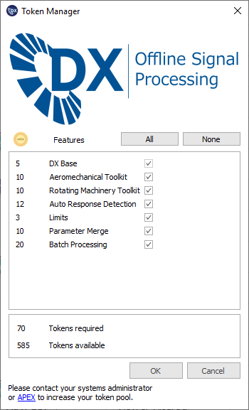

# Licensing

APEX DX uses token- and feature-based licensing to enable post-processing toolkits, data management integrations, and viewer capabilities. Current releases use the modern **[APEX License Manager (ApexLM)](../License%20Manager/README.md)**, with legacy FlexNet (`27000@host`) still supported on older builds prior to the October 2027 sunset.

> [!WARNING]
> **Legacy FLEXlm / FlexNet Discontinuation — October 2027**
> Legacy licensing powered by **FLEXlm / FlexNet** (`lmgrd`, `lmtools`, `lmutil`, `.lic` files, and `27000@host` servers) will be **discontinued as of October 2027**. All APEX product versions going forward will exclusively use the updated licensing architecture powered by **[APEX License Manager](../License%20Manager/README.md)**, the **APEX LM Daemon (`ApexLM_Service`)**, and the **APEX LM Server Daemon (`ApexLM_Server_Service`)**.

---

## Modern Licensing: APEX License Manager (ApexLM)

**[APEX License Manager (ApexLM)](../License%20Manager/README.md)** manages node-locked (`LOCAL`), central floating (`SERVER`), and client forwarding/reservation (`PASSTHROUGH`) entitlements through an authenticated license service. For complete setup, CLI usage, and server administration, see the [APEX License Manager Documentation](../License%20Manager/README.md).

- **Web Administration UI:** Manage license installation, view live token consumption, audit client sessions, and reserve floating tokens locally on loopback at **`http://127.0.0.1:27887/`** (or **`http://127.0.0.1:27888/`** on a dedicated ApexLM Server host via local console or SSH tunnel) — see [Web UI & Offline Reservations](../License%20Manager/web-ui-and-reservations.md).
- **Network Ports:** Local client IPC uses TCP port `27884` (`127.0.0.1`), while remote `PASSTHROUGH` forwarding communicates with floating `SERVER` nodes over CurveZMQ on TCP `27885` (or `27886`). See [Workstation & Server Setup](../License%20Manager/setup-and-server.md) and the [CLI Reference](../License%20Manager/cli-reference.md).
- **Offline Reservations:** When connected to a floating ApexLM Server in `PASSTHROUGH` mode, users can reserve licenses for offline field use for up to **30 days** from the **Reserve** tab in the Web UI.

### Shared `ANALYSIS` Token Pool & Applications

In ApexLM, APEX DX and related offline/viewer products draw accrual tokens from the shared **`ANALYSIS`** token pool (`Analysis Token Pool`). Tokens are automatically checked out when a toolkit or viewer capability is enabled and released when deactivated or exited.

Related application IDs in ApexLM include:
- `DX` — APEX DX offline processing application
- `DXPLUS` / `DX+OFFLINEANALYSIS` / `DX+ONLINEANALYSIS` / `DX+DAQ` / `DX+REMOTEVIEWER` / `DX+DATAVIEWER` — Next-generation APEX DX+ suite modules
- `DV` — APEX Data Viewer standalone file viewer

### ApexLM Feature Catalog for DX & Viewer Applications

| ApexLM Feature Key | Application(s) | License Type | `ANALYSIS` Tokens | Description |
| :--- | :--- | :--- | :---: | :--- |
| `BASIC-PROCESSING` | `DX` | `ACCRUAL` | 5 | Basic signal processing (`DX Basic`) |
| `AEROMECHANICS-PROCESSING` | `DX` | `ACCRUAL` | 15 *(10 in legacy FlexNet)* | Aeromechanical analysis toolkit |
| `ROTATINGMACHINERY-PROCESSING` | `DX` | `ACCRUAL` | 10 | Rotating machinery analysis toolkit |
| `ACOUSTICS-PROCESSING` | `DX` | `ACCRUAL` | 10 | Acoustics processing toolkit |
| `LIMITS-PROCESSING` | `DX` | `ACCRUAL` | 3 | Limits checking and exceedance analysis |
| `COLLECTIONS-PROCESSING` | `DX` | `ACCRUAL` | 12 | Collections processing / Automatic Response Detection |
| `PARAM-MERGE` | `DX` | `ACCRUAL` | 5 *(10 in legacy FlexNet)* | Low-speed Parameter Merge into dynamic files |
| `BATCH-PROCESSING` | `DX` | `ACCRUAL` | 20 | Automated batch processing workflows |
| `DXDM-INTEGRATION` | `DX` | `ACCRUAL` | 5 | APEX Data Manager integration with DX |
| `SIGNAL-MATH-PROCESSING` | `DX` | `ACCRUAL` | 10 | Derived signal mathematics processing |
| `APEX-FILE-STANDARD` | `ANY` | `INCLUDED` | 0 | Standard APEX `.rwx`/`.pkx` file access |
| `VIRTUAL-MODELS` | `DX+OFFLINEANALYSIS` | `ACCRUAL` | 10 | Virtual modeling toolkit |
| `SOLUTIONFIT-PROCESSING` | `DX+OFFLINEANALYSIS` | `ACCRUAL` | 10 | Solution fit processing |
| `VIDEO-STREAM` | `DX+DATAVIEWER` | `ACCRUAL` | 10 | Synchronized video streaming in Data Viewer |
| `DBMS` | `DBMANAGE` | `ACCRUAL` | 30 | Database management integration |
| `DVFILE`, `DVBANNER`, `DVPROJECT`, `DVSCREEN2`–`DVSCREEN4` | `DV` | `ACCRUAL` | 5 each | Standalone Data Viewer file, banner, project, and multi-screen views |

> [!NOTE]
> If the total number of tokens required exceeds the available count in the **`ANALYSIS`** pool, APEX DX prevents additional features from being checked out until existing sessions or toolkits release tokens.

---

## Legacy FlexNet Token Licensing *(Discontinued October 2027)*

> [!NOTE]
> Legacy **FLEXlm / FlexNet** (`lmgrd`, `.lic` files, `27000@host`) is deprecated and will be **discontinued as of October 2027**. Plan new deployments and renewals with **[APEX License Manager](../License%20Manager/README.md)** ([Quick Start](../License%20Manager/quick-start.md)).

Legacy APEX DX releases use FlexNet dynamic token licensing installed as either Node-Locked (local `.lic`) or Host Server (`27000@host`) licenses. Tokens are automatically checked out when a feature is activated. To release tokens back to the pool, open the **File** menu and uncheck features that are not in use; DX restarts after features are removed.

### Legacy Tokened Features

- **DX Basic** — 5 Tokens
- **Aeromechanical Toolkit** — 10 Tokens
- **Rotating Machinery Toolkit** — 10 Tokens
- **Automatic Response Detection** — 12 Tokens
- **Limits** — 3 Tokens
- **Parameter Merge** — 10 Tokens
- **Batch Processing** — 20 Tokens

Total available tokens are displayed at the bottom of the Token Manager to help monitor usage. If the requested token count exceeds the available balance, DX disallows checking out the selected features.

For legacy FlexNet host-server setup and `lmgrd`/`lmtools` diagnostics, see [FLEX Licensing](flex.md).
