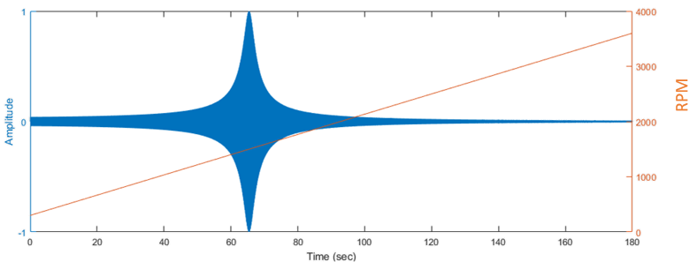
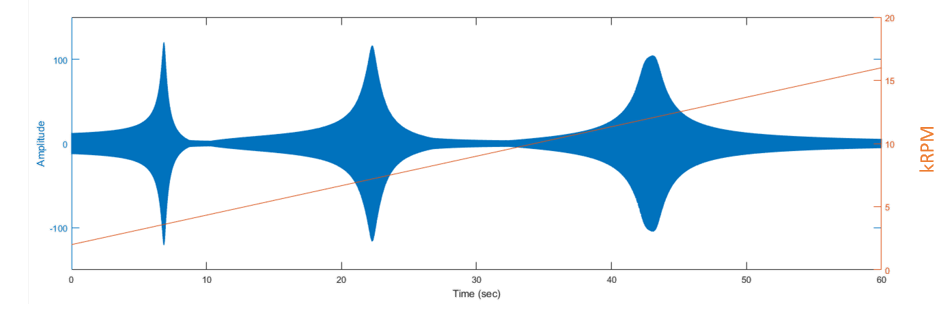
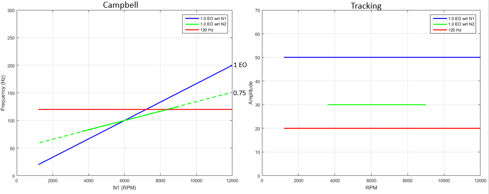
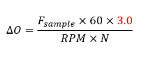
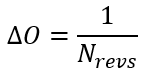

# Order Domain Processing

## What is order analysis?

- Analysis of mechanical systems with rotating components
- Engines (reciprocating & turbine), transmissions, motors, rotors, turbines, pumps, compressors, bearings, gear boxes, washing machines, dryers, mixers, etc.
- Many noise and vibration signal components are directly related to the rotating speed
- Imbalance, misalignment, gear mesh, bearing defects, loose coupling, resonance, etc.
- Order analysis normalizes the measurements to the rotating speed to better dissect these signal components

## Benefits of Order Analysis as Compared to Time Based FFT Processing

- Accurately analyze data that contains time variant frequency components
- Accurate phase relative to a physical location
- Leakage free synchronous analysis
- Insensitive to shaft slew rates
- Separation of synchronous and non-synchronous components
- Analysis of fractional order components
- Removal of random non-synchronous noise via synchronous averaging
- Correlation with other angular domain acquired data, e.g., blade tip timing

## Order Analysis

Order Analysis (or order tracking) is a method whereby the signal is sampled according to its frequency variation.

## Test Cases

- Evaluation test cases to ascertain algorithm suitability
  - Slow sweep rate, single (1 EO) order, SDOF response
    - Application:  Power gen, machine vibration, rotor balancing
    - Desire:  Accurate magnitude & phase to the 1/REV
  - Fast sweep rate, rich order content, SDOF response
    - Application:  Aeromechanics, blade vibration
    - Integral orders closely spaced representing an asymmetric or non-uniform stator configuration
    - Desire:  Accurate magnitude, minimize sensitivity to processing options
  - Crossing orders
    - Application: Machinery vibration & aeromechanics (mode crossing)
    - Multi-shaft machine, orders intersecting from 2 or more shaft speeds
    - Constant frequency intersecting with constant order response
    - Desire:  Accurate magnitude track at crossings

### Case 1: Slow Sweep Rate, 1 EO

- - **Acquisition settings**: - Fs = 10240
  - Δ t = 60 seconds
- Order:  1
- Sweep from 300 to 3,600 RPM over 300 seconds (11 RPM/s)
- Magnitude = 1.0, Q = 25, Φ 0 = 0 °

### Case 2: Fast Sweep Rate, Multi EO

- - **Acquisition settings**: - Fs = 81920
  - Δ t = 60 seconds
- Orders:  59, 60, 61 w/ SDOF resonances at 3 different speeds
- Sweep from 2,000 to 16,000 RPM over 60 seconds (233 RPM/s)

### Case 3: Crossing Orders

- - **Many applications contain multiple rotating components**: - High/low spool gas turbine engines
  - Gear boxes
  - Multi-stage centrifugal pumps driven by a bull gear
  - Drive trains
- Vibration may be present that is synchronous with one or more shaft frequencies or a combination of shaft frequencies
- Desire to decouple the vibration response(s)

## Processing Techniques

### Fourier Transform Based Order Tracking (Discrete Order Transform [DOT] in DX)

- Uses time domain sampled data and the FFT to determine orders
- Block size is constant, therefore not related to the rotational speed of the machine
- User input of order resolution is purely used as a (frequency) screening criteria, actual minimum order resolution is based on signal processing settings
- - **Major limitations**: - Limited order resolution at “low” RPM values, minimum obtainable order resolution based on signal processing:

    > 
    >
    > > [!NOTE]
    > > The factor 3.0 is a scalar on the resolution due to use of any window other than Rectangular. The factor is the result of smearing of energy due to the window. A lower value (2.0) can be used for a Hanning or other windows with a narrow main lobe.
  - Low enough RPM may result in frequency extraction (based on low orders) < minimum available frequency due to window effects near DC
  - Requires slow sweep rates to reduce smearing

### Computed Order Tracking (COT in DX)

- Uses synchronously resampled data and the FFT to perform order analysis
- - **COT processing resamples, via up sampling, the (constant time sampled) signal data at a constant angle**: - Requires knowledge of rotor angular position (over the revs)
  - Accurate phase requires knowledge of 1/REV phase crossing sample/time
  - Provides constant order resolution over the entire speed range
- - **Order extraction performed on angular resampled data**: - Frequency -> Order
  - FFT spectrum -> Order spectrum
  - Frequency resolution -> Order Resolution
  - Frequency bandwidth -> Order bandwidth
  - N(samples) -> N(revs)
- Similar to a time domain FFT where the ensemble size dictates the frequency resolution, the number of revs dictates the order resolution for order domain analysis, i.e.,

  > 
