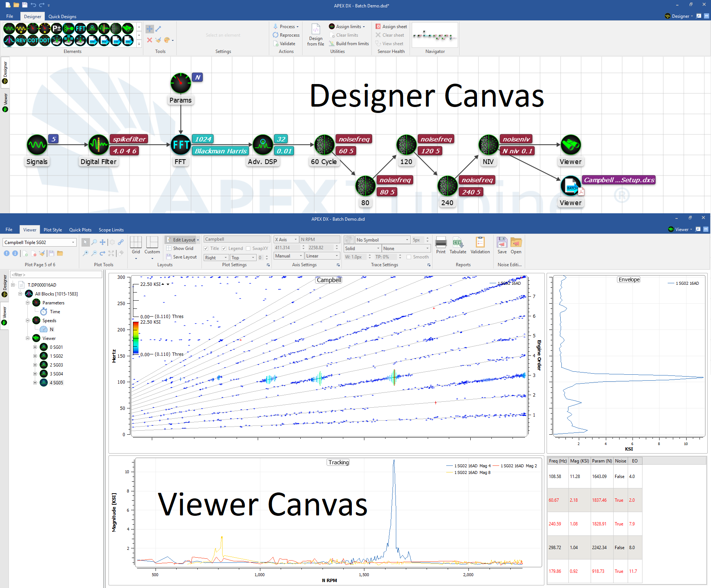

# Overview

## Introduction

APEX DX is an offline data analysis application that is designed to process data from a variety of open dynamic data file formats. DX is built from a dual workspace interface. These workspaces are called the [Process Designer](design.md) and the [Data Viewer](view.md) Workspaces. In the Process Designer, a data processing chain is built using a variety of processing elements. Processing elements are linked together graphically to form unique process flows that can be shared and used repeatedly to analyze any number of consistant data files with one consistant processing chain. Once a process chain has been created, data is sent to the Data Viewer to be viewed and interrogated using an always growing number of specialized and fully interactive engineering plots, charts, and tables. Plots can be layed out in any imaginable format, and printed to a variety of PDF or image formtats.

> 

The main goal of the 2 workspace process is to create a workflow that is easy to use, clear, and powerful. With these workspaces, DX creates a standardized and automated process. Each process chain created in the designer can be saved and loaded as many times as needed for as many data files as needed. Additionally, all plots created in the viewer can be edited and saved, so exact setups and data can be returned to again and again. This saveable process eliminates many "Expert Required" approaches like tip timing and other complex procedures. In short, DX is a controllable, saveable interface that documents how data was processed, saving time and money along the way.

## Features Overview

### Overall

1. Easy drag and drop element processing
2. Clear, repeatable analysis format
3. Fast file processing using memory mapped files
4. Process multiple blocksizes in the same design
5. Automatic file reblocking if specified FFT size different than the base block size
6. Keep all processed peaks only, or view direct FFT data
7. Drag-and-drop processing of data, limits, and design files
8. All designs are validated before data is processed - only valid designs are allowed
9. Full APEX Limits file support

### Designer

1. - **23 Design Elements**: 1. Signals - list specific channels to process
  2. Signals* - include channels whose names match a wildcard or regular expression
  3. Parameters - list specific parameters to process
  4. Parameters* - include parameters whose names match a wildcard or regular expression
  5. Parameter Math - perform basic math on parameter data to create new virtual and altered parameters
  6. Auto / Manual Split - split a file into virtual files to view subsets of data by time or block ranges
  7. Filters - specify specialized filters
  8. Digital Filter - 4 available
  9. Noise Filter - 14 available
2. - **Automatic Response Detection - identify important responses**: 1. Largest Peak Based Response Detection
  2. Grid Based Response Detection
  3. EO Based Response Detection
3. - **Exports - export data in a variety of powerful ways**: 1. Export Raw data files
  2. Export Peaks data
  3. Export CSV in a variety of formats
  4. Export Advanced response detection as .csv or binary
  5. Batch Export multiple files using the same plot setup
4. FFT - change the scaling, FFT size, FFT overlap, and windowing
5. Advanced Digital Signal Processor - find exact peak data using apex proprietary calculations
6. Group - link signal and group elements
7. Viewer - Output process chain to the Viewer
8. - **Designs are a graphical representation of how raw data is processed. They can be created in the following ways**: 1. Manually - the user can start with an empty design or load and modify an existing design.
  2. From a data file - groups signals by common settings. Signals with the same FFT settings will be routed to the same FFT processor. Different processors will be created as needed.
  3. From a Limits file - preserves the component, parts, and signal grouping in the limits file
9. Designs can be saved and later reloaded.
10. The user can change any or all settings of each element - each defaults to "File Default" which means to use the value from the file.
11. The user can send data in multiple directions to compare processing results
12. The user can insert multiple scopes to get the data at a desired step in the processing
13. A validation report can be created from applying the design to a specific data file

### Viewer

1. - **15 Fully Interactive Plots**: 1. Time
  2. History
  3. Magnitude
  4. Envelope
  5. Mag+Env
  6. Tracking
  7. Campbell
  8. Response Table
  9. Z-Mod
  10. Order Z-mod
  11. Collection
  12. Bode
  13. Waterfall
  14. Strip
  15. Orbit
2. Drag and drop plot creation
3. Plot signals versus any low-speed parameter
4. Overlay any number of signals or parameters
5. Multiple plot pages and plots per page
6. Flexible plot layouts
7. Use Quickplots to create pre-defined page layouts for multiple signals at a time
8. Plots may be re-arranged and/or resized
9. All plots are fully interactive with zoom, pan, and customizable point selection
10. Fully customizable plot settings including fonts, titles, axes settings, etc.
11. Wide array of trace settings including point symbols, line width, line style, fills, ect.
12. Draw manual noise patterns on Campbell Plots
13. Flexible limits editing
14. Plot setup loading
15. Customizable reporting to a variety of formats
