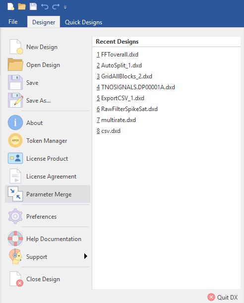
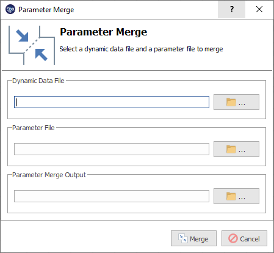

# Parameter Merge

Parameter Merge allows the user to take a dynamic data file (.rwx format) and merge it with a parameter file (.csv format) file to view low speed parameter data and high speed dynamic data in the same file.

Important notes:

- DX will not automatically match offset data, so make sure the dynamic data timecode matches that of the parameter file.
- Merged data files must be located in the same folder as the selected dynamic data file
- While file formats other than .rwx and .csv may be selected, DX does not guarantee these files will merge correctly.
- The merging .csv file may have either all IRIG entries filled in, OR a singal time IRIG entry at the top of the file with a sample rate filled into the "Time" column.
- Each parameter header in the .csv file must have units specified in parentheses "()".



The Parameter Merge function is found in the file menu I the top left of DX:



The Parameter Merge Dialogue contains 3 entries:

1. - **Dynamic Data File**: - Choose an .rwx format high speed or dynamic data file in this box.
  - .datx and .datx_index file formats is supported, but unexpected behavior may result.
2. - **Parameter File**: - Choose a .csv format low speed or parameter data file in this box
  - Date and time codes must overlap with the dynamic data file chosen in the previous text box.
3. - **Parameter Merge Output**: - Name your merged output file and select the folder where your dynamic data file is located. If saving to a different directory than the data file, please see the [Outputting Merged Files in Separate Directories](#outputting-merged-files-to-separate-directory).

Press “merge” and your data file will be created. Merged files may now be processed normally.

Example format variant 1 - absolute time indication on each sample

```
IRIG,Timex (Sec),Blockx (Count),Nx (RPM)
2011:317:23:04:58.499483,0,74322,31.813362
2011:317:23:04:58.601883,0.1024,74323,31.813362
2011:317:23:04:58.704283,0.2048,74324,31.813362
2011:317:23:04:58.806683,0.3072,74325,31.813362
2011:317:23:04:58.909083,0.4096,74326,31.813362
2011:317:23:04:59.011483,0.512,74327,31.813362
```

Example format variant 2 - with one absolute time indication

```
IRIG,Timey (Sec),Blocky (Count),Ny (RPM)
2011:317:23:04:58.499483,0,74322,31.813362
,0.1024,74323,31.813362
,0.2048,74324,31.813362
,0.3072,74325,31.813362
,0.4096,74326,31.813362
,0.512,74327,31.813362
,0.6144,74328,31.813362
,0.7168,74329,31.813362
```

## Outputting Merged Files to Separate Directory

Starting in DX 2020.47, the Parameter Merge operation allows for saving the merged file in a separate directory than the Data File. This is acheived by the file path to the dynamic file being saved in the merged files header. By doing this, this allows for creation of minimally sized merged files without having to copy the dynamic data file or saving the merged file to a data store or restricted location. However, there are some limitations to be aware of:

**Scenario 1: Local Drive Absolute Path:**

- **Given:**: - Data File Location: C:\data\rawData\myDataFile.rwx
- Output Location: C:\data\mergedData\myMergedFile.rwx

The merged file will contain the file path: "C:\data\rawData\myDataFile.rwx" in its header referencing the data file.

- **Caveats:**: 1. The data file cannot be moved, otherwise, it will break the link the merged file has. The merged file can freely move.
2. Sharing the merged file among users is limited. If shared, the other user must have the same data file in the same absolute file path.

**Scenari 2: Network Mapped Drive:**

- **Given:**: - Storage Server: MyStorageServer
- Data File Location: P:\data\rawData\myDataFile.rwx
- Output Location: C:\data\mergedData\myMergedFile.rwx
- **Where:**: - Drive P is "MyStorageServer" root directory mapped to drive P: on the local system.

The merged file will contain the file path: "P:\data\rawData\myDataFile.rwx" in its header referencing the data file.

- **Caveats:**: 1. The data file cannot be moved, otherwise, it will break the link the merged file has. The merged file can freely move.
2. Sharing the merged file among users is limited. If shared, the other user must have the same storage server directory mapped to same drive.
3. If sharing merged file, all users using it must have same permissions to access the drive the data file is stored on.

**Scenari 3: Network Storage Location:**

- **Given:**: - Storage Server: MyStorageServer
- Data File Location: \MyStorageServer\data\rawData\myDataFile.rwx
- Output Location: C:\data\mergedData\myMergedFile.rwx

The merged file will contain the file path: "\MyStorageServer\data\rawData\myDataFile.rwx" in its header referencing the data file.

- **Caveats:**: 1. The data file cannot be moved, otherwise, it will break the link the merged file has. The merged file can freely move.
2. Sharing the merged file among users is less restricted. However, if shared, the other user must have access to MyStorageSevrver.
3. If sharing merged file, all users using it must have same permissions to access the folder on the server the data file is stored on.
