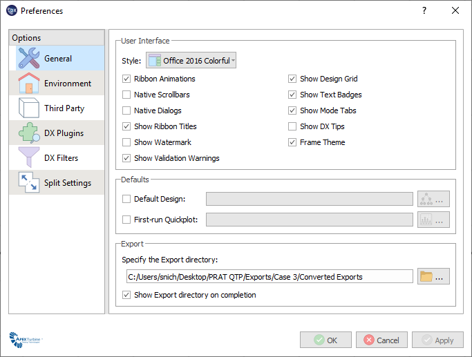
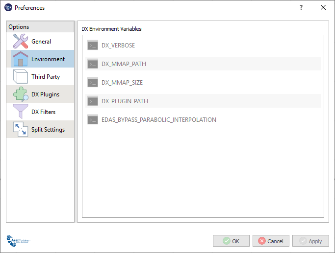
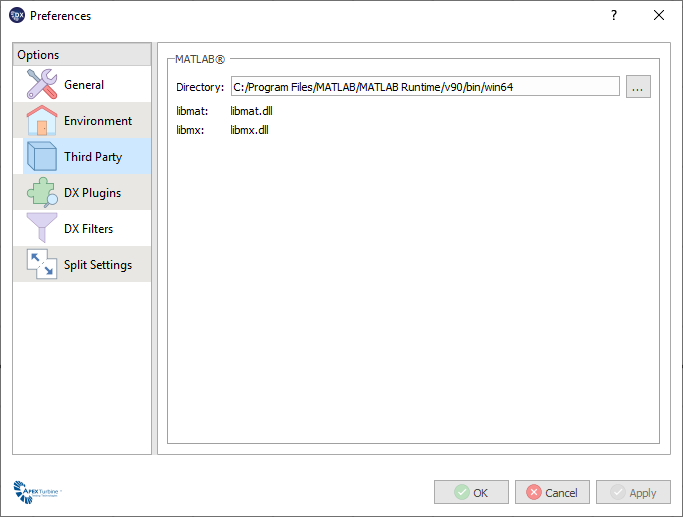
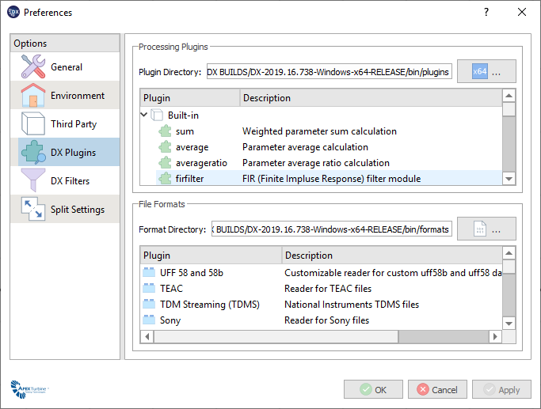
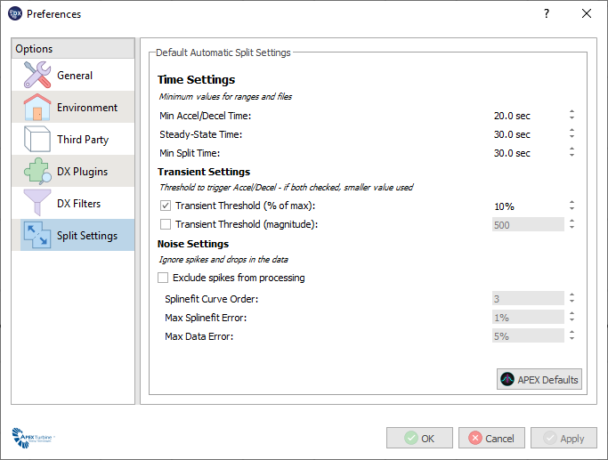

# Preferences

## General

### User Interface

- - **Animation**: - Enables menu and button hover and click animations
- - **Native Scrollbars**: - Enables native scrollbars
- - **Native Dialogs**: - Enables native dialog style
- - **Show Ribbon Titles**: - Shows ribbon section titles
- - **Show Watermark**: - Shows APEX watermark on design canvas
- - **Show Design Grid**: - Shows grid layout on design canvas
- - **Show Text Badges**: - Shows element text information badges on design canvas
- - **Frame Theme**: - Enables frame theme on Windows, title bar and window are merged
- - **Validation Warnings**: - Enables popup dialog if a file recieves a validation warning but can still process.

### General Defaults

- - **Default Design**: - This design is loaded on DX startup
- - **First-run Quickplot**: - This quickplot will be created in the viewer when a file is processed for the first time

## Environment

- - **DX_VERBOSE**: - Specifies the path of the DX log file, if set DX will verbosely log to the file specified.
- - **DX_MMAP_PATH**: - Location where DX will store temporary memory mapped files.
- - **DX_MMAP_SIZE**: - Size of memory mapped files
- - **DX_PLUGIN_PATH**: - Alternative path DX will search for plugins.

## Third Party

Matlab instalation point.

## Plugins and Formats

Lists the plugins and data formats loaded by DX.

Plugins are split into processing plugins and data format plugins. The plugin and format directories can be user specified.

## Split

The default split settings used by the auto split element.
