# Quickstart Guide

Read the [DX Overview](overview.md) for a brief explanation of the 2 workspace system that DX implements.

## Prerequisites & Licensing

Before launching **APEX DX**, confirm your installation ([Install APEX DX](install.md)) and active license ([Licensing](licensing.md)):

- **APEX License Manager (ApexLM)**: Verify active `DX` / `ANALYSIS` tokens in the local Web Admin UI at `http://127.0.0.1:27887/`.
- **Legacy FlexNet**: Ensure your `.lic` file or `27000@host` server path is configured ([FLEX Licensing](flex.md)).

## First Steps - Designer

This guide explains how to get started using APEX DX offline data analysis software quickly, and explains how to begin viewing and analyzing data right away. Once DX is open, only a few clicks are required to begin displaying, editing and interrogating data.

### Drag and Drop Data Viewing

The easiest way to get started in DX is to **drag and drop** a data file directly onto the design canvas. To quickly process data for viewing, simply browse to a data file using a file explorer and drag and drop the file into DX. Once the file has been dragged onto the canvas, DX will automatically create a design based on the settings in the file and process the data for easy data viewing and interrogation using any plots or layouts in the viewer workspace.

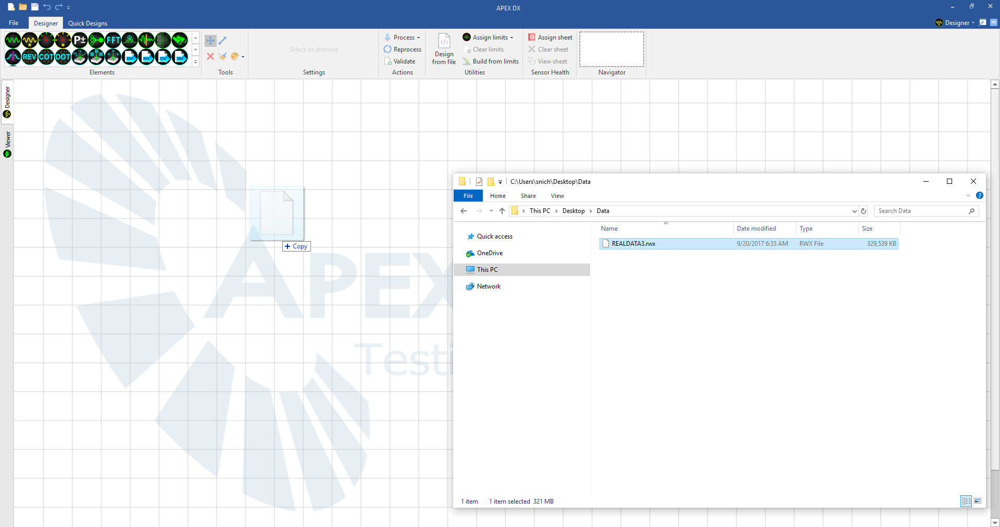

### Design From File

To begin to better understand the designer workspace, the same design can be created before processing using the **"Design from File"** button, located along the top ribbon in DX Designer. To navigate back to the designer from the viewer workspace, click the tab on the far left of the window. Click the "Design from File" button, navigate to a file in the file browser, and then select the file. DX will automatically generate the best design to view the file that that can now be edited for further analysis.

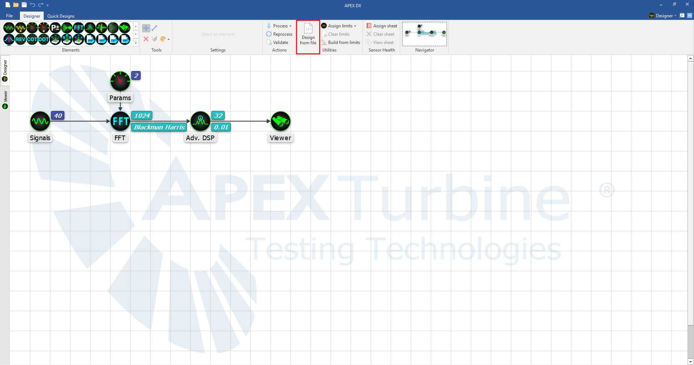

Once the design has been created, simply press the "Process" button to select the same (or similar!) data file to view it in the viewer workspace.

### Simple “Play All” Design With Quick Designs

Another good starting place is with **Quick Designs**. Navigate to the Quick Designs tab located in the top left of the ribbon and drag the "Catchall Adv. DSP" design onto an empty design canvas. This will create a simple and complete design that uses every signal and parameter in a file, and extract the peak data using the [Advanced Digital Signal Processor Element.](design.md#pke-advanced-digital-signal-processor-element) This design will work with both raw and processed data (PKX) (although processed files will ignore any changes made to the FFT and Peaks elements.)

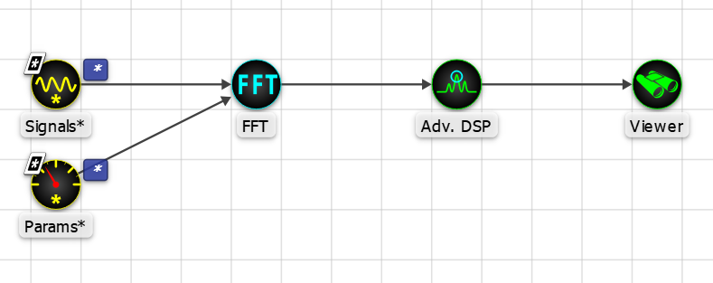

In addition to the "Catchall Adv. DSP" quick design, there are an array of other quick designs that work as a great starting point for any analysis process. Additionally, custom quick designs can be saved by selecting the design on the canvas selecting "Right Click --> Create Quick Design."

## First Steps - Viewer

Once a design has been created and data has been processed, DX will automatically navigate to its second workspace; the Data Viewer. In the viewer, plots can be easily created by dragging and dropping a signal, parameter, or groups of both onto the canvas. The viewer is near infinitely customizable and manipulatable in layout, setup, and plotting options.

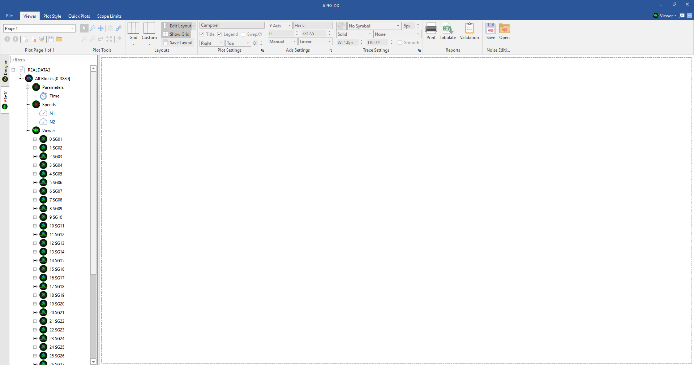

### Creating a few Simple Plot Layouts

- Example 1 - Creating Plots:

Usually, when getting started with creating a plot layout, the first thing to do is adjust the grid. To adjust the grid, navigate to the "layouts" section of the ribbon and click the "Grid" dropdown.  For this example, we are going to be examining 4 signals so we will create a 2x2 grid layout, but layouts can be [edited to any format](view.md#the-canvas-plot-layouts) and saved to custom layouts.

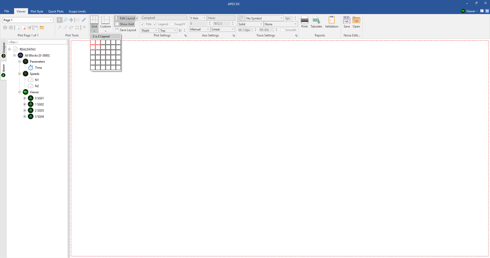

Once a grid layout has been created, simply drag a signal onto the canvas to create a plot. In this example, we will create an envelope (or FFT) plot. To do this, click ["Envelope"](issues.md#envelope-plots) option from the resulting drop-down box.

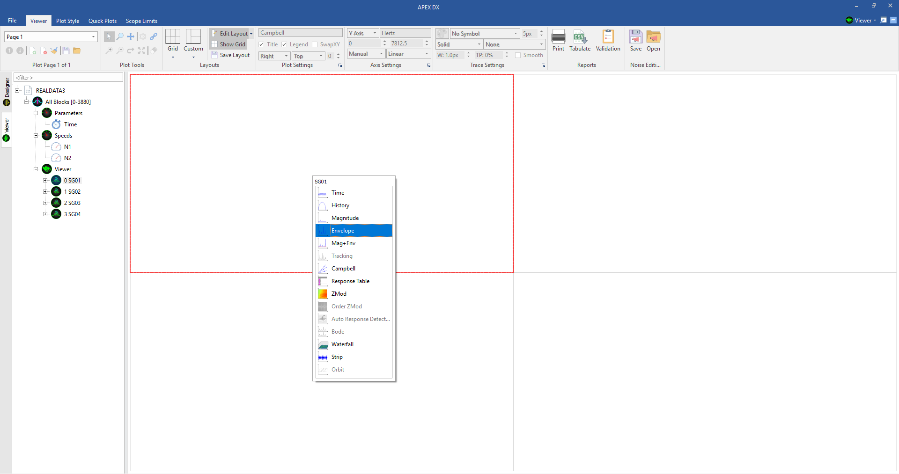

After selecting the Envelope plot, we will do this 3 more times for the signals SG02, SG03, and SG04 to create a plot page that contains 4 envelope plots to compare from 4 different signals.

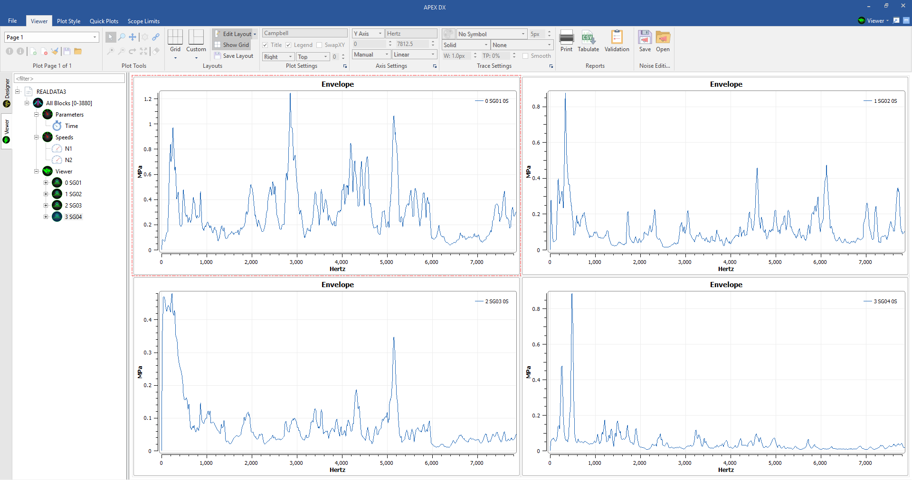

- Example 2 - Creating Multiple plots at once:

To save time, multiple plots can be created at once. To demonstrate this, we will create a new page and drag all 4 signals onto the canvas at once. To create a new page, click the small page button with the green plus near the top left of the ribbon.

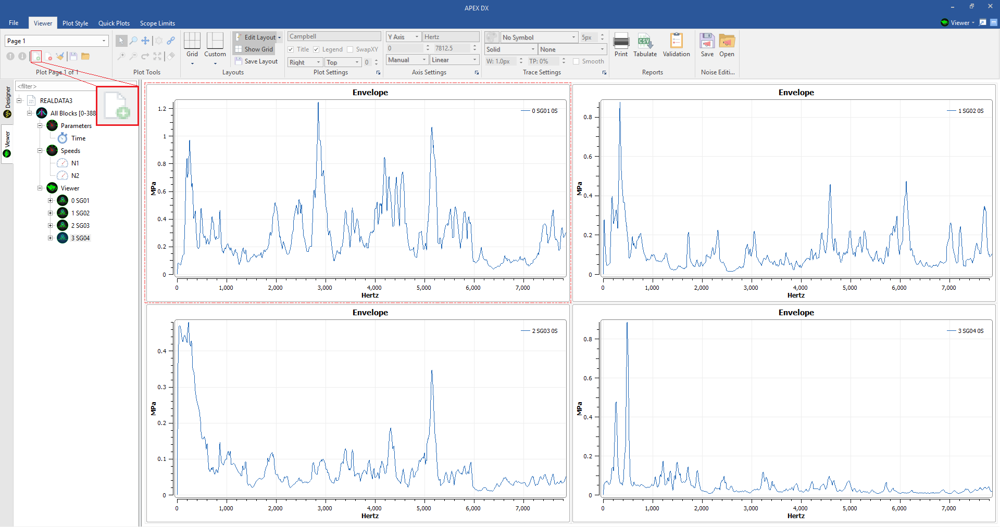

After creating a new page, the same empty plot layout as the current page will be created. To move back and forth through the pages, click the arrow buttons on the top left, or use the page dropdown to navigate to the desired page directly. To create multiple plots at once, click on a plot space and select all of them by hitting "ctrl+a." Additionally, multiple signals can be selected by using shift+select or ctrl+select (similarly to a spreadsheet editor's row selection). Once multiple signals are selected, drag the group of signals onto the canvas, select "Trace 1 Per" and select a plot type. For this example, we chose to create [Waterfall Plots.](view.md#waterfall)

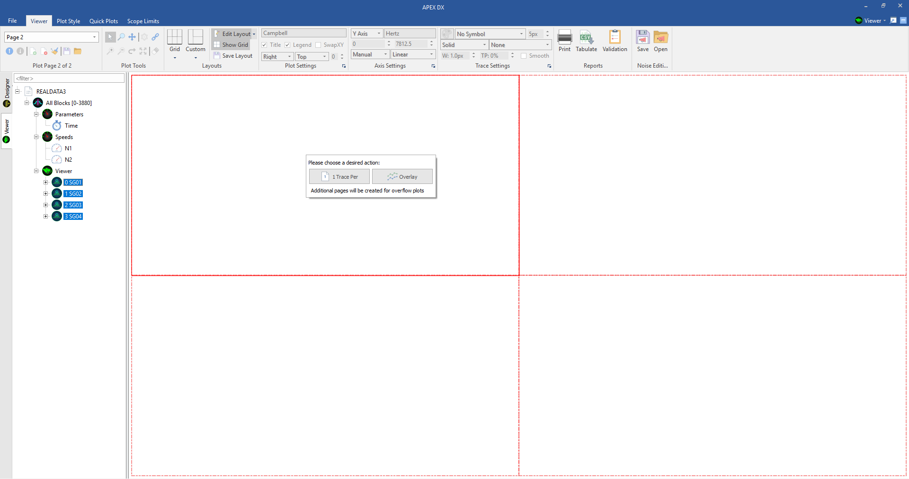

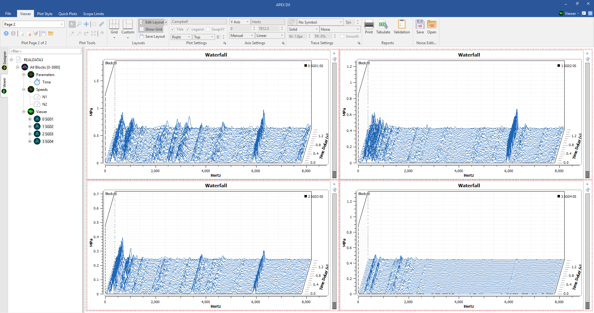

- Example 3 - Creating Overlayed Plots:

If "Overlay" had been selected instead of "Trace 1 Per," or if only 1 plot space was selected on the canvas when multiple signals were dragged over, plots would have been overlaid (not available for Tracking, Bode, Waterfall or Z-Mod plots). We will demonstrate this by creating another page, changing it to a 1x1 layout and dragging our 4 signals onto the canvas and selecting "Envelope Plot" again.

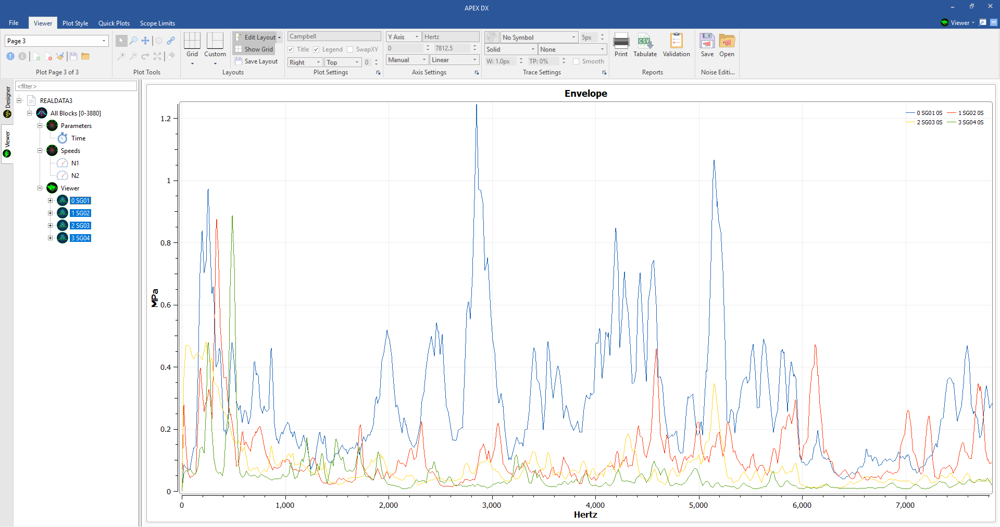

- Example 4 - Creating Signals Versus Parameters:

One of DX's most powerful features is its ability to create almost any plot of a signal versus a low-speed parameter. To plot signals vs parameters, ctrl+select the signal and the respective parameter from the signal tree and drag them to the canvas. We will demonstrate this by creating another page, ctrl+selecting SG01 and N1 and dragging them to the canvas to create a speed Campbell. Below, the created [Speed Campbell](view.md#campbell-plots) contains engine order lines specifically useful for aeromechanical analysis.

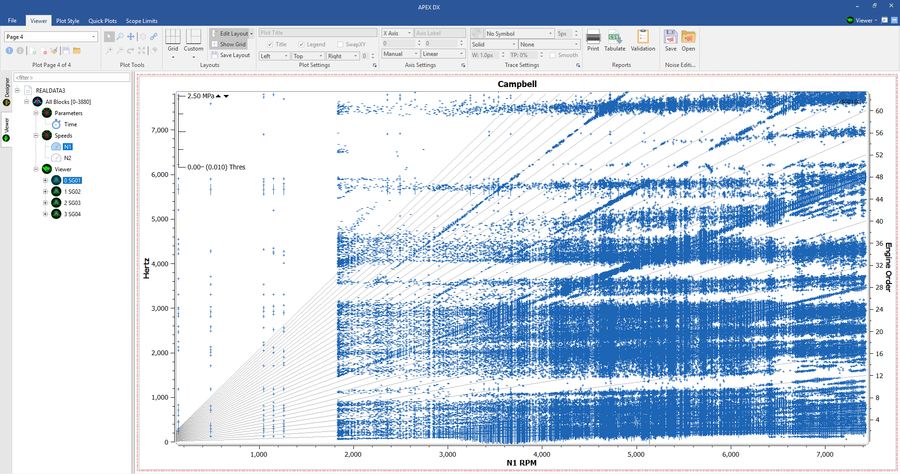

### Conclusion

Of course, DX is a deep product that gives the user control of the analysis without compromising ease of use. This quickstart guide should provide the tools needed to begin viewing and running basic data analysis. To discover more, either jump into the product and try out the features DX has to offer, or continue reading through the designer and viewer sections of this help documentation for an in-depth look at each of the features within the respective workspaces of DX. Specific features can be searched for it within the help, or questions can be submitted through [https://www.apexturbine.com/users/helpdesk](https://www.apexturbine.com/users/helpdesk)
