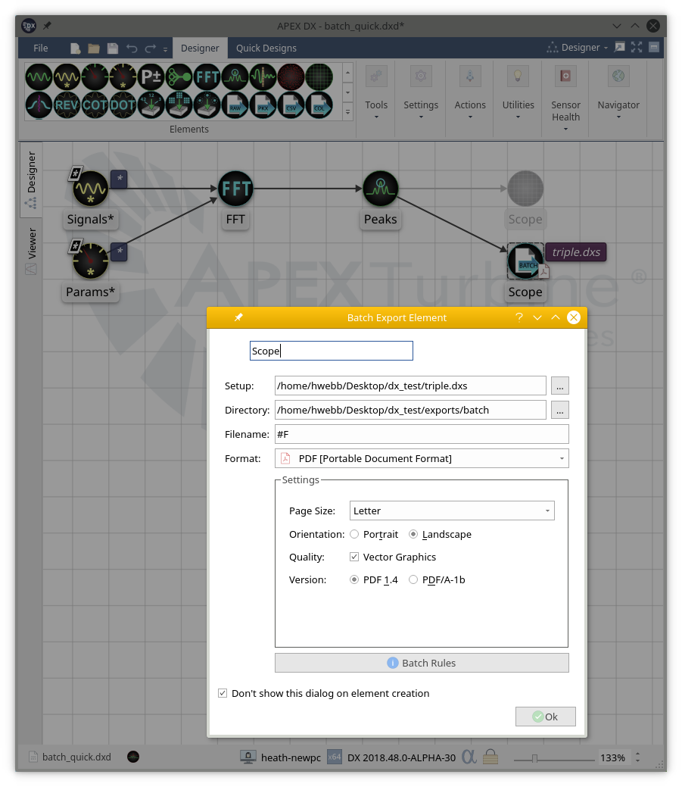

# Reporting

Batch reporting is used to export large amounts of data in large numbers of files into pre-customized reports. The batch export element functions as a Viewer element, but instead of sending data to the viewer for plot creation, it prints data to a .pdf or image file using a [plot setup](view.md#saving-loading-plot-setups) as a template. This means that the Batch Element must be located in the same place on the processing chain, and named the same as the Viewer through which the plot setups were created.

## Setting up and running Batch Exporting

1. Run DX
2. Process a single file similar to the files on which batch reporting will be run
3. Create plots and tables in the viewer that will serve as the template for Batch.
4. Save the [plot setup](view.md#saving-loading-plot-setups)
5. Return to the designer and add a Batch Element to the canvas
6. Connect the Batch Element to the same location as the viewer element
7. Name the Batch Element the same name as the viewer element
8. Disable the Viewer Element (optional, all files will be processed if the viewer is enabled and processing will take much longer.)
9. Open the Batch Element options dialog
10. In the Setup field, select the plot setup file created in step 4
11. In the Directory field, select a location for your reports to be saved
12. In the Filename field, indicate the naming scheme for the reports (hover for tooltip)
13. In the Format field, choose the output format - either PDF or Images
14. Further customize the output format settings if desired
15. Close the dialog and click Process
16. Select all files to include in Batch processing
17. Process and view the resulting reports. A directory with the exported files will open when processing has finished.

### Helpful Batch tips

1. Batch exporting can not be done with plot setups that contain more than one Viewer element.
2. When creating a plot setup file for batch exporting, make sure that only one scope is enabled in the process chain to limit confusion.
3. Batch exporting can not be done with plot setups that contain more than one file. When creating a plot setup file for batch exporting, make sure that only one file has been processed to limit confusion.
4. Give the scope and the batch element unique name. The names of both elements must be the same, so a non-default name for both clarifies what processing chain the batch exporter should be attached to.
5. Make sure plots are set to half or full auto on all axes. Unless there is a known data range desired, ensure that all data is shown in the export images by ensuring the axes scale with the data.

> [!NOTE]
> Batch - Element Filename tags #C & #A are only valid for Image formats (not PDF format)
