# DX Viewer

## Introduction

Once a design has been processed using the process designer, DX will automatically navigate to the **Process Viewer**. Inside the viewer, reports can be created, data can be viewed and interrogated, and plots can be highly customized and exported. All plots created in the viewer are instantaneous and fully interactive.

## The Signal Tree

The **Signal Tree** displays all plottable  signals and parameters, arranged by file, split, viewer, and group. To plot a signal, click and drag a signal, parameter or entire viewer or parameter section to the canvas. Signal statistics are located under signals by clicking the twirler to its left.

Collapse / Expand All buttons are located on the top of the tree. The Tree can be filtered to look for specific signal, parameter, viewer, split, or file names. This is useful for data files with large numbers of signals and/or parameters.

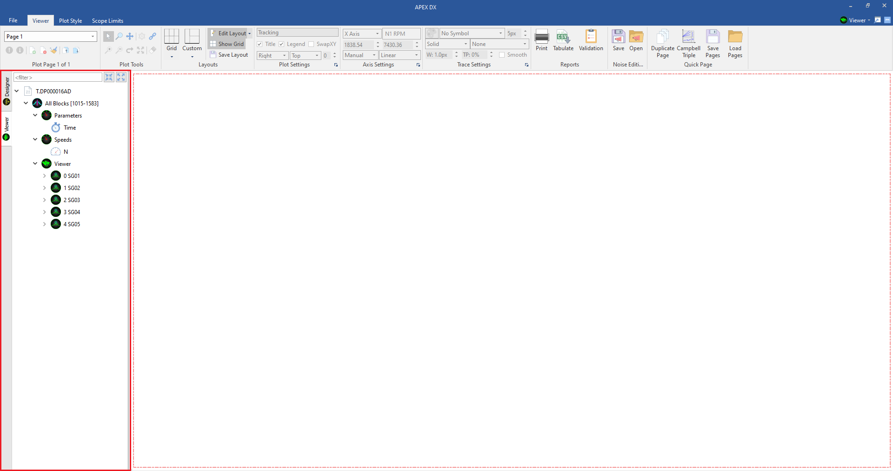

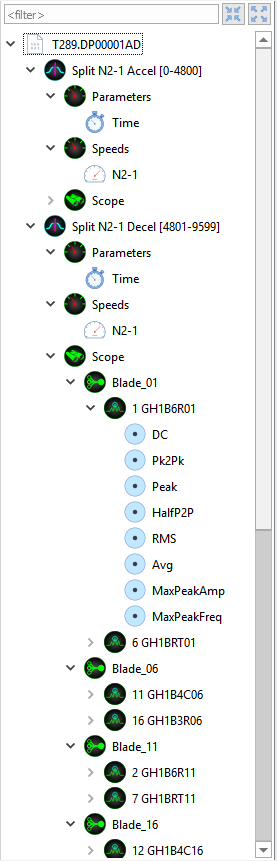

## The Canvas // Plot Layouts

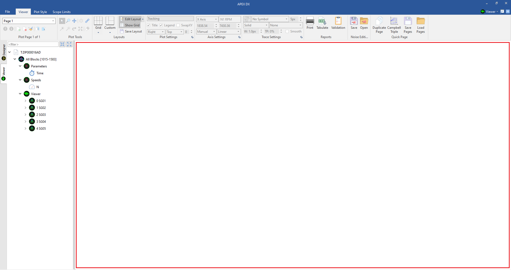

The **Canvas** is the main space where plots are created and interacted with. It can be divided into almost any custom layout to provide maximum flexibility for plot creation and reporting. The canvas layout is customizable by using the "Layouts" section of the ribbon. Plot spaces may also be customized through the right click menu on a blank space.

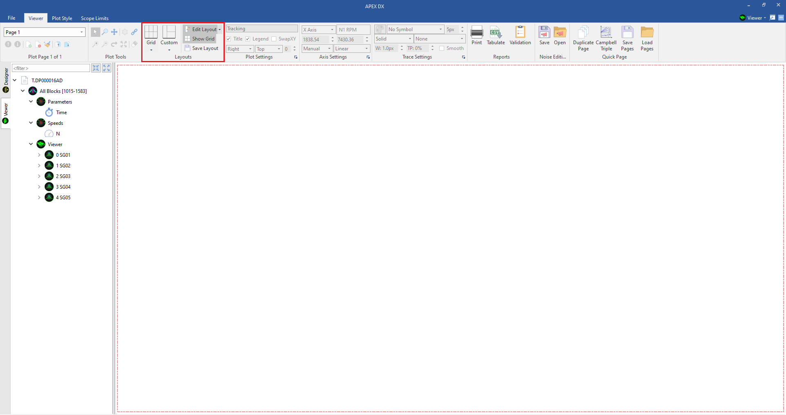

### Example

To begin customizing a plot layout, first select a grid size. For this example, we will start with a 3X3 grid layout.

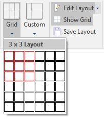

Once we have created the grid, we will remove the merge in the middle plot space vertically using the right click menu.

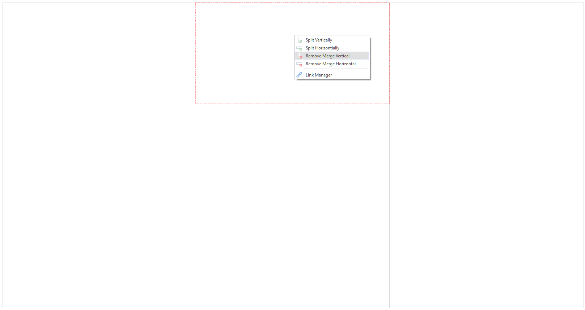

Once we have done this, we will repeat the remove merge vertical again to make one tall plot space in the middle. We are left with the following result:

After we have one tall plot space in the center, we can split it horizontally to create an even space down the middle of the plot:

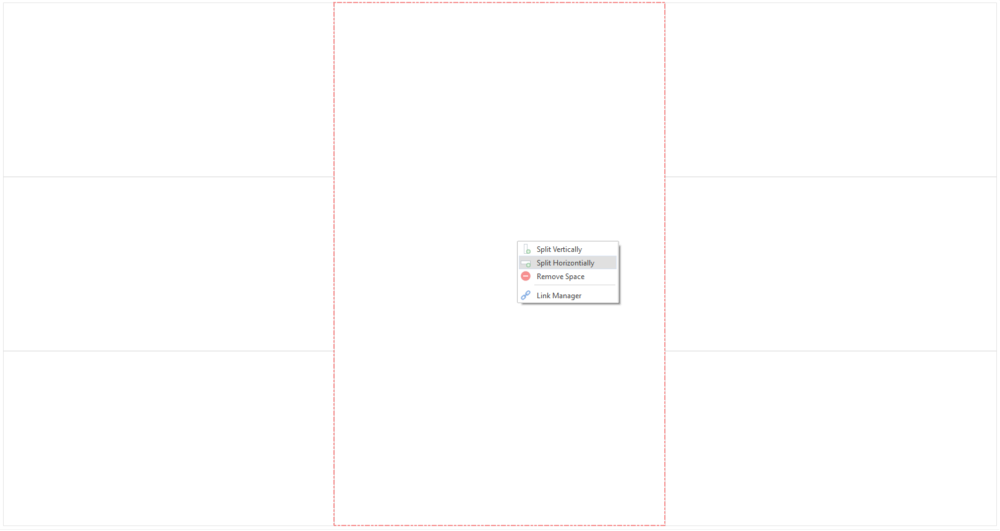

Once we have done this, we will remove the space in the middle plot space on the left and right. The remove space option will always remove the plot below the selected one unless the plot is on the bottom space.

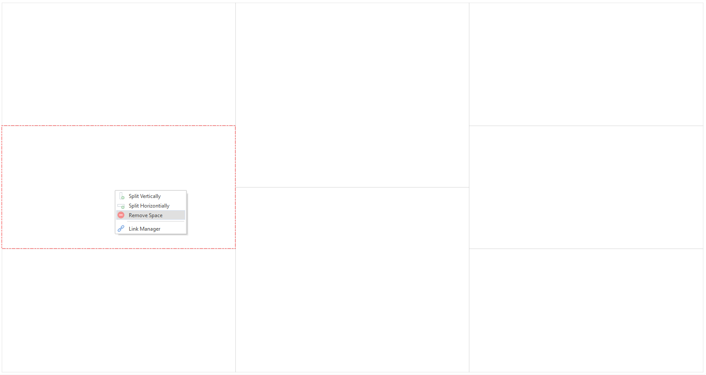

Once we are happy with our plot layout, we can fill in the plots in any way we choose:

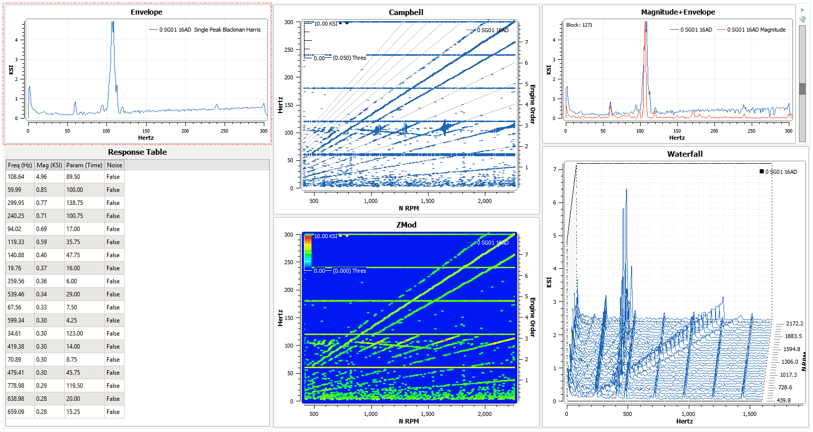

Of course, the plot layout can be edited while plots are already on the canvas (unless the new layout would require a plot to be removed). In addition to the right click menu, the dropdown next to the "Edit Layout" button in the layouts section of the ribbon can be used to change the grid layout. If the "Edit Layout" button is unchecked, it will disable the grid from being changed.

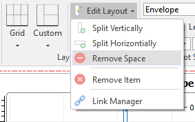

*See information on plot linking tool [here.](#link-tool) *

Any grid layout can be saved and used later using the "Save Layout" button. Once a grid layout has been saved, it will be added to the "Custom" layout dropdown next to the Grid selection. Note the layout created in the example is saved in the image.

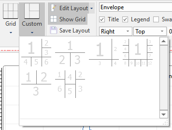

Finally, the grid can be toggled on and off with the "Show Grid" button.

## Pages

Any number of plot pages can be created to accommodate any analysis situation. To create a page, click the small "Page +" button in the upper right side of the canvas. To Remove a plot page, click the "Page -" button next to it. Pages are inserted next to the current page.

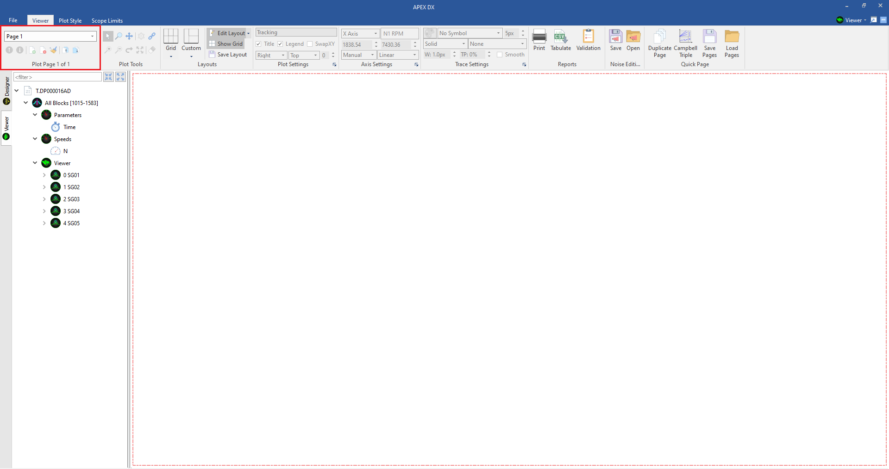

Pages can be navigated through using the up/down arrow buttons next to the page creation/removal buttons can be navigated to directly through the page name dropdown. Every page can have a custom name for added organization. Pages can be moved up or down with the page up/down buttons.

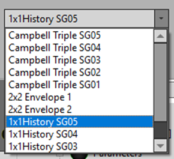

To delete all pages from the viewer, click the "Remove All" broom icon next to the Add/Remove page buttons.

## Plots

To create a plot, simply drag and drop it onto the canvas. To create a plot versus a parameter, or to overlay multiple signals, ctrl+select or shift+select multiple signals or parameters and drag them to the canvas.

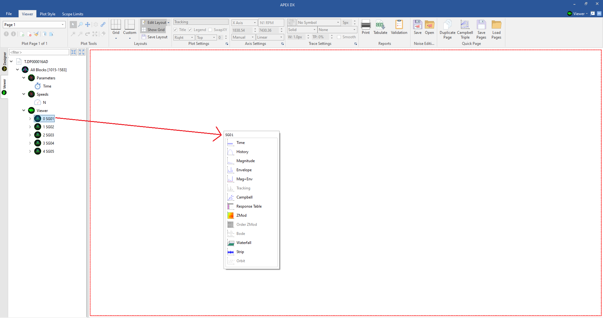

Once a signal, parameter, or mixture of both has been dragged to the canvas, select a plot from the list to create the plot.

All plots have a wide range of settings, each plot is detailed below.

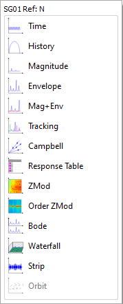

## Plot Tools

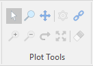

All plots can be interrogated using a variety of useful plot tools.

### Selector Tool

Use the **Select Tool** to make plot markers and select plot spaces (multiples with ctrl). The Selector tool can be activated by either clicking the tool button in the ribbon, or with the hotkey "C".

To create a plot marker, click on any point on a plot and it will display pertinent information for that point. Markers can be moved around by clicking on the text and dragging them to another location. Moving a plot marker will create an arrow showing where the point is.

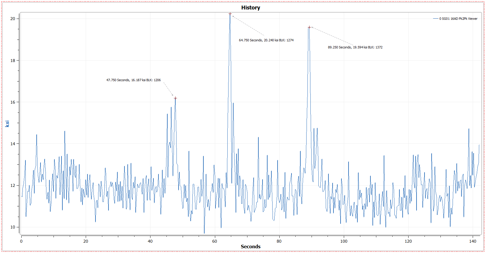

Multiple markers can be places on any plot by selecting Right Click > Markers > Multi-Mode. "Clear Markers" and a marker list is also available in the right click menu. Enabling the "Tracker" in the right click menu will show pointer information anchored to the mouse.

A Campbell plot can be sliced from any axis to create a spectrum plot of that axis. Using the Select Tool, click and drag along any axis to enable the slicer, release the left mouse button to see the slice. To return to the Campbell plot, either click on the "Revert" button in the "Plot Tools" section of the ribbon or select Right Click > Revert.

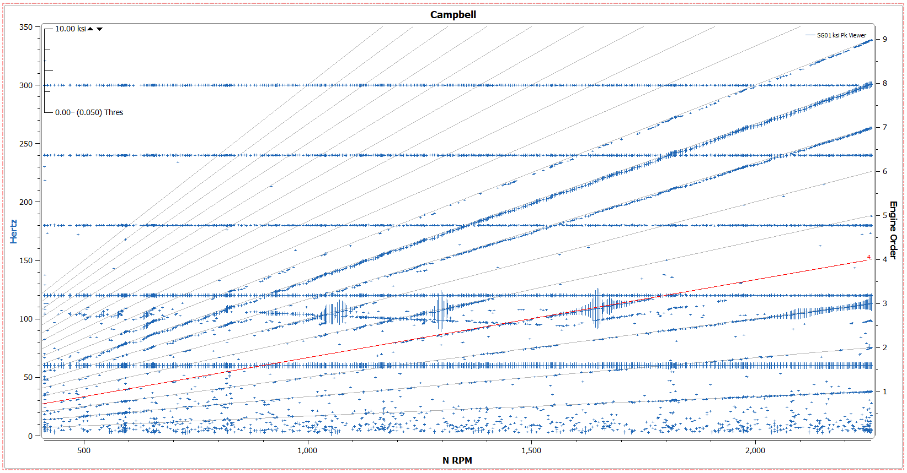

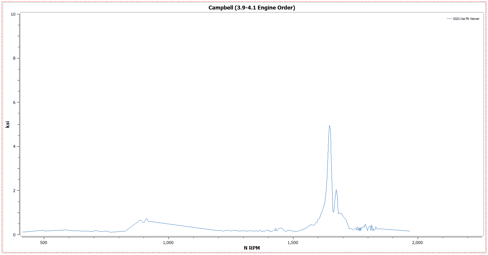

The Select Tool is also used for [Manual Noise Editing on Campbell plots.](#manual-noise-editing)

### Zoom Tool

Use the **Zoom Tool** to zoom in on specific points of data by clicking and dragging on the plot. To reset zoom, select either "Zoom Defaults" (which resets the plot to its default axis settings) or "Zoom Reset" (which resets the plot to the last manual axis range). Clicking the Middle-Mouse Button will also trigger the "Zoom Reset" functionality. The Zoom tool can be selected by either clicking the tool button in the ribbon, or with the hotkey "Z".

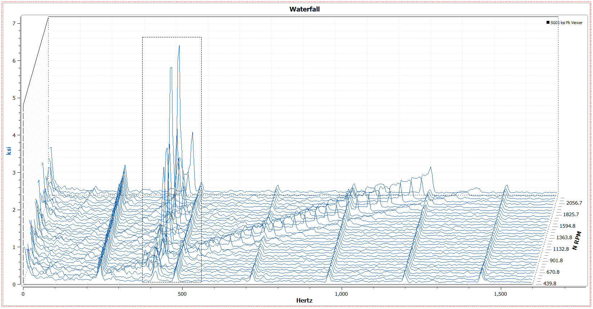

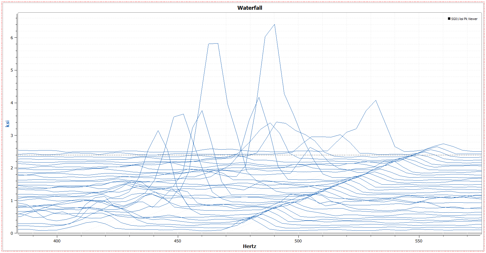

### Pan Tool

Use the **Pan Tool** to move data ranges after a plot has been zoomed. The Pan tool can be selected by either clicking the tool button in the ribbon, or with the hotkey "X".

### Plot Options Button

All [plot options](#plot-options) can be accessed through either the right click menu, or the plot options button in the "Plot Tools" section of the ribbon.

### Link Tool

Any plots and axis can be linked together using the **Link Tool.** When the link tool has been selected, DX will enter "link mode" where lines can be connected between axis or plots. Click and drag from one axis or plot to another to link them. Once linking has been completed, click the link tool again to exit link mode. The Link tool can be selected by either clicking the tool button in the ribbon, or with the hotkey "L".

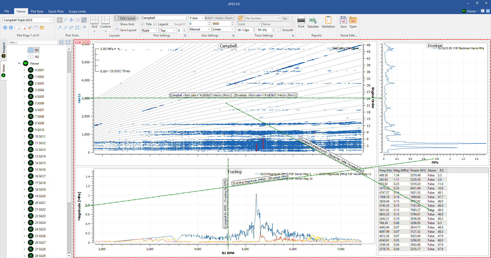

> [!NOTE]
> While linking does work in both directions, the plot that the link is drawn from is considered the "parent plot" and will control the plot(s) it is connected to.

To link all axes together, connect plots from the center. Playable plots block numbers will also be linked in this way.

### Zoom In // Zoom Out

Zoom In/Out buttons are also available in the "Plot Tools" section of the ribbon for smaller zooms. "Ctrl + +/-" may also be used.

### Quick Zoom

If multiple plots exist on a plot page, they can be double clicked to be made full screen and then double clicked again to return to their original placement. This functionality is also available as the **"Quick Zoom"** button in the "Plot Tools" section of the ribbon.

### Clear Traces

To remove all traces from a plot, select the **"Clear Traces"** button. This is also available from the right click menu. New signals can be dragged onto the blank plot space to create plots with the same ranges.

## Plot Options

All plots have a similar set of options, and a number of settings specific to the plot. Each plot (excluding tables) has General Settings section, an Axis Settings section, and a Traces Settings section. Not all options are available for all plots.

### General

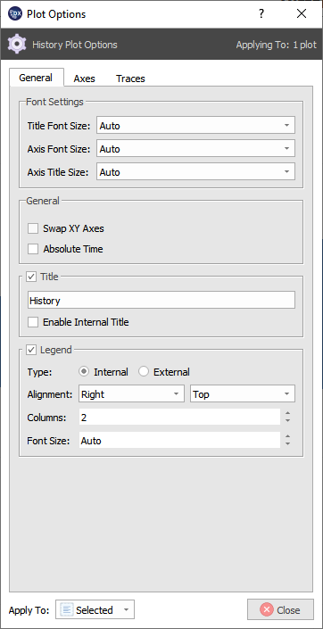

- **Font Settings:**: - - **Change font sizes for title, axis ticks, and axis title size**: 1. "Auto" font sizes will automatically scale with the plot size within the canvas grid.
  2. Manual font sizes can be selected from 8pt font to 28pt font.
- **General:**: - Swap the X and Y axes to view plot vertically.
- - **Absolute time**: 1. On plots vs time, "Absolute time" may be selected. Absolute time is based off of the timestamps in the file (IRIG).
  2. Absolute time is reflected in the axis settings section
- **Title:**: - Enable/disable plot title
- Change Title text
- Enable internal title to view the title inside of the plot
- **Legend:**: - Plot legends can be aligned anywhere within the plot (default top right corner)
- An external plot legend will place the plot legend outside of the plot
- If multiple traces are displayed on the same plot, the legend can be displayed in the specified number of columns
- Font size plot legends can be changed here

### Axes

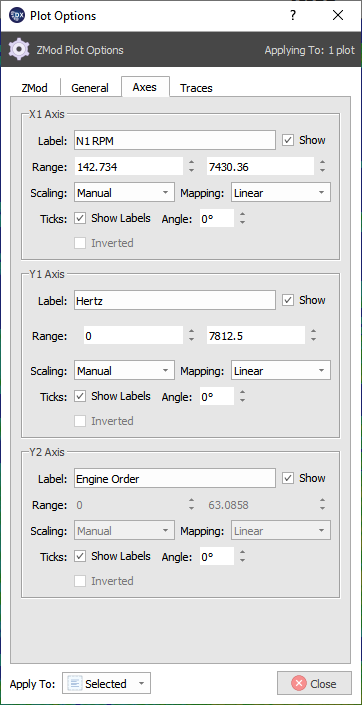

- **In the Axis settings for the time plot, the following settings are adjustable  for each axis:**: - - **Label**: 1. Plot label settings are linked directly to the settings defined by the file or signals element in the designer seciton. Unit labels will always match actual data units.
  2. Toggle "Show" to turn labels on and off.
- - **Range**: 1. Adjust the X axis data range for the plot
- - **Scaling**: 1. - **Change between manual, half automatic, and fully automatic scaling.**: 1. Manual scaling will not change with data and will stay at user defined values.
    2. Half Auto will scale with the data to the largest value and stay at that data range
    3. Full Auto will always scale to the data and grow and shrink the data scales.
- - **Mapping**: 1. Change between linear and log axes mapping for certain plots
- - **Ticks**: 1. Show Labels toggles on and off axis tick labels
  2. Angle will rotate the axis ticks
- - **Invert Axes**: 1. Reverse axis values to view the plot backwards

### Traces

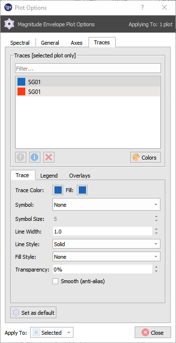

- **Multiple trace settings can be adjusted within the Traces Tab as follows:**: - - **Traces selector**: 1. Within the trace selection box, one or multiple traces can be selected at time to be edited.
  2. Navigate through the traces by clicking on them directly
  3. Rearrange or remove traces with the buttons on the bottom of the section.
- - **Trace**: 1. Change Trace color and fill color to differentiate traces on the plot
  2. Symbol includes 15 different shapes to be used as data point markers. (Default None)
  3. Symbol size adjusts the size of the data point marker symbols up to 35 pt.
  4. Line Width adjusts trace width up to 50 pt.
  5. Line style allows trace to be changed from a solid line to, dots, dashes, or combinations of both
  6. Fill style allows plots like envelope and magnitude plots to be filled in below the trace with a variety of different tick marks or gradients
  7. Transparency sets the opacity of the selected trace(s)
  8. Smooth toggles on and off anti-aliasing for a trace that makes the traces appear smoother.
- - **Legend**: 1. Use a number of legend keys to clarify traces.
  2. All trace keys are surrounded by "%" symbols
  3. Descriptions for trace keys are available in the description section of the legend tab
  4. Consistent strings may also be added to traces by typing plain text into the legend text box
  5. Once a Legend Key has been set, selecting "Set as Default" will cause any plots created after that point have the same legend information. This includes [Quick pages](#quick-pages).
  6. Legends are saved in plot setups
- - **Overlay**: 1. Show Limits / Modes Overlay - Toggle on-plot display of limits and modes
  2. Auto Response Detections - Quickly enable or disable response detection overlays
  3. Show / Hide frequency and parameterer bounds if they have been set by the ARD element

## Time Plots

The first plot type available is a playable **Time Plot.**

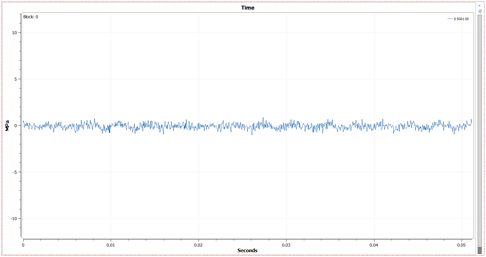

Time plots display time domain data per block, and can be played in the following ways:

- - **Play Through Blocks**: 1. - **This will play the plot through one block or second at a time and loop at the end.**: 1. Play speed can be changed from 25% to 1000% speed
- - **Drag the slider bar**: 1. This will allow for specific combing through the file.
- - **Use the arrow keys**: 1. After the slider bar has been clicked on, the keyboard arrow keys can be used to tab through blocks or seconds 1 at a time
- - **Select a block number directly**: 1. The top left of the plot shows the block number for the current data displayed. To change this to a specific block number, double click on the number and type in the desired value. Typing a value is not available for time values.

The Time Plot can be changed between Block and Time values by shift-clicking on the top right side of the plot where it says "Block" or "Time" respectively. Time plots still only show one block of data at a time (even while "time" is displayed instead of block number), so increasing the X value in the axis settings past default will not display more time data.

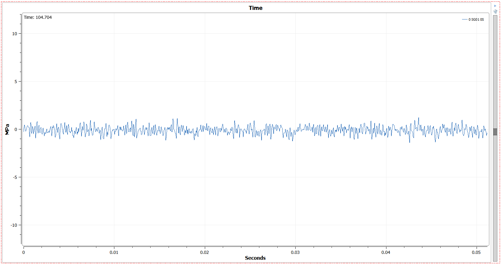

## History Plots

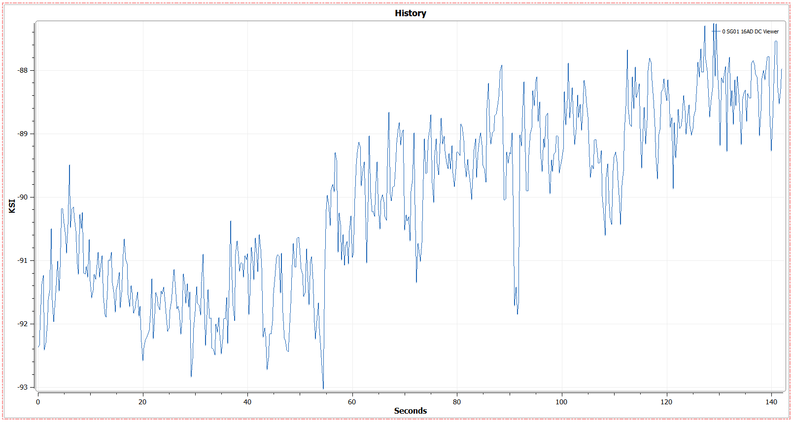

**History plots** can be created from parameter data or signal statistics. Dragging a signal to the grid and selecting "History" will open a dialogue box where a statistic can be chosen, in addition, a signal statistic can be dragged directly onto the canvas by clicking on the twirler next to the desired signal and dragging the respective statistic to the canvas.

DX built in statistics include DC, Pk2Pk, Peak, HalfP2P, RMS Avg, MaxPeakAmp, and MaxPeakFreq. The fftoverall statistic can be enabled in the signals element (in the designer) to enable oaRMS, oaPK and oaAVG. In addition, more custom statistics can be added through plugins. % Limits and modes for a given signal can also be plotted as history plots and are available below the signal in the tree.

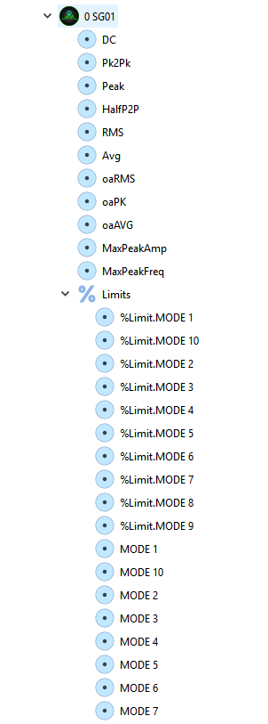

## Magnitude Plots

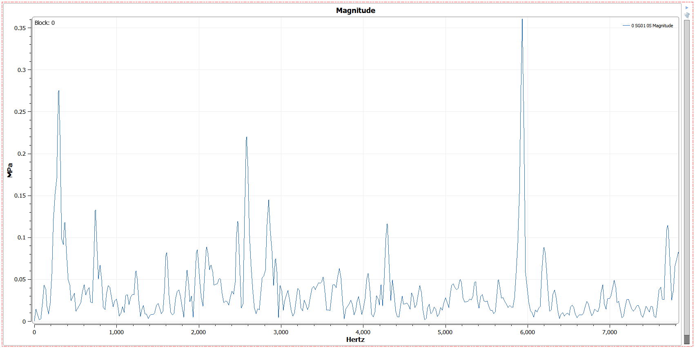

**Magnitude Plots** display spectral data per block, and can be played in the following ways:

- - **Play Through Blocks**: 1. - **This will play the plot through one block or second at a time and loop at the end.**: 1. Play speed can be changed from 25% to 1000% speed
- - **Drag the slider bar**: 1. This will allow for specific combing through the file.
- - **Use the arrow keys**: 1. After the slider bar has been clicked on, the keyboard arrow keys can be used to tab through blocks or seconds 1 at a time
- - **Select a block number directly**: 1. The top left of the plot shows the block number for the current data displayed. To change this to a specific block number, double click on the number and type in the desired value. Typing a value is not available for time values.

Magnitude plots can be plotted by either magnitude or power density in the spectral section of the plot options. All unit integration takes place within the signals element in the designer. Flexible trace settings allow plots to be filled and customized as desired.

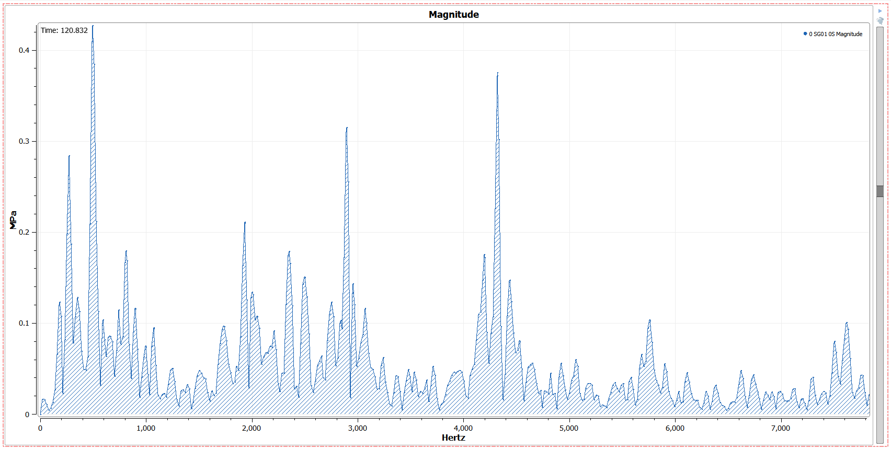

## Envelope Plots

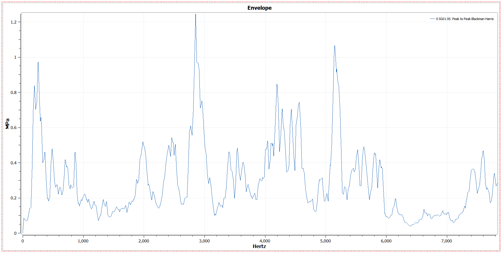

The **Envelope Plot** is an overall spectral plot. View by magnitude or power density in the settings menu.

## Mag+Env Plots

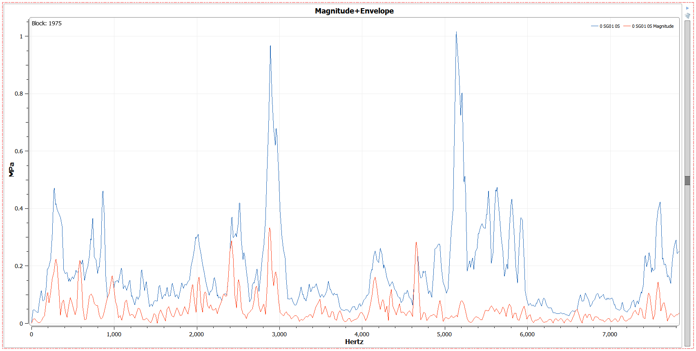

**Magnitude+Envelope Plots** are a combination of a magnitude and envelope plot in the same plot space. As the magnitude plot plays, the envelope trace is drawn to indicate the maximum points up to where the plot has been played. Playing through all plots will give the overall envelope (regular envelope plot) for the signal.

Mag+Env plots can be played in the following ways:

- - **Play Through Blocks**: 1. - **This will play the plot through one block or second at a time and loop at the end.**: 1. Play speed can be changed from 25% to 1000% speed
- - **Drag the slider bar**: 1. This will allow for specific combing through the file.
- - **Use the arrow keys**: 1. After the slider bar has been clicked on, the keyboard arrow keys can be used to tab through blocks or seconds 1 at a time
- - **Select a block number directly**: 1. The top left of the plot shows the block number for the current data displayed. To change this to a specific block number, double click on the number and type in the desired value. Typing a value is not available for time values.

Mag+Env Plots can be viewed by magnitude or power density in the spectral settings tab of the plot options. In addition, traces can be edited independently for greater clarity and customizability.

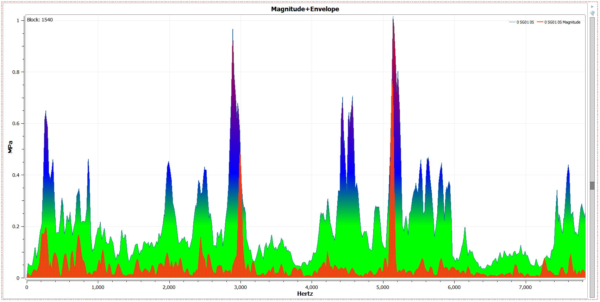

## Tracking Plots

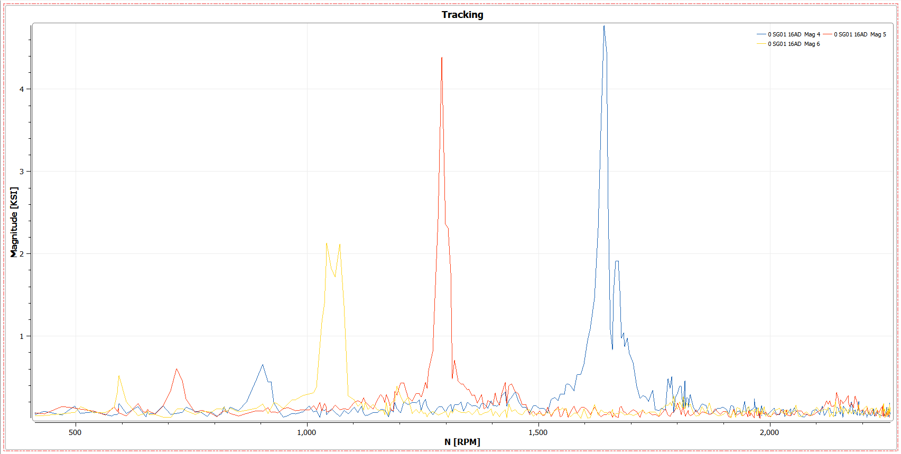

**Tracking Plots** show a track from specified IEOs. Multiple IEO traces can be placed on the same plot.

Tracking options can be changed in the following ways (plot options --> Tracking):

- - **Top Traces Selector**: 1. Select trace or traces to edit here
- - **Tracking Options**: 1. Tracking Type: select either Magnitude or Phase
  2. Engine Order: select IEO that the selected trace displays
  3. EO Tolerance: Tolerance for how close to the IEO the points collected need to be in order to be traced.
  4. Mag Threshold: Exclude points below a certain magnitude threshold on the plot
  5. Sort Points: If speed signal is jittery, the tracking plot will plot points back and forth. Checking this option make points them monotonically increase.  This will smooth out the trace, but points are no longer arranged by time.

Tracking plots are especially useful with order domain processing, which allows for lower RPM EOs to be more accurately and clearly plotted.

## Campbell Plots

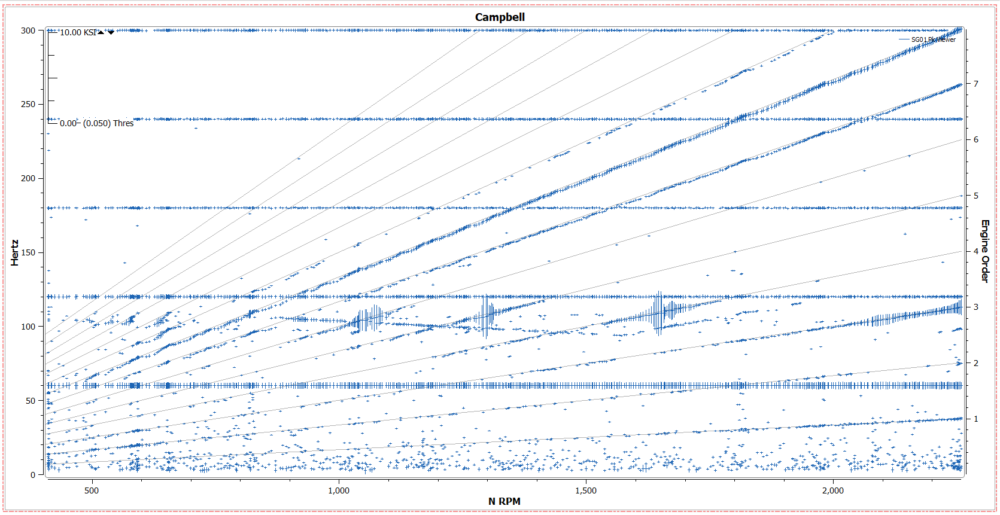

**Campbell Plots** are one of APEX DX's primary analysis features and provide a large amount of plot flexibility and options to ensure clear and accurate data is displayed. Two different types of Campbell plots area available:

- - **Time Campbell**: 1. Created by dragging a signal to a plot.
  2. Displays Y axis signal units (ie. Hertz) versus an X axis time value (ie. seconds)
- - **Speed Campbell**: 1. Created by dragging a signal and a speed parameter onto a plot simultaneously
  2. Displays Y axis signal units (ie. Hertz) versus an X axis speed value (ie. RPM) versus a Y1 Axis engine order track.

Multiple signals may be overlaid on both Campbell plot types.

### Options - Campbell Display Options

A Campbell plot can be customized in the following ways (Plot Options --> Campbell):

#### Display Modes

- Standard - Show points as uniform color (unless limits settings dictate otherwise)

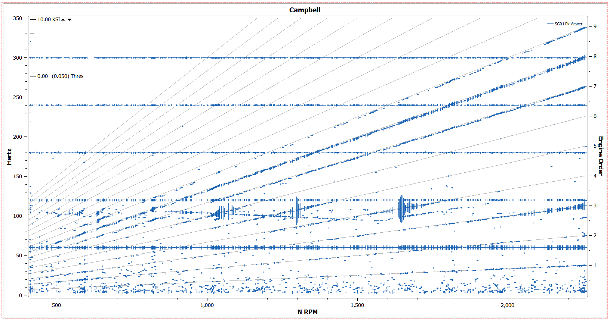

- Color Contour - Color points by magnitude.

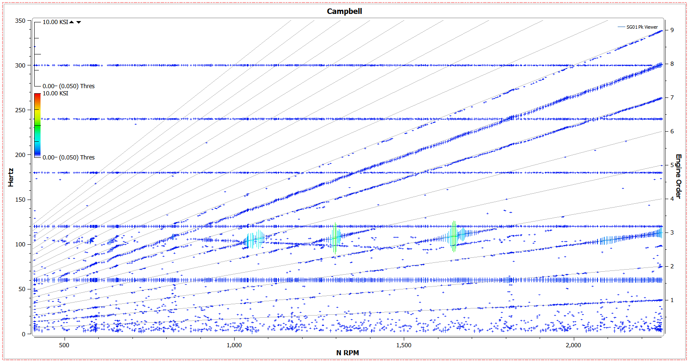

- Phase - Draw points by directional phase. Ticks point in the direction of the phase value and length denotes magnitude.

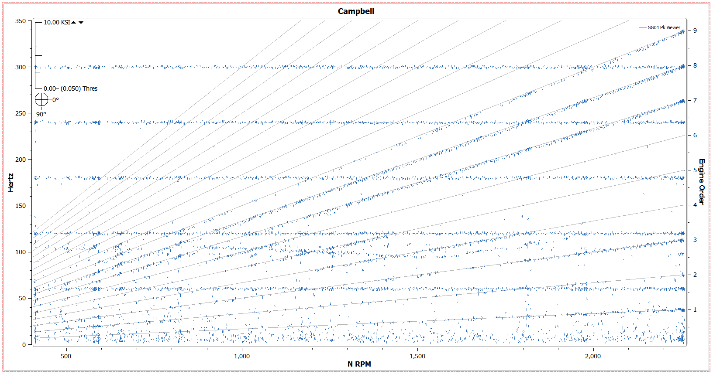

- Color Phase - Color points by directional phase.

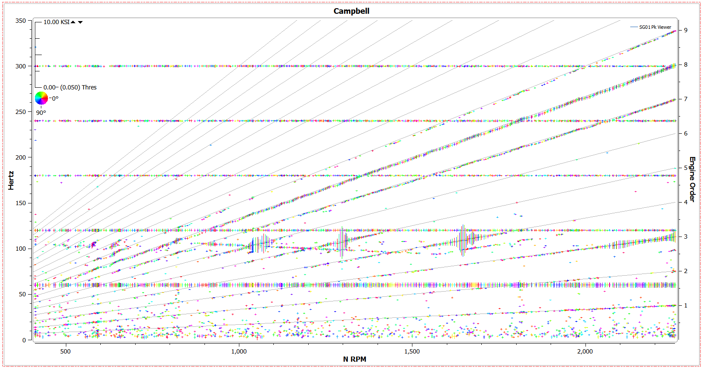

- Limits - Color points by % limits

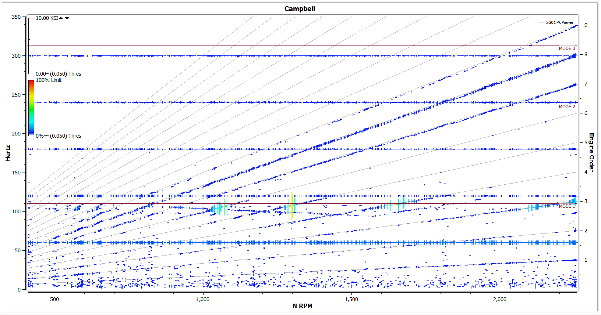

#### Other Settings

- - **Z Axis Range**: 1. Set the Z axis range sensitivity. Changing this value will grow or shrink the size of the points and the scale on the top left of the plot.
  2. The arrows next to the value on the top left of the plot will also change the Z axis range
- - **Z Axis Threshold**: 1. Prohibit points from being drawn below a certain magnitude
  2. The threshold range can also be changed by clicking and dragging the slider on the top left side of the canvas

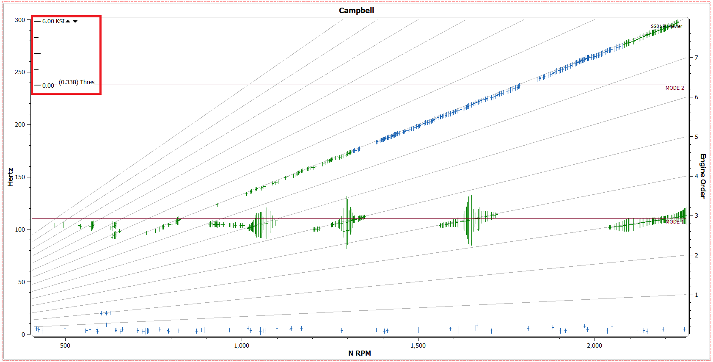

- - **EO Line Display (only available for Speed Campbells)**: 1. Display all EO lines, a custom user specified number of lines, or none
- - **Contour Scaling (only available for Color Contour display mode)**: 1. Change contour scaling for the color contour display mode from linear to log.

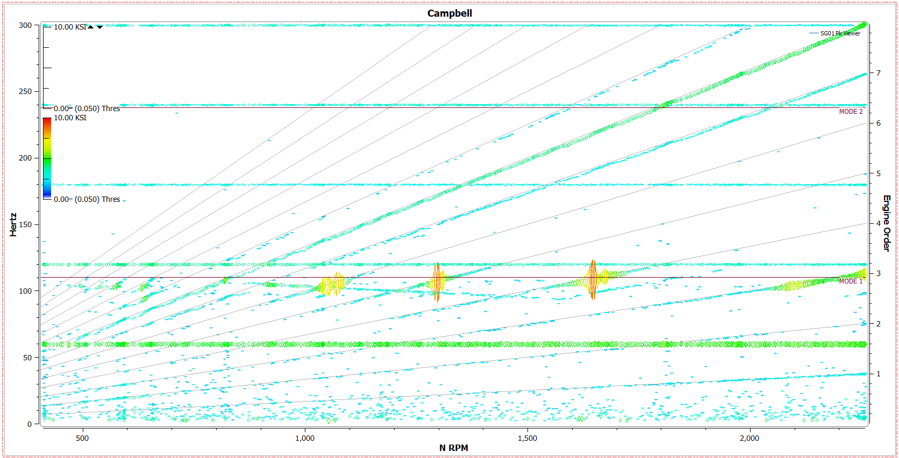

- - **Draw (only available for speed Campbells)**: 1. Draw All points, Integral Points, Non-Integral Points, or no points on a given plot.
- - **Symbol**: 1. Change the plot point symbols to Double Tick, Single Tick, Circle, Square Diamond, Upwards Triangle or Downwards Triangle.

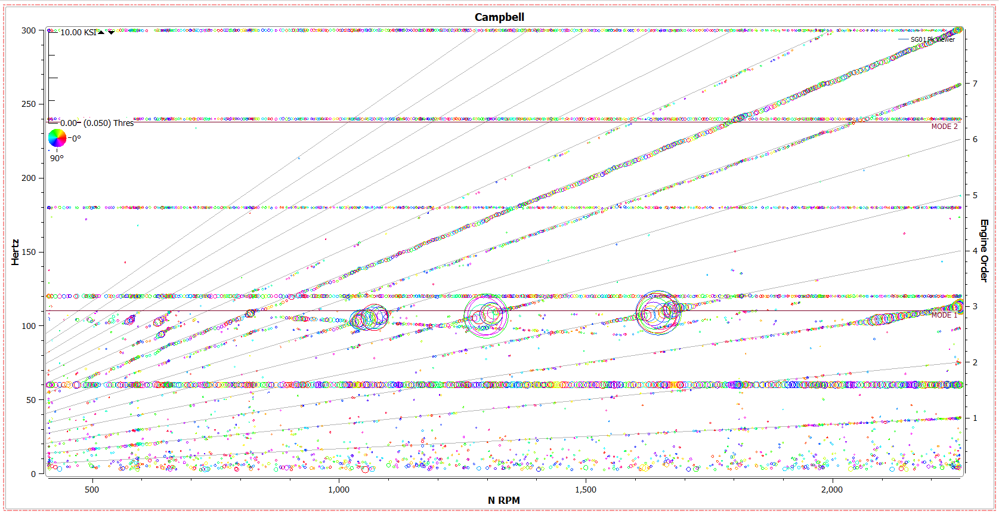

- - **Draw Noise**: 1. When a noise filter is applied, DX will remove it from a plot by default. Checking this option will show the noisy points in the color assigned.

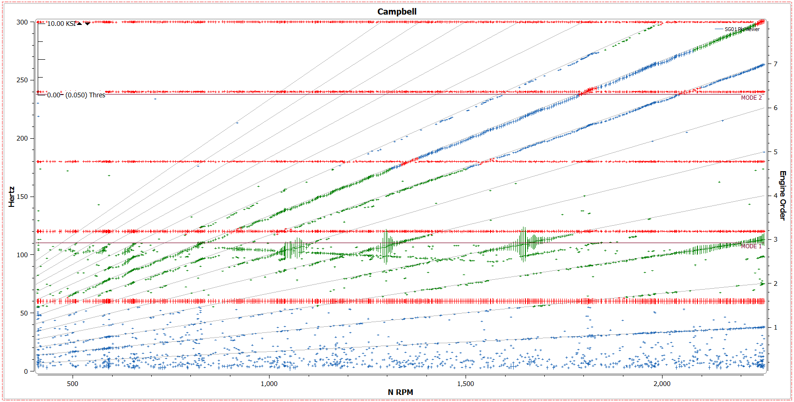

### Options - Limits/Modes Tab

Limits/Modes settings are only available if Limits have been assigned to the file in the designer.

- - **Alt Modes**: 1. Enabling this setting will highlight mode ranges in alternating colors
- - **Mode colors**: 1. "Selected:" - color that is used to highlight a mode range when the mode is selected on the plot
  2. "Alt:" - color that is used for the alternating mode range color. The color that the mode will alternate with is the plot's trace color.
- - **Info Format**: 1. Show % value for frequency, ratio, or limits per mode line.
  2. To show each, type [%freq], [%ratio], and/or [%limit]
  3. Text strings may also be entered here

### Options - Markers Tab

Selecting statistics in this tab will show more information about a selected point. Example:

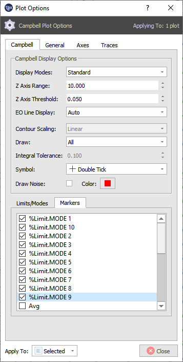

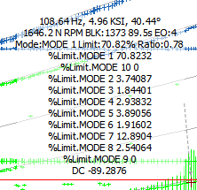

## Response Tables

**Response Tables** use information based on spectrum data and the half power filters to indicate important responses for a given signal. Parameters displayed in the table include Frequency, Magnitude, Parameter and Noise. Points that have been collected that are marked as noise will be flagged in read and read as "True" in the "Noise" column.

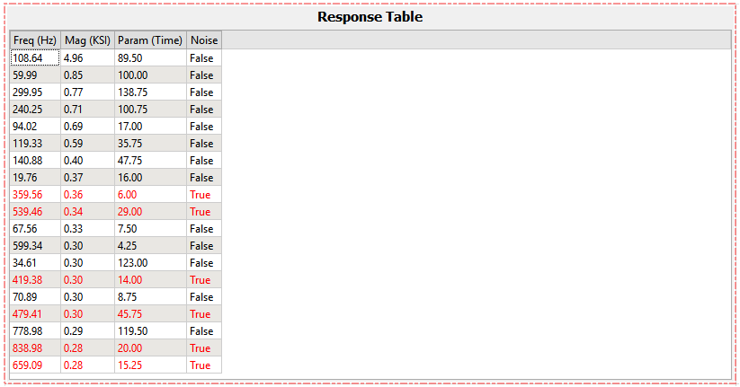

Response tables can be [linked](#link-tool) to other plots and will update when the plot is zoomed or panned.

## Z-mod Plots

Similarly to Campbell plots, **Z-mod Plots** can be either plotted as a signal alone, or as a "speed" Z-mod with speed parameter. Z-mod plots are heatmap plots that display spectrum magnitudes by color. Larger responses appear more red, while smaller responses appear blue. Because of this, the APEX Advanced Digital Signal Processor is especially useful because by extracting and interpolating only peaks from the FFT data, it allows the plot to be cleared of spectral lines. Below is an example of this using the same signal and data from a signal chain that outputs only the FFT data, and another chain that has been processed with the Adv. DSP Element.

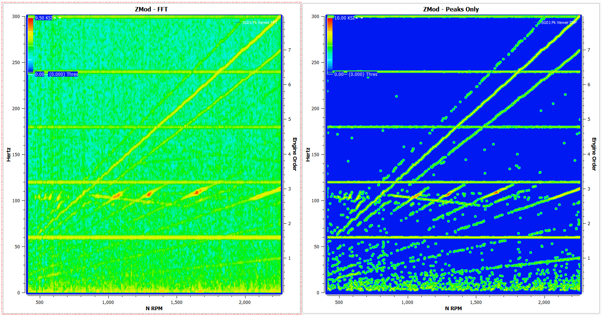

### Options - Z-mod Display Options

- - **Z Axis Range**: 1. Set the Z axis range sensitivity. Changing this value will alter the colors on the plot. Larger numbers set the range to cooler colors.
- - **Z Axis Threshold**: 1. Prohibit points from being drawn below a certain magnitude
- - **Contour Scaling**: 1. Change contour scaling for the color contour display mode from linear to log
- - **Draw (only available for speed Z-mods)**: 1. Draw All points, Integral Points, Non-Integral Points, or no points on a given plot
  2. Integral Tolerance - Set the nearness to the selected value for integral or non-integral points to be drawn

## Order Z-mod

An **Order Z-mod** works the same as a regular Z-mod plot, but frequency is replaced by order. While Order Z-Mods can be created with any signal versus a speed parameter, they are the clearest when processed with the RM COT element.

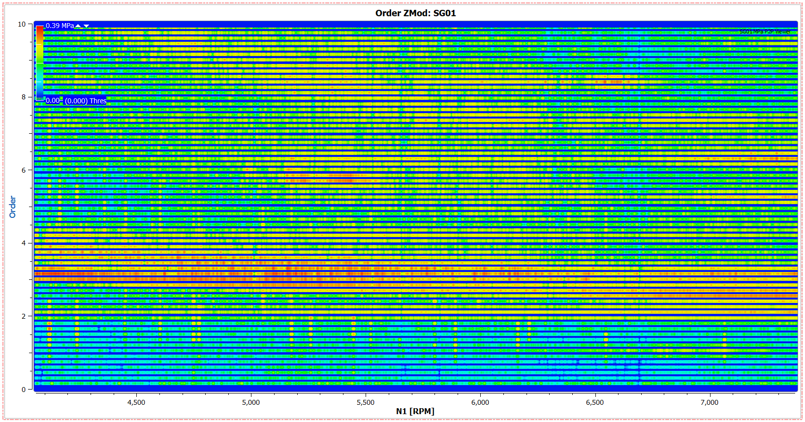

### Options - Order Z-mod Display Options

- - **Z Axis Range**: 1. Set the Z axis range sensitivity. Changing this value will alter the colors on the plot. Larger numbers set the range to cooler colors.
- - **Z Axis Threshold**: 1. Prohibit points from being drawn below a certain magnitude
- - **Contour Scaling**: 1. Change contour scaling for the color contour display mode from linear to log
- - **Draw (only available for speed Z-mods)**: 1. Draw All points, Integral Points, Non-Integral Points, or no points on a given plot
  2. Integral Tolerance - Set the nearness to the selected value for integral or non-integral points to be drawn

## Automatic Response Detection

If a design has been processed with one or more [Automatic Response Detection Elements,](#ard-design) the elements will appear in the viewer tree under the viewer section to which the elements are connected. These elements can be used in a variety of ways in the viewer.

> [!NOTE]
> How each Automatic Response Detection Element is setup is detailed in the "Designer" section of this help documentation. Refer to [that section](#ard-design) to learn how and what peaks are selected by the element.

### Tables

All points collected by the Automatic Response Detection elements can be listed with all important information by simply dragging the element from the viewer tree directly onto a blank space on the viewer canvas. This table can then be edited and exported in a variety of ways.

In the above image, all peaks collected by the Automatic Response Detection Element are displayed in the table. Results can be easily narrowed down by using the search bar along the top of the table. For instance, if the information for only one signal is needed, simply type the name of that signal into the bar. Multiple criteria can be entered into the box by selecting the green "+" button next to the search bar.

If the text in the search bar has been changed, the blue "refresh" button will refresh the table with the updated results. Alternatively, the return key may be pressed to update results. If multiple search criteria have been entered into the able, they can be removed by the red "-" button.

Table categories can also be narrowed down by right-clicking the categories on the top of the table and selecting / deselecting a given parameter. Selecting "Save State" will allow the current table state to be returned to after edits have been made to an existing table, or new tables have been made by selecting "Restore State". "Show All" and "Hide All" Show all categories or hide all categories on the table respectively.

> [!NOTE]
> If "Hide All" is selected, in order to select more categories, right click must be selected right along the top line of the table.

Any column can be moved right or left within the table by clicking and dragging it from the top. "Freeze Column" will disallow this function for the selected column(s).

Clicking on the top of a column will order all other rows according the selected column. Clicking a column more than once will toggle through ascending, descending, and default, which returns the row order to the last arrangement.

The current state of the response table can be exported as a .csv or .bcx (binary file) in the right click menu --> Export Auto Response Detection.

### Plotting

Once a plot has been created in the viewer, an Automatic Response Detection can be dragged and dropped on top of it to view all the collected peaks directly on the plot.

Points can be selected or edited in the Plot Options --> Traces --> Overlays section of all plot options tabs that support Response Detection overlays. If multiple response detections are included in the designer, they can be added or taken away in this section of the plot options menu. To change the color of an Auto Response Detection marker, double click the detection in the dialogue and choose the color from the selector.

## Bode

A **Bode Plot** is a dual plot that includes two tracking plots, one with Magnitude versus speed, and the other with Phase versus speed. Bode plots are automatically linked together on the X axis, so interrogating them with the zoom or pan tools will move them together.

Similarly to the Tracking plot, a dialogue will appear when creating a bode plot where a reference parameter, reference speed, engine order(s), EO Tolerance, Magnitude Threshold and sort points can be specified.

## Waterfall

**Waterfall Plots** are 3D spectrum plots that can be created versus time or a speed parameter. When created versus time (just a signal), the waterfall plot is a playable plot that shows magnitude units (like KSI) versus frequency units (Hertz) versus time delay. Playing the plot will move the traces forwards by time.

Waterfall plots can be played in the following ways:

- - **Play Through Blocks**: 1. - **This will play the plot through one block or second at a time and loop at the end.**: 1. Play speed can be changed from 25% to 1000% speed
  2. Waterfall plot displays time range specified by plot options
- - **Drag the slider bar**: 1. This will allow for specific combing through the file.
- - **Use the arrow keys**: 1. After the slider bar has been clicked on, the keyboard arrow keys can be used to tab through blocks or seconds 1 at a time
- - **Select a block number directly**: 1. The top left of the plot shows the block number for the current data displayed. To change this to a specific block number, double click on the number and type in the desired value. Typing a value is not available for time values.

### Time Waterfall Settings

- - **View**: 1. Waterfall plots can be viewed by either magnitude or power density
- - **Waterfall**: 1. X Offset: arranges the plot to the left or right. 0 offset views the plot directly on.
  2. Y Offset: tilts the vertical axis for the plot. 0 offset makes a flat plot.
  3. Step: sets the amount of distance in seconds between each trace. Higher time values mean less traces on the plot, and more space between each trace. Minimum 0.25.
  4. Range: sets the time range of the Y2 axis. Higher numbers display more data.
  5. Min / Max Hz: set the Hertz range for the waterfall plot
  6. Trace Gradient: Colormaps waterfall plot based on magnitude. Green for lower magnitude, blue for higher frequency.

### Speed Waterfall Settings

- - **View**: 1. Waterfall plots can be viewed by either magnitude or power density
- - **Waterfall**: 1. X Offset: arranges the plot to the left or right. 0 offset views the plot directly on.
  2. Y Offset: tilts the vertical axis for the plot. 0 offset makes a flat plot.
  3. Bins: Increase or decrease the resolution of the Y2 axis by drawing more or less bins
  4. Min / Max Hz: set the Hertz range for the waterfall plot
  5. Trace Gradient: Colormaps waterfall plot based on magnitude. Green for lower magnitude, blue for higher frequency.

## Strip Charts

A **Strip Chart** is an overview plot that contains all time data for a given signal. Because every data point is drawn on a Strip chart, compression will occur. To view exact points, zoom in on the plot.

## Orbit Plots

**Orbit Plots** display the phase between two signals. To create an orbit plot, drag two signals onto the canvas and select the "orbit" plot. They can be played in the following ways:

- - **Play Through Blocks**: 1. - **This will play the plot through one block or second at a time and loop at the end.**: 1. Play speed can be changed from 25% to 1000% speed
- - **Drag the slider bar**: 1. This will allow for specific combing through the file.
- - **Use the arrow keys**: 1. After the slider bar has been clicked on, the keyboard arrow keys can be used to tab through blocks or seconds 1 at a time
- - **Select a block number directly**: 1. The top left of the plot shows the block number for the current data displayed. To change this to a specific block number, double click on the number and type in the desired value. Typing a value is not available for time values.

## Manual Noise Editing

**Manual Noise** can be drawn directly onto a Campbell plot to be saved and used in conjunction with the [Peak Filter Element.](design.md#filter_peak-peak-filter)

> [!NOTE]
> Although manual noise is file specific and drawn on a specific Campbell plot, it can be loaded in any design with any file using the "Noise Definition Files" section of a peak filter. It is recommended that manual noise files are created for each specific file to avoid inaccurate flagging on different files.

To create manual noise, right click on a Campbell or Speed Campbell plot and select "Manual Noise."

This will turn on manual noise drawing and expand the right click menu to include options for manual noise:

- - **Manual Noise Options:**: 1. Open Definition - This will open a currently existing noise definition file for Editing
  2. Bad - All selections will be marked as noise
  3. Good - All selections will be marked as "good." this is useful if an automatic noise filter is marking data as noise that needs to be still included in processing. "Good" markings take precedence over "bad" markings.
  4. Flag All as Noise -  marks entire Campbell plot as noise.
  5. Plot Tool - use selector tool while remaining in the noise editor
  6. Rectangle Select - make rectangular selections on the Campbell plot
  7. Lasso Select - make free-form selections on the Campbell plot
  8. Remove Selection - Clicking within a selected noise area will remove noise marking
  9. Clear Noise - Remove all noise from selected Campbell plot

Once manual noise has been drawn onto the plot (or plots) - it can be saved as a Noise Definition file under the "Noise Editing" section of the viewer ribbon.

Once a noise definition file has been saved, it can then be added to any design using a peak noise filter and selecting  the "Noise Definition File" setting.

Once in the peak noise element, the marked sections will appear as noise throughout the viewer and will behave the same way as the rest of the DX noise filters.

## Plot Style

Next to the "Viewer" tab in the ribbon, the **"Plot Style"** tab is available, here a number of different plot themes can be chosen so plots may be colored and customized. Available plot styles include, White (default), Midnight, Blue, Engineer, and Gray. Note that Changing plot styles will change some axis label text colors, but not trace or unit text colors.

*Midnight Style*

## Saving / Loading Plot Setups

Once a plot page or pages have been created in the viewer, they can be saved for future use using **Plot Setups.** Plot setups save plots as they are in the viewer with full settings and layouts and can be used with the same data files OR different data files that use the same signal names, parameter names, and viewer element names. Plot setups are also used in conjunction with batch exporting in the designer. See the section on batch exporting [here](./report.md) for more information.

### Saving

To save a plot setup, first create a plot page or pages in the viewer. In this example, we have 2 plot pages. One overview plot page with a number of plot types, and a plot page with a Campbell and axis-swapped Envelope linked together. Once plots have been created, click the "Save" icon near the top left of the ribbon, next to the page creation / deletion buttons. Alternatively, plot setups can be saved with "Ctrl + S". We will save our plot setup as "PlotSetupOverview.dxs"

### Loading

After a plot setup has been saved it can be loaded again at any time. Select the "Load" icon (next to the "Save" icon) to load a plot setup. Alternatively, plot setups can be loaded with "Ctrl + L". In the below example, we have deleted all of the plots from the viewer and loaded the plot setup file saved above.

### Reprocessed Setups

DX uses the same process for plot setups that it uses to keep plots consistent in the viewer between reprocesses. This means that if a plot is created in the viewer, it will stay in the viewer even if the file or design is changed. For example, using the plot setup in the above example, we return to the designer and add a number of noise filters to flag the 60 cycle hum in the data. Once we have created those filters, we reprocess the file and return to the viewer.

### Plot Setups with different files

One of the most powerful features of plot setups is its ability to be used with varied files. Once a plot setup has been created, it can then be loaded using a different file than it was created with.

- **When loading with different files ensure that:**: 1. The viewer element name matches the viewer element name that the plot setup was created with. If a plot setup is saved with a viewer element named "viewer_filter," the plot setup must be loaded with a viewer element named "viewer_filter" in the design. Unknown results may occur if viewer name does not match.
2. Consistent signal and parameter names. If a different file is loaded, it must have the same signal and parameter names as is in the plot setup or it will not load the plots.
3. Plot ranges are saved in plot setups, so if a file is loaded with a different range, the plots will need to be rescaled unless they are set to Half or Fully Automatic scaling.

In the below example, a similar file is loaded that meets the above criteria using the design and plot setup we created in the last subsections.

## Quick Pages

On the far right side of the viewer toolbar is the Quick Page section. This section allows the user to quickly create duplicate pages for all or a subsection of signals in the tree, create APEX Preset pages (Campbell Triple), and [Save and Load Plot Setups.](#saving-loading-plot-setups)

### Duplicating Pages

The duplicate pages button allows the user to copy the current page setup and apply it to any number of signals selected in the viewer. When creating a page setup to duplicate, ensure that only one signal is present on the page. Once a page has been setup, click the "Duplicate Page Button." This will open a dialogue where signals can be selected to apply to the current page.

All plots, parameters, statistics, links, axis ranges and plot settings will be copied onto new pages. If a signal name is found in the page title, it will be concatenated to match the new signal on the page. If no signal name is in the page name, the signal name will be added to the page name. All new pages are inserted after the duplicated page.

The duplicate function can be used in conjunction with the [plot setup](#plot-setup) features to save and load page setups for use on other files, tests, and projects. If a single page is saved, it can be easily loaded with another file and duplicated from there.

### Campbell Triple Button

The Campbell Triple plot is a comon plot layout for aeromechanical analysis that includes a speed Campbell plot linked to a tracking plot, and envelope plot and a response table. To automatically generate a Campbell Triple plot, select a signal and ctrl+select a speed parameter from the viewer tree and click the Campbell Triple button. This will spawn a Tracking plot option box, change the parameters as needed and click "okay" or click "cancel" to create let DX choose what orders the tracking plot contains.

## Limits

If limits have been assigned to a file, they will appear on the following plots if limits information is available for them:

1. - **[Time Plots](#time-plots)**: Limits show as horizontal lines marking the upper and lower limits on time plots if min/max limits have been assigned to the file.

..image:: sam2/viewer_timelimits.png

1. - **[Envelope plots](issues.md#envelope-plots)**: Limits appear as horizontal red or yellow lines on envelope plots indicating the magnitude limits of certain frequencies in the file.

1. - **[Campbell Plots](#campbell-plots)**: Limits will appear along mode lines on Campbell plots. These mode lines can be moved up or down according to the instructions [below.](#editing-and-saving-scope-limits) By default, points on a Campbell plot will alternate in colors according to their mode assignment. Campbell plots can also be colored by % limits.

Limits files can be created with the APEX [limits utility](limits.md) that can be downloaded for free through the [APEX User Site.](https://www.apexturbine.com/users)

## Editing and Saving Scope Limits

When a limits file is loaded, mode lines will appear on Campbell plots. These modes can be moved and editing using the "Edit Modes" option in the right-click menu. This will enable "Edit Limits" Mode.

When the Edit Limits mode is turned on, mode lines can be clicked and dragged using the cursor tool on a Campbell plot.

Once modes have been moved, they can be saved in the "Scope Limits" tab. Once a scope limit file has been edited and saved, the data file will need to be reprocessed with the new scope limits so they can take effect on the Campbell plot. Save options include "Save" which will overwrite the current scope limits file, and "Save As" which will save a new scope limits file. When modes have been edited and scope limits can be saved, an asterisk (*) will appear next to the Scope Limits tab indicating that changes have been made.

The "Open" button will open the limits .csv file that can be edited and saved. Making changes to the scope limits file will require the design to reprocess with the edited limits. "View" will open a text version of the scope limits file within DX for quick viewing. "Scope Limit Info" indicates the file name and directory location of the limits file.
