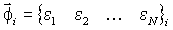
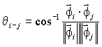
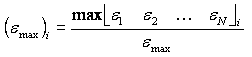
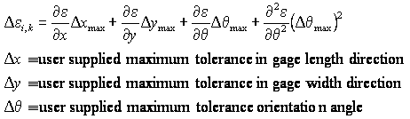
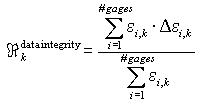
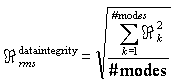

# Pre-Test Optimization

## Overview

During vibration testing, responses of the structure to various boundary conditions are measured. Knowledge of the amplitudes of these response vibrations allows dynamic stress to be determined and assessed. Then some criteria can be applied to assess the susceptibility of the component or structure to fatigue failure. Assessment of the structural fidelity of the structure depends on accurate knowledge of the stress at all possible critical locations on the structure. However, the amount of instrumentation that can be placed on the structure is limited due to data acquisition system limitations, instrumentation accessibility and/or durability, quantifying the effect of the instrumentation on the measured response, and possibly many other factors. Therefore, it is important to relate the stress at sensor locations to the stress at all possible critical locations within the structure. The need exists for assessment and collection of high quality response data.

The quality of the response data if highly dependent on the instrumentation design. Sensor locations must be chosen such that the measured response values are as close as possible to the critical values. However, these locations are often in regions of high response gradients, which increases the sensitivity of the measurements to small inaccuracies of sensor placement and orientation. Additionally, the sensors must be placed in such a manner that the vibratory modes can be effectively determined. Mode superposition and transposition can lead to incorrect modal identification unless the sensors are located so as to discriminate between the responses.

Typical objectives of vibration testing are:

- To obtain response measurements for all vibratory events that occur within the expected service range of operation.
- To correctly identify which natural mode(s) of vibration are excited.
- To use the measurements at the sensor locations to determine the maximum response at the peak location on a component.
- To obtain high quality sensor data with a minimum of experimental error and uncertainty.

GageMap contains several metrics to design optimum sensor locations. The user has the option to weight each metric individually depending upon the relative importance of that metric. The metrics incorporated into GageMap II are:

- Mode identification
- Mode Visibility
- Data integrity
- Geometry

A brief description of each one of these metrics and the measures used to quantify them are presented.

## Mode Identification

This criterion is based on the need to correctly identify the mode(s) of vibration that are excited at any point in time for the structure of interest. Ordinarily, this is accomplished by comparing the predicted natural frequencies to the frequency for the experimental response and selecting the closest match. However, for many structures of interest, the mode density (# of modes/kHz) can be quite high. Often, the frequency associated with a particular mode can change (mode swapping) due to factors such as stress stiffening, temperature, or unanticipated constraints. Frequency as the sole discriminator would be inadequate under these conditions. Therefore, the need exists to consider other information, such as mode shape, in addition to the frequency for positive mode identification.

It is a well known fact that vibration mode shapes form a mutually orthogonal basis for the structure. This implies that if the full (every point in the continuum) mode shape were known it would be a simple matter to determine responding modes. However, in practical structural applications, response data is only available at the sensor locations. The collection of sensor readings for a given response constitutes a "reduced mode shape" for the structure. For example, if strain is measured at N locations on a structure, the reduced mode shape for mode i can be expressed as

> 

Since the number of sensor locations, N, is not infinite, these reduced mode shape vectors do not retain their orthogonality. The reduced mode shape vectors can be considered as vectors in N dimensional space from which the angle between any two reduced mode shapes can be expressed as

> 

A successful instrumentation map will exist when the angle between all modes (or a subset of modes which may be difficult to identify with frequency alone) is as close as possible to orthogonal (90°). GageMap II allows the user to identify modes to maximize identification relative to other modes and impose a penalty as the angle deviates from orthogonal. Only modes with closely spaced frequencies need to be considered, excessive application of this criteria may result in no optimum solution. Two methods are available to assess the instrumentation design for mode identification:

- Define the smallest acceptable angle between any mode pairs for consideration. This will result in an instrumentation design that meets a minimum standard.
- Root-sum of the sum of the squares of angles for all selected mode pairs. Applies the standard in an overall sense, however, the possibility exists that one or more mode pairs may violate the criteria.

## Mode Visibility

Once the correct mode has been identified, the next objective is to determine the amplitude of the response. Knowledge of the vibratory amplitude is necessary in order to apply some criteria and assess the structural integrity of the instrumented component. Optimally, it would be advantageous to place a sensor at the critical location for each mode. Practically, this is not possible; therefore extrapolations to the critical locations must be performed.

The theoretical maximum amplitude ratio for a given mode is from the highest responding sensor for that mode for which the divisor for the ratio is the maximum possible sensor response on the structure for a given mode. GageMap calculates the maximum theoretical response ratio (MRR) for N sensors and a given response mode, i.

MRR is defined as

> 

The objective would be to maximize MRR for all modes of interest. Two methods are available to evaluate the MRR:

- Smallest value of MRR for any mode. Ensures MRR meets a minimum standard.
- Root-mean-square measure. Assures the minimum criterion is met in an average sense, however, the possibility exists that one or more modes may require extrapolation beyond the user-defined limit.

## Data Integrity

Mode identification and mode visibility provide adequate information to identify the correct mode and reduce the level of extrapolation under precise instrument placement. However, precise instrument placement is rarely achieved under complex geometries. GageMap implements a process to minimize the errors introduced under small variations in sensor placement by calculating the response to small misplacements and misorientations. The user defines the maximum expected tolerance for the strain gage application and a maximum possible error is computed for each sensor location using the following formula for the ith gage, kth mode

> 

For each mode a composite gradient value is computed using a weighted average according to the formula

> 

Two methods are available for computing the maximum gradient measure:

- The largest value of gradient for any selected mode. This ensures that the worst mode meets at least a basic standard.
- Root-mean-square measure for all modes selected to satisfy the requirement in an average sense.

  > 

## Geometry

This metric is implemented to specify the minimum distance between any two sensors on the component of interest. Implementing this metric will prevent the optimization algorithm from identifying sensor locations in close proximity to each other. This criteria is implemented as a constraint, therefore, no design that violates the minimum standard is allowed to exist.
