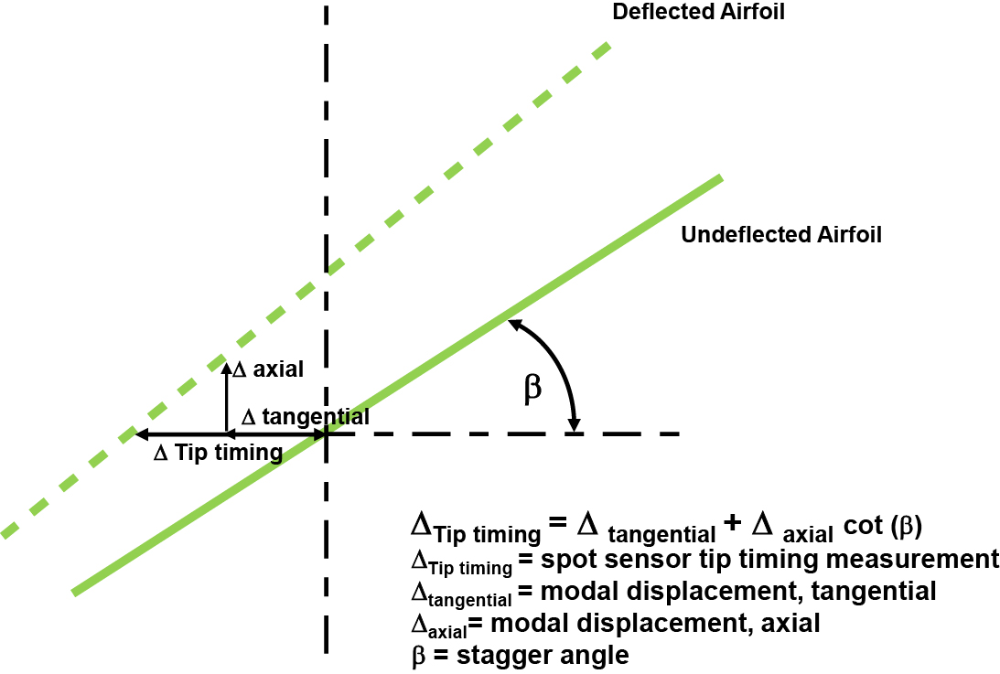
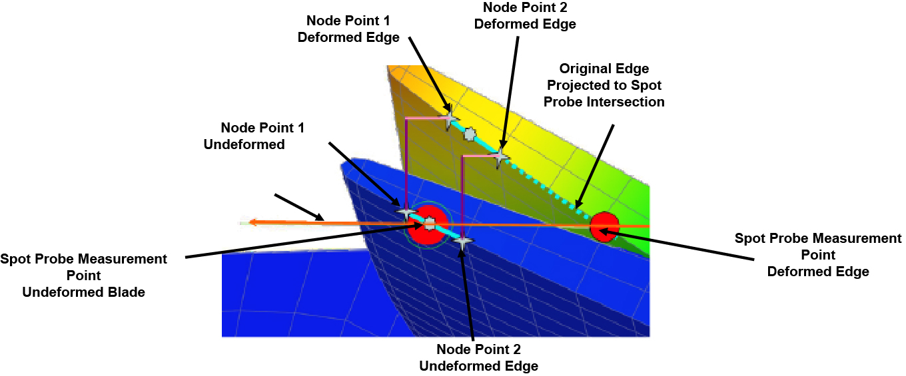

# Tip Timing Sensor Modeling

This section pertains to modeling of spot sensors only.

  

Unlike strain gages, tip timing sensors are fixed in space and do not move with the vibration of the part. They are typically case mounted and pointed radially inward. While a tip timing sensors natural measurement is time, a virtual tip timing sensor in GageMap measures deflection. Three deflection measurements are computed:  tangential, axial and actual. The tangential and axial measurements are straight-forward and simply results in the components of transforming the displacement vector into the cyclic coordinate system as defined by the user during the “blade tip” definition process. The “actual” deflection is determined by establishing a local coordinate system normal to the chord (or stagger) angle in the vicinity of the sensor location. This chord line is then projected into the plane of rotation. The displacements in the tip timing coordinate system can then be computed. The global deflection values are interpolated based on the nodes connecting the edge on which the sensor is placed.

  

The following figure illustrates the trigonometry required to compute actual deflections assuming an airfoil with a constant chord angle.

  

  

For actual airfoils the chord angle is not typically constant so it must be computed in a local sense. The local chord angle (actually a line representing the local chord angle) is computed based on the two nodes connecting the edge upon which the sensor is mapped. This line is then projected towards the tangential plane of the sensor. The intersection of this line with the tangential sensor plane relative represents the actual deflection.

  

