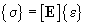
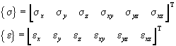
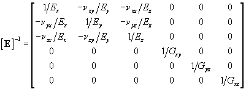
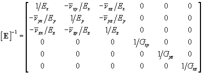
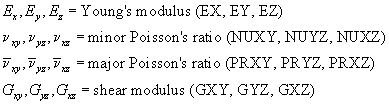
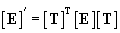
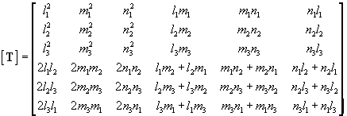

# Anisotropic Materials

If material properties are found in the database file they will be read and applied to the appropriate element type for computation of face and gage stresses. The 6x6 material stiffness matrix is formed according to the relation:

> 

where,

> 

and

> 

or

> 

with

> 

Either major, minor or both Poisson ratios may be defined. GageMap will form and report the material stiffness matrix by selecting Options > Model Info. Once the material stiffness matrix is formed, GageMap will transform the matrix such that it is parallel with either the face or strain gage coordinate system according to the relation:

> 

where

> 

and l1, l2, l3, m1, m2, m3, n1, n2, n3 form the elements of the direction cosine matrix relating the face or strain gage coordinate.
