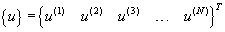
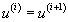
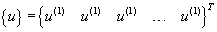
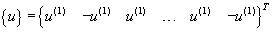
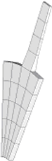
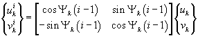
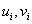
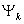
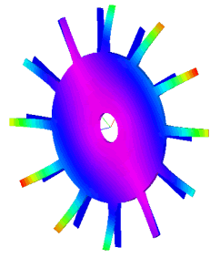
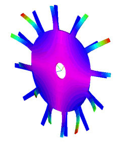

# Cyclic Symmetry

This chapter will explain the theory implemented in GageMap for modal cyclic symmetry. GageMap supports modal cyclic symmetry output from the ANSYS and ABAQUS finite element programs. Displacements, strains, and stresses from modal cyclic symmetry analyses are supported. Support for NASTRAN will be supported in a future release.

A rotationally periodic structure consists of N identical substructures with J degrees-of-freedom in each substructure. The total number of degrees-of-freedom in the structure is NJ. The degrees-of-freedom are ordered so that the J degrees-of-freedom of the first substructure are followed by J degrees-of-freedom on the second substructure and so on. An eigenvector of the whole structure, {u}, can be written:

> 

Typical modal analysis of cyclic symmetric structures is performed on a single sector with cyclic symmetric boundary conditions applied to the cyclic boundaries of the model. Three classification of mode shapes are possible:

1. Each substructure has the same mode shape as its neighbors, i.e.

  > 
2. Each substructure has the same mode shape as its neighbors, but is vibrating in anti-phase with them, i.e.
3. All other possible mode shapes

Modes of class (a) or (b) do not exhibit degeneracy (except for accidental degeneracy which may occur if an unrelated mode shape is associated with the same natural frequency).

For class (a) modes, the eigenvector {u} can be written

> 

and it is obvious that rotating the mode shape through any integral number of substructures leaves it unchanged, so that no other mode shape is needed to describe the motion. These mode shapes are typically associated with the term "nodal circles", however this term neglects mode shapes with torsion about the axis of rotation.

Class (b) modes can exist only if N is even, {u} has the form:

> 

Clearly rotation of the mode shape through an even number of substructures leaves it unchanged. When it is rotated through an odd number of substructures, the mode shape for the basic sector is multiplied by (-1). All other mode shapes fall into class (c), and exhibit two-fold degeneracy.

Finite element output consists of single and paired eigenmodes for the basic sector. The basic sector is a finite element model of 1/N th of the entire structure:

> 

The eigenmodes for 0-fold cyclic symmetry are always single. For even N the eigenmodes for the N/2-fold cyclic symmetry are also single. The eigenmodes for the remaining N/2-1 (even N) or (N-1)/2 (odd N) cyclic symmetry modes are paired. The natural frequencies corresponding to the paired eigenmodes are equal and always appear together in the finite element output. The expansion of the eigenmodes with k-fold cyclic symmetry (k<N/2) to the sector i = 2,...,N can be performed using the following expression:>

> 

Here (u,v) and () are paired eigenmodes corresponding to double natural frequencies on the basic sector and on the ith sectors, respectively. u and v are sometimes referred to the cosine and sine modes, respectively; and  is the inter-blade phase angle for the k-fold cyclic symmetry mode,

To visualize cyclic symmetry mode shapes both the eigenvectors and finite element geometry must be expanded. Two examples of mode shapes that are expanded the full 360° are shown below.

>  1-Fold Mode Shape    2-Fold Mode Shape
