# Mean Stress Alignment

This chapter will explain the theory implemented in GageMap for mean stress alignment.

## Description

The following tasks are performed on a node-by-node basis for each vibratory mode within the SDR file. If multiple static load cases exist in the SDR file, static stress transformation will be performed for only the chosen static load case. Transformed static stress may also be scaled within the “Animate” and “Fatigue Assessment” tasks via a scale factor if the load case does not contain a rotational velocity or w2 if the load case does contain a rotational velocity.

Both cases below assume the following nodal quantities being available:
Mean stress/strain vectors:

> 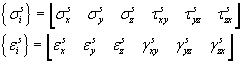 (equations 180.1 & 180.2)

Vibratory stress/strain vectors:

> 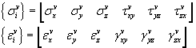 (equations 180.3 & 180.4)

Form the following mean/vibratory stress/strain tensors:

>  (equations 180.5 & 180.6)
>
> 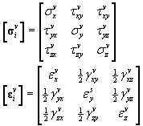 (equations 180.7 & 180.8)

## Case #1: Transformation of static stress into the maximum vibratory principal strain direction

Determine the principle strains and their directions from equation 180.8 above via an eigensolution technique. The eigenvalues of the strain tensor are the principle strains and the eigenvectors of the strain tensor are the corresponding direction vectors. Therefore we seek the solution to the following:

> 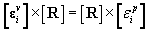 (equation 180.9)

Where,

> 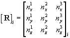
> 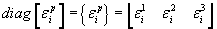

It is assumed that 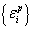 and the corresponding columns in 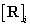 have been reordered such that 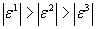.

Additionally if each column of   represents the direction vector normal to the maximum principal strain plane,   may be organized such that each row represents the corresponding direction vector by computing the transpose of .

Prior to transformation it should be verified that   is a proper directional cosine matrix. This is true if the following relation holds:

> 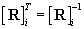 (equation 180.10)

If  is not a proper DCM then each column of the matrix should be normalized to a unit vector.

Transform the static stress tensor into the 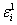 direction using one of the two formulas provided.

If each row of  represents a direction of principal strain then the following transformation applies:

> 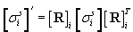 (equation 180.11)

If each column of  represents a direction of principal strain then the following transformation applies:

> 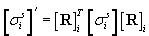 (equation 180.12)

Where,

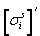 is the static stress tensor in the  direction.

## Case #2: Transformation of static stress into the maximum vibratory principal stress direction

Determine the principle strains and their directions from equation 180.7 above via an eigensolution technique. The eigenvalues of the stress tensor are the principle stresses and the eigenvectors of the stress tensor are the corresponding direction vectors. Therefore we seek the solution to the following:

> 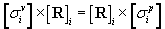 (equation 180.9)

Where,

> 
> 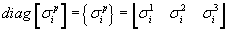

It is assumed that 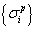 and the corresponding columns in  have been reordered such that 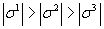 .

Additionally if each column of  represents the direction vector normal to the maximum principal stress plane,  may be organized such that each row represents the corresponding direction vector by computing the transpose of .

Prior to transformation it should be verified that  is a proper directional cosine matrix. This is true if the following relation holds:

>  (equation 180.10)

If  is not a proper DCM then each column of the matrix should be normalized to a unit vector.

Transform the static stress tensor into the 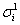 direction using one of the two formulas provided.

If each row of  represents a direction of principal stress then the following transformation applies:

>  (equation 180.11)

If each column of  represents a direction of principal stress then the following transformation applies:

>  (equation 180.12)

Where,

 is the static stress tensor in the  direction
