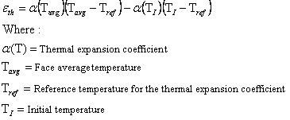
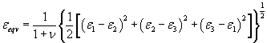

# Strain and Stress Computation

For the computation of strains and stresses within GageMap, the following calculations are performed.

## Strain

Elastic strains are computed and reported at the nodes of the model. Elastic strains are only computed when they are not imported or available from the FE model during conversion or when explicitly chosen if imported strains are available.

GageMap computes surface strains and stresses by looping through all element free faces. A local face coordinate system is established and nodal displacements are transformed into the local face coordinate system. The strain-displacement relationship for the 2-D face type is used to compute the total strains at the integration points (GageMap always uses full integration) enforcing a plane stress relationship (if shells are present with non-zero rotational degrees-of-freedom, nodal roations are transformed into additional nodal displacements). Thermal strain (for static shapes only) is computed for the entire face by the following relationship:

> 

Initial temperatures are not currently supported and are therefore assigned zero for all nodes.

Elastic strain is then computed by subtracting the thermal strain from the total strain. Elastic strains are extrapolated to the nodes and averaged. Extrapolated strains are then transformed into the Global Cartesian coordinate system.

> [!NOTE]
> If two faces intersect with different material properties, the resulting intersection nodes will contain averaged strain from two different material properties.

## Stress

Stresses are also computed and reported at all the nodes of the model. Stresses are only computed when they are not imported from a FE model during conversion or when you explicitly choose to compute them when imported strains are being used.

Nodal stresses are computed by transforming the extrapolated elastic strains computed above using the parent elements' material matrix (also transformed into the local face coordinate system if material is anisotropic).  Stresses are then averaged at the nodes.

## Equivalent Strain

The equivalent strain is computed at each node based on the equation

> 

> [!NOTE]
> In order to equate a Poisson's ratio for each node, a deterministic worst-case Poisson's ratio routine is used. For each node, all associated elements are found and a temperature dependent Poisson's ratio is computed for each material property (one property per associated element). Based upon the above equation, the lowest Poisson's ratio is the worst-case.
