# GageMap Overview

## Third Party Libraries

Some features of GageMap are only available with third-party libraries. In order to make these libraries available to GageMap, they need to be found in the path of the operating system. This applies to such libraries as MATLAB and ANSYS.

Tools such as MATLAB and Abaqus are installed with libraries that GageMap can use. For example, Model Export can export to MATLAB MAT format if it has access to those libraries. These tools cannot be packaged with GageMap as they are proprietary, but if they are installed on the local machine, various features will be enabled.

In order for GageMap to find the needed libraries, they must be available in a system path. The following is a simple guide in setting this up for Windows and Linux.

### Windows

There is a setup panel for environment variables in the Control Panel of Windows. On modern operating systems, the quickest route is to open the start menu and use the search bar at the bottom to find 'environment variables'. The widget will contain a button for editing these variables.

Both the user and the system variables may have a variable called "Path" which can be set to anything. Whatever is in that path, GageMap will see.

GageMap will need a complete path leading to the library files desired. For example, Windows' MATLAB requires a path along the lines of the following:

*C:\Program Files\MATLAB\R2012b\bin\win64*

**WARNING: Do not delete existing paths. Append new paths only, or other system operations may cease to operate correctly.**

### Linux

Either install the third-party library to the standardize paths such as */usr/lib or /usr/lib64*, or set the environment variable *LD_LIBRARY_PATH* to point to its custom location.

To set this field **temporarily** in a terminal, use: *export LD_LIBRARY_PATH="<path>:$LD_LIBRARY_PATH"*

To set this field **permanently**, review how this is done for the Linux distribution in use. It is likely to be a matter of editing a file such as *.bashrc* or *.profile.* The internet provides ample information for every flavor of Linux.

Alternatively, you may edit the script files used to launch GageMap executables and add the path to the same place that the scripts already adjust *LD_LIBRARY_PATH*.

### Required Libraries

For MATLAB: Point to the path containing libmat.so(Linux) or libmat.dll(Windows)

For ANSYS: Point to the path containing libansys.so(Linux) or libansys.dll(Windows)

> [!NOTE]
> As of GageMap version 3.6, this is no longer required

For ABAQUS: Point to the path containing the ABAQUS libraries. A list of these libraries can be seen here: [Required Abaqus Libraries](abq_required.md)

## Starting the Software

When starting the software, the startup screen will appear.

The startup screen shows the version of GageMap and the licensing information for the current GageMap installation. The same information is also available in the program's **Help > About GageMap** from the Main Menu. Pressing the close button on the splash screen, closes the splash screen and opens the GageMap Main Window.

## The Main Interface

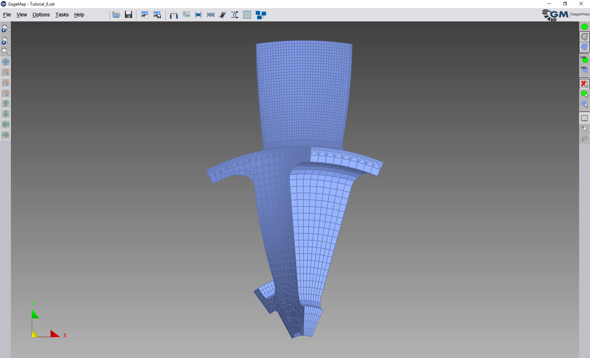

### Menu Bar

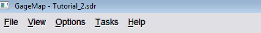

The GageMap menu bar contains the following menus:

- [File](#file)
- [View](#view)
- [Options](#options)
- [Tasks](#tasks)
- [Help](#help)

#### File

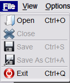

**Open**

Selecting **Open** (Ctrl+O) will bring up the file open dialog for loading an SDR file.

**Close**

Selecting **Close** will close the current model.

**Save**

Selecting **save** will save any changes to the current model.

**Save As**

Selecting **Save As** will allow you to save a copy of the current model.

**Exit**

Selecting **Exit** (ctrl+Q) will close the application.

#### View

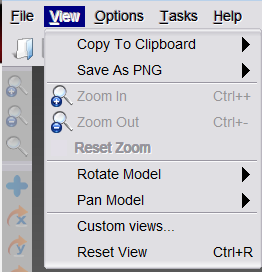

**Copy to Clipboard**

Selecting **Copy to clipboard** allows the curent model or model view to be coppied to the clipboard.

**Save As PNG**

Selecting **Save As PNG** allows the current model or model view to be saved as a PNG file type.

**Zoom In** and **Zoom Out**

Selecting **Zoom In** or **Zoom Out** allows the model view to be zoomed in or out.

**Reset Zoom**

Selecting **Reset Zoom** allows the model view's zoom to be reset to its default.

**Rotate Model**

Allows the model to be rotated about the X, Y, or Z axis either clockwise or counter-clockwise.

**Pan Model**

Allows the model to be moved in either the up, down, left, or right directions.

**Custom Views**

Selecting **Custom Views** displays a dialog to allow the user to define thier own view.

**Reset View**

Selecting **Reset View** resets the model's viewport to its default zoom and orientation.

#### Options

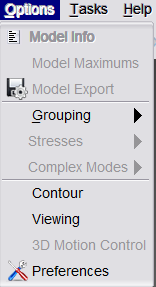

**Model Info**

Selecting **Model Info** displays a report detailing the information for the model, such as number of elements, number of nodes, material information, etc.

**Model Maximums**

Selecting **Model Maximums** displays a report detailing the maximum stresses and strains for the model.

**Model export**

Selecting **Model Export** allows the export of the models characteristics. See [Working With SDR Models](usingSDR.md)

**Grouping**

Selecting **Grouping** allows the option selection for how groups are displayed.

**Stresses**

Selecting **Stresses** allows the selection of whether to use imported or GageMap computed calculations.

**Complex Modes**

Selecting **Complex Modes** allows the selection of whether to use complex or individual modes.

> [!NOTE]
> This option is only available when cyclic symmetry is present in the model.

**Contour**

Selecting **Contour** opens the contour options dialog, allowing customization of the contour color scheme.

**Viewing**

Selecting **Viewing** opens the View options dialog.

**3d Motion Control**

Selecting **3d Motion Control** opens the 3d motion control dialog.

**Preferences**

Selecting **Preferences** opens the preferences selection dialog.

#### Tasks

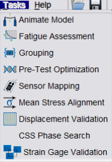

**Animate Model**

Starts the Animate Model task. See [Model Animation](task_modelAnim.md)

**Fatigue Assessment**

Starts the Fatigue Assessment task. See [Fatigue Assessment](task_fatigue.md)

**Grouping**

Starts the Grouping task. See [Model Grouping](task_group.md)

**Pre-Test Optimization**

Starts the Optimization task. See [Pre-Test Optimization](task_optimize.md)

**Sensor Mapping**

Starts the Sensor Editor. See [Sensor Mapping](task_sensors.md)

**Mean Stress Alignment**

Starts the stress alignment task. See [Mean Stress Alignment](task_meanStress.md)

**Displacement Validation**

Starts the Displacement Validation task. See [Model Validation](task_modelValid.md)

**CSS Phase Search**

Starts the Cyclic Symmetry Phase Search task. See [Cyclic Symmetry Solutions](task_cssPhaseSearch.md)

**Strain Gage Validation**

Starts the Strain Gage Validation task.

#### Help

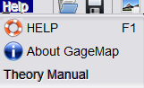

**Help**

Selecting **Help** brings up this documentation in HTML format.

**About GageMap**

Selecting **About GageMap** displays information about the licensing and current version of GageMap.

**Theory Manual**

Selecting **Theory Manual** brings up the theory manual for GageMap.

### Quick Bar

> 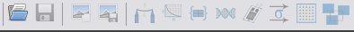

Quick access links to the most frequently used features of GageMap includeing all of the tasks described under the task menu option. See [Tasks](#tasks)

### Toolbars

These toolbars are quick access view options for the model view. See [View](#view)

> 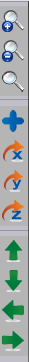

### View Options

These quick viewing options allow you to turn various visual representations on the model off or on. This includes the nodes, edges, and faces.

> 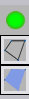

### Labeling

These options toggle labels for nodes and faces. When turned on, the labels will appear as small text near each node or face, and can be useful for tracking down a specific region of the model.

> 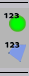

### Selection Tools

Using the selection tools, you can choose either a face or a node to highlight for more information, such as strains and stresses, and displacement at various modes. When you are finished selecting faces or nodes, you should click the "X" selection tool to change back to regular mouse controls.

> 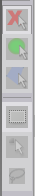
