# SDR File Manager Utility

> [!NOTE]
> For the complete, updated standalone manual — including browser guides, `.sdr` schema details, batch `GmScript`/`SDRDump` workflows, and troubleshooting — see **[SDR File Manager Documentation](../SDRFM/README.md)** ([Browsers & Operations](../SDRFM/browsers-and-operations.md), [File Format & Batch](../SDRFM/file-format-and-batch.md)).

## Overview

The SDR File Manager (SDR-FM) provides the following functionality:

- Information regarding SDR file contents and basic model attributes.
- Export of reduced SDR files that can contain any subset of the following:
  * FE geometry via GageMap groups.
  * Static load cases.
  * Modes
- Cyclic symmetric model expansion for arbitrary modes & sectors.
- Export of cyclic symmetric virtual mode shapes
- Generation of user defined static load cases via a combination of existing static load cases. Load cases may be pre-multiplied by any real valued scalar prior to summation.
- Generation of user defined modes via a combination of existing modes. Modes may be pre-multiplied by a real or complex valued scalar prior to summation.
- Import of user defined nodal temperature definition.
- Import of user defined static load case nodal displacements, strains and stresses. All quantities must be real valued.
- Import of user defined modal displacements, strains and stresses. Quantities can be either real or complex valued.

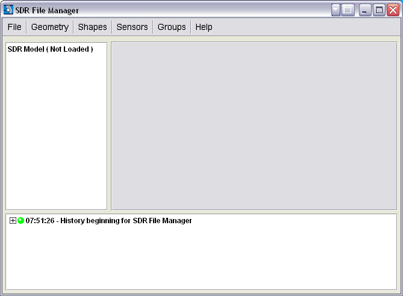

The SDR-FM interface contains three regions:

- The model tree which lists all modes, static load cases, groups, and sensors. Each level of the tree can be expanded or compressed by selecting the +/- sign to the left of each of the items respectively.
- The information panel lists top level information for each item selected within the model tree. For example, selecting the SDR Model will provide information regarding the FE geometry (node & element statistics, faces, materials, etc.).
- The history window provides a running list of user instructions with time stamps. Each instruction can either be colored green for success or red for failure.

## Project Management

A SDR-FM project is a file which contains all the modes, static loads, and gages which are loaded into the SDR File Manager window (groups are not stored with the project). The project file is saved with the SDR extension. A project allows the user to save out their working SDR Model to a file for continued use at a later time. When the SDR File Manager is started, a blank project is created automatically. From this point, geometry can be imported from any existing SDR file or the entire contents (geometry, shapes, sensors) of the SDR file can be imported..

Below is the project definition after Loading Geometry, Loading Shapes, Loading Sensors, and Loading Groups operations have been performed. Each operation generates an additional entry in the project definition that can be expanded to obtain more information.

> [!NOTE]
> Geometry contains the following:  node labels, node coordinates, element labels, element connectivity, nodal temperatures and material properties. Shapes can be either static or modal, must contain displacements, and may contain strains and stresses (averaged at the nodes).

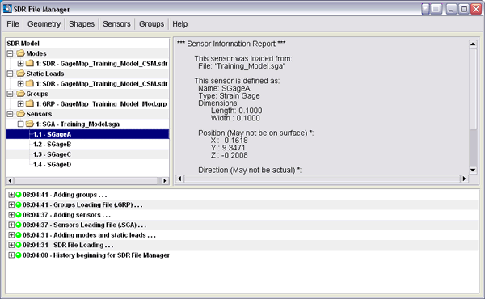

### Loading a Project

A SDR-FM project can only be loaded when there is no current project. If another project is already loaded, the SDR File Manager must be exited and restarted. This is to prevent the overwriting of existing projects. To load a project, follow the steps below.

1. Open the SDR File Manager utility.
2. From the File menu, select the Load Project menu item.
3. From the file browser window, browse and select any SDR file and press the Open button.
4. The project will be loaded. Upon opening the desired SDR file the SDR-FM will scan the contents. This may take several minutes and is dependent on the size of the SDR file. A progress bar (Figure 3) provides the status of the SDR file scan.

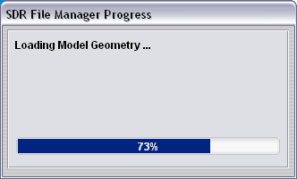

### Saving a Project

Any project can be saved as a new project with the limitation that is cannot overwrite the existing project. All modes, static load cases and sensors that appear in the model tree will be saved to the new project. Groups are currently not saved within projects. To save a project, follow the steps below.

1. Open an existing project or import the geometry (see sections below for further assistance).
2. From the File menu, select the Save Project As menu item.
3. From the file browser window, browse and select any SDR file or enter the name of a new SDR file and press the Save button.
4. The project will be now be saved.

> [!NOTE]
> Saving a project will save all the modes and static loads to a project file. If only a subset of shapes is desired please see the Exporting Models section.

## Loading Geometry

It is not necessary to load an existing project to work with SDR files. Geometry can be loaded directly from any SDR file. To load geometry, follow the instructions below.

1. Using a new project with no existing geometry, select Geometry -> Load from SDR File.
2. From the file browser window, browse and select any SDR file and press the Open button.
3. The model's geometry is now loaded. You can display some brief model statistics by click on SDR Model in the model tree.

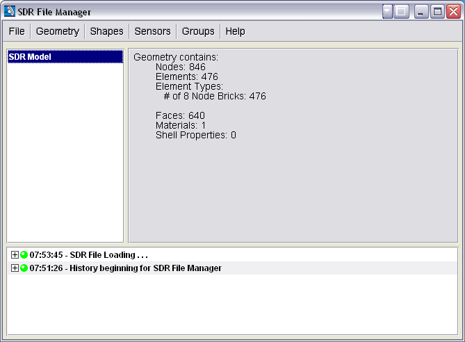

## Loading Shapes

Once a project has been opened or geometry has been loaded (see sections above), it is now possible to import shapes from any compatible SDR file.  A compatible SDR file is one that has identical geometry; number of nodes, elements faces, material properties, real constants (i.e., shell thickness), node temperatures, node and element labels, element connectivity, as the existing SDR project.  Geometry (coordinate) checks are performed for all nodes and must be within an absolute distance of 1E-08 in model units.  If any of the criteria above is violated no shapes will be imported.  Multiple shape instances for the same geometry can be imported.  Each occurrence is listed within the project definition.  No overwriting of shapes is permitted.

To load shapes:

1. Using a project with existing geometry, select Shapes -> Load from SDR File.
2. From the file browser window, browse and select any SDR file and press the Open button.
3. The model's shapes are now loaded if the geometry checks succeed. A note will be made in the history log accordingly. Shape statistics can be displayed by clicking on the appropriate shape in the model tree.

## Loading Sensors

Sensors can be imported directly from an SGA file or an SDR file.  Sensors are listed in the same order that they are present in either file.  Information concerning each sensor is displayed as each sensor is highlighted.  Geometry information must be present in order to load sensors.  Sensor information is not guaranteed to be accurate because the sensor is not physically mapped onto the geometry.  More accurate sensor information can be obtained within GageMap.  Multiple sensor files can be loaded.  Each occurrence is listed within the project definition.  No overwriting of sensors is permitted.

To load sensors:

1. Using a project with existing geometry, select Sensors -> Load from SDR File or Sensors -> Load from SGA File.
2. From the file browser window, browse and select any SDR or SGA file and press the Open button.
3. The sensors are now loaded if the geometry checks succeed. A note will be made in the history log accordingly. Sensor statistics can be displayed by clicking on the appropriate sensor in the model tree.

## Loading Groups

If it is necessary to remove certain regions of the model in preparation for a GageMap analysis then groups must be imported. After loading in the group (GRP) file, all valid groups will be reported within the project definition.  Multiple group files can be loaded. Each occurrence is listed within the project definition. No overwriting of groups is permitted.

To load groups:

1. Using a project with existing geometry, select Groups -> Load from GRP File.
2. From the file browser window, browse and select any GRP file and press the Open button.
3. The groups are now loaded.  Group options and members can be displayed by clicking on the appropriate group in the model tree.

## Exporting Shapes & Importing User Defined Shapes

The SDR-FM has the ability to export shapes to a text file.  The text file contains nodal temperatures, header information for each shape as well as all of the shape information including displacements, stresses and strains.

### User Defined Shape File Format

The format of the file is as follows:

> nodetemp = node temperature
>
> START,<MODE or LOAD>
>
> infofreq,<frequency (real float)>
>
> infondd,<nodal diameter (real integer)>
>
> inforpm,<rotational velocity (real float)>
>
> <data type>,<node label>,<vector or tensor/array data>
>
> data type can be any of the following
>
> nodedisp = node displacement *(Ux, Uy, Uz)*, may be real or complex valued
>
> nodestrain = node strain *(ex, ey, ez, gxy, gyz, gzx)*, may be real or complex valued

> [!NOTE]
> Engineering strains NOT tensor strains
>
> nodestress = node stress *(sx, sy, sz, txy, tyz, tzx)*, may be real or complex valued
>
> <repeat above for each shape>
>
> FINISH

User defined shapes can also be imported and/or appended to loaded projects.  The format of the import file is identical to the export file described above.  User defined mode shapes are not required to contain nodal values for all defined nodes.  Nodes that do not have values assigned will be assigned zero.  The amount of information per shape does not have to be consistent.  For example, shape 1 may only contain displacement information while shape 2 can contain displacement, stress and strain information.  Importing user defined shapes requires geometry to be present within the project.  Import shapes by selecting **Shapes ->  Import User-defined**

## Exporting Models

The size of an SDR file is limited only by the operating system, however, the ability to load SDR files into GageMap is limited by the amount of physical memory available when loading the SDR file within GageMap.  It may be necessary to reduce the size of the model in order to perform an analysis within GageMap.  The SDR FM provides a versatile and powerful means to reduce the size of the SDR file. Subsets of shapes and model geometry can be exported to a user specified SDR file.

### Preparing Model for Export

In order to export a subset of a project, a valid project must be constructed. This involves loading geometry, shapes, sensors, and groups prior to entering the SDR File Exporter.

To prepare to export follow these steps:

1. Create a project or load an existing one.  See the sections Loading a Project or Loading Geometry above.
2. Load any additional shapes as needed for export from existing SDR files or import custom shapes.. See the section Loading Shapes above.
3. Load any sensors into the project for export from either an SDR or SGA file. See the section Loading Sensors above.
4. Load any groups into your project for trimming the model. See the section Loading Groups above.

### Displaying the SDR File Exporter Window

After preparing the project, an export can be performed. Open the SDR File Exporter window, select **File -> Export Model** from the SDR File Manager window. The **SDR File Exporter** window is now displayed.

> 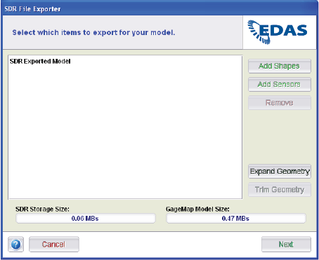

The SDR File Exporter window contains the following regions:

- The region in the center provides a status of the items to be exported, initially it is blank and becomes populated as shapes and sensors are added.
- The activity region to the right provides means to add/remove shapes, sensors and also trim geometry. There is no requirement to perform these steps in any predefined order.
- The status at the bottom provides the user with approximate size of the exported SDR file and an estimation of the memory requirements upon loading the file within GageMap.

> [!NOTE]
> **Expand Geometry** is only available if a cyclic symmetric model has been loaded.  **Trim Geometry** is only available if groups have been loaded.

### Exporting the Model

After preparing the project and opening the SDR File Exporter window, the model can now be exported. To export a model, follow these steps.

1. Add shapes to the export definition by selecting Add Shapes. See the Adding Shapes section below for further instructions.
2. Add shapes to the export definition by selecting Add Sensors. See the Adding Sensors section below for further instructions.
3. Trim your exported geometry by selecting Trim Geometry. See the Trimming Geometry section below for further instructions.
4. Verify that the SDR Storage Size does not exceed the space available on the output storage device. If it does exceed the space, select a mode, static load, or sensor and press the Remove button or reduce the amount of geometry that is exported. Continue removing items until the size is reduced to the required level.
5. Verify that the GageMap Model Size does not exceed the amount of available memory. If it does exceed the requirement, select a mode, static load, or sensor and press the Remove button or reduce the amount of geometry that is exported. Continue removing items until the size is reduced to the required level.

  > 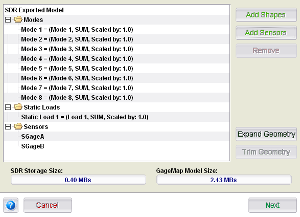
6. Select Next to continue.
7. Enter or browse to a directory/filename to export the file.  Overwriting a loaded SDR files is not permitted.
8. Select Export to export the file. A prompt is displayed asking if the model is to be exported again. Selecting Yes returns to the SDR File Exporter (step 1), selecting No exits the Exporter and returns to the SDR File Manager.

## Adding Shapes

Shapes can be selected for export via a variety of means. Shapes for export can be rescaled with arbitrary values, either real or complex, combining multiple shapes using shape arithmetic, creating a virtual mode shape from a cyclic symmetry mode and expanding cyclic symmetry modes to arbitrary sectors. Adding shapes is extremely easy and highly flexible with the ability to add one or more shapes numerous times with different attributes.

To add a shape, simply follow the **Shape Selection Wizard**. To open the wizard, select **Add Shapes** from the **SDR File Exporter** window. The Shape Selection Wizard should now be available.

> 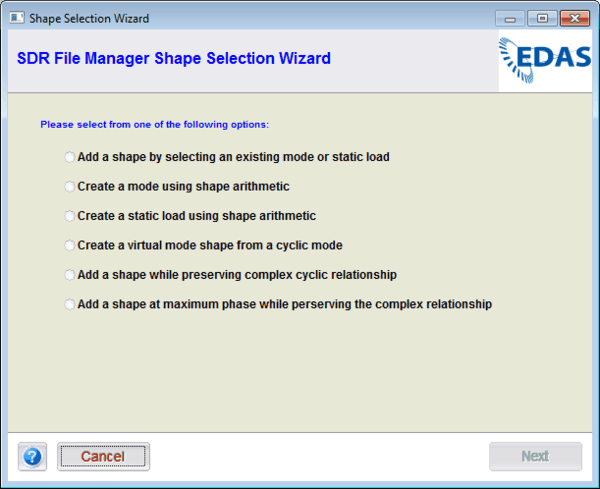

The following options are available for adding shapes for export ( each are explained below ):

- [Add a Shape by Selecting an Existing Mode or Static Load](#add-a-shape-by-selecting-an-existing-mode-or-static-load)
- [Create a Mode Using Shape Arithmetic](#create-a-mode-using-shape-arithmetic)
- [Create a Static Load Using Shape Arithmetic](#create-a-static-load-using-shape-arithmetic)
- [Create a Virtual Mode Shape from a Cyclic Model](#create-a-virtual-mode-shape-from-a-cyclic-model)
- [Add a Shape While Preserving Complex Cyclic Relationship](#add-a-shape-while-preserving-complex-cyclic-relationship)
- [Add a Shape at Maximum Phase Angle While Preserving the Complex Relationship](#add-a-shape-at-maximum-phase-angle-while-preserving-the-complex-relationship)

### Add a Shape by Selecting an Existing Mode or Static Load

This option is used to select modes and static load cases from the project for export into a new SDR file. This is the option to select if the objective is to reduce the size of the parent SDR file by selecting a subset of modes and/or static load cases. This option combined with Trim Geometry provides a powerful method to reduce the size of SDR files for use within GageMap. In addition to selecting modes and/or static load cases, either can be pre-multiplied by a real constant prior to export. Modes can be pre-multiplied by a complex scalar. The SDR-FM Shape Selector is shown in Figure 2. Simply use the navigation tree on the left side to select the desired mode(s) and/or static load case(s) for export. Use of the <Shift> and <Ctrl> keys is permitted for selecting multiple shapes. Once a shape or shapes are selected then select the Add button. Repeat the operation, as necessary, to append additional shapes. Note that shapes are exported in the same order as which they are appended, therefore, it is possible to change the mode and/or static load case order within this task. Figure 3 shows the result of appending the following shapes to the File Exporter:

1. Mode 1 scaled by 1.0
2. Mode 2 scaled by 1.0
3. Mode 1 scaled by 0.7
4. Mode scaled by the complex scalar 0.50 + i0.5
5. Static Load 1 scaled by 1.0

If shapes are appended in error they can simply be removed by high-lighting the desired shape and then selecting the Remove button.  Note that the storage and memory is updated with each appended shape.

> 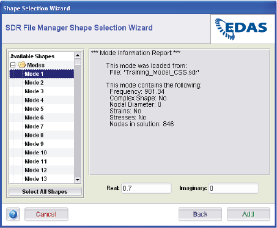
>
> 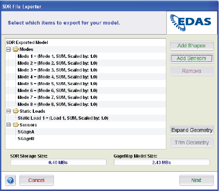

### Create a Mode Using Shape Arithmetic

This option is used to combine modes from the project for export into a new SDR file. Modes can only be summed together, no other arithmetic operations are permitted. Multiple modes can be combined and each mode can be pre-multiplied by either a real or complex scalar prior to summation. Each resulting mode from mode summation must be created one at a time. Mode summation is performed using the GUI in Figure 4.  To perform mode summation perform the following steps:

1. Select shape to be summed using drop down box.
2. Select operation (currently restricted to sum).
3. Apply scalars (real and/or imaginary coefficients).
4. Select "Add Step".
5. Repeat 1-4 above as often as necessary.
6. Select "Create"

  > 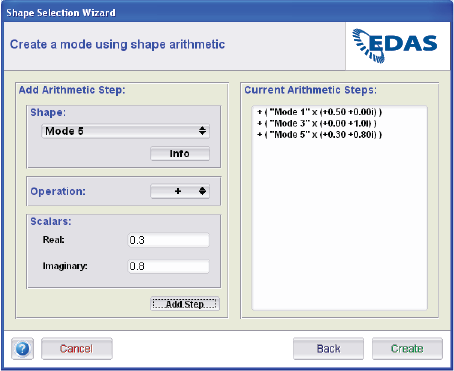
  >
  > 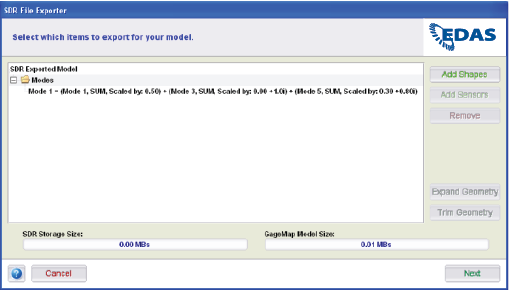

### Create a Static Load Using Shape Arithmetic

This option is used to combine static load cases from the project for export into a new SDR file. Static load cases can only be summed together, no other arithmetic operations are permitted.  Multiple static load cases can be combined and each static load case can be pre-multiplied by a real scalar prior to summation.   Each resulting static load case from static load case summation must be created one at a time. Static load case summation is performed using the GUI in Figure 6. To perform static load case summation perform the following steps:

1. Select shape to be summed using drop down box.
2. Select operation (currently restricted to sum).
3. Apply scalars (real coefficient).
4. Select "Add Step".
5. Repeat 1-4 above as often as necessary.
6. Select "Create"

  > 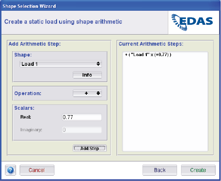

### Create a Virtual Mode Shape from a Cyclic Model

Virtual mode shape - A virtual mode shape results from the phase search of a cyclic symmetric mode pair on a node-by-node basis for the maximum value of a selected quantity. Therefore, a virtual mode shape does not represent a physical mode shape but the maximum value of the selected variable over the entire model on a per-node basis. The maximum value and corresponding phase angle at which the maximum is achieved is obtained using the cyclic symmetry expansion equation:

> 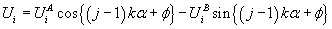

where:

> i = node number
>
> j = sector number (always 1)
>
> k = harmonic index or nodal diameter
>
> a = sector angle
>
> f = phase angle (0....360)
>
> U = user selected variable (displacement, stress, strain, etc.)
>
> U A = Real mode shape, cos mode shape, basic sector solution
>
> U A = Imaginary mode shape, sin mode shape, duplicate sector solution

Once the phase angle is determined all other available variables at each node are expanded at the same phase angle using the formula above.

The following variables are available for virtual mode shape expansion:

1. Displacements *(Ux, Uy, Uz, Usum)*
2. Rotations *(Rx, Ry, Rz, Rsum)*
3. Strains *(ex, ey, ez, gxy, gyz, gzx)*

> [!NOTE]
> Strains must be available in the project, therefore, must be imported from the FE results during conversion..

1. Strain invariants (e eqv , Max principals)

> [!NOTE]
> Stresses must be available in the project, therefore, must be imported from the FE results during conversion..

1. Stress components *(sx, sy, sz, txy, tyz, tzx)*

> [!NOTE]
> Stresses must be available in the project, therefore, must be imported from the FE results during conversion.

1. Stress invariants (VonMises, Max principals)

> [!NOTE]
> Stresses must be available in the project, therefore, must be imported from the FE results during conversion.

The virtual mode shape GUI is shown in Figure 7. The panel consists of a mode selection region and a user preference region. The mode selection region lists all modes available within the current project. Only modes other than 0 or N/2 nodal diameter are available for virtual mode shape expansion.  Selecting each mode lists properties for that mode including if strains and stresses are available. The preference region contains the following options:

1. Compute Max Phase by:  select variable for maximum phase search (see above).
2. Phase angle increment (degrees): select the increment in phase angle to search for maximum value (0.1, 0.2, ..., 15.0)
3. Mass Normalize Output Mode: if yes then all output variables will be multiplied by 1/sqrt(N/2)
4. Output Additional Information Mode:  if yes then an additional mode at the same frequency is output that contains the maximum value and the corresponding phase angle at which the maximum occurs. Due to limitations within the SDR file format these variables are stored in the Ux and Uy locations respectively. All other variables are zero.

  > 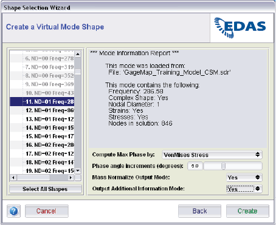

### Add a Shape While Preserving Complex Cyclic Relationship

This option is used to expand cyclic symmetry results at arbitrary phase angles to arbitrary sectors. Options include normalization and output of complimentary mode shape. The complementary mode shape has a phase angle difference of 90º from the base mode shape. The complementary mode shape is used for traveling wave simulations and is not recommended for sensor placement.

Both zero and N/2 modes can be expanded, however, the phase relationship is only available for non zero or N/2 modes. To expand a cyclic symmetric model follow the shape selection wizard to select modes that have common properties and then select **Expansion** on the **SDR File Exporter** panel.

Select modes with a common phase angle, normalization options and output of complimentary modes. Use the **<Ctrl>** key to select individual modes or the **<Shift>** key to select all modes.

> 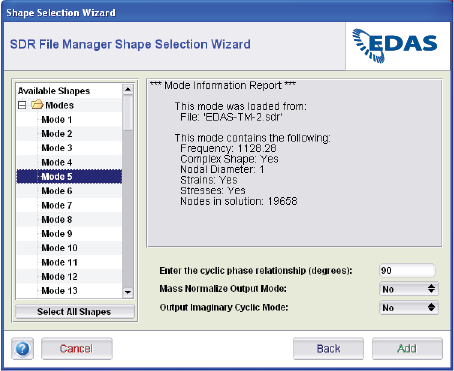

All modes and their properties are listed within the export panel:

> 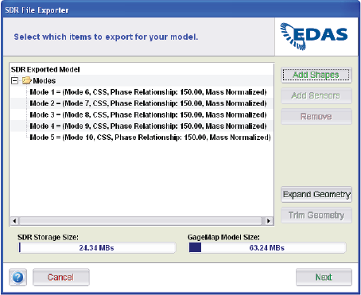

Select Expand Geometry and the model expansion wizard will begin. This will guide the process of expanding the model in four steps.

Step 1: Begin the wizard

> 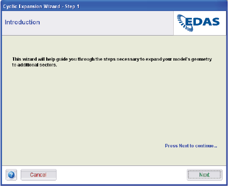

Step 2: Select sectors. Select the desired sectors and then toggle them either on or off. On represents a sector for expansion while off will not expand to that sector.

> 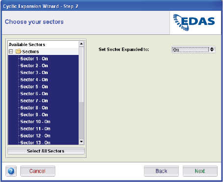

Step 3: Select axis of symmetry.

> 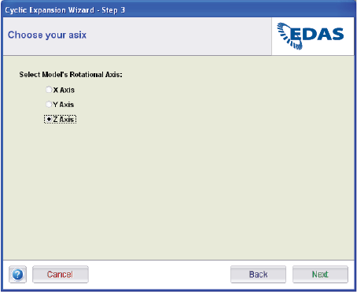

Step 4:  Summary of the expansion options.  Select Finish

> 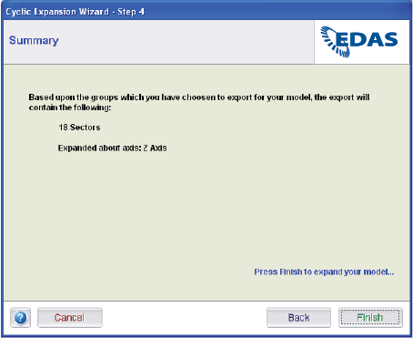

### Add a Shape at Maximum Phase Angle While Preserving the Complex Relationship

This method option is used to expand cyclic symmetry results at the phase angle for which the selected nodal result achieves a maximum. This option produces a similar result as the one obtained under the [Cyclic Symmetry Solutions](task_cssPhaseSearch.md) menu item. Options include normalization and output of the imaginary cyclic mode shape. The imaginary mode shape has a phase angle difference of 90º from the base mode shape. The imaginary mode shape is used for traveling wave simulations and is not recommended for sensor placement. Zero and N/2 modes are not available within this export option.

The process is as follows:

Step 1:  Select one or more (non-zero or N/2 nodal diameter) modes

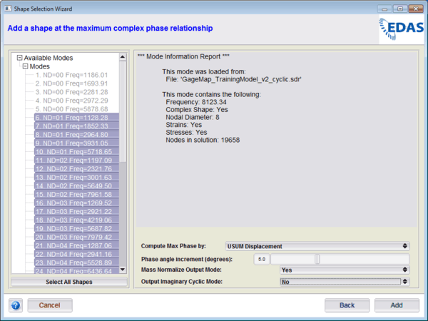

*Information for any single mode is presented. Note that only non-zero and non N/2 modes are available.*

Step 2:  Select the nodal variable to be used for the phase search. Only variables resident in the SDR file are available.

Step 3:  Select the phase angle increment for conducting the phase search. Use either the slider and/or the <Tab> key to select the desired value.

Step 4:  Enable Mass Normalization of the mode. This divides all nodal variables by the quantity 1/sqrt(N/2).

Step 5:  Enable output of imaginary cyclic mode. This will result in the output SDR having 2 modes at the same frequency with a 90º phase difference. Export of this mode is only recommended if this procedure is to be followed by an expansion process.

Step 6:  Select **Add**. All shapes selected for phase search are now added to the export panel. Any individual shape can be removed by selecting the **Remove** button. The model can be expanded and/or exported from this point.

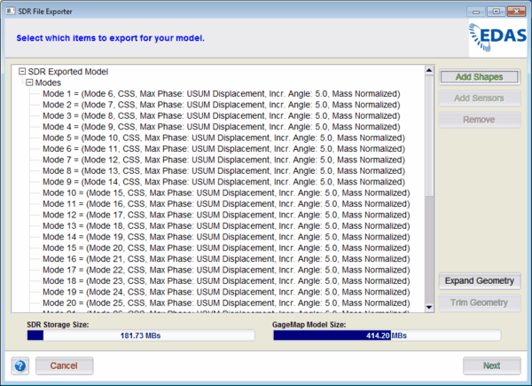

## Adding Sensors

Adding sensors is extremely easy with the ability to add one or more sensors numerous times or in combinations. This allows creating and exporting a model with a subset of the available sensors.

To add one or more sensors, simply open the **Sensor Export Selector**. To open the Sensor Export Selector, select Add Sensors from the SDR File Exporter window. The Sensor Export Selector should now be shown.

> 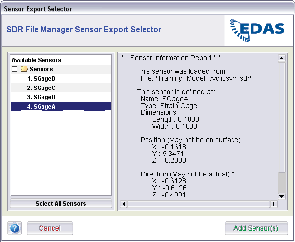

To add a sensor:

1. Expand the selection tree and select the sensors for export.  Use of the <Shift> and <Ctrl> keys is permitted. Also, all sensors can be selected using the Select All Sensors button.
2. Click the Add Sensor(s) button.
3. The Sensor Export Selector window should now be gone. The selected sensors are now available within the export definition on the SDR File Exporter window.

## Trimming Geometry

Trimming geometry is performed by using the **Trim Wizard**.  Trimming geometry requires a valid GageMap group file to be loaded within the project definition. GageMap group files are normally created during conversion but can be created within GageMap or any text editor. The Trim Wizard is shown in Figures 1-3.

To open the Trim Wizard, select Trim Geometry from the SDR File Exporter window. If the button is disabled, no groups are currently loaded within the SDR-FM project.

To trim the geometry simply select the desired group from the available groups and set the group Boolean to the desired value. Upon selecting a group, the group type and contents are displayed. Recall that all GageMap groups are node based, therefore, only node indices are shown as group members.  Group members cannot be modified within the SDR FM.  Selecting "Next" lists the contents of the exported model based on the Booleans provided.

> 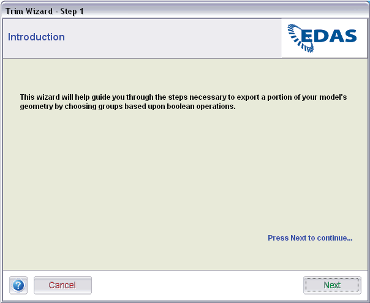
>
> 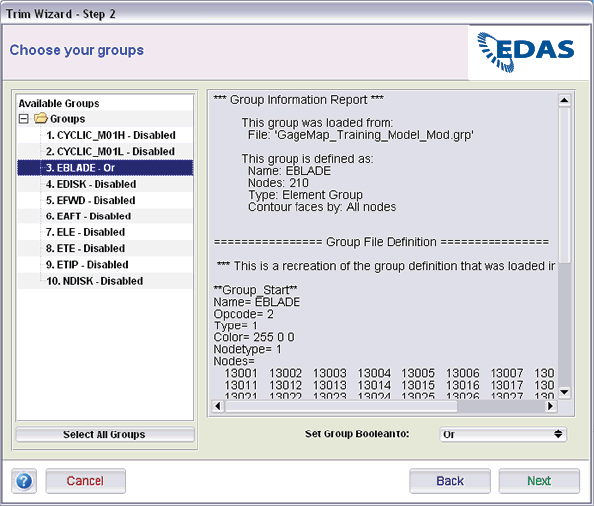
>
> 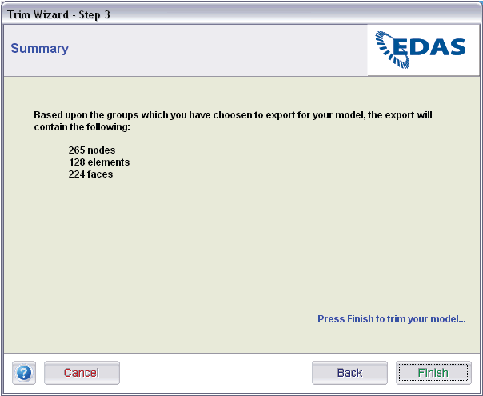
