# Cyclic Symmetry Solutions

## Overview

Cyclic Symmety is a means of representing system mode shapes by only modeling a single sector. This can greatly expedite solutions and post-processing.

GageMap supports the use of cyclic symmetry models which were created in ANSYS or ABAQUS. These features are only available when using a model which was converted using the cyclic symmetry flag during the conversion process. Upon conversion, GM stores cyclic symmetry results as a complex variable such that: the basic sector solution for the first mode in the mode pair is mapped as the REAL coefficient and the duplicate sector solution for the first mode in the mode pair is mapped as the IMAGINARY coefficient. The duplicate mode information is ignored. See conversion report. Cyclic symmetry modes in GageMap are stored as complex modes

GageMap allows for Strain Gage optimization and cyclic phase search (similar to ANSYS). In addition to nodal variables, strain gages can also be swept over phase.

### Complex Modes

Two representations:
- Individual modes (default)
- Complex modes

> - Real coefficients assigned to 1st mode
> - Imaginary coefficients assigned to 2nd mode
> - Both modes have same frequency
> - Invariants available but computed for each individual mode

- - **Magnitude & phase**: - Single mode, magnitude
  - Phase available via “Model Export”
  - Magnitude, 1st mode
  - Phase, 2nd mode
  - Invariants of vectors and tensors unavailable
  - This representation is required for optimization on cyclic modes
- - **Change format via Options -> Complex Modes**: - Use as complex (magnitude & phase)
  - Use as individual modes

## Cyclic Mode Optimization

> [!NOTE]
> By default, cyclic modes are presented as “individual modes”, i.e., the cos & sin modes are listed separately.

1. Launch GageMap and load an SDR file and a group file.
2. Options -> Preferences: set these preferences as desired.

  > 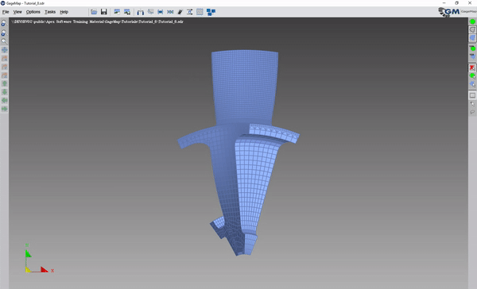
3. Options -> Complex Modes -> Use as complex.

  > 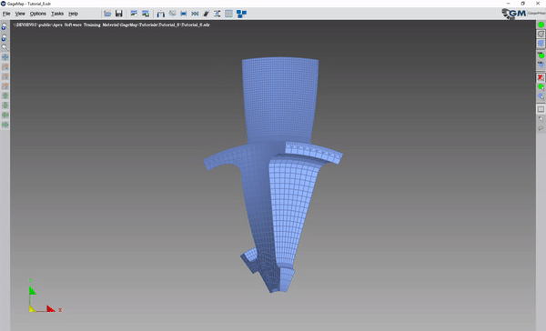
4. Start the optimizer.
5. Add a single sensor.
6. Open "Advanced" and "Restrict Placement" and/or "Change Sensitivity" as desired.

  > 
7. Under Modes, enable all modes.
8. Under Objectives, set the Minimum Amplitude Ratio (in the example, .4 was used).

  > 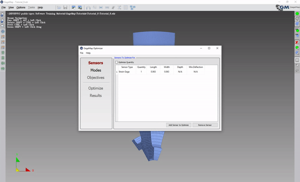
9. Begin Optimization and optimize for a few minutes and then stop.

  > 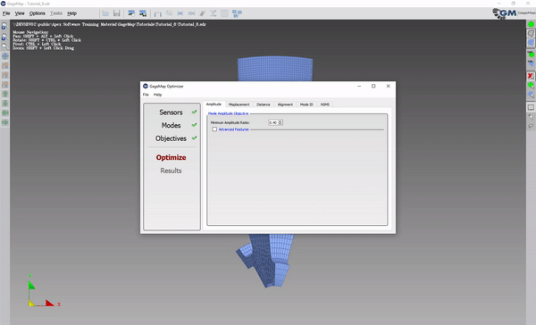
  >
  > In the example file, the Optimizer (using the default settings) covered the first mode with a very high ratio and did not cover the second mode (ratio below threshold).
  >
  > If this happens, it can easily be fixed.
10. Return to the Objectives panel.
11. Under Amplitude tab, enable Advanced Features.
12. “More Settings.”
13. “Maximum Ratios” tab.
14. Enable “Maximum Amplitude Ratio Options.”
15. Enable both modes.
16. Change the maximum amplitude ratio (in the example, it was changed to .6).

  > 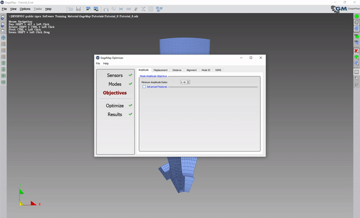
17. Optimize again.

  > 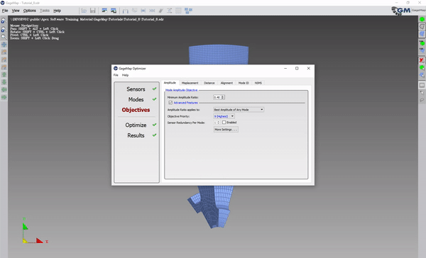
18. Apply sensors
19. Close the Optimizer task

  > 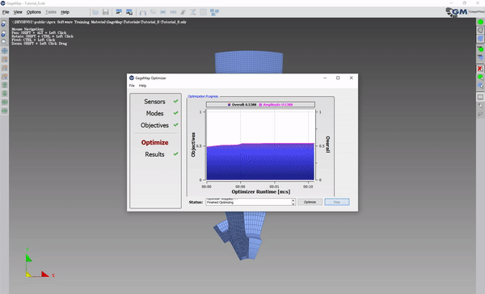
  >
  > Now that optimization has been completed, individual modes can be returned in preparation for a phase search.
20. Return the mode representation to "Use as Individual Modes."

  > 
  >
  > Cyclic symmetry phase searching permits calculation of maximum and minimum values for all cyclic symmetric mode pairs.
21. Tasks -> CSS Phase Search

  > 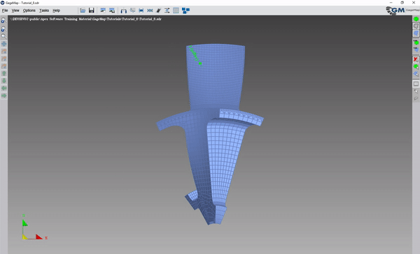
22. Available sections include: displacements, strains, stresses, fatigue, and sensors. Fatigue becomes active if assignments have been performed within the fatigue task. Sensors become active if sensors have been loaded. Both components and invariants of nodal quantities will be calculated.
23. Enter the Phase angle increment in degrees to define the resolution of the phase  search. For example, 5 degrees will perform a search at 5 degree increments. Enter any value between 0.1 and 15.
24. Select Mass Normalize Report to normalize all results by 1/sqrt(N/2).
25. "Re-Calculate."

  > 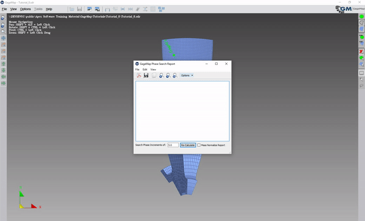
  >
  > The normalization basis should be identical between the optimizer and phase search reports. In the example, the “Airfoil” group was used as the normalization basis. The phase search occurred over ALL nodes but because tge max node was in the Airfoil group the model did not have to be trimmed as the phase search occurs over all visible nodes.
  >
  > The ratio and phase angle for the gage may be slightly different because this report reflects the actual mapping of the sensor while the report in the optimizer was just an estimate.
  >
  > The ratios reported here reflect “system mode” ratios where they are ratio’ed spatially to another section of the model. You will be required to make the model non-cyclic to perform a fatigue assessment.
26. Scroll down to the sensor response section
27. Note that the normalization basis reported is the same as in the optimizer report

  > 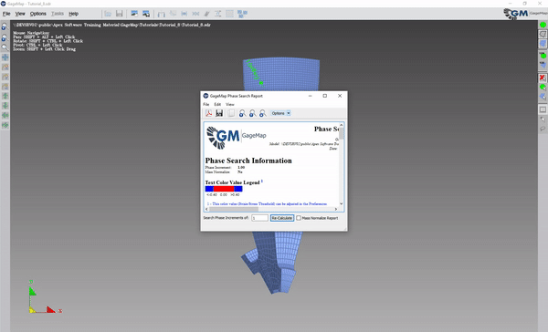

The report sections are explained below.

- **Displacements** - When selecting this option, the eigenvectors for each mode are expanded at the specified "phase angle increments" starting at 0 degrees. The returned values are the UX, UY, UZ, and USUM minimum and maximum values for each mode along with the phase angle at which each occurs.
- **Strains** - When selecting this option, first the node strain is computed for the 1st sector. Next, the invariants of strain (Epsilon's and Gamma's) are expanded by incremental phase angles. Finally, equivalent and principal strain calculations is performed.
- **Stresses** - When selecting this option, first the node stress is computed for the 1st sector. Next, the invariants of stress (Sigma's and Tau's) are expanded by incremental phase angles. Finally, a principal stress calculation is done.
- **Gages** - When selecting this option, first the maximum strains for the model are computed. Next, the strains for the gage at sector 1 are computed. Following, the expanded displacements are computed about the center point of the gage. Finally, the nominal strain is computed by expanding the strain invariants (Epsilon X, Epsilon Y, and Gamma XY) by incremental phase angles. The returned result for each gage is the minimum and maximum displacements at the center of the gage, the nominal gage strain, and the normalized (normalized from the maximum strain per mode over the whole model) gage strain per mode along with the phase angle at which each occurs.

## Model Validation

Cyclic symmetry for model validation works in the fashion that allows the user to search for validation results based on mode shapes occurring at inter-blade phase angles instead of just sector 1.

The easiest way to perform cyclic symmetry model validation is as follows:

1. Load in the model with or without modes.

> [!NOTE]
> You can specify additional .sdr model files to use for validation later so you don't need all the modes in the loaded model. This can cut down on your memory requirements.

1. Go to the model validation task. Click on the Vibrometry button on the right. Now load the vibrometry grid, map it, and then close the vibrometry window. Note: This step can be examined further in the vibrometry chapter.
2. Load in the UFF data file in Data Set #1 on the left.
3. Choose "Internal Vibrometry" from Data Set #2.
4. If a cyclically symmetrical model is loaded, a prompt will ask to search additional sectors or certain nodal diameters. Choose yes or no.

  > - If no is chosen, validation will only be done based on the mode shape for sector 1 of the model and you are done.
  > - If yes is chosen, the Cyclic Symmetry Validation window will appear.
  >
  > 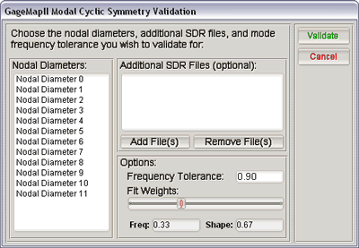
5. From this validation window, select which nodal diameters to search by highlighting them.

  > - If it is desired to search other modes that are contained in a different SDR model that is not loaded, add those SDR files to the additional SDR files box.
  > - In the options box, select the frequency tolerance for each mode to validate. This frequency tolerance is set when comparing modes during validation. If the frequency fits between the mode from data set #1 and the mode from data set #2 is less than this tolerance, then a overall fit will not even be computed for these modes. This option is to improve speed of the comparisons and should normally never be lower than 0.75.
  > - Also, choose the fit weights for the overall fit totals based on these percentages.
6. Once all the options have been selected, click on the "Validate" button.

  > - GageMap will now begin comparing all selected nodal diameters for every sector starting with sector 1 and going through the number of sectors in the cyclic symmetry model.
  > - How it works: Each mode in your data set #1 (should be UFF data in this example) is compared with every mode in data set #2 that first fits the frequency tolerance that was set in step #6. If the overall fit is better than anything found so far, that mode is flagged as the best. This goes on until the last mode shape of the last sector of the last additional SDR file was evaluated. You are then left with X number of modes that best fit your X number of modes in data set #1. From these best fit modes, inter-blade phase angles are then searched at +/- 100 iterations of phase angles between the next and previous blades. If a better overall fit is found at an inter-blade phase angle is found, then that result is kept. At the end, a set of X number of modes is returned where X equals the number of modes in data set #1.
7. From this point, the model validation panel works the same as it does for a non-cyclic symmetry model. For additional help, visit the model validation chapter.
