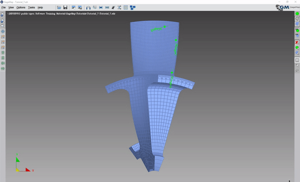
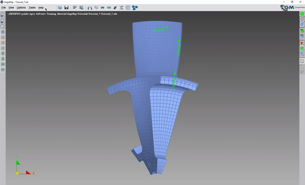
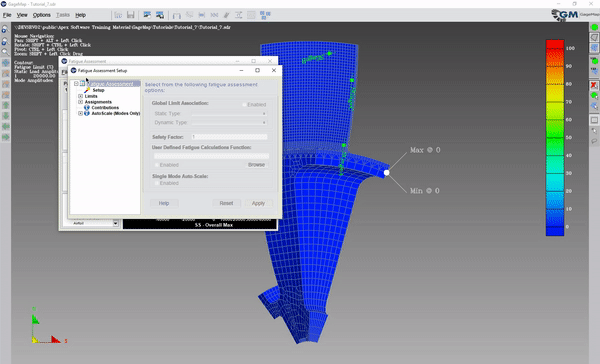
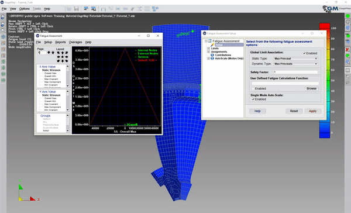
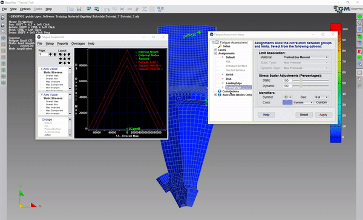
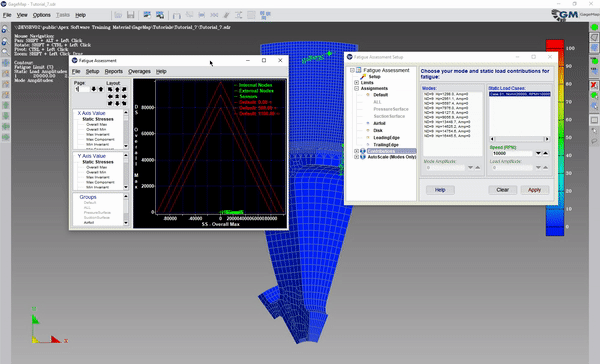
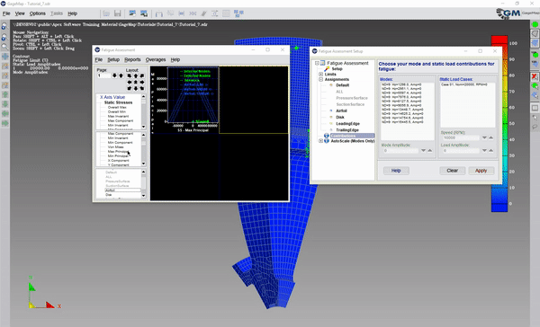
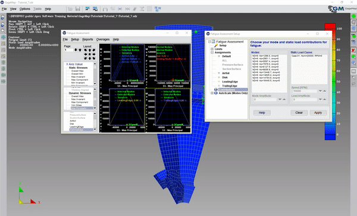
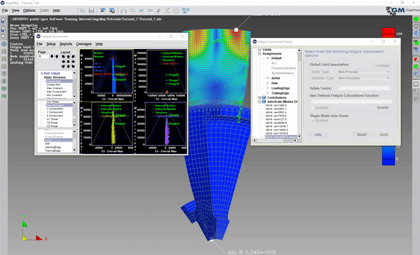

# Fatigue Assessment

## Preliminaries

The Fatgue Assessment task is model based tool based on a constant life (Goodman/Haigh) diagram (stress-life).  Fatigue Assessment should be used to define mode-based limits before a test.  It can also be used for post-test determination of "HCF margin" based on measurements.

The Fatigue Assessment task is designed to perform the following functions:

1. Generalized plotting of fatigue parameters (percent limit, static and vibratory stresses, coordinates).
2. Assignment of fatigue material properties based on group membership.
3. Multiple methods of fatigue material property temperature interpolation as well as user programmable interpolation via a DLL.
4. Plotting properties based on group membership.
5. Extensive reporting including generation of sensor limits and ratios.

If the fatigue assessment is to be performed on a group basis, i.e., groups are to be used to assign plot properties, materials, scalars and/or adders, the Boolean of the group and the order the groups appear within the grouping task become important. In order for a group to be available for assignment of fatigue properties it must have a Boolean (function) of Or or And. Groups that are disabled or have function Not will not be available. In addition, nodes can be a member of one and only one group. The group membership is determined by the top-down order of the groups within the grouping task. The lowest group that contains the node takes precedence and therefore, will be removed by all groups above. Any nodes that are not a member of any group are assigned to the "Default" group. The "Default" group is available within the fatigue task.

## Pre-Task Check List

Before entering the fatigue assessment task, confirm:

> - Model representation is valid (expanded cyclic symmetry model is acceptable).
> - - **Groups & their respective membership profile (recall a node can be a member of one and only one group)**: - It is advised that ALL nodes be assigned to at least one group or nodes not assigned to a group be removed from the model
>
>   -Sensor design (required for generating limits)
> - Stress-life material fatigue properties (static stress & dynamic stress)
> - For post-test analysis:  Modal amplitudes

### Fatigue Material Properties

The limits section lists the currently loaded material fatigue limits.  By default GageMap uses an internally derived limit diagram based upon the model characteristics. This is for notional use only and should not be used for fatigue evaluations. User material fatigue limit properties can be entered via the GageMap preference (.gmf) file. The format of the material properties within the preference file is provided below. A preference file is loaded within the main fatigue assessment window under the File menu. For legacy users there is also an option to import .glm files within the File menu, however, this is not the preferred method and support for this format may be dropped in a future release.

#### Fatigue Material Specification

`CLEAR,MATERIALS` (clears all current material definitions)

material,<material name>,<# of temperatures>
curve,<material name>,<temperature index>,<temperature in model units>,<number of points (n pairs)>,<static limit for pair 1>,<dynamic limit for pair 1>,...,<static limit for pair n>,<dynamic limit for pair n>
repeat above as necessary for each material
An example material (.gmf):

> `START,FATIGUE`
>
> `CLEAR,MATERIALS`
>
> `material,Airfoil Material,5`
> `material,Disk Material,1`
> `material,LE Material,1`
> `material,TE Material,1`
> `material,Tip Material,1`
> `material,FOR Material,1`
> `material,AFT Material,1`
>
> `curve,Airfoil Material,1,70,3,-100000,0,0,100000,100000,0`
> `curve,Airfoil Material,2,100,3,-90000,0,0,90000,90000,0`
> `curve,Airfoil Material,3,200,3,-80000,0,0,80000,80000,0`
> `curve,Airfoil Material,4,300,3,-70000,0,0,70000,70000,0`
> `curve,Airfoil Material,5,400,3,-60000,0,0,60000,60000,0`
> `curve,Disk Material,1,70,3,-200000,150000,0,150000,200000,0`
> `curve,LE Material,1, 70,3,-60000,0,0,60000,60000,0`
> `curve,TE Material,1, 70,3,-60000,0,0,60000,60000,0`
> `curve,Tip Material,1, 70,3,-60000,0,0,60000,60000,0`
> `curve,FOR Material,1,70,3,-200000,150000,0,150000,200000,0`
> `curve,AFT Material,1,70,3,-200000,150000,0,150000,200000,0`
>
> `FINISH`

The material data is viewable by under Fatigue Material Properties. Each material is listed in the order it was created along the temperature and points defining the limit curve.  Entries cannot be modified within GageMap. Modifying entries requires modification and re-loading of the material preference file.

### Mean Stress Alignment

> - Project static stress tensor into the vibratory principal direction
> - - **Storage of a single “mean stress aligned” static variable**: - Fatigue assessment task
>   - Animate task
> - - **Process**: - Select static load case
>   - - **Select vibratory tensor for alignment**: - Stress
>     - Strain
>   - - **Select static variable for storage**: - Max prin, mid prin, min prin
>     - XY, YZ, ZX shears
>   - - **Export**: - Static / vibratory stress and strain principal directions are available for export
>     - Aligned static stress and strain tensors are also available in model export

### Pre-Test Fatigue Assessment

> 1. Launch GageMap and load an SDR file.
> 2. If gages are not already mapped, map them.
> 3. Load a group file and confirm the order and Booleans are correct.
>
>   > 
> 4. Start the Fatigue Task.
>
>   > > [!NOTE]
>   > > The background color can be changed in Setup -> Color Scheme.
>   >
>   > 
> 5. Setup -> Fatigue Assessment
> 6. Select Setup
> 7. Define Static and Dynamic Stress types
>
>   > > [!NOTE]
>   > > Before a fatigue assessment can proceed, the “stress type” must be supplied. The stress type should be consistent with the material fatigue property definition & standard work. It is typically Max Principal or von Mises.  By enabling “Global Limit Association” we are telling GageMap that this is a global property and not dependent on group. If this is disabled then we can define different stress types based on groups.
>   >
>   > > [!NOTE]
>   > > The “Safety Factor” applies only to gage limits and is a divisor on the limit. For example is the limit is 100 with a safety factor of 1.0, entering a safety factor of will reduce the limit by 2.0, i.e., limit = 50.
>   > >
>   > > The "User Defined Fatigue Calculations Function is for advanced users only. GageMap permits the linking of custom libraries for fatigue material temperature interpolation. By default, the interpolation scheme as shown on the next slide is used.
> 8. Enable or disable "Single Mode Auto-Scale" and select "Apply"
>
>   > > [!NOTE]
>   > > Enabling single mode auto-scale tells GM to apply enough mode amplitude such that 1 node will be at 100% of limit. This will not permit the entry of mode scale factors. This should only be enables for pre-test while establishing limits.
>   >
>   > 
> 9. From the faigue task window (not the setup panel) select File -> Open Preferences
> 10. Open the materials file (must be a GMF file) and "Exit" the report panel.
>
>   > 
> 11. Select each group and confirm it is the correct material.
>
>   > 
> 12. Assign stress scalars
>
>   > Stress scalars can be used to artificially increase or decrease all of the stresses (stress type) in a group. They can be applied to both the static and dynamic stresses.
> 13. Assign plot Identifiers
>
>   > The plot identifiers dictate what colors & symbols to use for each group so they may be distinguished on the Goodman diagram. By default, the same color that was assigned in the group task is used here.
> 14. Expand "Contributions"
> 15. Select a static load case and enter a speed in the "Speed (RPM)" box.
> 16. "Apply"
>
>   > 
> 17. Return to the main Fatigue Task window (leave the setup window open).
> 18. Expand number of graphs as needed.
>
>   > 
> 19. Choose Static and Dynamic Stress types
>
>   > 
> 20. Return to the setup panel
> 21. Expand AutoScale (modes only)
> 22. Select each mode and view
>
>   > 
>   >
>   > GageMap has scaled the dynamic stresses such that a single node lies at 100% of limit. The node is identified by a red “star” and the label is listed in the legend. For this mode it is in the Airfoil group.  Note in the setup panel, the mode amplitude to achieve 100% of limit is listed. Also review the model window as the model has been contoured to now display “% of limit”.
>   >
>   > The Sensor Limit & Ratio Report is the most important report in the fatigue task. It summarizes all the sensor ratio and scope limit information for all modes in a single report. When initiated GageMap loops through each mode in sequence, determines the MSF to achieve 100% limit and reports the following for each strain gage:
>   >
>   > > - MSF = Modal Scale Factor
>   > > - The critical HCF node
>   > > - The limiting vibratory node
>   > > - Critical stress ratio
>   > > - Vibratory stress ratio
>   > > - Scope limit
>   > > - Variation in limit/ratios due to sensor misplacement
> 23. Reports -> Sensor Limit and Ratio
>
>   > 
>   >
>   > > [!NOTE]
>   > > The stress scope limit is in model units (0-Pk). The bounds of the min/max are set in the "Optimizer" task. If NSMS sensors are present, deflection units are also computed.
