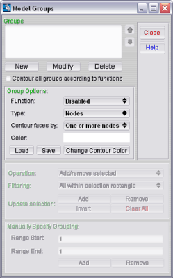
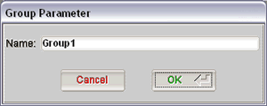
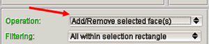
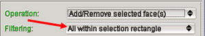
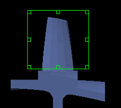
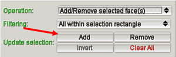
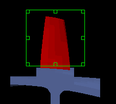
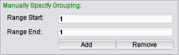
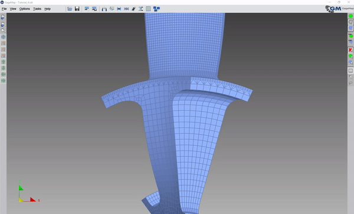

# Model Grouping

## Overview

GageMap allows you the flexibility to group out regions or components of your model, similar to ANSYS "components" or ABAQUS "sets."
This feature is standard and is included with the GageMap Basic licensed version. To open the Model Groups window (see figure 1), select Tasks > Grouping from the GageMap Main window.

> 

The grouping option is used for removing sections of the model for GageMap to consider placing sensors during the optimization process,
sensors responses based on normalized values, or viewing only portions of a model during animation.
Groups can also be used to aid in assignment of fatigue properties, cyclic phase search, model maximums, and export.
This constitutes a very powerful tool to eliminate regions of the model that may be inaccessible to the technician or areas of high geometric
curvature where great difficulty may exist in placing the strain gage accurately. Additionally, it is possible to create groups of certain faces which can be loaded as a new SDR file.
All groups in GageMap are node based.  Groups can be created in GageMap or imported from either ANSYS or ABAQUS.

> [!NOTE]
> Groups converted from ANSYS or ABAQUS are converted into a .grp file containing all of the ANSYS components or ABAQUS sets.
> Groups are named identically as in the FE code, and element groups are translated to nodes.

## Creating Your Own

- **It is very easy to create your own groups to use with your model. Once you have created a group, you can view or contour only the sections of your model which you choose.**: To create a group, follow the instructions below:

1. Open the Model Groups window by select Tasks > Grouping from the GageMap Main window.
2. Click on the New button. The Group Parameter dialog should now be shown.

  > 
3. Enter the name of your new group in the Name field and click OK. The Group Parameter dialog should now be closed. You should now see your group listed in the Groups section of the Model Groups window.
4. Click on the group from the Groups section which you just created to select and highlight.
5. Choose your Group Options. See the section name Group Options below for further details.
6. Choose your group Operation.

  > 
  >
  > There are three types of operations. Each operation allows you to interact with the model different. The 3 operations are explained as follows:
  >
  > 1. **Add/Remove selected:** This operation allows you to use a selection rectangle over the model to Add, Remove, Invert, or Clear All selected nodes, faces, or elements.
  > 2. **Click to select:** This operation allows you to use the mouse to click and select any node, element, or face on the model.
  > 3. **Click to deselect:** This operation allows you to deselect any node, element, or face on the model using your mouse.
  >
  > > [!NOTE]
  > > The name of all operations will change based on your group Type. See the section Grouping Options for further details on the group Types.
7. Choose your group Filtering.

  > 
  >
  > There are three types of operations. Each operation allows you to interact with the model different. The 3 operations are explained as follows:
  >
  > 1. **All within selection rectangle:** This filtering method will select all nodes, faces, or elements normal to the screen within the defining selection rectangle. Imagine extruding the selection rectangle through the volume in a direction normal to the screen. All faces/elements within that volume will be selected. If selecting large regions of elements it is usually good practice to make the selection rectangle large such that it extends beyond the boundary of all desired nodes, faces, or elements.
  > 2. **Forward facing only:** This filtering method will select all nodes, faces, or elements, which are normal to the screen in the forward facing direction only. All nodes, faces, or elements which are not normal to the screen will be unable to be selected until the model is rotated in such a fashion that they are now normal to the screen.
  > 3. **Visible only:** This filtering method will select all nodes, faces, or elements which are visible on the model. This will exclude those nodes, faces, or elements which are not on any surface of the model.
  >
  > > [!NOTE]
  > > This option will select internal nodes, faces, and elements if they are on a surface of a cooling passage for example.
8. In the GageMap Main window, manipulate the selection rectangle (if necessary). This is only necessary if you are using the Add/Remove selected group operation

> [!NOTE]
> If you are using a different operation, continue at step 11.
>
> 

1. Click on Add in Update Selection options (if necessary). This is only necessary if you are using the Add/Remove selected group operation.

  > 
2. The model should be contoured from the faces that you selected.

  > 
3. Click to select or deselect the individual nodes, faces, or elements (if necessary). This is only necessary if you are using the Click to select or Click to deselect group operation.
4. Manually select nodes or faces based upon the index of the entity using the Manually Specifying Grouping box.

  > 
5. Repeat steps 2-11 to create multiple groups.
6. Save out your groups to a file. See the Loading and Saving section below for further details.
7. Verify that no uninted nodes are included in the group.

> [!NOTE]
> Use wireframe mode to verify group membership – especially if faces (internal) are incorrectly identified.  Caution must be used to avoid unintentionally selecting nodes.

You are now finished with creating your groups.

## Group Options

The group options allow you to specify your group functions, group type, group color, group contour by options will be. To set your group options, follow the instructions below.

1. Select a group from the Groups selection box. The group that you selected should now be highlighted.
2. Select a Function for the group.

  > Grouping functionality utilizes Boolean functions. Each group can have a Function of Disabled, And, Or, or Not. Each group, no matter its type, is evaluated to a set of nodes which have been selected. Each group can contain one or more nodes in its set. So, when you define a group with a Function of And, all other groups with a Function of And will be And'ed to this group to create of union of nodes.
  >
  > Each group is evaluated by its Boolean Function in order from top to bottom. Each And has a higher precedence before the Or which has a higher precedence before the Not groups.
  >
  > The default Function for a group is always Disabled. If you wish not to use this group in your grouping, set its Function to Disabled.
3. Select the Type for the group.

  > There are 3 types that a group can be defined as:
  >
  > 1. **Nodes:** A Node group will only contain nodes. It has no higher level function. Each node has to be selected individually.
  > 2. **Faces:** A Face group is group of nodes defined by faces. As you select or deselect a face, each node of that face is flagged as included or excluded from the node list of its group. This is why the Contour Faces by option is available. See below for an explanation of the Contour Face by option.
  > 3. **Elements:** An Element group is a group of nodes defined by elements. As you select or deselect an element, each node of that element is flagged as included or excluded from the node list of its group. This is why the Contour Faces by option is available. See below for an explanation of the Contour Face by option.
4. Select how to Contour faces by.

  > Even though groups are basically defined by a set of nodes, the model is contoured by using faces. We use this method because it is the only way to contour a surface. These faces roughly represent which nodes of the model are selected by their group Function and type. There are 2 options on how to Contour faces by:
  >
  > 1. **One or more nodes:** This option will contour a face if any node of that face is selected in the group.
  > 2. **All nodes:** This option will contour a face if all nodes of that face are selected in the group.
5. Select the Color of the group by clicking on the Change Contour Color button.
6. To change more group options, repeat step 1 to 5.

## Importing and Saving

In GageMap, a group file can be loaded or saved to provide easy retrieval of groups which you have made. Also, group files are created during the conversion process from components of an ANSYS DB file. The group file used in GageMap has a .GRP extension and is text based. You can manually edit the file if needed, but we would not recommend it.

### Importing

1. Launch GageMap and load a .sdr file.
2. Start the Grouping Task
3. "Load"
4. Browse to and select the desired .grp file.
5. "Close"
6. Select each group in turn and note which groups have Type = Faces – these were created in GageMap. Note that the members are highlighted as each group is selected (turn node display on to see node group members).

> [!NOTE]
> Of the 7 groups loaded the following were generated in GageMap:  PressureSurface, SuctionSurface, LeadingEdge, TrailingEdge.  The remainder were translated from ANSYS components.

> [!NOTE]
> The 7 groups are listed as they appear in the file. The order in which they appear can be important. The fatigue task requires a node to be a member of 1 and only 1 group and the lowest group that contains that node takes precedence. How many nodes would be in  the “LeadingEdge” group based on the stack order shown?
>
> You must configure your group order prior to entering the fatigue task.

## Saving

1. To save a GageMap group file [.GRP], click on the Save button in the middle of the Model Groups window.
2. A simple file browser will appear and allow you to browse to the directory which you would like to save the group file into.
3. Once you have located the directory, type in the a filename and click OK.

> [!NOTE]
> A .grp file is ASCII text based and can be edited. The format is relatively simple and can be edited to include or exclude very specific nodes. Please edit the file at your own risk and perform a backup of the group file before beginning.

## Using Group Functionality

After your groups have been set and the grouping window has been closed, 3 Grouping Options are activated from the Options menu.

They are described as follows:

1. **Contour Grouped Regions:** When this menu item is checked, the model will be contoured according to all group's Boolean functions.
2. **View Grouped Regions Only:** When this menu item is checked, only the faces which have been grouped according to all the group's Boolean functions will be visible.
3. **Invert Grouped Face Normals:** Once you are viewing only grouped regions, this menu option will become selectable. This option will invert the faces normals of the current essentially turning the model inside out. This is very useful if looking at a group which is a tube structure and you wish to see the tube's faces as if they were pointing away from the inside of the tube.

Also, you can save the model as a smaller model based on only grouped regions that are visible but only if you have the 2nd Group Option above selected (View Grouped Regions Only). You can do so by selecting Save Visible As from the File Menu.

> [!NOTE]
> The new model that you will saved does not get loaded automatically.

> [!NOTE]
> The Pre-Test Optimization Task will perform its searches based on only the grouped regions that are displayed. So, if you wish to search only a few grouped faces, you would need to have the 2nd Group Option above selected (View Grouped Regions Only) and then perform the optimization.
