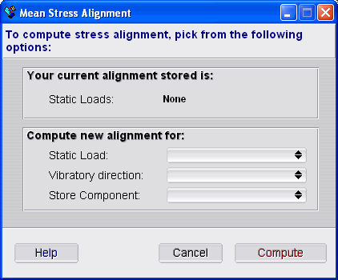

# Mean Stress Alignment

## Overview

The mean stress alignment is a task used in GageMap to align  mean/static stresses into either the vibratory/dynamic maximum principal strain direction or the vibratory/dynamic maximum principal stress direction.  Once generated, mean stress aligned values become available in both the Animation Task and Fatigue Assessment task.  Each pass through the analysis produces a mode dependent variable.

To open the Mean Stress Alignment window (see figure 1 below),  select Tasks > Mean Stress Alignment from the Main Window. The Mean Stress Alignment window is now shown.

> 

> [!NOTE]
> See the alignment section in the Theory Manual for more details.

## Limitations

In order to conserve on memory requirements, speed of use, and ease of use, a few limitations in the mean stress alignment task have been implemented. The limitations are as follows:

- User will be limited to retention in memory of one (1) component of the transformed stress tensor for a single static load case.
- Accessibility to other components will require an additional computation cycle.

- In the Animation Task, this feature will not be available for mode superposition.
- In the Fatigue Assessment Task, this features will not be available for the mode superposition.

## Aligning Mean Stress

1. Open the Mean Stress Alignment window (see the Overview section above for further help).
2. From the Compute new alignment for section, select the static load to be aligned from the Static Load selection drop-down list.
3. Select the vibratory direction to align the static load selected above by selecting from the Vibratory direction drop-down list.
4. Select which component of the transformed stress tensor to be stored by selecting from the Store Component drop-down list.

> [!NOTE]
> When choosing either X, Y, or Z, the stored component is computed from a sorted eigenvector in the order of max_prin_absolute to min_prin_absolute. For example, if you choose the option of X (Max Prin), this max principal is the greatest absolute value of the three principals.

1. Click on Compute to compute the new stress alignment values.
2. If successful, the Mean Stress Alignment window will automatically close.

## Contouring Aligned Mean Stress Values

The aligned static stress variable selected for storage is available as a mode dependent variable ("Static Stress Aligned").  The variable can be contoured by following the instructions below:

1. Open the Model Animator window by selecting Tasks -> Animate Model from the Main Window.
2. Select the Static Load Case from which the alignment was performed.  Enter the appropriate scale factor or RPM value (see the Model Animation section for further instructions).
3. Select the desired mode from the Modes list. Enter any non-zero Mode Amplitude and set an appropriate Animation scale.
4. Select Static stress aligned from the Contour mode drop-down list.
5. The model now reflects a contour of the computed mean stress alignment values.
6. To contour other modes, repeat steps 3 & 4.

> [!NOTE]
> In conjunction with the contouring, the static stress aligned variable is also available for plotting and mode scaling within the Fatigue Assessment Task.  The variable is available under the Static Type as Vibratory Aligned.
