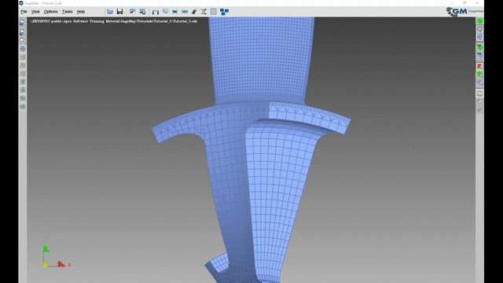
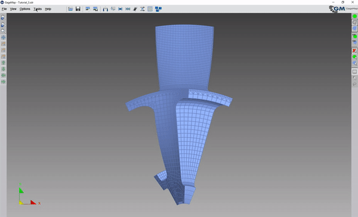
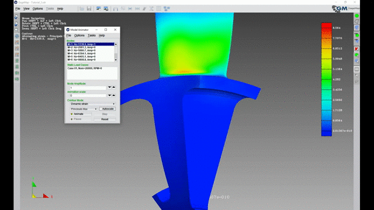
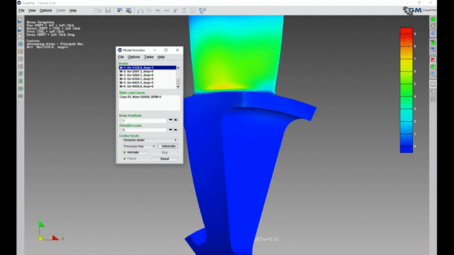
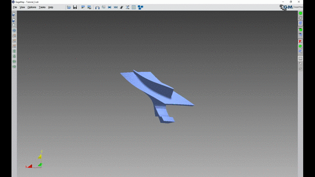

# Model Animation

## Overview

GageMap provides the ability to animate and contour either mode shapes, static load cases, or a combination of both.
This feature is standard and is included with the GageMap Basic licensed version. To open the Model Animator window (see figure 1 below), select Tasks ->
Animate model from the main GageMap window.

When animating, GageMap provides a visualization for reference purposes of the displaced model and contoured surface (based on the selected contour type).

## View Settings

1. Launch GageMap and load the SDR file
2. Disable Face Outlines
3. Select Options -> Viewing and disable “File Path”
4. "Apply" & "Close"

Typical model view properties are available, however, during conversion GageMap replaces elements with faces. Faces consist of any element face that is unattached.
Internally, the element connectivity is retained but for viewing purposes, only nodes and faces are present.

## Animation

1. With an SDR file loaded...
2. Select the animate icon or Tasks -> Animate Model
3. Select a mode
4. Set the "Mode Amplitude"
5. Set the "Animation Scale"
6. Set the "Contour Mode"
7. Set the dropdown under "Contour Mode" if availible
8. Enable/Disable Autoscale

All typical contour variables are available. Some differences from classic FE post-processors:

- Principals Max for dynamic shapes:  maximum of abs(max/min) principal
- Total Displacement/Strain/Stress:  summations of the static & dynamic values
- Static aligned:  available after an alignment has been performed – becomes a modal property

## Custom Contour

1. Disable “Autoscale”
2. Options ->  Contour (from GM GUI)
3. Set "Minimum" and "Maximum"
4. Set "Number of Levels"
5. “Apply”
6. “Close”

## Adjusting the View

1. View -> Custom Views
2. Select a view
3. “OK”
4. Close the Animate task

## GageMap Computed Values

We will now instruct GageMap to compute nodal strains & stresses from the displacements for all surface nodes.
Models with good element quality will compare well with the FE values.

1. Enable Options -> Stresses -> Use GageMap computed (Dynamic)
2. Start the Animate task
3. Note maximum strain value
4. Select “Reset”
5. Select M=2
6. Set "Mode Amplitude" & select anywhere outside of entry field

  > > [!NOTE]
  > > Note that any areas of the model that exceeded the upper contour limit is colored red.
  > > We could either increase the contour range or enable “Autoscale” to automatically reset the range for each mode.
  > > Regions below/above the minimum/maximum contour value can be defined using a custom color.
7. Manipulate model so maximum value indicator is shown
8. Note maximum principals strain
9. Repeat for remaining modes, noting the maximum principals strain or simply use the “Model Maximums Report” for both results computation methods.

If a model has well formed elements the comparison between the imported values and those from GageMap is quite favorable. Therefore, we can feel confident regarding downstream analyses.
