# Pre-Test Optimization

## Overview

The amount of time normally spent by an engineer for developing a sensor design can be significant.
Using the sensor optimization tool, a sensor design which meets the objectives is developed in a fraction of the time.

Given the number of possible sensor locations, the complexity of the models and the testing objectives, it could be extremely expensive and time-consuming to determine all the
location possibilities throughout the entire model.

GageMap provides two types of sensor optimizations: 1) optimize the location and orientation of a defined number of sensors and
2) find the position and orientation of the minimum number of sensors that will cover the current modes.
Technique #1 permits optimizations based on a many optimization criteria (amplitude, misplacement, etc.) whereas #2 maximizes only the strain gage ratio.

The optimizer operates with the objectives enabled to find the best locations for the sensor suite.
Utilizing a proprietary randomized searching algorithm, the optimizer places each sensor on the model and then checks the overall sensor design against the
defined objectives to find a high quality design. There is no guarantee the all objectives will be satisfied but the resulting design seeks to maximize the overall fitness.

### Preliminaries

Only available for modes (no consideration for static strain):

> - Ratio & sensitivity:  interchangeable terms meaning the percentage of the maximum available strain the sensor measures; a ratio/sensitivity of 1.0 indicates the sensor is placed at the mode’s       limiting location
> - The denominator variable in the ratio term is controlled by the user for reporting
> - All optimization seek to maximize the strain ratio, not the stress ratio as strain is the native measurement unit for strain gages

> [!NOTE]
> Strain ratios exceeding 1.0 are possible:
> Sensor strain ratios are derived from the displacements whereas the denominator can be from either imported or surface strains. Considerable extrapolation of strains in the FE model can cause ratios to exceed 1.0. Ratios to GageMap computed stresses should be ~1.0 in this case, however
> Large thermal gradients between the sensor location and the limiting location. Assumes material properties vary with temperature

## Genetic Algorithm

For a given number of sensors, determine the best location to place those sensors in the presence of one or more objectives

The objectives can be any of the following:

> - Amplitude Ratio (required)
> - Misplacement
> - Mode Identification (applicable only for more than 1 sensor)
> - Distance (applicable only for more than 1 sensor)
> - Alignment

“Best location” is determined by maximizing the objective function:

> - The optimizer seeks the “best” locations by assessing the objectives for all enabled modes
> - There is no guarantee that all modes will be “covered”
> - Seeks to maximize redundancy at the expense of mode coverage
> - This will result in a single design

### Genetic Algorithm: Mode ID

> - If two or more sensors are used in the presence of closely spaced modes, the relative ratio (and phase) can be utilized to assist with correct mode identification
> - - **The objective function is the angle between all closely spaced modes (user determines how close)**: - The higher the angle the more orthogonal the modes, the easier to distinguish between closely spaced modes
>
>   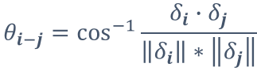
>
>   - Example:  2 sensors, 2 modes

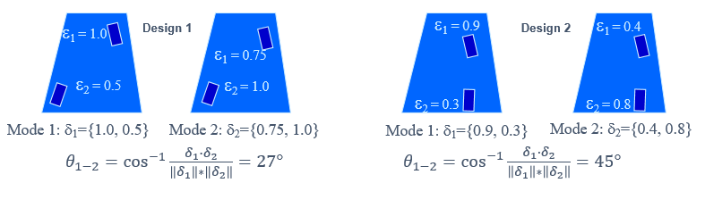

### Genetic Algorithm: Data Integrity

Objective is to place sensors in such a location that the change in ratio is minimized in the presence of sensor misplacement.  Application tolerances are prescribed by the user.

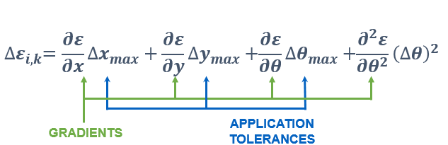

### Genetic Algorithm: Considerations

> - - **Generate groups for placement and/or normalization**: - Eliminate boundary condition stress concentrations which can artificially reduce strain gage normalized amplitudes
>   - How well do computed strains match imported?
> - - **Include only important modes**: - Select modes where you expect a significant response
>   - Do I have other instrumentation, i.e., tip timing?
> - Goal is to maximize overall fitness.
> - Simulations run fast, therefore, the effect of objectives can be evaluated quickly.
> - - **Multiple “Objectives” are available**: - Decide relative importance if more than 1 objective is enabled

### Genetic Algorithm: Basic vs. Advanced

> - Most optimization options have a set of basic features and a set of advanced features
> - Advanced features are not necessary to perform a basic optimization
> - Advanced features allow control over optimization priorities and can introduce additional optimization objectives

### Optimization Advice

> - - **What is a good design?**: - Maximized ratios?
>   - Redundancy?
>   - Easy to place?
>   - Applicability to non-optimized modes?
> - Difficult Designs:  some designs are much more difficult because of the locality and size of the maximum strain -> review your strain contours and you will be able to identify some of the difficult modes

### Genetic Algorithm: Strategy 1

Optimize one mode at a time. This can be done manually or using a script. In this case each mode was optimized independently and then combined into a single design with 20 modes & 20 gages. Below are the strain ratios with the goal being 0.30 or 30% of the maximum, vibratory location – all ratios in blue exceed the threshold

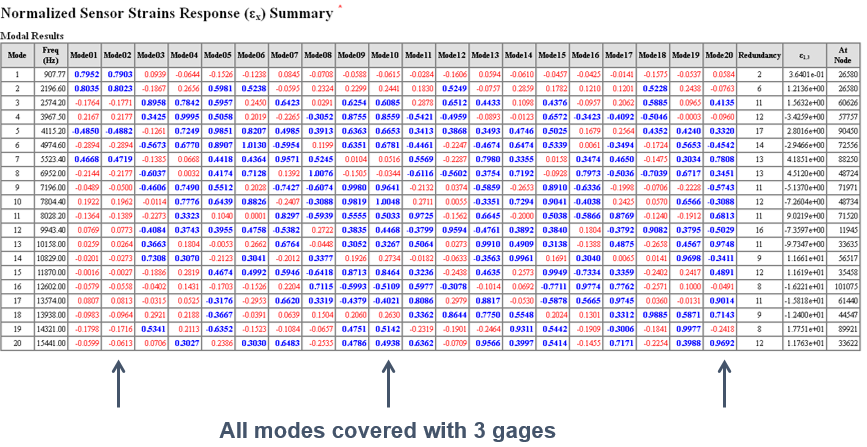

### Genetic Algorithm: Strategy 2

Stepped Optimization. Optimize for all modes using a single gage. Disable all modes covered by that gage and then proceed. Continually add gages until all modes are covered. This will typically result in a design with minimum redundancy.

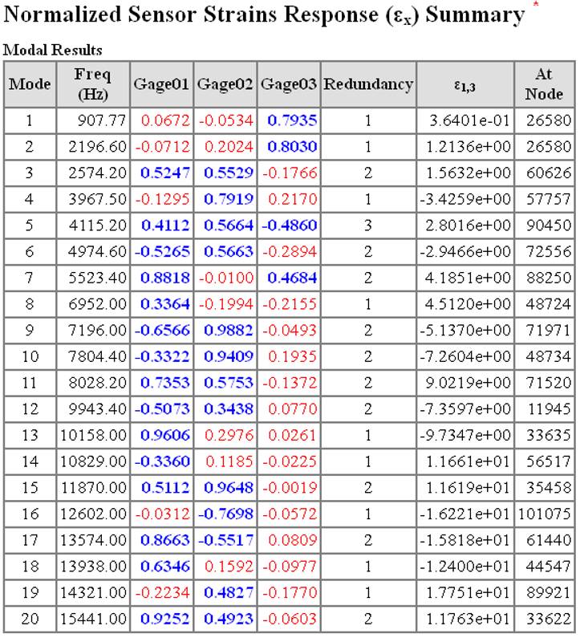

### Genetic Algorithm: Strategy 3

Stepped Optimization with additional objectives. Assume the goal is to optimize for mode ID for 3 mode pairs as shown. This will require a minimum of 2 gages. Disable all modes but those 3 pairs. Perform optimization and then disable those 6 modes and continually add gages until all modes are covered.

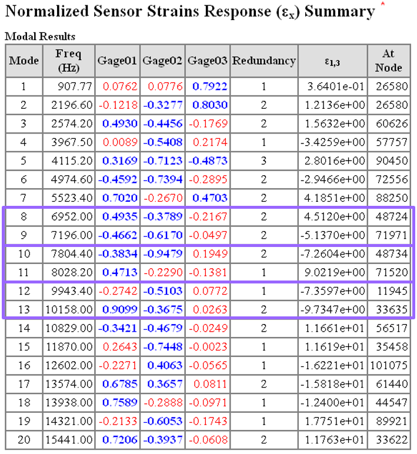

### Genetic Algorithm: Strategy 4

Utilize both a minimum and maximum ratio criterion. Set them to the same or nearly the same value to penalize “easy to cover” modes, i.e., modes with a large high strain field.
This will force the optimizer to penalize those modes and drive the design to a minimal sensor count.

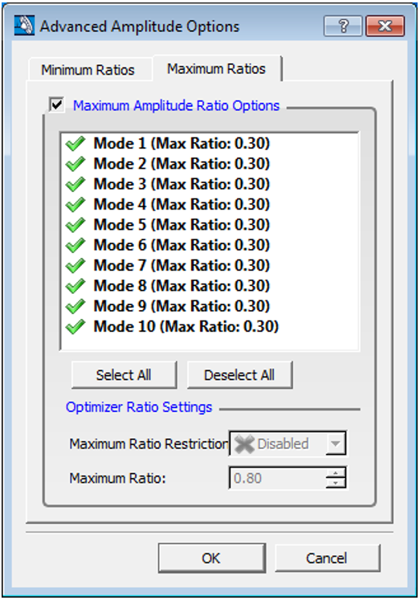

### Genetic Algorithm: Strategy 5

Multiple design families. This is a common strategy employed whereby the mode coverage is segregated into multiple designs and a different design is used for each instrumented part. Utilizing this strategy may make comparisons between parts more difficult. In the example below there is a common gage between the 2 designs.

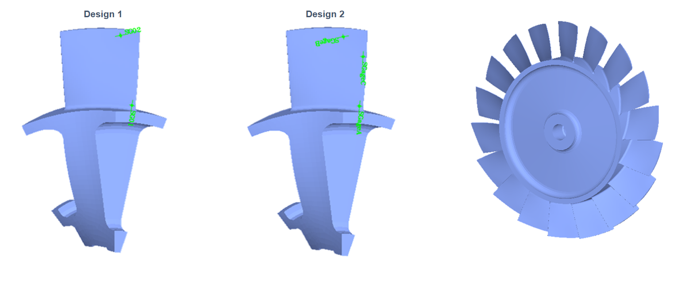

### Genetic Algorithm: Yet More Advice

> - How well did GageMap do?  Select 1 mode/1 gage for each desired mode as a benchmark to grade the gage design. Use scripting to perform this quickly for many modes.
> - Use in conjunction with the Quantity Optimizer.
> - Run multiple designs and remember to save the .sga’s!
> - Optimum designs are dependent on the selection of objectives.
> - To fix a sensor to a specific location create a group with a single node. GageMap will orient the gage for optimum coverage

### Quantity Optimizer

For a given ratio (sensitivity) determine the minimum sensor count to cover all enabled modes.

> - Sensors are added to the solution until all modes are covered
> - May result in minimal redundancy.
> - No other objectives are available
> - Typically results in multiple designs to choose from

## Optimizing to Minimize Sensor Count

> In this exercise we are going to use both optimizers to minimize the sensor count. We are also going to restrict where the sensor is placed and what group of nodes forms the basis for the denominator of the ratio.

1. Launch GageMap and load a .sdr file.
2. Start the grouping task, load the desired group, and close the grouping task.

  > Before we enter the optimization task we are going to instruct GageMap what strain type to use for the normalization basis. Here, we have chosen the “Max Principals” strain. In addition we’ll also set the normalization basis to the “Airfoil” group. This is not required for the genetic algorithm but is required for the quantity optimizer. The strain threshold is our goal to declare a mode as “covered”. These inputs are also used for sensor reports as we’ll see later.
  >
  > It is good practice to increase the strain threshold above the minimum requirement to account for misplacements and averaging.
3. Options -> Preferences
4. Normalize Strain By:  Choose from the dropdown
5. Normalize Stress By:  Choose from the dropdown
6. Normalize to Group: Choose a group to normalize to
7. Set the "Strain Threshold"

  > 
  >
  > The quantity optimizer utilizes very simple settings. You cannot set the gage quantity & the normalization basis was set in Preferences panel. You can, however, restrict where the gage may be placed and the size of the gage. GageMap defaults to a size of 0.063 x 0.063.
8. Start the optimizer; Tasks -> Pre-Test Optimization
9. Enable the Quantity Optimizer
10. Select “Add Sensor to Optimize”
11. Select “Advanced”
12. Enable “Restrict Placement” and choose a group to restrict sensor placement to. (What group on the part does the sensor need to be on?)
13. - **“OK”  & “OK” to return to the main optimizer panel**: 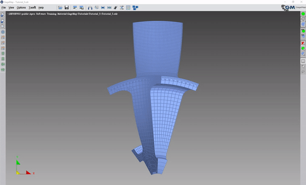
14. Select "Modes"

  > > [!NOTE]
  > > By default all modes are enabled and there are no advanced settings.
15. Select "Objectives"

  > > [!NOTE]
  > > The minimum amplitude ratio is initially set to the same value as specified in the Preferences.  There are no advanced or other objectives availible.
16. Select "Optimize"

  > > [!NOTE]
  > > Once the optimization has begun, the following takes place:
  > >
  > > > - Determine possible placement locations based on node location, gage size & mapping tolerances.
  > > > - Narrow population of acceptable nodes and add gages until all modes have adequate ratios.
  > > > - Tune gage locations off node as needed.
17. Select "Optimize" to begin the optimization process

  > 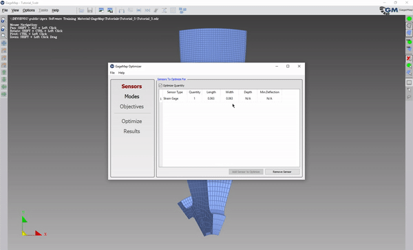
  >
  > The designs that meet the criteria are listed. They are ordered from “best” to “worse” by average ratio for all enabled modes. Each design is selectable and is displayed on the model upon selection.  In the example case, 4 designs meet the objectives and 2 gages are required to cover all 10 modes.
18. Select each of the designs and review on the model.

  > 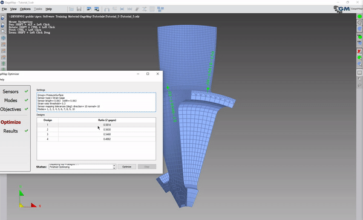
  >
  > > [!NOTE]
  > > The algorithm operates such that there should be a significant difference between designs.
  >
  > The report summarizes all 4 designs by listing what sensors in what designs cover each mode. We can see here that all modes are covered by all designs. Sometimes all modes can be covered by one less gage if adjusting the gage off node results in a mode from being uncovered to covered – as is the case with the first design.
  >
  > The design we select is now a matter of additional criteria:  easy to place, redundancy, lead wire runs, etc.
  >
  > The design that is shown on the model when exiting the task is the only one retained. Access to the other designs requires re-running the optimizer.
19. Select "Results"
20. - **Return to the "Sensors" tab**: 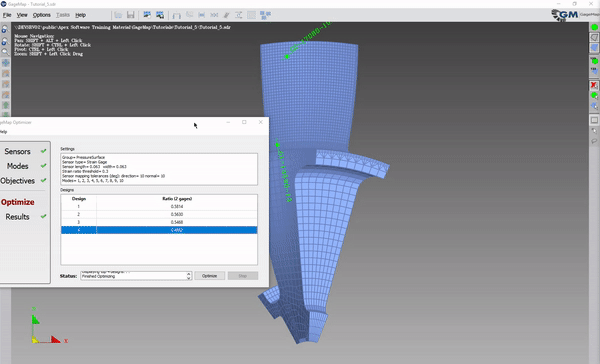

  After finding the required number of sensors needed to cover all modes, GageMap can now be used to find better locations for the sensors. In some cases, without proper adjustments, the genetic algorithm is incapable of finding an adequate 2-gage design.
21. Disable “Optimize Quantity”
22. Select the sensor definition via double-click
23. Increase the quantity to the number of gages needed to cover all modes (this was found during the first optimization).
24. “Advanced”
25. Enable “Change Sensitivity” and set to the group the gages should be sensitive to.
26. - **“OK”  & “OK”**: 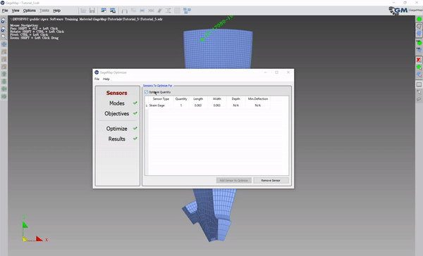
27. Select "Optimize"
28. - **Select "Optimize"**: 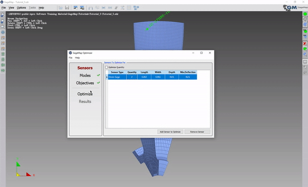
29. Select "Stop" after a few minutes or when the graph levels off.

  > > [!NOTE]
  > > The optimizer will continue to run until the stop button is selected.
  >
  > > [!NOTE]
  > > Recall that the genetic algorithm does not place a premium on “covering” modes. So, in order to force mode coverage we have to penalize the “easy to cover” modes with a maximum amplitude restriction.  We know from running the quantity optimizer that the average ratio to cover the modes was ~0.6 so we’ll set that as a maximum value.
30. - **View "Results"**: 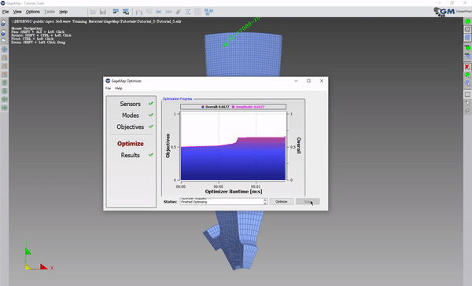

  > [!NOTE]
  > In the GIF above, the optimizer successfully found all the modes.  However, sometimes the optimizer will fail to cover a mode.  Fortunately, this can be fixed.

### If your design does NOT cover all modes

> 1. Select “Objectives”
> 2. Enable “Advanced Features”
> 3. Select “More Settings …”
> 4. Enable “Maximum Amplitude Ratio Options”
> 5. “Select all”
> 6. Maximum Ratio Restriction:  Enabled
> 7. Maximum Ratio:  Set this as the approximate average ratio needed to cover all modes as discovered in the Quantity Optimizer.
>
>   > > [!NOTE]
>   > > The genetic algorithm does not place a premium on “covering” modes. So, in order to force mode coverage a maximum amplitude restriction must be used to "penalize" the "easy to cover" modes.
>   >
>   > After running the Quantity Optimizer, an average ratio to cover the modes is revealed.  This should be used as the maximum value.
> 8. “OK”
> 9. Select “Optimize”
> 10. - **Select “Optimize”**: 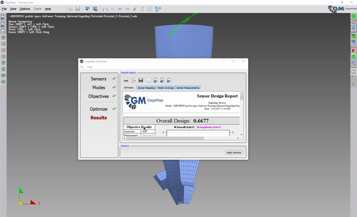
> 11. Select “Stop” after a few minutes.
> 12. Select "Results"
> 13. - **Scroll down in the results to the Mode Coverage section.**: 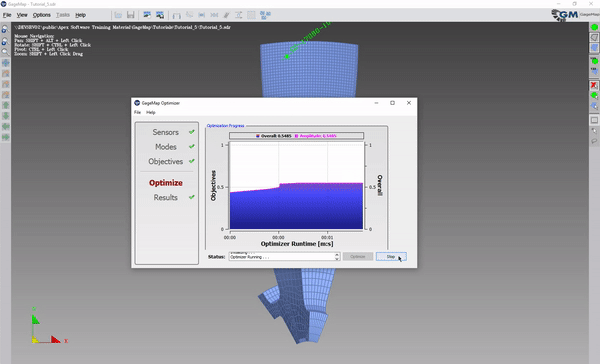
