# Sensor Mapping

## Mapping Strain Gages

### Preliminaries

Earlier we discussed sensor mapping theory, we will now extend that discussion to creating, modifying and retrieving information about sensors

- **Sensor Mapping Process:**: - - **Create sensor either manually or in the Optimizer**: - Sensor Properties:  Name, Type, Size
- - **Map sensor to model surface**: - All sensors are initially unmapped
- Repeat as necessary
- Save sensors directly on the model or into a separate file

### Strain Gage Basics

Sensors are initally placed in the center of the current view.  To map the sensor to the model, select and drag it to the desired location.

Strain gages can be selected either using the Sensor Editor GUI or selecting them on the model.  It is highly recommended to use the Sensor Editor to select strain gages.  Selecting them on the model will result in a slight movement of the gage, and if the sensor is on the opposite surface, it will be pulled through.

> 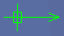

### Strain Gage Mapping Preferences

- Options -> Preferences or Tools -> Preferences within the sensor editor
- - **Mapping tolerances**: - Increase this tolerance to permit strain gages to be placed in regions of high curvature
  - Used by optimizer
- - **Logging**: - Enable logging to identify why gages will not map to certain regions of the model
- Reporting:  normalization basis

### Adjusting Sensor Positions

- - **Strain gages can either be adjusted by drag-n-drop or using user defined increments**: - Translation
  - Rotation
- Available in Sensor Editor

### Distancing and Dimensioning (D&D)

> - - **Distancing & dimensioning was originally developed in order to translate location information to sensor application technicians**: - Not recommended for precise location definitions
>   - Use strain gage position information (in SGA file) and translate to CAD surface
>   - D&D using CAD
> - - **However, D&D should be used to adjust the gage positions as needed**: - Parallel to edges
>   - Accommodate lead-out wiring and/or substrate size
>   - Etc.
> - - **4 D&D methods are available**: - Gage center to node distance
>   - Gage center to element edge
>   - Center line to node
>   - Center line to edge angle
> - Tools -> Distances in the Sensor Editor

### If Sensors Do Not Map

> - - **Is there too much curvature between faces?**: - Increase the adjacent face normal tolerance under Options -> Preferences
> - Do edges of the gage fall of the edge of the model?
> - Make sure the gage size is in consistent model units.
> - - **Options -> Preferences**: - Enable “Log Sensor Mappings”
>   - Review log file:
>   - GageMap cannot resolve the natural coordinates of the corner from the underlying element
>   - What is the quality of the underlying element?
>   - ANSYS models:  Were 20 node bricks converted to 10 nodes tets via the TCHG command?

### Reports

Two Reports are available:

Detailed sensor:

> - Requires an active (selected) gage
> - Detailed information about the active gage
> - IS updated as the gage position is adjusted

Sensor summary:

> - Does not require  an active gage
> - Information regarding the current sensor design
> - IS NOT updates as gage positions are adjusted

### Mode Identification

Cosine of the angle between modes

> - Lower the value the higher the angle (cos 0 deg = 1, cos 90 deg = 0), i.e., low = goodness
> - 90 deg -> orthogonal (best possible scenario to discern between modes)
> - Table entry ~= 0

### Misplacement Estimation

> - - **Numerical model that estimates the change in strain ratio due to misplacement**: - - **Internally maps the gage at up to 125 different locations by varying the following:**: - Misplacement along length (X) direction
>     - Misplacement along width (Y) direction
>     - Rotation
>   - Forms a linear least-squares (over determined) problem to estimate coefficients A, B, C, & D
>   - Reports model, unperturbed strain ratio and model fit statistics
> - - **Strain ratio range due to misplacement**: - Using the same 125 mappings as above reports just the extrema of the strain ratios

## Creating and Modifying Strain Gages

> In this exercise we will manually place a gage at the maximum strain location for a specific mode. We will then adjust the gage position to be as parallel to the edge as possible.  Then we will create a second gage for m and attempt to place the gage in the fillet region.
>
> These steps detail how to manually place a gage at the maximum strain location for a specific mode.  It will also detail adjsting the gage position to be as parallel to the edge as possible.  They will also detail how to create a second gage in the fillet region.
>
> 1. Launch GageMap
> 2. Load an SDR file
> 3. Use the Animate task to contour Dynamic Strain - “Principals Max” for the desired mode.
> 4. Identify the approximate location of the max strain
> 5. Close the Animate task
>
>   > 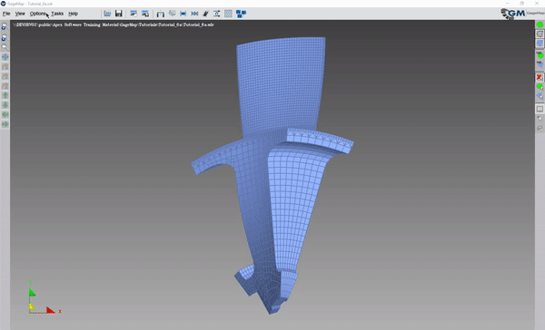
> 6. “Create & Edit Sensors” Task
> 7. “New”
> 8. Fill in the sensor properties as shown
> 9. “OK”
> 10. Drag the sensor near the region of maximum strain & rotate to be parallel to edge
>
>   > 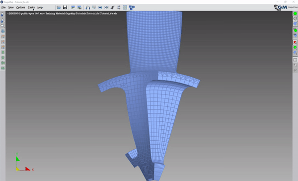
> 11. Return to the Animate task
> 12. While in the Animate task, select Tasks -> Create & Edit Sensors
> 13. Select the gage in the Sensors window or on the model and drag it to the max strain region
>
>   > 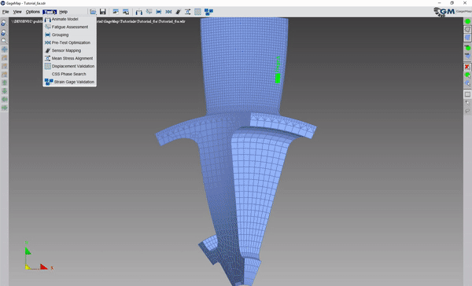
>   >
>   > > [!NOTE]
>   > > We could have just as easily created the gage directly from within the Animate task. Note what happens when you try to place the center of the gage directly at the maximum strain position. It will unmap because not all corners lie on the model.
> 14. Select the gage in the sensor editor, launch the “Detailed Sensor” report and scroll down to the “Normalized Strains” section.
> 15. Adjust the position along the edge until Ex is maximized. You may have to re-scroll after each adjustment. Use the “Reposition by Offsets” in the Sensor Editor
>
>   > 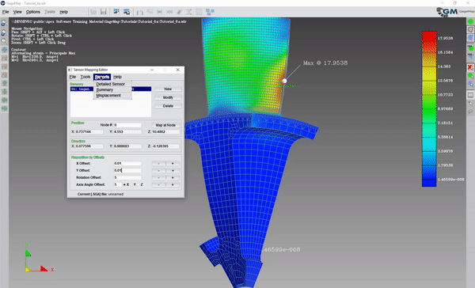
> 16. Activate the face outlines if not active
> 17. Zoom in as shown
> 18. With the gage still selected, Tools -> Distances in the Sensor Editor
> 19. In the first section, enable “center line to edge angle”
> 20. “Select node/edge”
> 21. With the Distance panel still active adjust the angle of the gage using “Rotation Offset” until the angle is minimized.
>
>   > 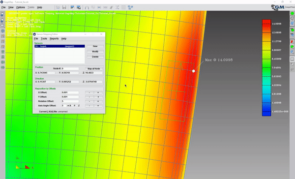
>   >
>   > ..note :: In order to capture certain modes, a strain gage may need to be mapped to a location of maximum strain in the fillet region.
> 22. Zoom to the fillet region
> 23. Create a sensor (while in the Animate task) & place in the fillet region.
>
>   > 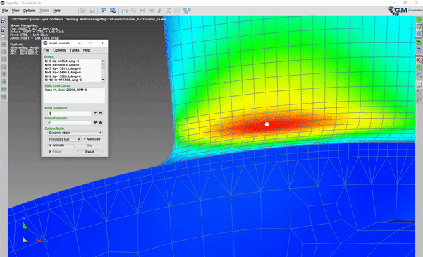
>   >
>   > > [!NOTE]
>   > > The sensor will not map to the location of maximum strain because the adjacent face tolerance is too low.  This can be adjusted.
> 24. Tools -> Preferences in Animate task.
> 25. Increase the “Adjacent face normal tolerance” to 30 degrees.
> 26. “OK”
>
>   > 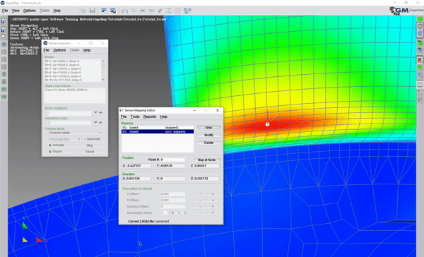
> 27. Try again to map in the fillet region. You should now be able to get much closer.
> 28. Rotate the gage to maximize the strain ratio.
>
>   > 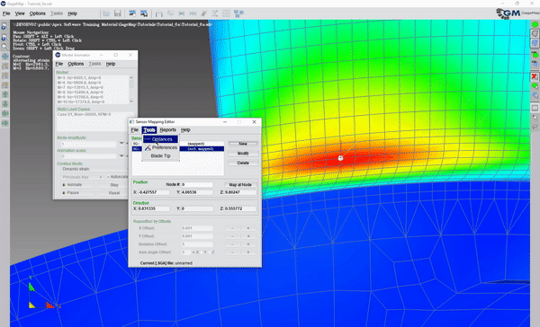
> 29. Close the sensor & animate tasks.
> 30. File -> Save As “your_name_here.sdr”
> 31. “Save”
> 32. “Close”
>
>   > 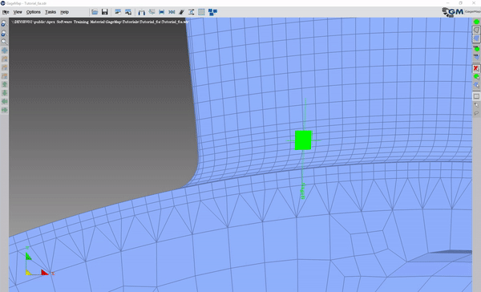
> 33. Open the Sensor Editor
> 34. File -> Save File As “your_name_here.sga
> 35. Close the sensor editor
>
>   > 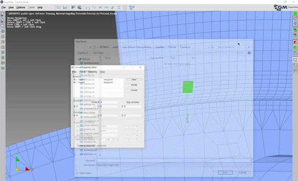
