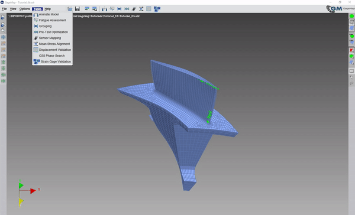
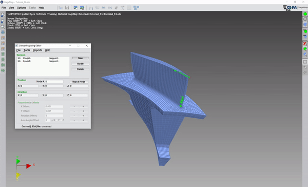
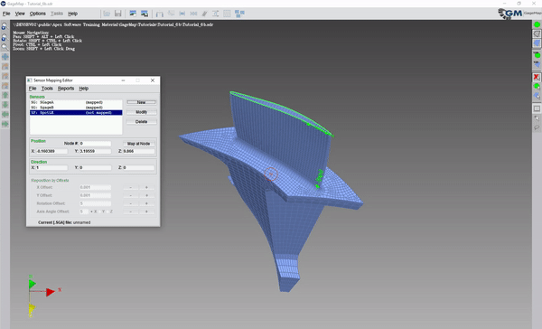

# Tip Timing Sensors

## How to model tip timing sensors

Virtual tip timing sensors can be modeled in GageMap with the following restrictions:

> - Only spot sensors are available. Spot sensors point radially inward from the case.
> - The sensor must be constrained to the tip of the airfoil.
> - The sensor dimensions (beam width) is ignored for deriving displacements.
> - Limited to modal displacements and the modal displacements are assumed to be small such that linear assumptions regarding the mode shape are valid.

Prior to creating and mapping a virtual sensor the “blade tip” must be defined. The blade tip comprises of element edges along the tip chord of the airfoil. The tip chord can be comprised of the pressure surface, suction surface or both. Once the blade tip is defined, the tip timing sensor may be placed anywhere along the element edges defining the blade tip. Caution should be exercised when placing tip timing sensors near the leading or trailing edge such that static deformation does not result in the sensor to be fore or aft of the leading or trailing edge respectively.

### Defining the Blade Tip and Placing Tip Timing Sensors

> The blade tip determines the edge location for placement of spot/cap probes.  It is restricted to element edges/nodes that define the tip of the blade.  No consideration is given for case/rotor movement due to thermals, static deflection, lean, twist, etc.  Definition of the blade tip requires knowledge of the cyclic coordinate system: axial and tangential directions.
>
> 1. Launch GageMap and load the desired file.
> 2. Start the Create and Edit Sensors Task
> 3. Launch “Blade Tip” tool from the “Tools” menu
> 4. Select “Set Direction Vectors”
> 5. Select the axial direction
> 6. Select the radial direction
>
>   > > [!NOTE]
>   > > GageMap must be told the axial and radial directions on the model.  Direction vectors should be entered such that the cross product is in the rotational direction. Right-hand rule applies.
> 7. “OK”
> 8. “Search for Tip”
> 9. "OK"
>
>   > 
>   >
>   > > [!NOTE]
>   > > The Blade Tip as determined by the algorithm is displayed as green element edges. These should define the outermost tip-chord edge of the airfoil. If the airfoil profile contains large radial gradients then the “Radial Tolerance” may be increased. For centrifugal rotors it may be necessary to define the blade tip manually. In this case the automatic blade tip search produced the desired result. The blade tip can be edited or completely defined manually by using the LMB to either enable or disable element edges.
>   >
>   > We will now create a sensor and place it near the leading edge. We should place the sensor sufficiently far back from the LE to compensate for any rotor/case relative motion such that the sensor remains on the tip. It is good practice to verify the sensor location for different load conditions. The “Width” is purely for visualization purposes and reflects the beam diameter in model units. The sensor deflection is derived from the natural coordinates of the underlying element.
> 10. "New"
> 11. Create a new "NSMS Sensor - Spot Probe" and fill in the width information.
>
>   > 
>   >
>   > 
>   >
>   > > [!NOTE]
>   > > The “Depth” is not used.  Leave it as zero.
> 12. Add as many sensors as needed.
> 13. To view a detailed sensor report, select a sensor in the sensor editor and go to Reports -> Detailed Sensor.
>
>   > 

## Sensor Reports

The detailed sensor report requires selection of an individual sensor. This report lists the cyclic coordinate system, the sensor mapping and the nominal deflections in the tangential, axial and tip timing directions for each mode. The “Actual” deflection is the deflection as measured by the tip timing sensor. Note that these deflections are not normalized or ratio’ed to any node displacement. If strain gage sensors are present then additional tables of information listing the (actual) deflection-to-(gage) strain and deflection-to-(gage) stress ratios are presented.

The sensor summary report lists the (actual) deflection ratio’ed to the maximum nominal strain and maximum nominal stress for the stress type and all nodes in the normalization basis as defined in sensor preferences.

  

## Sensor Deflection Limits

Tip timing sensor deflection limits are computed in the Fatigue Assessment task using the same methodology as for strain gages. The modal scale factor is either entered by the user or automatically computed by GageMap. Once the modal scale factor is known, sensor deflection limits are computed by multiplying the actual deflection by the modal scale factor. In addition to the deflection limit, ratios of the deflection to both the max vibratory stress and critical stress locations are computed. No attempt is made to report the variability in the deflection limit or ratios due to misplacement.
