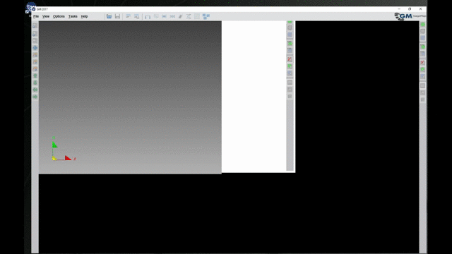
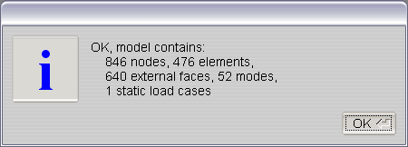
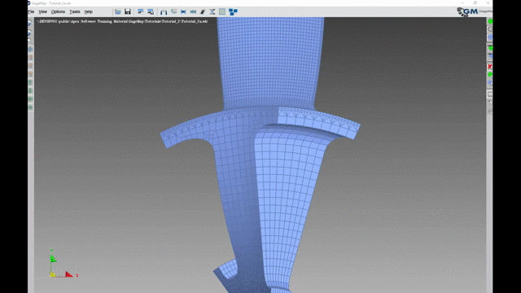
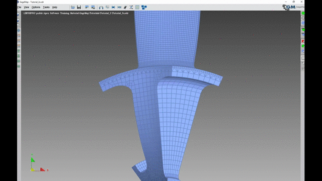
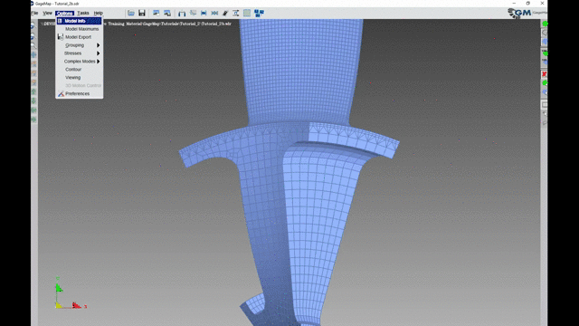
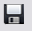
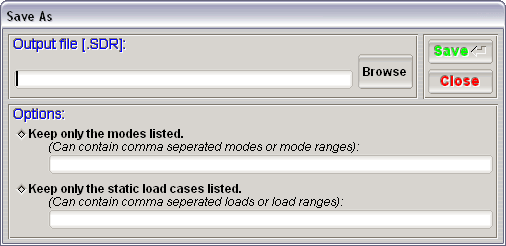
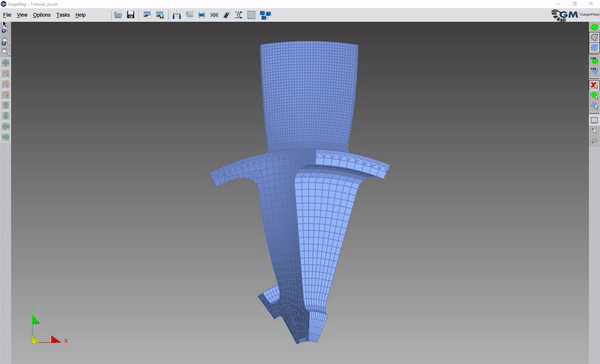

# Working With SDR Models

## Overview

GageMap uses an APEX proprietary input file known as an SDR file to store the information needed for the program interface. This SDR file allows the application to store a reduced set of information from popular FE modeling programs. The SDR file also permits optimum efficiency in file size and memory requirements, therefore,  providing the ability to analyze quite large models.

See the following sections for information regarding:

- [Load](task_modelValid.md#load)
- [Save](task_modelValid.md#save)
- [Exporting a Model](#exporting-a-model)

## Loading a Model

Once a model has been converted using either [ABAQUS to SDR Converter](aba2sdr.md), [ANSYS DB to SDR Converter](ansys2sdr.md), or [NASTRAN Converter](nastran2sdr.md) or you have an existing model, you can now load a model into GageMap.

To load in a model, select **File > Open** or click on the  icon or press ctrl+o. This will launch the **Load SDR File** window shown below:

Once the Load SDR file window has appeared, click on Browse or type in the path and name to your SDR file. Now that you have selected the SDR file which you want to load, the additional input fields in the window will be updated to reflect what is contained already in the SDR file. If this is the first time loading a SDR file which doesn't contain any material properties for the model, almost all the fields will be activated. All of the input fields are listed and described in detail below.

### SDR File Name

The path and filename to the appropriate SDR file can be manually entered. You may also select the "Browse" button which you will be able to use a standard file browser dialog box to select the path and filename of your SDR file.

GageMap defaults to the directory from where it was launched. To change directories or drives, use the drop down drive list and branch down to the desired SDR file. By default, all files with [.SDR] extensions are displayed and available for loading by selecting the desired file in the window.

### Load (if present)

Select the solution variables for GageMap to load. The **Shapes** option loads the Strains, stresses, displacements, and rotations if they are avaialble. This option must be selected if animated Goodman diagrams are desired. Otherwise, all nodal values will lie on the ordinate of the Goodman diagram. The **Gages** option loads the gages which have been saved within the SDR file.

Once the desired SDR file and material properties are input, the model will be loaded in. If the model is tremendously large, a notification will appear asking if the loading process should continue. This is to prevent the software from using up all of the computer's memory capacities. Choose 'Yes' to continue with the loading if enough memory is available.

When the model is successfully loaded, an information window will appear which will list the summary information about the model loaded. The number of nodes, the number of elements, the number of external faces, the number of modes, and the number of static load cases are displayed in the summary shown below:

> [!NOTE]
> If the model cannot be loaded due to the size of memory that the model will require being too large, answer 'No' when asked to continue. You will want to proceed to increase your virtual memory size of install additional memory in your computer before you try loading again. You could also decrease the number of nodes or elements, or not include all of the modes during your importing or conversion phase from your FE model.

## Model Information

Select Options, then Model Info.  The Model Information report contains information about the Node and Element counts, the imported static and dynamic stresses, and the materials present.

## Model Maximums

The model maximums report contains extensive information regarding the individual shapes including displacements, stresses, & strains.
The report can be saved as a PDF, Text or HTML. In addition, individual section of the report can be copied/saved to a spreadsheet while retaining the format.

For cyclic symmetry models, the “Mode” column is replaced with “Nodal Diameter” and also note that the modes are displayed as pairs. Internally, these are represented as complex pairs.

## Saving a Model

Once a model is loaded or imported, all GageMap operations are done in the computer's memory. This creates a need to save out the model when something has changed. Certain operations on the model including grouping, mapping sensors, vibrometry, and others will effect the model where that it will need to be saved out to a file so that no updated information is lost.

There are 2 differnt methods of saving the model.

### The Save Option

The Save option allows you to just save the model to the original filename from which the model was loaded. This will overwrite the existing model and save your changes.

You can save your model this way by selecting **File > Save**, or clicking on the Save  icon from the toolbar, or by pressing Ctrl+s. Any of these methods will invoke the standard Save command.

### The Save As Option

The Save As option allows you to save the model to a different path and name from the original. By using this method, you will also be able to select which mode or static load cases you wish to save into your new SDR model. To save your model using these special options, follow the steps below.

You can save your model this way by selecting **File > Save As** or by pressing Ctrl+a. These two methods will invoke the Save As command.

After invoking the Save As command, the Save As window will appear (see figure 1).

1. Specify the Output file path and name that you wish to save the SDR as. You can either manually type the path and filename into the Output file [.SDR] field or use a standard file browser by clicking on the Browse button.

> [!NOTE]
> The next few steps are optional. If you do not want to specify specific mode or static load cases to save to the model, simply click on the Save button. All modes and static load cases are saved by default unless the steps below are used.

1. - **Check the Keep only the modes listed box.**: 1. Input the list of modes that you wish to output to the new SDR file.
2. - **Check the Keep only the static load cases listed box.**: 1. Input the list of static load cases that you wish to output to the new SDR file.

> [!NOTE]
> A list can be of the form **1,4,7 or 1-5,8, 9-10**

1. Click Save.

## Exporting a Model

Once a model has been loaded or imported, information regarding the model can be accessed and exported from within GageMap. To export a model's information from GageMap, select Options -> Model Export from the main GageMap window. The SDR Export window should now appear:

The model export feature of GageMap is a very useful and powerful tool which provides access to any detailed information in the model. Temperatures, material property information, sensor information, indices, normals, eigenvectors, strains, and stress. Basically, any value within the model is available in a convenient report driven fashion.

### Accessing Model Information

To access the model information, follow the steps below:

1. Select the Options tab from the upper left of the SDR Export window.
2. From the SDR Output Options section, check all the options for which information is required.
3. From the Modes list, select one or more modes if desired. If all modes are desired, simply check the All Modes checkbox to the far right.
4. From the Static Load Cases list, select one or more static load cases if desired. If all static load cases are desired, simply check the All Static Load Cases checkbox to the far right.
5. If output is desired in 2X Precision Format, check the so-named checkbox in the lower right corner.
6. If complex mode output is desired in Magnitude and Phase, check the so-named checkbox in the lower right corner.
7. If only a small set of nodes is desired, input a list of node indexes in the Node Sub-Set input in the lower right corner.
8. Click on the Export It button. If the button is not active, you have not selected enough valid output options and you should redo from step 2 again.

> [!NOTE]
> If output is required for a large subset of nodes use the grouping task to temporarily trim the model. The Model Export only operates on the current model view.

1. Depending on the size of your model, the export process might take some time.
2. Depending on which SDR Output Options that have been selected, the output report tabs located across the top of the window will become active.
3. Select either the Nodes, Faces, Elements, Gages, Modes, Static Loads, or Other tabs to view a corresponding report. For example if the Node Normals output option is selected, the resulting report will be available under the Nodes tab.
4. The reports are listed in row by column order by spaces. After the name of any report, the report columns are defined within the next few lines to follow before any data is output.
5. If more information is required, repeat steps 1 through 11.

### Exporting Model Information

GageMap supports the export of the model information to 3 different file formats. The file formats are text, comma-separated values, and a MATLAB .M file. To export the model information follow the instructions below.

1. Launch Model Export from Options.
2. Enable the desired options to be exported.
3. Select a mode.
4. Click "Export It".
5. If a MATLAB .M file or .MAT file is chosen, the file can be loaded and further analyzed within MATLAB.

> [!NOTE]
> Because the example file exported in the gif was a cyclic symmetry model, the first mode is in reality a mode pair so 2 modes are documented.

### MAT File Contents

| Array | Description |
| --- | --- |
| node_index | A single dimension vector of the node indexes specifying the order in which all node arrays are output. |
| face_index | A single dimension vector of the face indexes specifying the order in which all face arrays are output. |
| Nmodes | A single scalar value identifying the number of modes which are contained in the output file. |
| Nloads | A single scalar value identifying the number of static loads which are contained in the output file. |
| mode_ndd | A 2 dimension Matrix of the each mode's nodal diameters of all modes contained in the output file, and the number of sectors. This Matrix is Nmodes long. |
| ndd_mode_index | A numeric matrix array specifying for each nodal diameter, where the mode offset number is for that mode |
| mode_frequencies | A single dimension vector of each mode's frequency of all modes contained in the output file. This vector is Nmodes long. |
| static_load_rpms | A single dimension vector of each static load's rpm of all static loads contained in the output file. This vector is Nloads long. |
| node_indices | A numeric matrix array specifying the position of the node coordintes. |
| node_normals | A numeric matrix array specifying the normals of each node computed from all contributing faces of an elements. |
| node_temperatures | A numeric matrix array specifying the temperatures of each node. |
| gage_mappings | A structure array specifying a mapped gage's name, positioning, and local coordinate system. |
| gage_corner_positions | A numeric matrix array specifying a mapped gage's corner positions and face index upon which each corner falls on. |
| gage_sensitivity | A number matrix array specifying the sensitivities of a mapped gage. |
| gage_Gprime | A number matrix array specifying the material matrix of a gage based upon the element's material definition upon which it is mapped. |
| material_properties | A number matrix array specifying all the material definitions at each input temperature. |
| face_indices | A number matrix array specifying each face and the nodes which each face is generated from. |
| face_normals | A number matrix array specifying each face's normal at the center. |
| element_node_indices | A number matrix array specifying each element,the nodes which each element contains, and thickness |
| element_face_indices | A number matrix array specifying for each face the element which it was generated from. |
| face_center_strains_modes | A cell array formatted in the following way by each level: * Modes - A 1 x Nmodes cell array. > - Strain - A 1 x 3 cell array for each face strain component. |
| face_center_strains_loads | A cell array formatted in the following way by each level: * Static Loads - A 1 x Nloads cell array. > - Strain - A 1 x 3 cell array for each face strain component. |
| mode_eigenvectors | A cell array formatted in the following way by each level: * Stress Layer - A cell array for each node layer of stress that is found in the model. > - Modes - A 1 x 6 cell array for each mode. The 6 cells are for each component of the output >   eigenvectors. |
| mode_strain_comp | A cell array formatted in the following way by each level: * Stress Layer - A cell array for each node layer of stress that is found in the model. > - Modes - A 1 x 6 cell array for each mode. The 6 cells are for each component of strain. |
| mode_strain_invariants | A cell array formatted in the following way by each level: * Stress Layer - A cell array for each node layer of stress that is found in the model. > - Modes - A 1 x 3 cell array for each mode. The 3 cells are for each of: Equivalent, Max Principal, >   Min Principal |
| mode_strain_principal_directions | A cell array formatted in the following way by each level: * Stress Layer - A cell array for each node layer of stress that is found in the model. > - Modes - A Cell Array of 1x9 for each mode. Once cell for each of the 3x3 rotation directions. > [!NOTE] > When outputting a complex array regardless of whether the Magnitude and Phase option is > chosen, these directions are always output in real and imaginary terms. |
| mode_stress_comp | A cell array formatted in the following way by each level: * Stress Layer - A cell array for each node layer of stress that is found in the model. > - Modes - A 1 x 6 cell array for each mode. The 6 cells are for each component of stress. |
| mode_stress_invariants | A cell array formatted in the following way by each level: * Stress Layer - A cell array for each node layer of stress that is found in the model. > - Modes - A 1 x 3 cell array for each mode. The 3 cells are for each of: VonMises, Max Principal, Min >   Principal |
| mode_stress_principal_directions | A cell array formatted in the following way by each level: * Stress Layer - A cell array for each node layer of stress that is found in the model. > - Modes - A Cell Array of 1x9 for each mode. Once cell for each of the 3x3 rotation directions. > [!NOTE] > When outputting a complex array regardless of whether the Magnitude and Phase option is > chosen, these directions are always output in real and imaginary terms. |
| static_load_displacements | A cell array formatted in the following way by each level: * Stress Layer - A cell array for each node layer of stress that is found in the model. > - Static Loads - A 1 x 6 cell array for each static load. The 6 cells are for each component of the >   output eigenvectors. |
| static_load_strain_comp | A cell array formatted in the following way by each level: * Stress Layer - A cell array for each node layer of stress that is found in the model. > - Static Loads - A 1 x 6 cell array for each static load. The 6 cells are for each component of strain |
| static_load_strain_invariants | A cell array formatted in the following way by each level: * Stress Layer - A cell array for each node layer of stress that is found in the model. > - Static Loads - A 1 x 3 cell array for each static load. The 3 cells are for each of: Equivalent, >   Max Principal, Min Principal |
| static_load_strain_principal_directions | A cell array formatted in the following way by each level: * Stress Layer - A cell array for each node layer of stress that is found in the model. > - Static Load - A Cell Array of 1x9 for each static load. Once cell for each of the 3x3 rotation >   directions. > [!NOTE] > When outputting a complex array regardless of whether the Magnitude and Phase option is > chosen, these directions are always output in real and imaginary terms. |
| static_load_stress_comp | A cell array formatted in the following way by each level: * Stress Layer - A cell array for each node layer of stress that is found in the model. > - Static Load- A 1 x 6 cell array for each static load. The 6 cells are for each component of stress. |
| static_load_stress_invariants | A cell array formatted in the following way by each level: * Stress Layer - A cell array for each node layer of stress that is found in the model. > - Static Load- A 1 x 3 cell array for each static load. The 3 cells are for each of: VonMises, Max >   Principal, Min Principal |
| static_load_stress_principal_directions | A cell array formatted in the following way by each level: * Stress Layer - A cell array for each node layer of stress that is found in the model. > > - Static Load- A Cell Array of 1x9 for each static load. Once cell for each of the 3x3 rotation > >   directions. > > > [!NOTE] > > When outputting a complex array regardless of whether the Magnitude and Phase option is > > chosen, these directions are always output in real and imaginary terms. |
| static_load_strain_aligned_stress | A cell array formatted in the following way by each level: * Stress Layer - A cell array for each node layer of stress that is found in the model. > - Static Load - A 1 x Nloads cell array for each static load output. > >   > - Modes - A 1 x 6 cell array for each mode. The 6 cells are for each component of the aligned >   >   stress. |
| static_load_stress_aligned_stress | A cell array formatted in the following way by each level: * Stress Layer - A cell array for each node layer of stress that is found in the model. > - Static Load - A 1 x Nloads cell array for each static load output. > >   > - Modes - A 1 x 6 cell array for each mode. The 6 cells are for each component of the aligned >   >   stress. |

## Missing Nodes or Zero values

When exporting the model information, some of the model's nodes may be missing from the strain and stress outputs or zeroes for the shapes. This is intentional and will occur in the following situations:

- When using either imported or GageMap computed strains or stress, the midside node information is not reported because the information is not saved in the SDR file due to the lack of necessity in GageMap.
- When using GageMap computed strain or stress, the internal nodes' strains and stresses are not computed because they are not required for any operations within GageMap.
