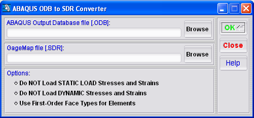
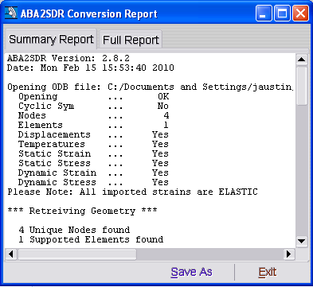

# ABAQUS to SDR Converter

> [!NOTE]
> For the consolidated `SdrConverter` ABAQUS guide (covering Abaqus 2018–2021 and 6.14-1 runtime DLLs, output requests, rotational static steps, and screenshots), see **[ABAQUS Converter Guide](../SDR%20Converter/abaqus.md)** and **[SDR Converter Overview](../SDR%20Converter/README.md)**.

## Overview

The **ABAQUS** to **SDR** Converter, also known as ABA2SDR, is used to convert ABAQUS output database files to the standard reduced file (SDR) format for use within GageMap. Static (STATIC) and frequency extraction (FREQUENCY) steps are converted. Non-linear (STEP, NLGEOM=YES) static solutions are also supported, however, the base state of geometry that is saved within the SDR file is the geometry at the end of the static step. This may be important for sensor dimensioning.

As of version 3.0, this is distributed as a separate application. Installation requires the following:

1. **Abaqus libraries:** The DLLs for Abaqus version 6.14-1 are needed to execute. They must be found in the system path. A list of the required libraries can be seen here: [Required Abaqus 6.14-1 Libraries](abq_required.md)

> [!NOTE]
> As of January 2015, The previously available link provided by Simulia for the Abaqus library downloads has been removed.

1. **(WINDOWS ONLY) Microsoft's VS 2005 SP1 MFC Security Update:** This can be located [here](http://www.microsoft.com/en-us/download/details.aspx?id=26347).

## ELEMENTS

The following elements are supported:

### 2-D Continuum elements:

CPS3, CPS4, CPS4I, CPS4R, CPS6, CPS8, CPS8R

### 3-D Continuum elements:

C3D4, C3D4H, C3D6, C3D6H, C3D8, C3D8H, C3D8I, C3D8IH, C3D8R, C3D8RH, C3D10, C3D10H, C3D10I, C3D10M, C3D10MH, C3D15, C3D15H, C3D20, C3D20H, C3D20R, C3D20RH

### Membrane elements:

M3D3, M3D4, M3D4R, M3D6, M3D8, M3D8R

> [!NOTE]
> Other elements may be present in the ODB file, however, they will not be imported (ignored) during conversion. The converter log file will list elements present but not supported.

## MATERIAL PROPERTIES

The following materials types are supported (ELASTIC):

1. Isotropic (TYPE=ISOTROPIC)
2. Orthotropic (TYPE=ENGINEERING CONSTANTS)
3. Isotropic thermal expansion (EXPANSION,TYPE= ISO)

Non-zero thermal expansion reference temperatures are also supported.
Material properties may be temperature dependent and oriented arbitrarily through orientations (ORIENTATION).

## OUTPUT

Displacement output must be present for both static load cases and modes, however element solution output (strains & stresses) is optional.

In order to convert an ABAQUS ODB file to SDR format the following output requests are recommended to be included in the ABAQUS job input file for both static loads and frequency extraction (stress and strain output is optional):

> `*OUTPUT, FIELD`
> `*ELEMENT OUTPUT, ELSET=<elset>, POSITION=NODES`
> `EE, S`
> `*NODE OUTPUT, NSET=<nset>`
> `U, NT`

NT required if nodal temperatures are defined.

If non global Cartesian material orientations are defined, all output will be transformed into the global Cartesian coordinate system during conversion.

It is not required to supply output for the full model. For example, output for only a subset of the model through use of NSET's and ELSET's is supported.

## CONVERTER

The ABAQUS to SDR Converter is shown below:

> 

> [!NOTE]
> Only elastic strains (EE) are imported from ABAQUS.

> [!NOTE]
> Initial temperature conditions (INITIAL CONDITIONS, TYPE=TEMPERATURE) are not currently supported.

## Converting a Model

In order to convert any model using the converter, follow the steps below.

1. In the **ABAQUS Output Database File** field, enter the filename or click **Browse** to select the file.
2. The **GageMap File** field will be filled out automatically to match the input file, however, the output file can be changed to any valid file name.
3. Select the desired options from the **Options**. (see the **Converter Options** section below)
4. Click the **OK** button to begin converting the model.  If any steps are of type STATIC a prompt will be issued asking if the static case is rotational.  If yes a further prompt will require input of the RPM associated with the step.

> [!NOTE]
> If the output file already exists, you will be prompted to overwrite the file before continuing the conversion process.

1. The **ABA2SDR Conversion Report** window should appear with the **Summary** tab selected. ( see Figure below )  This is a  display for the entirety of the conversion process.

  > 
2. Depending on the size of the model, the conversion process may take a considerable amount of time - especially if the database (ODB) needs to be converted for compatibility with the current ABAQUS API. The log file provides the status of the conversion process.

## Converter Options

- **Do NOT Load STATIC Load Stresses and Strains:** Selecting this option will store static load cases in the GageMap SDR file without the ABAQUS strain and stress values. This will force GageMap to calculate its own strain and stress values for the model upon load.
- **Do NOT Load DYNAMIC Stresses and Strains:** Selecting this option will store modes in the GageMap SDR file without the ABAQUS strain and stress values. This will force GageMap to calculate its own strain and stress values for the model upon load.
- **Use First-Order Face Types for Elements:** This option forces the converter to use first-order (linear) face types for elements which are defined with second order (parabolic) face types. This will effect how strains and stresses are computed for faces only (sensor strain and stress ratios may be subsequently affected also). If the model contains parabolic elements and the GageMap computed stress distribution is non-smooth or not what as expected, reconvert the model with this option selected.
