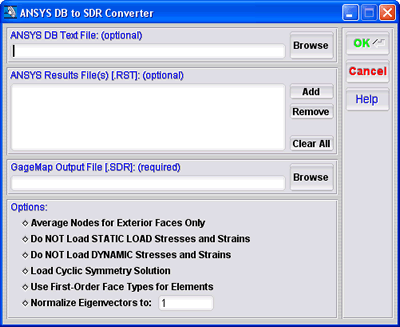
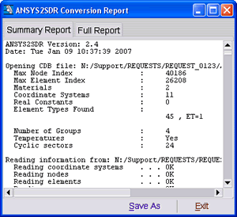

# ANSYS DB to SDR Converter

> [!NOTE]
> For the consolidated `SdrConverter` ANSYS guide (covering ANSYS 2019 R2+, CDB/RST workflows, all GUI options, non-linear geometry, and cyclic symmetry), see **[ANSYS Converter Guide](../SDR%20Converter/ansys.md)** and **[SDR Converter Overview](../SDR%20Converter/README.md)**.

## Overview

The ANSYS DB to SDR Converter, also known as ANSYS2SDR, is used to convert ANSYS FE Models to the standard reduced file format for use with GageMap. Both static (ANTYPE,STATIC) and frequency extraction (ANTYPE,MODAL) steps are converted. Non-linear (NLGEOM,ON) static solutions are also supported, however, by default, the base state of geometry saved within the SDR file is the geometry at the end of the static step. This is important for dimensioning sensor locations. The format of files that can be read from ANSYS are:

1. DB text file, referred to as the CDB file (output from ANSYS using the CDWRITE,DB,<cdb file name>,cdb command)
2. Structural results file, referred to as the RST file

The converter does not require both types of file to be present. A CDB file can be converted by itself for later use within GageMap or the SDR File Manager.  RST file(s) can be converted directly, however, the following will not be available: material properties (default material properties will be substituted), element & node components, and nodal temperatures.

## ELEMENTS

The following elements are supported:

### 1-D elements (visualization only, no results other than node displacements are supported)

LINK1, BEAM3, BEAM4, LINK8, LINK10, PIPE20, BEAM23, BEAM24, BEAM44, BEAM54, PIPE59, LINK180, BEAM188

### 2-D Continuum elements

PLANE42, PLANE82, PLANE182, PLANE183

### 2-D Structural shell elements

SHELL28, SHELL41, SHELL43, SHELL63, SHELL181, SHELL93, SHELL281

### 3-D Continuum elements

SOLID45, SOLID92, SOLID95, SOLID185, SOLID186, SOLID187, SOLSH190

> [!NOTE]
> Other elements may be present in the CDB/RST files, however, they will not be imported during conversion. The converter log file will list elements present but not supported.
>
> It is important to note that element definitions for some parabolic element types may have incomplete definitions. This is especially true for mesh transition regions if the TCHG command has not been performed. Any element that does not contain a proper connectivity definition (node labels must be non-zero positive integers and the nodes must exist in the CDB file) will be reduced to the linear counterpart, i.e., 20 node brick to 8 node brick. Warnings will be issued during conversion.
>
> The shell element thickness property must be defined using REAL constants. Section information is ignored.

> [!NOTE]
> Shell Element Support is limited. There is no support for mid-surface element results, therefore mid-plane results should not be written to the RST file.

## MATERIAL PROPERTIES

The following elastic materials types are supported:Isotropic (MP,<EX,NUXY,PRXY>) and MPDATA,<EX,...>.

1. Orthotropic (MP,<EX,EY,EZ,NUXY,NUYZ,NUXZ,PRXY,PRYZ,PRXZ, GXY,GYZ,GXZ, and MPDATA,<EX,...>
2. Isotropic thermal expansion (MP,ALPX) and (MPDATA,ALPX)
3. Thermal expansion reference temperature, MP,REFT and TREF.

Material properties may be temperature dependent and oriented arbitrarily (ESYS).

## OUTPUT

Displacement output must be present for both static load cases and modes, however element solution output (strains & stresses) is optional. It is highly recommended that strain & stress output for shell elements be present for both static load cases and modes as GageMap contains only basic shell element theory. Output split between multiple files (/CONFIG,FSPLIT) is also supported, supply only the main RST (.rst) file to the converter input.

Both top/upper and bottom/lower surface element results for shell elements are required.  Results at other locations (mid for example) are not permitted.

While the geometry for both the CDB and RST files must be consistent, it is not required to supply output or geometry for the full model. For example, output for only a subset of the model with a full model CDB is supported or a partial CDB for a full output is also supported. In the former case the geometry will be as defined in the CDB file while only a subset (those nodes/elements with results in the RST file) of the model will have results defined. In the latter case the geometry will be as defined in the CDB file with node/element results for those nodes/elements not in the CDB file ignored.

## CONVERTER

The ANSYS to SDR Converter is shown below:

> 

> [!NOTE]
> The converter accepts up to 25,000 different element (TYPE) definitions. An error will result if the this amount is exceeded.

> [!NOTE]
> Imported strains are ELASTIC (not total).

## Converting a Model

To perform the conversion, follow the steps below:

1. Provide the ANSYS DB Text File input field, either type in the path and filename or click the Browse button to select the file. This file input is optional, but highly recommended. (Optional)
2. Provide the ANSYS Results File(s) input, select Add to browse to the RST files. One or more RST files may be supplied, but they all must contain the same geometry unless converting a non-linear pre-stressed analysis. (see the Converting a Non-Linear Model section below)

> [!NOTE]
> The order which the result files are ordered in this list will be the order which the modes occur in the output SDR file.

1. Enter the desired output SDR name in the GageMap Output File field or click the Browse button to select your file.
2. Select the desired options from the Options. (see the Converter Options section below).
3. Click the OK button to begin converting your model.

> [!NOTE]
> If the output file already exists, a prompt will be displayed to overwrite the file before continuing the conversion process.

1. The ANSYS2SDR Conversion Report window should appear with the Summary tab selected. (see Figure below).

  > 
2. Depending on the size of the model, the conversion process may take a considerable amount of time. The log file provides the status of the conversion process.

## Converter Options

- **Average Nodes for External Faces Only:** Mimics POWERGRAPHICS on or off within ANSYS.  If selected, this option will produce a model with the imported strains and stress from the modes and static load cases equivalent to having the POWERGRAPHICS ANSYS option ON. An exception is that GageMap considers any element on the surface if it has a free face, whereas ANSYS considers any element on the surface that has a free edge.
- **Do NOT Load STATIC Load Stresses and Strains:** If any RST files contain static load cases with strain and stress solutions, then selecting this option will store static load cases in the GageMap SDR file without the ANSYS strain and stress values. This will force GageMap to calculate its own strain and stress values for the model.
- **Do NOT Load DYNAMIC Stresses and Strains:** If any RST files contain modes with strain and stress solutions, then selecting this option will store modes in the GageMap SDR file without the ANSYS strain and stress values. This will force GageMap to calculate its own strain and stress values for the model.
- **Load Cyclic Symmetry Solution:** Selecting this option will allow the converter to extract the cyclic symmetry solution. If this option is selected and the model is not valid for cyclic symmetry, the converter will error and quit. If this option is not selected and the model is valid for cyclic symmetry, the converter will process the geometry as non-cyclic.
- **Use First-Order Face Types for Elements:** This option forces the converter to use first-order (linear) face types for elements which are defined with second order (parabolic) face types. This will effect how strains and stresses are computed for faces only (sensor strain and stress ratios may be subsequently affected also). If the model contains parabolic elements and the GageMap computed stress distribution is non-smooth or not what as expected, reconvert the model with this option selected.
- **Relax Geometry Comparison by (units):** ANSYS typically provides geometry information in the static RST and modal RST files in addition to the CDB file. By default GageMap will compare the geometry between all files provided to ensure each file is identical. GageMap permits a maximum of 1% deviation from the baseline (CDB) geometry. In the case of a nonlinear geometry analysis the modal RST file geometry will be the base geometry plus the static displacements. This will be confirmed by the converter. Enabling this option permits relaxation of the geometry checking by a user supplied value in model units. Therefore, geometry checking can be effectively disabled by making this value large enough. This may be desired for pre-test optimization where the gage locations are required on the undeformed geometry, however, caution should be used when  placing gages in regions of large static displacements.
- **Maintain Local Coordinate System (Strains/Stresses):** Enabling this option will retain the element results in the coordinate system as defined by the ESYS property. By default all element results are transformed into the global Cartesian coordinate system and then averaged at the nodes.

## Non-Linear Results

In order to produce a SDR model using non-linear results, the following process is recommended:

1. Export a CDB file containing the undeformed geometry - prior to issuance of any geometry updating commands.
2. Supply a nonlinear static load case results solution file.  (Required)

> [!NOTE]
> One and only one static load case is permitted. This is required to verify geometry between the CDB file and the pre-stressed modal results file. To utlize more nonlinear static results files enable the relaxation of geometry comparison as described above.

1. One or more pre-stress modal results file resulting from updating the coordinates after the static solution. (Optional)

## Cyclic Symmetry Solutions

As of version 3.4, the following are requirements for cyclic symmetry solutions:

1. A CDB file is required due to the CDB containing information for which the converter relies.
2. The CDB and RST **MUST** contain both the basic and duplicate sectors.
3. The RST **MUST** contain the solutions for **ALL** nodes and elements defined in the CDB.
4. **ALL** Geometry defined within the CDB **MUST** exist in the RST.
