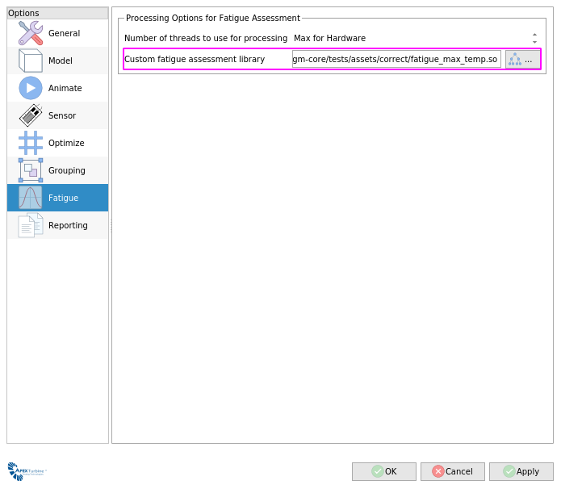
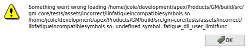
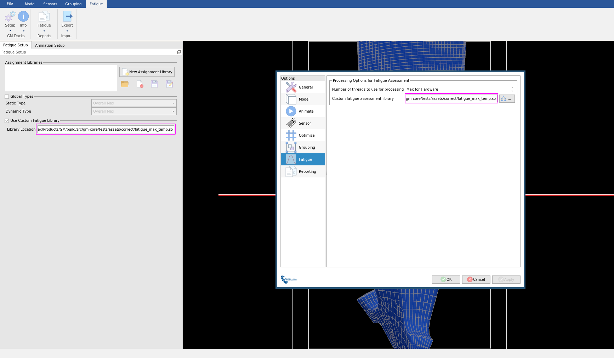

# Custom Fatigue Library Support

GageMap supports extension of the fatigue assessment capability by providing
tools to load and use a user-implemented fatigue library.

## Loading a Custom Fatigue Assessment Library

Open the GageMap Preferences and navigate to the Fatigue options. As seen in
[fatigueLibPreferences](#fatiguelibpreferences), there is an option to change the current
custom fatigue assessment library. This library must be a dynamic-link library,
having a `.so` extension on Linux and a `.dll` extension on
Windows.

*Loading a custom fatigue library*

When a custom fatigue library is selected, GageMap tests the following
conditions:

- the library can be opened at the specified path
- symbols matching the custom fatigue library interface are able to be
  loaded from the library
- the user defined limit function has been defined with the correct name and
  correct parameter list

If these conditions are not met, the fatigue library specified will be rejected
and an error message will be displayed indicating that a problem occured, as
seen in [fatigueLibFailure](#fatiguelibfailure).

*Error while loading fatigue library*

Once a fatigue library has been successfully loaded, it can be used as part
of the fatigue assessment, but custom fatigue library usage is not enabled
by default. In order to use the loaded fatigue library, navigate to the
fatigue assessment tab and check that the fatigue library path in the box is
correct (it should always update with the fatigue library path in the
prefrences), then click the "Use Custom Fatigue Library" setting in the side
panel. Doing so will load the custom fatigue library and prepare it for
use in the fatigue assessment.

