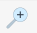
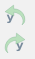
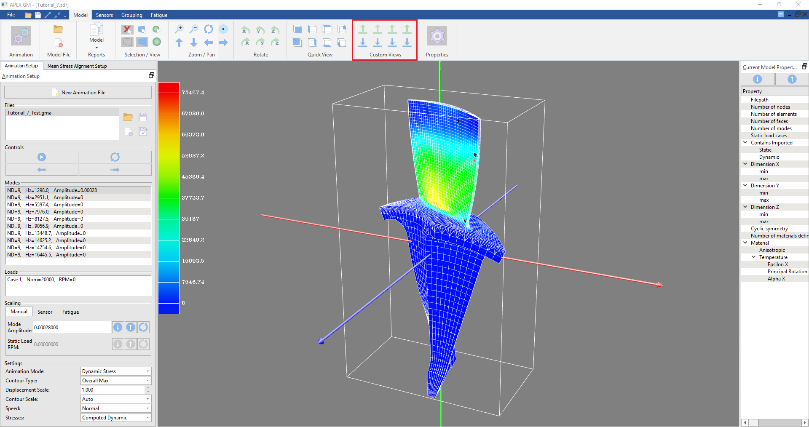

# Model Tab - Manipulating the Model

There are many options for adjusting and manipulating the model view within GageMap 2019, including quick and custom views with the click of a button. Below is a list of all the ways to move the model within the 3D space.

## Click and drag options

The easiest way to manipulate the model is by clicking and dragging within the viewing space.

- Right click and drag - Rotate model around the view center.
- Left click and drag - Pan model within the 3D space. This adjusts the view center
- Right + Left Click and drag up and down - zoom in and out

In addition to using right + left click together, the model can also be zoomed in and out using the scroll wheel.

## Zoom / Pan and Rotate Buttons

Another way to move the model by known values is with the Zoom/Pan and Rotate Panels of the top ribbon.

Use the Zoom In  or Zoom out  buttons to zoom in or out on the model. Clicking the Zoom Reset  button will center the model within the viewing space. Use the  button to set the view center to a specific spot on the model. Press the Move Up , Move Down , Move Left  and Move Right  buttons to move up, down, left, and right to move the model withing the 3D space respectively. To rotate the model along each of it's axis, click the ,  or  buttons.

## QuickView

To instantly snap to a preset view, use the QuickView Buttons. There are 8 direct views of the model to choose from. Ctrl+R will reset the model to its default position (front).

## Custom Views

If an indirect view must be returned to frequently, the custom views section of the ribbon can be used. To set a custom view, rotate the model to a desired point, and click the Save Position  button. This will enable the Load Position  directly below it. Click Load Position  to instantly snap back to the saved position.

