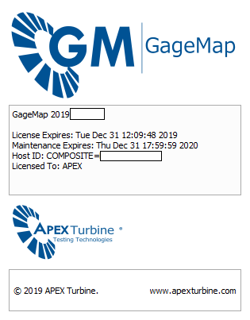
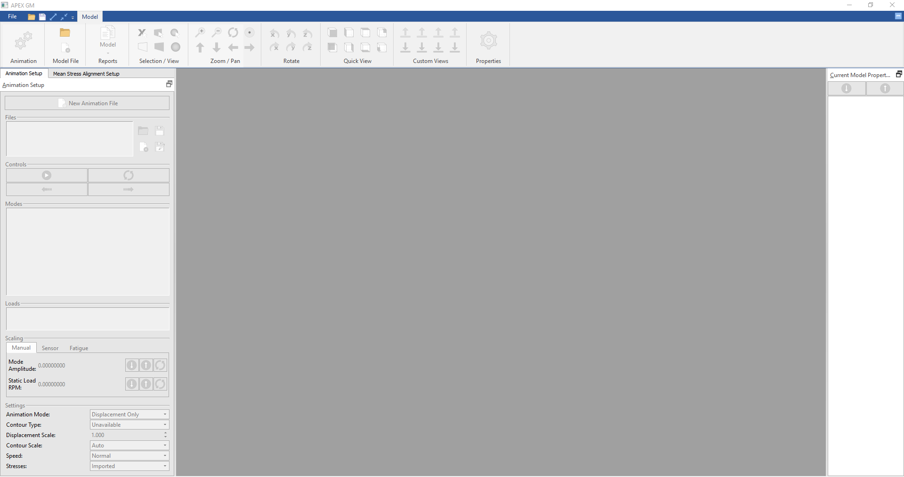
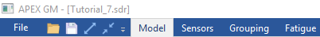
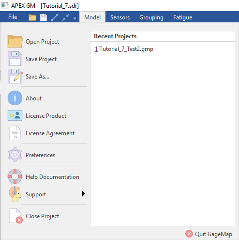

# Basic Information / Startup

## Third Party Libraries

Some features of GageMap are only available with third-party libraries. In order to make these libraries available to GageMap, they need to be found in the path of the operating system. This applies to such libraries as MATLAB and ANSYS.

Tools such as MATLAB and Abaqus are installed with libraries that GageMap can use. For example, Model Export can export to MATLAB MAT format if it has access to those libraries. These tools cannot be packaged with GageMap as they are proprietary, but if they are installed on the local machine, various features will be enabled.

In order for GageMap to find the needed libraries, they must be available in a system path. The following is a simple guide in setting this up for Windows and Linux.

### Windows

There is a setup panel for environment variables in the Control Panel of Windows. On modern operating systems, the quickest route is to open the start menu and use the search bar at the bottom to find 'environment variables'. The widget will contain a button for editing these variables.

Both the user and the system variables may have a variable called "Path" which can be set to anything. Whatever is in that path, GageMap will see.

GageMap will need a complete path leading to the library files desired. For example, Windows' MATLAB requires a path along the lines of the following:

*C:\Program Files\MATLAB\R2012b\bin\win64*

**WARNING: Do not delete existing paths. Append new paths only, or other system operations may cease to operate correctly.**

### Linux

Either install the third-party library to the standardize paths such as */usr/lib or /usr/lib64*, or set the environment variable *LD_LIBRARY_PATH* to point to its custom location.

To set this field **temporarily** in a terminal, use: *export LD_LIBRARY_PATH="<path>:$LD_LIBRARY_PATH"*

To set this field **permanently**, review how this is done for the Linux distribution in use. It is likely to be a matter of editing a file such as *.bashrc* or *.profile.* The internet provides ample information for every flavor of Linux.

Alternatively, you may edit the script files used to launch GageMap executables and add the path to the same place that the scripts already adjust *LD_LIBRARY_PATH*.

### Required Libraries

For MATLAB: Point to the path containing libmat.so(Linux) or libmat.dll(Windows)

For ANSYS: Point to the path containing libansys.so(Linux) or libansys.dll(Windows)

> [!NOTE]
> As of GageMap version 3.6, this is no longer required

For ABAQUS: Point to the path containing the ABAQUS libraries. A list of these libraries can be seen here: [Required Abaqus 6.14-1 Libraries](abq_required.md)

## Starting the Software

When starting the software, the startup splash screen will appear.

The startup screen shows the version of GageMap and the licensing information for the current GageMap installation. The same information is also available in **File > About**. GageMap will launch automatically after a few seconds, and the splash screen will close.

## The Main Interface

Upon Opening GageMap, only the "Model" tab will be active before a file has been loaded. Once a file has been loaded, the "Sensors," "Grouping," and "Fatigue" tabs will become available. All Tasks within GageMap are performed in these tabs. See [GageMap File Formats](files.md) for more information on GageMap file structure and how to load files.

### Menu Bar / GageMap Tasks

Along the top left of the window is the GageMap menu. This is where projects can be loaded, saved, minimized or maximized. The [File Menu](#file-menu) menu is located along this bar, along with the tabs that include the main GageMap Tasks:

- [Model Tab - Animation](task_modelAnim.md)
- [Sensor Tab - Sensor Management](task_sensors.md)
- [Grouping Tab - Managing Groups](task_group.md)
- [Fatigue Tab - Performing Assessments](task_fatigue.md)

### File Menu

- - **Open Project**: - brings up the file open dialog for loading a [GMP](#gmp) file
- - **Save Project**: - Saves any changes made to the current project
- - **Save As**: - Opens a dialog box to save a copy of the current project as another name
- - **About**: - Displays information about GageMap including version and license information
- - **License Product**: - Change the license type, hostname or file in this dialogue. Also includes "Host ID" needed for creating licenses
- - **License Agreement**: - Opens license Agreement
- - **Preferences**: - Opens GageMap preferences. These preferences include operational settings for many of the GageMap tasks that are necessary for setting up projects.
- - **Help Documentation**: - Opens this help document
- - **Support**: - Includes quick links to Help Documentation, the APEX User Site (prefered method of support), and direct email contact to APEX.
- - **Close Project**: - Closes the current Project
