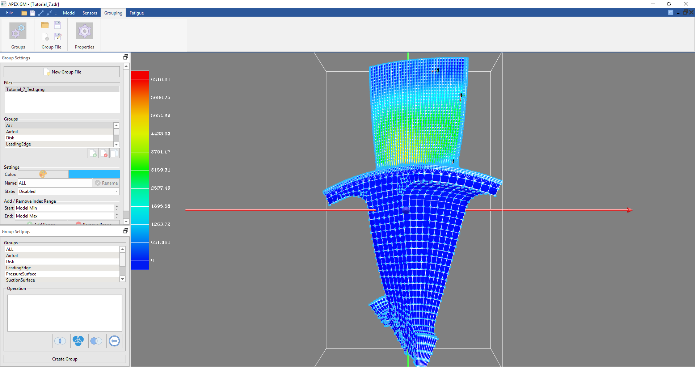
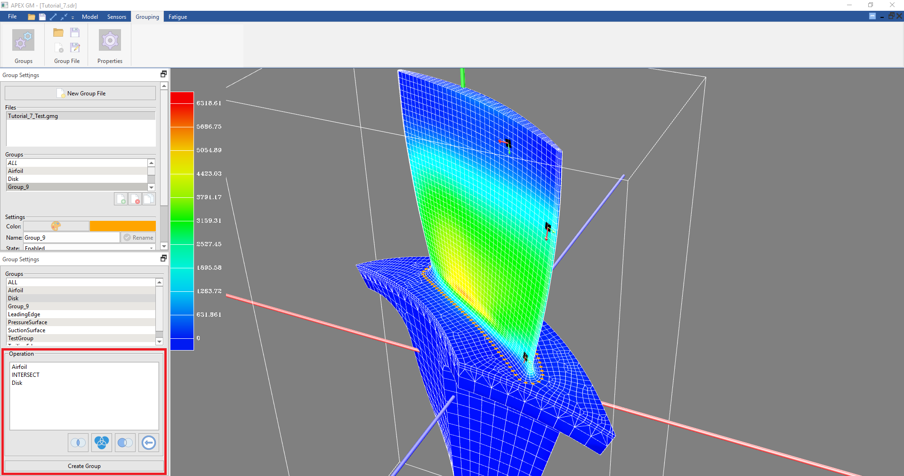
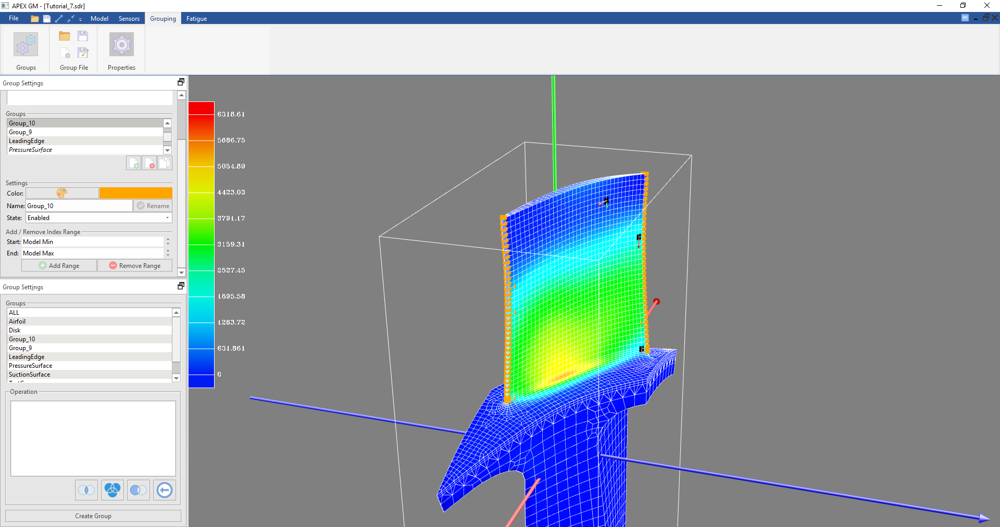
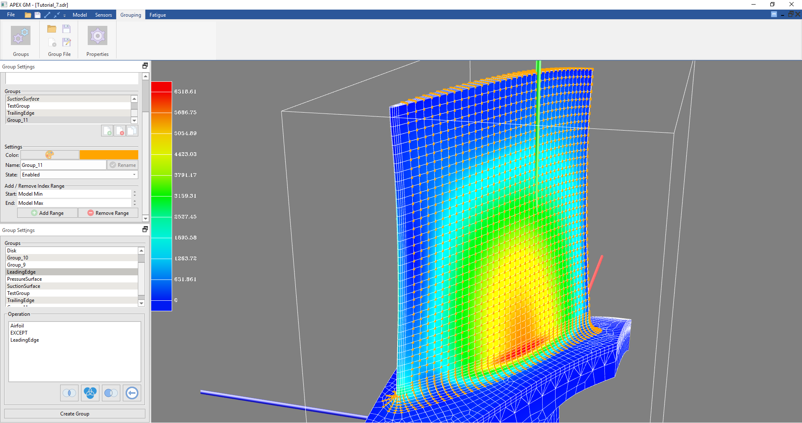

# Grouping Tab - Managing Groups

## Overview

GageMap allows the flexibility to group out regions or components on a model, similar to ANSYS "components" or ABAQUS "sets."
This feature is standard and is included with the GageMap Basic licensed version. To load, edit, or create groups, load an SDR file and navigate to the "Groups" Tab

The grouping option is used for removing sections of the model for GageMap to consider placing sensors during the optimization process, sensors responses based on normalized values, or viewing only portions of a model during animation. Groups can also be used to aid in assignment of fatigue properties, cyclic phase search, model maximums, and export.
This constitutes a very powerful tool to eliminate regions of the model that may be inaccessible to the technician or areas of high geometric curvature where great difficulty may exist in placing the strain gage accurately. All groups in GageMap are node based. Simple Groups can be created in GageMap or more complex groups imported from either ANSYS or ABAQUS.

> [!NOTE]
> Groups converted from ANSYS or ABAQUS are converted into a .grp file containing all of the ANSYS components or ABAQUS sets.
> Groups are named identically as in the FE code, and element groups are translated to nodes.

## Custom Groups

Simple Groups can be created in GageMap from the "Grouping" tab. To create a custom Group, use the following steps:

1. In the "Grouping" tab, click "New Group File." This will create a saveable GMG file that will appear in the textbox under "Files"
2. Create a new group with page + button under the "Groups" textbox. This will create a new group
3. Set group settings as desired. Settings include Colors, Names, and State (Enabled/Disabled)

4. Add an index range. Index ranges are based on node numbers.
4. When "Add Range" is clicked, every node in the range specified will be selected and added to the group.
5. If "Remove Range" is selected, all nodes between the selected range will be removed from the existing group.

## Editing Groups

Once multiple groups have been created, they can be edited together to create new groupings. The "Operation" section has a number of simple functions. These operations take existing groups and merge or separate them based on the options selected:

- - **Intersect - This will take the group selected and create a new group that includes all nodes that overlap with the next group selected in the list.**: - Example: "Airfoil" INTERSECT "Disk" will create a group in the small section near the fillet region where the airfoil and disk overlap.

- - **Union - This will create a group including the groups selected and all of their overlapping nodes.**: - Example: "LeadingEdge" UNION "TrailingEdge" will create a group including both the leading edge and trailing edge of the blade.

- - **Except - This will include all nodes in the first selected group, minus the next selected group.**: - Example: "Airfoil" EXCEPT "LeadingEdge" will create a group that includes all of the airfoil minus the nodes on the leading edge.

Multiple operations can be used at the same time to further customize groups. To remove a group or operation from the operations list, click the "erase" button. Once the operation has been specified, click "Create Group" to execute the operation and create the group. The new group will appear in the "Groups" list along the left side panel.

## Loading/Saving

As mentioned earlier, groups can be imported from ANSYS and ABAQUS directly into GageMap. We recommend creating groups in these programs, as there is slightly more functionality for creating the groups. To import a group from ANSYS and ABAQUS, open the GMP or SDR file associated with the group associated with it, navigate to the "Groups" tab, and click the "Open" folder. Navigate to the exported group file and select it in the file browser. Once selected, it can be saved again as a GMG file, and will be associated with the main GageMap GMP project file when it is saved.

If groups have been created within GM, or a group has been edited, it can be saved with the "Save" button in the "Groups" tab, or saved with the GageMap project file with Ctrl+S or the save button in the file menu or hotbar. Groups are then loaded in the same was as they are imported from ANSYS or ABAQUS.
