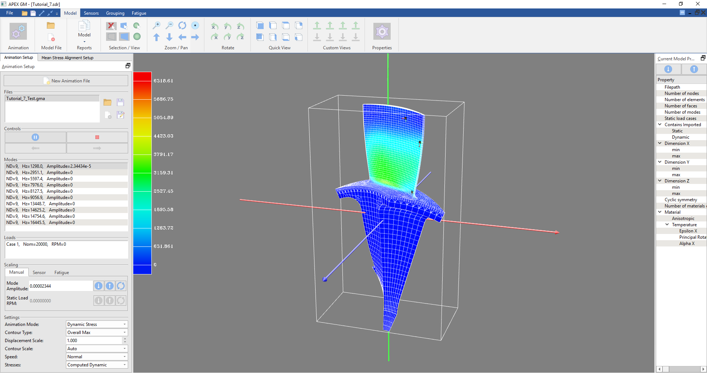
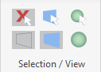
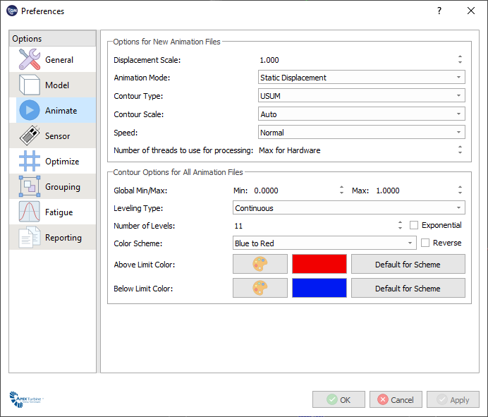

# Model Tab - Animation

## Overview

GageMap provides the ability to animate and contour either mode shapes, static load cases, or a combination of both.
This feature is standard and is included with the GageMap Basic licensed version. The model animator appears on the left side of the "Model" tab window (See below). The animator is also available in the "Fatigue" tab (under the "Animation Setup" tab on the left) for faster access when working with Fatigue models.

When animating, GageMap provides a visualization for reference purposes of the displaced model and contoured surface (based on the selected contour type).

## View Settings

Once an SDR model has been loaded with a GageMap session, view settings become available along the top ribbon of the "Model" tab. Faces, outlines, and nodes can be shown or hidden by pressing respective buttons in the "Selection/View" section of the ribbon.

Additional model view settings are available in "File > Preferences > Model/Animate" These settings include color customizability for Faces, nodes, face outlines, and color contour options; 3D compass and bounding box viewing, display options for new models, skewed face handling for new modes, stresses for new modes, and new animation files options.

## Animation

1. With an SDR file loaded...
2. In the model tab, on the left side of the screen
3. Select a mode
4. Set the "Mode Amplitude" in the "Scaling" section (Manual Tab)
5. Set the "Animation Mode"
6. Set the "Contour Type"
7. Set the "Displacement Scale"
8. Set the dropdown under "Contour Scale" if available
9. Set the dropdown for animation "Speed"
10. Set the dropdown "Stresses"

All typical contour variables are available. Some differences from classic FE post-processors:

- Principals Max for dynamic shapes:  maximum of abs(max/min) principal
- Total Displacement/Strain/Stress:  summations of the static & dynamic values
- Static aligned:  available after an alignment has been performed – becomes a modal property

## Custom Contour

As mentioned above, custom contour options are available in GageMap. Color Contour options are available in "File > Preferences > Animate."

1. Open "File > Preferences > Animate."
2. Set "Minimum" and "Maximum"
3. Set "Number of Levels"
4. “Apply”
5. “Close”
