# Model Validation

## Overview

GageMap has the ability to perform finite element model validation. To open the MAC Computation window, select **Tasks -> Model Validation** from the main GageMap window.

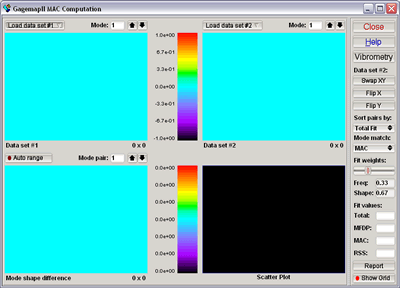

The data required prior to performing a finite element model validation are either an EDAS SDR file containing results from a modal analysis or a PolyTec universal file(s) resulting from a scanning laser vibrometry experiment. Once these two items have been collected the user only needs to open the SDR file, load, orient and map the vibrometry grid geometry within the Vibrometry task, and then perform the validation within the Model Validation task. The model validation task can also be used to compare any two datasets as long as they contain the same number of sampling points. The data sets may be PolyTec universal files, an internal vibrometry file, or a MATLAB data file produced by GageMap or external to GageMap.

The model validation panel is shown below. The window is comprised of five regions.

1. Data set #1 mode shape (contour plot)
2. Data set #2 mode shape (contour plot)
3. Mode shape difference (contour plot)
4. Data set #2 vs. data set #1 (line plot)
5. Controls/reporting

## Data Set #1 Mode Shape

Select the reference mode shape for comparison. For model validation this data set should contain the experimental mode shapes from the PolyTec vibrometry file. Use the pull down selection box to select the type of file to be imported:

**Internal vibrometry** - Imports mode shape data from a previously mapped vibrometry grid.

**Matlab data file** - Opens file selector for MATLAB ASCII (.m) files. Files are produced by the "Write data" option in the vibrometry panel.

**UFF file** - Opens the file selector for PolyTec universal files. For model validation purposes this would be the appropriate selection. Select the desired universal file and the data set for comparison. Most PolyTec universal files contain more than one data set for comparison. GageMap will ask for permission to find a regular grid from the data points. In most all cases the appropriate answer is to select "No".

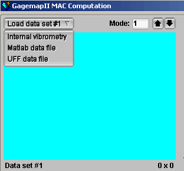

## Data Set #2 Mode Shape

The same three options from data set #1 are available for data set #2. For model validation purposes the appropriate selection is "Internal vibrometry", however, if comparisons between experimental modes or analytical modes is desired the number of points in the data sets must be equal. The frequency, data set type, data set name, and number of points being compared are shown at the bottom of the figure. The data set #2 mode shape is scaled (in a least squares sense) relative to data set #1, therefore if the modes are orthogonal to each other the data set #2 mode shape may be near zero for all displacements. Additionally the maximum displacement in either data set is scaled to 1.0.

Each of the data sets contains a mode selector box to compare any two data sets available. Either use the up/down arrows to select a mode or type in the desired mode.

> [!NOTE]
> The cyclic symmetry model validation upgrade is also available and is very useful for validation modes at inter-blade phase angles.

## Mode Shape Difference

Displays a contour of (Data set #2 - Data set #1) for each available point. This plot is useful for indicating locations where the greatest differences exist.

## Scatter Plot

Point by point comparison for each data point. Three diagonal lines are displayed. The center one corresponds to a direct 1:1 correlation. The two bounding lines represent absolute error limits of +/- 0.2.

### Controls

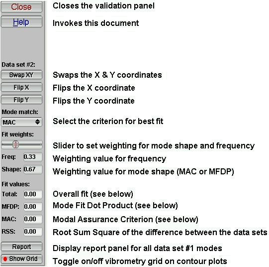

### Overall Fit

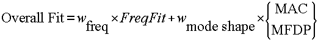

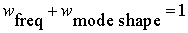

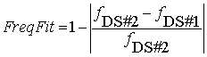

### Mode Fit Dot Product

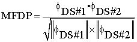

### Modal Assurance Criterion (MAC)

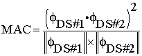

Selecting the "Report" button summarizes the validation results between data set #1 and data set #2. All modes in data set #1 are matched using the selected weighting criteria to the data set #2 mode with the highest overall fit resulting in the possibility of not every mode in data set #2 may be selected. Therefore for validation of experimental mode shapes data set #1 should contain the experimental mode shapes and data set #2 the internal vibrometry mode shapes.

## Vibrometry Mapping Task

GageMap provides the functionality of mapping a vibrometry grid over the top of a model. To open the Vibrometry Tool window, select **Vibrometry** from the main Model Validation window.

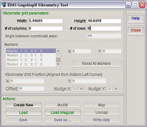

The vibrometry mapper is a powerful and easy to use feature for quantitatively assessing mode shape differences between FE models, or FE model to experiment. A vibrometry map is an array of sampling points from where displacements are assessed. Two different types of vibrometry grids can be generated; a rectangular grid of regularly spaced sampling points, and in addition GageMap includes a built-in interpreter to read PolyTec universal files that result from scanning the part with a laser vibrometer.

The type of grid that is to be generated will determine the sequence of commands in GageMap:

**Rectangular Grid**

There are four steps to generating vibrometry displacement data:

- Input the size and number of sampling points.
- Position the grid over the structure using the pointer.
- Map the grid to the surface of the part by selecting "Map".
- Export vibrometry displacements if desired. Two sets of displacements are exported: displacements in the eye direction and global FE displacements (x,y,z) at each of the vibrometer grid points.

**PolyTec Grid**

- Load the PolyTec universal file.
- Select the units consistent with the FE model.
- Size (if necessary) and position the grid.
- Map the grid to the surface of the part by selecting "Map".
- Export vibrometry displacements if desired.

In both circumstances the grid and its position with respect to the model can be saved to a file. Additionally the vibrometry map can also be un-mapped, re-positioned, and re-mapped with ease.

### Grid Parameters

Two distinct regions of the Vibrometry Tool window (see figure 38) exist and are explained in the following sections.

#### Vibrometer grid parameters

- **Width** - Define the vibrometry grid width in global units.
- Height** - Define the vibrometry grid height in global units.
- **# of columns** - Define the number of sampling points in the width direction.
- **# of rows** - Define the number of sampling points in the width direction.
- **Angle between coordinate axes** - Specify a non-orthogonal vibrometry grid orientation. 90° is the default value for a rectangular grid.

  > 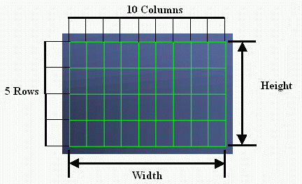

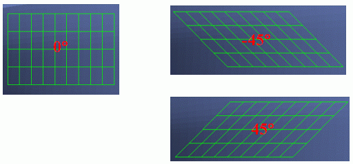                    

> 

- **Markers** - Allow specification of up to eight points on the grid map which are indicated in red. These can be helpful for precise positioning of the grid. X, Y values are in vibrometer grid coordinates (i.e. 1 .. # of columns and 1 .. # of rows) . Pressing "Reset All Markers" will remove all marker indicators.

The following figure contains a 10 x 10 grid with markers at (1,1), (5,5), (4,1), (9,7), (2,9).

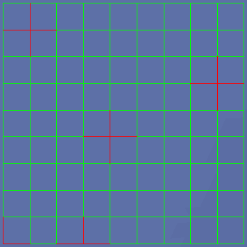

- **Vibrometer Grid Position** - Allows precise positioning/movement of the grid. The X & Y parameters indicate the position of the grid in GageMap view panel coordinates. (0,0) is the center of the view panel while (-1,-1) is the lower left corner and (1,1) is in the upper right corner. Entering (0,0) will position the center of the grid in the center of the view panel. The Offset value is used to nudge the grid in either the X or Y direction a percentage of the view panel coordinates, i.e., an Offset value of 0.1 would move the grid 10% of the view panel coordinates with each nudge. The ability to move the grid in known coordinate values can be an extremely valuable tool to check the sensitivity of the grid to small positional changes when doing model validation.

### Action Buttons

#### Create New

Places the vibrometry grid on the model. The grid is unmapped at this point.

#### Modify

Applies current settings to displayed grids. Mapped grids must be unmapped first.

#### Map

Places the grid on the model in the eye direction defined in "Custom views". The grid is permitted to extend beyond the boundary of the structure. All vertices that cannot be mapped to the structure have zero displacement.

#### Load

Loads an EDAS vibrometry file (.vbr) that has been previously saved.

#### Load Irregular

Loads irregular grid data from PolyTec universal files. Universal files with extensions of .asc, .unv, .uff, .dat are displayed in the EDAS file browser. Select the file, select the units, and then position the grid as before. The number of points in the universal file are shown in the "# of columns" box. The irregular grid can be re-sized. No markers are available.

#### Unmap

Removes the grid from the structure. Only unmapped grids can be moved or modified. Select "Unmap", reposition, then select "Map".

#### Save

Saves the current vibrometry grid definition to the active .vbr file.

#### Save As

Saves to file defined in the file browser window. Uses a .vbr extension.

#### Write Data

Outputs global displacements and displacements in scanning direction to comma-separated and MATLAB™ file formats for all vibrometry grid vertices. Displacements in scanning direction are defined by the value of the eye direction in "Custom views". Displacements interpolated using element shape function.
