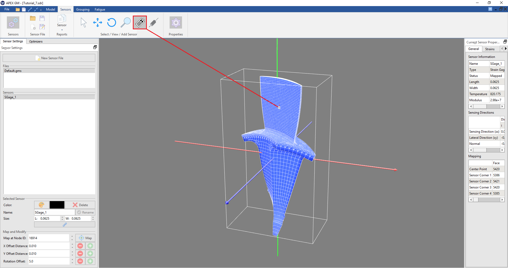
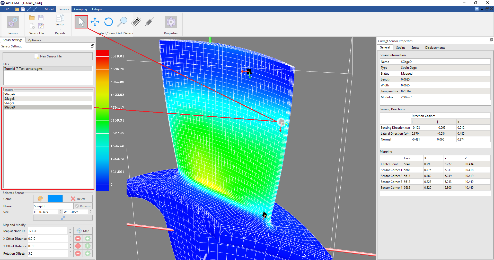
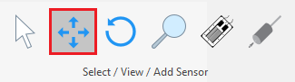

# Sensor Tab - Sensor Management

## Mapping Strain Gages

### Preliminaries

Earlier we discussed sensor mapping theory, we will now extend that discussion to creating, modifying and retrieving information about sensors

- **Sensor Mapping Process:**: - - **Create sensor either manually or in the Optimizer**: - Sensors are automatically mapped upon creation
  - Sensor Properties:  Name, Type, Size
- Repeat as necessary
- Save sensors directly on the model or into a separate file

### Strain Gage Basics

To place a new strain gauge manually, select the "Strain Gage" button along the top of the ribbon in the "Sensors" Tab. Click anywhere on the model and the Strain Gage will be mapped to that location.

> 

Strain Gages can be selected by either clicking directly on them with the Selector Tool (located at the top of the ribbon in the "Sensors" tab), or by selecting them in the "Sensors" box along the side bar (Sensor Settings Tab).

> 

### Strain Gage Mapping Preferences

- File -> Preferences -> Sensor
- - **Mapping tolerances**: - Increase this tolerance to permit strain gages to be placed in regions of high curvature
  - Used by optimizer

### Adjusting Sensor Positions

> 

Strain Gages can be moved and adjusted with either the "Move" or "Rotate" buttons in the ribbon, or with the "Map and Modify" section on the side bar.

To move a sensor directly on the model, select a sensor using the "Selector" tool or from the list on the side, click on the "Move" tool and then click anywhere on the model to move the sensor to that location. To rotate a sensor from the model, similarly select a sensor and click the "Rotate" tool in the ribbon and click around the sensor to change the direction it points.

In addition, the sensor can be moved using the "Map and Modify" section of the side bar (sensor settings tab). Every node has a specific ID that sensors can be moved to, so if the ID is known, it can be typed into the "Map at Node ID" box and the sensor will snap to that node when the "Map" button is pressed. Changing the X or Y "Offset Distance" changes how far the sensor moves when the "+" or "-" buttons are pressed for each respective sensor. Likewise, the "Rotation Offset" value changes how much the sensor rotates when the "+" or "-" buttons are pressed.

### If Sensors Do Not Map

> - - **Is there too much curvature between faces?**: - Increase the adjacent face normal tolerance under Options -> Preferences
> - Do edges of the gage fall of the edge of the model?
> - - **Make sure the gage size is in consistent model units.**: - GageMap cannot resolve the natural coordinates of the corner from the underlying element
>   - What is the quality of the underlying element?
>   - ANSYS models:  Were 20 node bricks converted to 10 node sets via the TCHG command?

### Reports

Three Reports are available:

Detailed sensor:

> - Requires an active (selected) gage
> - Detailed information about the active gage
> - Must be recomputed every time gage changes
> - Information is synonymous with "Current Sensor Properties" pane (which updates dynamically)

Sensor summary:

> - Does not require  an active gage
> - Information regarding the current sensor design
> - Must be recomputed every time gage changes

Sensor Misplacement Report

> - Requires an active (selected) gage
> - Detailed information on gage misplacement
> - Provides information for all attempted mappings
> - Must be recomputed every time gage changes

### Mode Identification

Mode identification is found in the detailed sensor report.

Cosine of the angle between modes

> - Lower the value the higher the angle (cos 0 deg = 1, cos 90 deg = 0), i.e., low = goodness
> - 90 deg -> orthogonal (best possible scenario to discern between modes)
> - Table entry ~= 0

### Misplacement Estimation

Misplacement Estimation is found within the detailed sensor report.

> - - **Numerical model that estimates the change in strain ratio due to misplacement**: - - **Internally maps the gage at up to 125 different locations by varying the following:**: - Misplacement along length (X) direction
>     - Misplacement along width (Y) direction
>     - Rotation
>   - Forms a linear least-squares (over determined) problem to estimate coefficients A, B, C, & D
>   - Reports model, unperturbed strain ratio and model fit statistics
> - - **Strain ratio range due to misplacement**: - Using the same 125 mappings as above reports just the extrema of the strain ratios

## Creating and Modifying Strain Gages

> In this exercise we will manually place a gage at the maximum strain location for a specific mode. We will then adjust the gage position to be as parallel to the edge as possible.  Then we will create a second gage for m and attempt to place the gage in the fillet region.
>
> These steps detail how to manually place a gage at the maximum strain location for a specific mode.
>
> 1. Launch GageMap
> 2. Load an SDR file
> 3. Use the Animator to contour Dynamic Strain - “Principals Max” for the desired mode.
> 4. Identify the approximate location of the max strain
> 5. Navigate to the "Sensors" tab
> 6. Create a new sensor with the "Strain Gage" button along the top bar
> 7. Click on the earlier determined position on the model
> 8. Along the right side panel, under the "Strains" tab, locate the Ex for the chosen responding mode
> 9. Using the buttons along the bottom left panel, adjust the position along the edge until Ex is maximized.

To save the sensor(s) placed, click the save button on the top left of the ribbon. This will save an .gms file format that will be updated when the main GageMap project is saved. Multiple sensor files can be loaded in every GageMap session by clicking the "Load" button, or by creating a "New Sensor File" with the button under the "Sensor Settings" tab on the left panel.

Sensor colors, Names, and Sizes can be adjusted in the sensor settings tab on the left side panel. To remove a placed sensor, highlight it in the "Sensors" box and click the "Delete" button.
