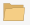
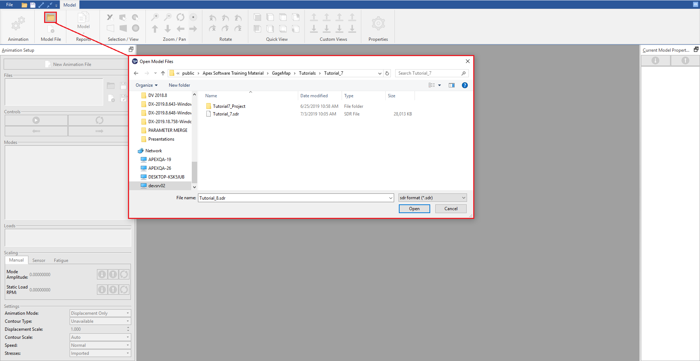
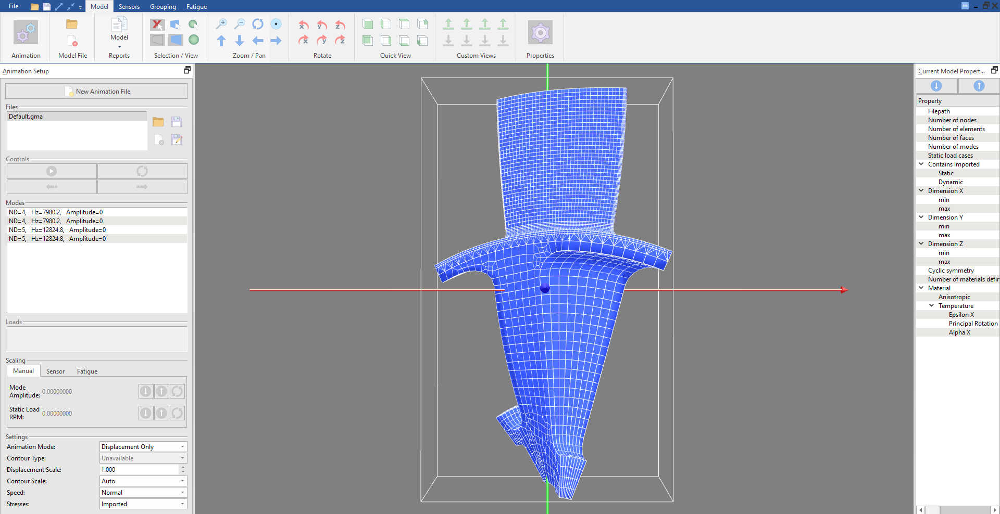
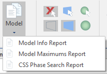
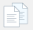

# Model Tab - Using SDR

## Overview

GageMap uses an APEX proprietary input file known as an SDR file to store the model information needed for the program interface. This SDR file allows the application to store a reduced set of information from popular FE modeling programs. The SDR file permits optimum efficiency in file size and memory requirements, providing the ability to analyze large models.

See the following sections for information regarding:

- [Load](#loading-a-model)
- [Save](#phase-search-report)
- [Reports](#reports)

## Loading a Model

Once a model has been converted using [ABAQUS to SDR Converter](aba2sdr.md), [ANSYS DB to SDR Converter](ansys2sdr.md), or [NASTRAN Converter](nastran2sdr.md), or an existing file, it can be loaded into GageMap.

To load in a model, click the yellow folder icon  towards the top left of the ribbon, under the "Model File" section. This will open a file browser where the desired SDR file may be selected. Alternatively, an SDR file may be loaded into GageMap by dragging the file directly into the program from a file browser.

Once the SDR file has been loaded, GageMap will unlock appropriate features, load the model, and show information based on the file loaded. The "Sensors," "Grouping," and "Fatigue" tabs will appear along the top of the ribbon. When an SDR file is loaded, GageMap will default to the "Model" tab where model navigation tools and the animator are located.

## Saving a Model

Once a model is loaded or imported, all GageMap operations are done in the computer's memory, so GageMap sessions should be saved often. To save SDR information, either "Save" or "Save As" in the GageMap file menu. If a GMP file already exists, Saving will will update the file and save all library information in the current GageMap session. "Save As" will create a new GMP file and update the SDR file. The GMP file is the main "Project" file in GageMap. Inside the GMP file, all library files including the SDR file will be saved. See [GageMap File Formats](files.md) for more information on GageMap file systems and saving libraries. SDR files can not be altered within GageMap.

## Reports

### Model Information

To see Model Information, select the "Model" dropdown in the "Reports" section of the ribbon  and click the "Model Info Report."  The Model Information report contains information about the Node and Element counts, the imported static and dynamic stresses, and the materials present.

All reports can be saved as a PDF, Text or HTML. Reports can also be printed or copied directly to clipboard.

### Model Maximums

To see Model Information, select the "Model" dropdown in the "Reports" section of the ribbon  and click the "Model Maximums Report." The model maximums report contains extensive information regarding the individual shapes including displacements, stresses, & strains.

All reports can be saved as a PDF, Text or HTML. Reports can also be printed or copied directly to clipboard.

For cyclic symmetry models, the “Mode” column is replaced with “Nodal Diameter” - modes are additionally displayed as pairs. Internally, these are represented as complex pairs.

### Phase Search Report

To see a CSS Phase Search Report, select the "Model" dropdown in the "Reports" section of the ribbon  and click the "CSS Phase Search Report." Phase Search Reports include Information including Model Displacements with modal minimums and maximums, Maximum Strain Values with individual components and invariants, and Maximum Stress Values with individual components and invariants. Phase Search Reports are only available for cyclic models. Changing the angle for your Phase Search is done in the preferences panel
