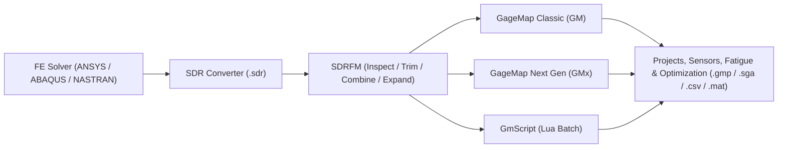

# APEX GageMap Product Suite Documentation

APEX GageMap is an integrated suite of finite-element (FE) post-processing, sensor placement optimization, high-cycle fatigue (HCF) assessment, and blade tip-timing engineering tools for turbomachinery and structural vibration testing.

> [!TIP]
> New to GageMap? Start with the **[APEX GageMap Quick Start Guide](quick-start.md)** to convert an FE model to `.sdr`, place sensors, and run fatigue evaluation.

## Product Suite Overview

| Product | Description | Documentation |
| --- | --- | --- |
| **GageMap Classic (`GM`)** | Production FLTK/Qt hybrid GageMap desktop application for model animation, grouping, strain-gage & tip-timing sensor placement, pre-test optimization, cyclic symmetry phase search, mean stress alignment, HCF fatigue assessment, and model validation. | [GM Documentation](GM/README.md) |
| **GageMap Next Gen (`GMx`)** | Modern Qt 3D ribbon-based GageMap desktop application featuring `.gmp` JSON project libraries, updated 3D viewport navigation, genetic/quantity optimization, custom fatigue DLL/SO plugin support, and ApexLM integration. | [GMx Documentation](GMx/README.md) |
| **GmScript** | Headless/batch Lua scripting engine (`GmScript`) automating SDR conversion, SDRFM operations, sensor mapping, optimization, fatigue assessment, and report generation. | [GmScript Documentation](GmScript/README.md) |
| **GM Theory** | Theoretical reference covering strain/stress tensor computation, pre-test optimization metrics, cyclic symmetry expansion, anisotropic materials, mean stress alignment, tip-timing modeling, and modal scale factor determination. | [GM Theory Manual](GM%20Theory/README.md) |
| **SDR File Manager (`SDRFM`)** | Utility for inspecting `.sdr` model contents, combining or scaling static/modal shapes, expanding cyclic symmetry sectors, generating virtual mode shapes, trimming geometry with `.grp` groups, and importing/exporting user-defined shapes. | [SDRFM Documentation](SDRFM/README.md) |
| **SDR Converter (`SDR Converter`)** | Unified conversion wizard (`SdrConverter`) and solver backends translating native ANSYS (`.rst`/`.rstp`/`.cdb`), ABAQUS (`.odb`), MSC Nastran (`.op2`), and NX Nastran (`.op2`) FE models into reduced `.sdr` files. | [SDR Converter Documentation](SDR%20Converter/README.md) |

## End-to-End Engineering Workflow

1. **Solve FE Model**: Run modal (`ANTYPE,MODAL` / `FREQUENCY`) and/or static (`ANTYPE,STATIC` / `STATIC`) analyses in ANSYS, ABAQUS, MSC Nastran, or NX Nastran.
2. **Convert to `.sdr`**: Use [SDR Converter](SDR%20Converter/README.md) (or `GM.sdrconverter()` in [GmScript](GmScript/README.md)) to extract geometry, materials, nodal temperatures, displacements, and optional nodal strains/stresses into an `.sdr` file.
3. **Prepare & Reduce in `SDRFM`**: Optionally inspect model statistics, validate compatible meshes, trim geometry using group files, combine shapes, or expand cyclic symmetry models in [SDR File Manager](SDRFM/README.md).
4. **Analyze & Automate**: Load the `.sdr` into [GageMap Classic (`GM`)](GM/README.md), [GageMap Next Gen (`GMx`)](GMx/README.md), or [GmScript](GmScript/README.md) for sensor mapping, pre-test optimization, cyclic symmetry phase search, mean stress alignment, and fatigue margin/limit reporting.

## File Formats Summary

> [!IMPORTANT]
> **End-User Format License Notice:** All APEX GageMap file formats (`.sdr`, `.gmp`, `.gmo`, `.gml`, `.gmm`, and related schemas) are provided strictly for internal end-user use with licensed APEX software and cannot be used for commercial means without formal written authorization from APEX. See the **[Software License Agreement](../Release%20Policies/software-license-agreement.md)**.

| Extension | Format Type | Role in GageMap Suite |
| --- | --- | --- |
| `.sdr` | Binary (Reduced FE Model) | Stores reduced FE mesh (nodes, elements, free surfaces), temperature-dependent isotropic/orthotropic materials, shell real constants, cyclic symmetry metadata, mode shapes, static load cases, and optionally embedded sensors. |
| `.gmp` | JSON (GageMap Project) | Master `GMx` project manifest (`GMProject`) linking one `.sdr` file with modular project library files (`.gma`, `.gms`, `.gmo`, `.gmg`, `.gml`, `.gmm`/`.gmf`). |
| `.sga` | ASCII Text (Sensor Definitions) | Legacy plain-text format defining strain gages (`Single`), tip-timing spot probes (`NSMS_Spot`), and blade-tip rotation/edge data (`Blade_Tip`). Modern `GMx` sessions store sensors in JSON `.gms` files. |
| `.mat` | MATLAB Binary | Binary data export generated via Model Export / `SDRDump` containing node coordinates, normals, mode frequencies, static RPMs, eigenvectors, strains, and stresses for MATLAB post-processing (requires MATLAB `libmat`). |
| `.csv` | Comma-Separated Values | Tabular text export from GageMap Model Export, `SDRDump`, and sensor/fatigue reports for spreadsheet and external post-processing workflows. |

Additional modular project and utility formats used across `GM` and `GMx` include `.gms` (Sensors), `.gmg` (Groups), `.gma` (Animation), `.gmo` (Optimizer), `.gml` (Fatigue), `.gmm`/`.gmf` (Assignments/Preferences), `.grp` (Legacy Group definitions), and `.gbf` (User-defined shape ASCII import/export). See [GMx File Formats](GMx/files.md) and [GM Working With SDR Models](GM/usingSDR.md).

## Licensing Overview (ApexLM & Legacy FlexNet)

> [!WARNING]
> **Legacy FLEXlm / FlexNet Discontinuation — October 2027**
> Legacy licensing using **FLEXlm / FlexNet** (`lmgrd`, `lmtools`, `.lic` files, `27000@host`) will be **discontinued as of October 2027**. All product versions going forward will exclusively use **[APEX License Manager](../License%20Manager/README.md)** (`ApexLM`), the **APEX LM Daemon**, and the **APEX LM Server Daemon**.

APEX GageMap supports a dual-licensing architecture across modern **APEX License Manager (ApexLM)** and legacy **FlexNet Publisher** deployments:

- **APEX License Manager (ApexLM)**: ZeroMQ (`CurveZMQ`) local/network licensing service with Ed25519-signed JSON license files. Supports `LOCAL`, `PASSTHROUGH` (with offline borrowing up to 30 days), and `SERVER` modes.
  - **Standard Ports**: `27884` (`APEXLM_PORT`, local ZMQ), `27885` (`APEXLM_SERVER_PORT`), `27886` (`APEXLM_SERVER_LISTEN`, external passthrough), `27887` (`http://127.0.0.1:27887/` Local Web Admin UI), `27888` (Server Web Admin UI).
  - **Registered Suite Applications & Features**: `GM`, `GMx`, `GMSCRIPT`, `SDRFM`, `SDRDUMP` (with counted features `VIRTUAL-MODELS` and `GMSCRIPT`, plus legacy/modular feature gates `GM_BASE`, `GM_OPTIMIZER`, `GM_FATIGUE`, `GM_CSS`, `GM_TIP_TIMING`, `GM_SCRIPTING`, and converter seats).
- **Legacy FlexNet Publisher**: Uses `lmgrd` / `lmutil` / `lmtools` (FLEXnet v11.4) with `27000@host` or `.lic` paths configured via `LM_LICENSE_FILE`, `GM_FLEX_SERVER`, `GAGEMAP_FLEX_SERVER`, or `GMSCRIPT_FLEX_SERVER`.

For application-specific licensing and installation instructions, see:

- [GM Licensing (ApexLM & Legacy FlexNet)](GM/flex.md) and [GM Installation](GM/install.md)
- [GMx Licensing (ApexLM & Legacy FlexNet)](GMx/flex.md) and [GMx Installation](GMx/install.md)
- [GmScript Installation & Licensing](GmScript/install.md)
