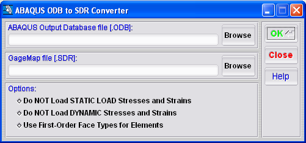
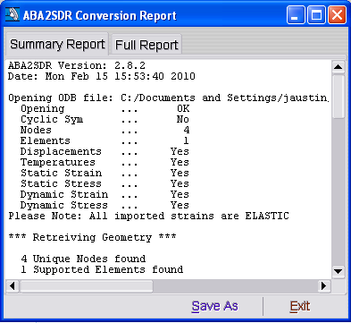

# ABAQUS to SDR Converter

The **ABAQUS to SDR Converter** (available as the **Abaqus (.ODB)** option in `SdrConverter`, and formerly standalone `ABA2SDR`) converts ABAQUS output database (`.odb`) files into APEX `.sdr` files for GageMap and `SDRFM`.

Both static (`STATIC`) and frequency extraction (`FREQUENCY`) steps are supported, including non-linear static solutions (`STEP, NLGEOM=YES`). For non-linear static steps, the deformed geometry at the end of the static step is saved as the base `.sdr` geometry.

---

## Runtime & Library Prerequisites

Proprietary ABAQUS ODB libraries cannot be bundled with GageMap and must be accessible on the system library search path (`PATH` on Windows, `LD_LIBRARY_PATH` on Linux):

- **`SdrConverter` (Current Releases)**: Requires ABAQUS runtime libraries from **Abaqus 2018 or newer** (verified up through **Abaqus 2021**). Earlier Abaqus versions are not supported by current `SdrConverter` builds.
- **Legacy `ABA2SDR` Builds**: Compiled against **Abaqus 6.14-1** libraries and, on Windows, requires the **Visual Studio 2010 Runtime** and **Microsoft VS 2005 SP1 MFC Security Update**.

<details>
<summary>Required Abaqus 6.14-1 Shared Libraries (Linux &amp; Windows Reference)</summary>

### Linux (`.so`)

**ABAQUS Specific Libraries (45)**:
`libABQDMP_Core.so`, `libABQSMABasCoreUtils.so`, `libABQSMADynModalComponent.so`, `libABQSMAObjSimObjectsMod.so`, `libABQSMASglSharedLib.so`, `libABQSMAAbuBasicUtils.so`, `libABQSMABasGenericsLib.so`, `libABQSMAEliLicense.so`, `libABQSMAOdbApi.so`, `libABQSMASglSimXmlFndLib.so`, `libABQSMASspUmaCore.so`, `libABQSMAAbuGeom.so`, `libABQSMABasMem.so`, `libABQSMAElkCore.so`, `libABQSMAOdbAttrEO.so`, `libABQSMAShpCore.so`, `libABQSMAStiCAE_StableTime.so`, `libABQSMAAspCommunications.so`, `libABQSMABasPrfTrkLib.so`, `libABQSMAFeoModules.so`, `libABQSMAOdbCore.so`, `libABQSMASimBulkAPI.so`, `libABQSMASubCoreSubcomp.so`, `libABQSMAAspDiagExtractor.so`, `libABQSMABasShared.so`, `libABQSMAFsmShared.so`, `libABQSMAOdbCoreGeom.so`, `libABQSMASimContainers.so`, `libABQSMAUzlZlib.so`, `libABQSMAAspSchemaSupport.so`, `libABQSMABasXmlDocument.so`, `libABQSMAMsgCommModules.so`, `libABQSMAOdbDdbOdb.so`, `libABQSMASimInterface.so`, `libABQSMASrvBasic.so`, `libABQSMAAspSupport.so`, `libABQSMABasXmlParser.so`, `libABQSMAMsgModules.so`, `libABQSMARfmInterface.so`, `libABQSMASimManifestSubcomp.so`, `libABQSMASimPoolManager.so`, `libABQSMABasCatia.so`, `libABQSMABlaModule.so`, `libABQSMAMtxCoreModule.so`, `libABQSMARomDiagEx.so`

**Other Linux Dependencies (18)**:
`libimf.so`, `libCATMainwin.so`, `libintlc.so.5`, `libCATSysAllocator.so`, `libiomp5.so`, `libCATSysCommunication.so`, `libirc.so`, `libCATSysMultiThreading.so`, `libmkl_core.so`, `libCATSysTS.so`, `libmkl_intel_lp64.so`, `libJS0BASEILB.so`, `libmkl_intel_thread.so`, `libJS0GROUP.so`, `libsvml.so`, `libSMAFeaBackbone.so`, `libifcoremt.so.5`, `libifport.so.5`

### Windows (`.dll`)

**ABAQUS Specific Libraries (45)**:
`ABQDMP_Core.dll`, `ABQSMABasGenericsLib.dll`, `ABQSMAElkCore.dll`, `ABQSMAOdbCore.dll`, `ABQSMASimContainers.dll`, `ABQSMAAbuBasicUtils.dll`, `ABQSMABasMem.dll`, `ABQSMAFeoModules.dll`, `ABQSMAOdbCoreGeom.dll`, `ABQSMASimInterface.dll`, `ABQSMAAbuGeom.dll`, `ABQSMABasPrfTrkLib.dll`, `ABQSMAFsmShared.dll`, `ABQSMAOdbDdbOdb.dll`, `ABQSMASimManifestSubcomp.dll`, `ABQSMAAspCommunications.dll`, `ABQSMABasShared.dll`, `ABQSMAMsgCommModules.dll`, `ABQSMARfmInterface.dll`, `ABQSMASimPoolManager.dll`, `ABQSMAAspDiagExtractor.dll`, `ABQSMABasXmlDocument.dll`, `ABQSMAMsgModules.dll`, `ABQSMARomDiagEx.dll`, `ABQSMASrvBasic.dll`, `ABQSMAAspSchemaSupport.dll`, `ABQSMABasXmlParser.dll`, `ABQSMAMtxCoreModule.dll`, `ABQSMASglSharedLib.dll`, `ABQSMASspUmaCore.dll`, `ABQSMAAspSupport.dll`, `ABQSMABlaModule.dll`, `ABQSMAObjSimObjectsMod.dll`, `ABQSMASglSimXmlFndLib.dll`, `ABQSMAStiCAE_StableTime.dll`, `ABQSMABasCatia.dll`, `ABQSMADynModalComponent.dll`, `ABQSMAOdbApi.dll`, `ABQSMAShpCore.dll`, `ABQSMASubCoreSubcomp.dll`, `ABQSMABasCoreUtils.dll`, `ABQSMAEliLicense.dll`, `ABQSMAOdbAttrEO.dll`, `ABQSMASimBulkAPI.dll`, `ABQSMAUzlZlib.dll`

**Other Windows Dependencies (18)**:
`msmpi.dll`, `mkl_intel_thread.dll`, `JS0GROUP.dll`, `mkl_core.dll`, `JS0BASEILB.dll`, `libmmd.dll`, `DSYSysWMIDriver.dll`, `libiomp5md.dll`, `CATSysTS.dll`, `libifportMD.dll`, `CATSysMultiThreading.dll`, `libifcoremd.dll`, `CATSysCommunication.dll`, `SMAFeaBackbone.dll`, `CATSysAllocator.dll`, `MSVCR80.dll`, `MSVCP100.dll`, `MSVCR100.dll`

Also see [Required Abaqus 6.14-1 Libraries](../GMx/abq_required.md).

</details>

---

## Supported Elements & Materials

### Elements

- **2-D Continuum**: `CPS3`, `CPS4`, `CPS4I`, `CPS4R`, `CPS6`, `CPS8`, `CPS8R`
- **3-D Continuum**: `C3D4`, `C3D4H`, `C3D6`, `C3D6H`, `C3D8`, `C3D8H`, `C3D8I`, `C3D8IH`, `C3D8R`, `C3D8RH`, `C3D10`, `C3D10H`, `C3D10I`, `C3D10M`, `C3D10MH`, `C3D15`, `C3D15H`, `C3D20`, `C3D20H`, `C3D20R`, `C3D20RH`
- **Membrane**: `M3D3`, `M3D4`, `M3D4R`, `M3D6`, `M3D8`, `M3D8R`

> [!NOTE]
> Unsupported element types present in the `.odb` file are ignored and listed in the conversion log file.

### Material Properties (`ELASTIC`)

- **Isotropic**: `TYPE=ISOTROPIC`
- **Orthotropic**: `TYPE=ENGINEERING CONSTANTS`
- **Isotropic Thermal Expansion**: `EXPANSION, TYPE=ISO` (with non-zero reference temperatures supported)
- Material properties may be temperature-dependent and oriented via `ORIENTATION` definitions.

---

## ABAQUS Output Requests

Displacements (`U`) are required for both static and frequency steps; element strains and stresses (`EE`, `S`) are optional. Include the following field output requests in your ABAQUS input deck:

```text
*OUTPUT, FIELD
*ELEMENT OUTPUT, ELSET=<elset>, POSITION=NODES
EE, S
*NODE OUTPUT, NSET=<nset>
U, NT
```

- `NT` is required only when nodal temperatures are defined.
- **Only elastic strains (`EE`) are imported** from ABAQUS.
- **Initial temperature conditions** (`INITIAL CONDITIONS, TYPE=TEMPERATURE`) are not currently supported; if GageMap-computed thermal stresses are needed, adjust reference/thermal conditions so zero initial conditions hold (see [Known Issues](../GM/known_issues.md#abaqus-converter-aba2sdr)).
- Output subsets via `NSET` and `ELSET` are supported. Non-global Cartesian material orientations are transformed to global Cartesian coordinates unless local coordinates are preserved.

---

## Converting an ABAQUS Model (GUI)



1. Select **Abaqus (.ODB)** in `SdrConverter` and click **Next**.
2. Browse to the `.odb` input file (`ODB`); the **SDR** output path defaults to the same base name.
3. Configure **Options** (see below).
4. Click **Add To Conversion List** and then **Convert**.
5. For any `STATIC` step found in the `.odb`, the converter prompts whether the step is a **rotational** static case and requests the associated **RPM** value.
6. Monitor progress and logs in the Output view (or legacy **Summary** report tab). Large `.odb` files created with older ABAQUS versions may take extra time if internal ODB API upgrading occurs.



---

## Converter Options

| Option | Description |
| --- | --- |
| **Load Static Load Stresses and Strains** | Checked by default. Uncheck to omit ABAQUS static stresses/strains and let GageMap compute them from displacements and material properties. |
| **Load Dynamic Mode Stresses and Strains** | Checked by default. Uncheck to omit ABAQUS modal stresses/strains and let GageMap compute them from mode shapes. |
| **Use First Order Types for Elements** | Forces linear (first-order) surface faces on parabolic elements (`C3D10*`, `C3D20*`, `CPS6`, `CPS8*`) to prevent irregular GageMap-computed surface stress interpolation. |
| **Maintain Local Coordinate System (Strains / Stresses)** | Preserves element strain/stress outputs in local material orientations rather than transforming them into global Cartesian coordinates. |
