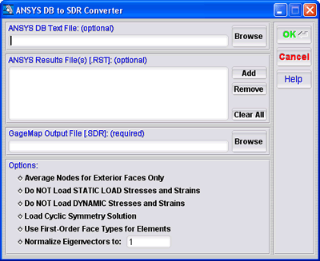
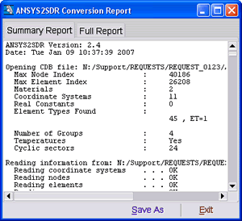

# ANSYS to SDR Converter

The **ANSYS to SDR Converter** (available as the **Ansys (.RST)** option in `SdrConverter`, and formerly standalone `ANSYS2SDR`) converts ANSYS structural finite-element results into APEX `.sdr` files for GageMap and `SDRFM`.

Both linear static (`ANTYPE,STATIC`) and modal (`ANTYPE,MODAL`) solutions are supported, along with non-linear (`NLGEOM,ON`) pre-stressed static and modal analyses and cyclic symmetry models.

---

## System & Library Prerequisites

### ANSYS Shared Libraries (`SdrConverter` — ANSYS 2019 R2 and Newer)

`SdrConverter` loads the native ANSYS result reader libraries directly from an ANSYS installation on the local workstation. Append the following directories (adjusting `${ANSYS_VER}` such as `v201` for 2020 R1, `v202` for 2020 R2, `v211` for 2021 R1, `v212` for 2021 R2, etc.) to your system `PATH` (Windows) or `LD_LIBRARY_PATH` (Linux):

1. `C:\Program Files\ANSYS Inc\${ANSYS_VER}\ansys\bin\winx64`
2. `C:\Program Files\ANSYS Inc\${ANSYS_VER}\tp\IntelMKL\2020.0.166\winx64`
3. `C:\Program Files\ANSYS Inc\${ANSYS_VER}\tp\IntelCompiler\2019.3.203\winx64`

Verify that the first directory contains:
- **ANSYS 2021 R1 and above**: `CadoeKernel.dll` and `CadoeReader.dll` (or Linux `.so` equivalents)
- **ANSYS 2019 R2 to 2020 R2**: `CadoeCore.dll`

> [!WARNING]
> ANSYS installations prior to **2019 R2** are not supported by `SdrConverter`. Additionally, ANSYS reader libraries are **not forward-compatible** with newer `.rst` files (for example, converting a 2021 `.rst` with 2020 libraries on `PATH` will crash). If ANSYS libraries cannot be located, the converter reports *"Ansys does not appear to be installed on your system..."*.

### Input Files (`.rst`, `.rstp`, and Legacy `.cdb`)

- **Structural Results File (`.rst` / `.rstp`)**: Primary input in `SdrConverter`. Multiple `.rst` files can be added to the `RST` list; modes/loads are written to the `.sdr` file in the list order. Split results (`/CONFIG,FSPLIT`) are supported by supplying only the main `.rst` file.
- **ANSYS DB Text File (`.cdb`)** *(Legacy `ANSYS2SDR` workflow)*: Generated via `CDWRITE,DB,<cdb_filename>,cdb`. While `ANSYS2SDR` can convert a `.cdb` alone or `.rst` alone, omitting the `.cdb` substitutes default material properties and omits element/node components and nodal temperatures.

---

## Supported Elements

### 1-D Elements *(Visualization & Nodal Displacements Only)*

`LINK1`, `BEAM3`, `BEAM4`, `LINK8`, `LINK10`, `PIPE20`, `BEAM23`, `BEAM24`, `BEAM44`, `BEAM54`, `PIPE59`, `LINK180`, `BEAM188`

### 2-D Continuum Elements

`PLANE42`, `PLANE82`, `PLANE182`, `PLANE183`

### 2-D Structural Shell Elements

`SHELL28`, `SHELL41`, `SHELL43`, `SHELL63`, `SHELL181`, `SHELL93`, `SHELL281`

### 3-D Continuum Elements

`SOLID45`, `SOLID92`, `SOLID95`, `SOLID185`, `SOLID186`, `SOLID187`, `SOLSH190`

> [!NOTE]
> - Unsupported element types present in the model are skipped and listed in the conversion log.
> - Incomplete parabolic elements (such as mesh transitions lacking `TCHG`, or non-positive/missing mid-side nodes) are automatically degraded to their linear counterpart (e.g., 20-node brick to 8-node brick) with warnings logged.
> - Shell element thickness must be defined using `REAL` constants; section (`SECTYPE`) thickness data is ignored.
> - Shell element results require both **top/upper** and **bottom/lower** surface results. Mid-plane shell results are unsupported and must not be written to the `.rst`.

---

## Supported Material Properties & Output Requirements

- **Isotropic Elastic**: `MP,<EX,NUXY,PRXY>` and `MPDATA,<EX,...>`
- **Orthotropic Elastic**: `MP,<EX,EY,EZ,NUXY,NUYZ,NUXZ,PRXY,PRYZ,PRXZ,GXY,GYZ,GXZ>` and `MPDATA`
- **Isotropic Thermal Expansion**: `MP,ALPX` / `MPDATA,ALPX` with reference temperatures `MP,REFT` and `TREF`
- Properties may be **temperature-dependent** and arbitrarily oriented via `ESYS`.
- **Output Requirements**: Nodal displacements are required for all static load cases and modes. Element strains and stresses are optional (strongly recommended for shells). **All imported ANSYS strains are elastic (not total).**

---

## Converting an ANSYS Model (GUI)

1. In `SdrConverter`, select **Ansys (.RST)** on the initial wizard page and click **Next**.
2. Click **Add RST** to add one or more `.rst` / `.rstp` files to the `RST` list (ordered as desired in the output `.sdr`; in legacy `ANSYS2SDR`, also specify the optional `.cdb` file).
3. Enter or browse to the output `.sdr` file in **SDR**.
4. Configure the desired options in the **Options** group (see below).
5. Click **Add To Conversion List** (you may queue multiple output `.sdr` conversions) and click **Convert**.
6. Monitor progress and conversion warnings on the Progress/Output screen (or the legacy **Summary** report tab).

> [!NOTE]
> Legacy `ANSYS2SDR` accepts up to 25,000 distinct element `TYPE` definitions per model.

---

## Converter Options

### Unified `SdrConverter` Options

| Option | Description |
| --- | --- |
| **Use Max Element Nodal Strains/Stresses** | At shared nodes, keeps the maximum magnitude nodal strain/stress across adjacent elements instead of averaging across contributing elements. |
| **Load Static Load Stresses and Strains** | Checked by default. Uncheck to omit ANSYS static stresses/strains so GageMap computes them from nodal displacements and materials. |
| **Load Dynamic Mode Stresses and Strains** | Checked by default. Uncheck to omit ANSYS modal stresses/strains so GageMap computes them from mode shapes. |
| **Load Custom Mode Indexes** | Enables an index/range filter (e.g., `1-5, 10, 11-20`) to convert only a subset of modes. |
| **Apply Non-Linear Geometry** | Applies deformed geometry from a static solution step before importing pre-stressed modal shapes. Specify **File Index** (`1` = first static file; defaults to `-1` / first static file) and **Shape Index** (`1` = first shape). |
| **Load Cyclic Symmetry Solution** | Extracts basic/duplicate sector cyclic symmetry mode pairs. Specify **Frequency Tolerance** (default `0.000001`) for matching harmonic mode pairs. Fails if the model is not valid cyclic symmetry. |
| **Use First Order Types for Elements** | Forces parabolic elements to create linear (first-order) surface faces, smoothing irregular surface stress/strain mapping. |
| **Maintain Local Coordinate System (Strains / Stresses)** | Keeps element stresses and strains in the `ESYS` local material coordinate system rather than transforming to global Cartesian coordinates before nodal averaging. |

### Legacy `ANSYS2SDR` Options

- **Average Nodes for External Faces Only**: Mimics ANSYS `POWERGRAPHICS` surface averaging (GageMap treats elements with a free face as surface elements, whereas ANSYS checks free edges).
- **Relax Geometry Comparison by (units)**: Relaxes the default 1% coordinate deviation check between `.cdb` and `.rst` files (for example, when mapping sensors onto undeformed `.cdb` geometry despite large static deflections).

---

## Non-Linear & Cyclic Symmetry Notes

- **Non-Linear (`NLGEOM,ON`) Pre-Stressed Models**:
  - In `SdrConverter`, enable **Apply Non-Linear Geometry** and point **File Index** / **Shape Index** to the non-linear static load step so pre-stressed modal results align with the deformed base geometry.
  - In legacy `ANSYS2SDR`, supply the undeformed `.cdb`, **one and only one** non-linear static `.rst` (or enable geometry comparison relaxation), followed by pre-stressed modal `.rst` files.
- **Cyclic Symmetry Models**:
  - Must contain both basic and duplicate sectors and complete node/element solutions across the sector geometry.
  - In legacy `ANSYS2SDR`, a `.cdb` file matching all `.rst` nodes and elements is required for cyclic symmetry extraction.
