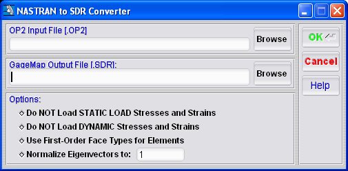
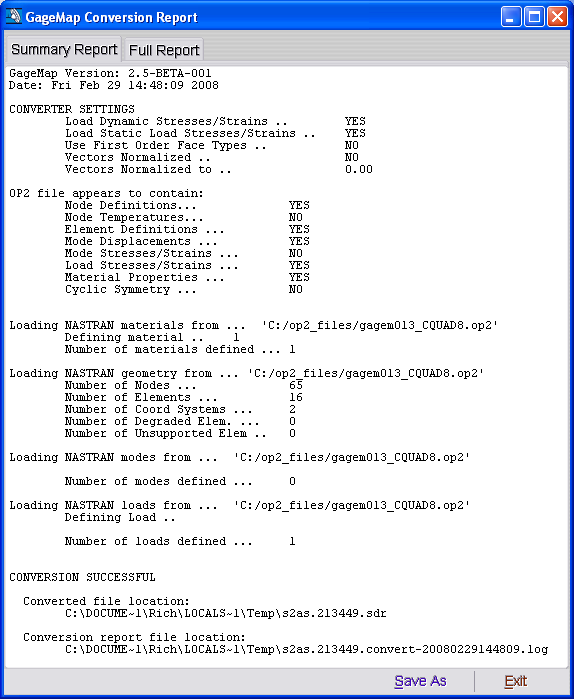

# NASTRAN to SDR Converter

The **NASTRAN to SDR Converter** supports both **MSC Nastran (`.OP2`)** and **NX Nastran (`.OP2`)** binary output files inside `SdrConverter` (and legacy `NAS2SDR`), converting geometry, materials, static load cases, and modal results into APEX `.sdr` files.

---

## Supported Elements & Materials

### Elements

- **3-D Solid Elements**: `CHEXA` (8/20-node brick), `CPENTA` (6/15-node wedge), `CTETRA` (4/10-node tetrahedron), `CPYRAM` (13-node pyramid)
- **2-D Plate & Shell Elements**: `CQUAD4`, `CQUAD8`, `CTRIA3`, `CTRIA6`
- **1-D Elements**: `CBEAM`, `CBAR`, `CROD`

### Material Cards

- **Isotropic (`MAT1`)**: Young's modulus, Poisson's ratio, shear modulus, thermal expansion coefficient (`A`), and coordinate system.
- **Orthotropic Shell (`MAT8`)**: Directional moduli (`E1`, `E2`), shear moduli (`G12`, `G1z`, `G2z`), and thermal expansion (`A1`, `A2`).
- **Anisotropic Solid (`MAT9`)**: Anisotropic constitutive tensor (`G`) and thermal expansion (`A`).

> [!NOTE]
> Unlike ANSYS and ABAQUS (which import elastic strains), **all strains imported from NASTRAN `.op2` files are TOTAL strains**.

---

## Converting a NASTRAN Model (GUI)

1. On Page 1 of `SdrConverter`, choose either **MSC Nastran (.OP2)** or **NX Nastran (.OP2)** and click **Next**.
2. Click **Open** to select the `.op2` file (`OP2`); the **SDR** output filename auto-populates (if converting from legacy standalone dialogs, specify both paths).
3. Select the desired **Options** (see below).
4. Click **Add To Conversion List** and then **Convert**.
5. Review conversion progress, warnings (such as unsupported or degraded elements), and the conversion log (`<sdr_basename>-dd-MM-yy-hh-mm-ss-zzz.log`) or Summary report.

---

## Converter Options

Not all options apply to both MSC Nastran and NX Nastran; `SdrConverter` automatically shows the active options for the chosen solver:

| Option | Solver Availability | Description |
| --- | --- | --- |
| **Load Static Load Stresses and Strains** | MSC & NX Nastran | Checked by default. Uncheck to exclude `.op2` static strains/stresses so GageMap computes them from displacements and material properties. |
| **Load Dynamic Mode Stresses and Strains** | MSC & NX Nastran | Checked by default. Uncheck to exclude `.op2` modal strains/stresses so GageMap computes them from mode shapes. |
| **Load Cyclic Symmetry Solution** | MSC Nastran | Extracts cyclic-symmetry complex mode pairs when present in the `.op2`. |
| **Use First Order Types for Elements** | MSC & NX Nastran | Forces linear (first-order) surface faces on parabolic elements (e.g., converts 20-node `CHEXA` / 10-node `CTETRA` faces to 4-node quads / 3-node triangles without mid-side nodes). Recommended if computed surface stress contours appear non-smooth. |
| **Maintain Local Coordinate System (Strains / Stresses)** | MSC Nastran | Preserves element strain/stress results in local coordinate systems rather than transforming them into global Cartesian coordinates. |
| **Merge Orthogonal Modes** | NX Nastran | Checked by default. Pairs orthogonal cyclic/repeated modes where applicable. |
| **Take Node Value as Maximum of Elements** | NX Nastran | Takes the maximum nodal strain/stress across contributing elements instead of averaging element contributions. |
| **Normalize Eigenvectors to** | Legacy `NAS2SDR` / `SDRFM` | Scales modal eigenvectors to a target normalization value. In modern workflows, perform mode scaling or mass normalization ($1/\sqrt{N/2}$) in [SDR File Manager](../SDRFM/browsers-and-operations.md#normalization-and-unit-handling). |
