# SDR File Manager: Browsers and Operations

This guide covers the `SDRFM` graphical user interface, all interactive tree browsers, project assembly, shape arithmetic, cyclic symmetry expansion, virtual mode generation, mass normalization, geometry trimming, and unit-handling behavior.

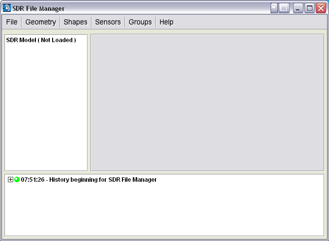

## User Interface Regions & Browsers

The main `SDRFM` window consists of three coordinated regions:

1. **Model Browser (`FM_Model_Browser`)**: Hierarchical tree displaying the loaded `SDR Model` root and four expandable branches (`Modes`, `Static Loads`, `Groups`, and `Sensors`). Clicking `+`/`-` expands or collapses each source file and individual item. Multi-selection is supported for batch inspection.
2. **Information Panel (`reportDisplay`)**: Context-sensitive report view displaying detailed attributes for the currently highlighted tree item:
   - **SDR Model Root**: Node count, element count, element-type breakdown, external surface face count, material count, and shell thickness/real-constant count.
   - **Modes**: Source file, natural frequency, complex vs. real flag, nodal diameter (if cyclic symmetric), strain/stress availability, and node count in solution. When cyclic phase-search data is present, lists peak phase angles (`1.0°` increments) for displacements (`Ux`, `Uy`, `Uz`, `Usum`), engineering strains, and stresses.
   - **Static Loads**: Source file, rotational case indicator and rotational velocity (`RPM`), complex vs. real flag, strain/stress availability, and node count.
   - **Materials & Shell Constants**: Anisotropic/orthotropic flag, temperature points, directional elastic moduli (`Ex`, `Ey`, `Ez`), shear moduli (`Gxy`, `Gyz`, `Gzx`), Poisson's ratios (`Prxy`, `Pryz`, `Prxz`), and shell thickness properties.
   - **Groups**: Source `.grp` file, group name, member node count, group type (`Node Group`, `Element Group`, or `Face Group`), contour draw rule (`All nodes` vs. `One or more nodes`), RGB color, Boolean opcode, and node index list.
   - **Sensors**: Source `.sdr`/`.sga` file and raw sensor definition fields.
3. **History Browser (`FM_History_Browser`)**: Timestamped operational log on the right/bottom panel. Entries display a **green** dot icon on success or a **red** dot icon on validation or I/O failure, with expandable multi-line diagnostic details.

Additional specialized tree browsers appear inside the **SDR File Exporter** (`SDR Editor`) workflow:

- **`FM_Model_Exporter`**: Summary tree of staged export modes, static load cases, sensors, and model state (`Trimmed`, `Expanded`, or `Trimmed & Expanded`).
- **`FM_Shape_Browser`**: Mode and static-load selector for direct subset export.
- **`FM_Cyclic_Browser` & `FM_VMode_Browser`**: Selectors restricted to cyclic-symmetric modes (`FM_VMode_Browser` filters out `0` and `N/2` nodal-diameter modes when generating virtual modes or max-phase expansions).
- **`FM_Sector_Browser`**: Cyclic sector toggle list for multi-sector geometry expansion.
- **`FM_Sensor_Browser`**: Sensor tree selector for exporting subsets of `.sdr`/`.sga` gages.
- **`FM_Group_Browser`**: Group Boolean selector (`And`, `Or`, `Not`, `Disabled`) inside the Trim Wizard.

> [!NOTE]
> **Nodes, Elements, Materials & Boundary Conditions**: `.sdr` is a reduced structural post-processing format containing mesh nodes (coordinates, temperatures, stress layers), elements (connectivity, material ID, thickness/real-constant ID), external faces, materials, sensors, and response shapes. Explicit FE boundary-condition cards (SPC/MPC constraints) are not stored separately; fixed constraints appear as zero displacements in the static/modal shapes, and model sub-regions are managed via `.grp` component groups.

---

## Project Management

An `SDRFM` project aggregates a base geometry together with any appended modes, static loads, and sensors into an output `.sdr` file. Groups (`.grp`) are session-only trimming/inspection aids and are not saved inside `.sdr` files.

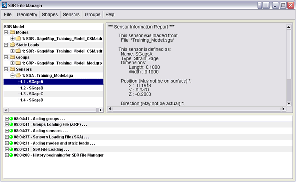

> [!NOTE]
> Geometry comprises node labels, node coordinates, element labels, element connectivity, nodal temperatures, external faces, shell real constants, and material properties. Shapes may be static or modal, must include displacements, and optionally include nodal strains and stresses.

### Loading a Base Project

An `.sdr` project can only be loaded when no model is currently open (to prevent accidental overwrites, exit and restart `SDRFM` before loading a different base model):

1. Open `SDRFM`.
2. Select **File > Load Base SDR** (or **Load Project**).
3. Browse to an `.sdr` file and click **Open**. A progress dialog monitors the file scan.

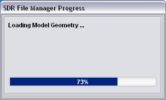

### Saving a Project

Save all currently loaded modes, static load cases, and sensors (excluding `.grp` groups) to a new `.sdr` file:

1. Select **File > Save As**.
2. Choose a new `.sdr` filename (overwriting the currently open base `.sdr` file is disallowed).
3. Click **Save**.

> [!NOTE]
> **File > Save As** writes all loaded modes and static loads verbatim. To export a reduced subset, combine/scale shapes, trim geometry, or expand cyclic sectors, use **Edit > SDR Editor** (or **File > Export Model**) described below.

---

## Loading Geometry, Shapes, Sensors, and Groups

### Loading Geometry Only

1. In an empty session, select **Geometry > Load from SDR File**.
2. Choose an `.sdr` file and click **Open**. Geometry statistics appear when selecting `SDR Model` in the tree.

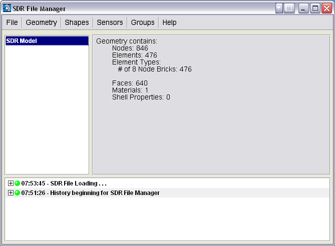

### Loading Compatible Shapes

After geometry is loaded, additional shapes can be appended from any compatible `.sdr` file:

1. Select **Shapes > Load from SDR File**.
2. Choose the secondary `.sdr` file.
3. `SDRFM` validates strict mesh equivalence before importing:
   - Identical node, element, face, material, and real-constant counts.
   - Matching original node IDs, nodal coordinates (within `1.0e-8` in model units), nodal temperatures, and stress layer counts.
   - Matching original element IDs, material assignments, thickness assignments, material property curves, and real constants.
4. If validation passes, shapes are appended to the model tree without overwriting existing shapes.

### Loading Sensors

1. Select **Sensors > Load from SDR File** or **Sensors > Load from SGA File**.
2. Select one or more sensor files. Sensors are listed in file order.

> [!NOTE]
> `SDRFM` displays raw imported sensor coordinates and properties without physically mapping sensors onto element faces. Perform physical sensor mapping inside GageMap (`GM` or `GMx`).

### Loading Groups (`.grp`)

1. Select **Groups > Load from GRP File**.
2. Select a GageMap `.grp` file. Multiple group files can be loaded into the session for inspection or geometry trimming.

---

## Importing & Exporting User-Defined Shapes

`SDRFM` supports exporting loaded shapes to text (`.gbf`) via **Shapes > Export Shapes as GBF** and importing custom user-defined shapes and nodal temperatures via **Shapes > Import User-Defined**.

### User-Defined Shape File Format

```text
nodetemp,<node_label>,<temperature>
START,<MODE or LOAD>
infofreq,<frequency (real float)>
infondd,<nodal diameter (integer)>
inforpm,<rotational velocity (real float)>
nodedisp,<node_label>,<Ux>,<Uy>,<Uz>[,<Ux_im>,<Uy_im>,<Uz_im>]
noderot,<node_label>,<Rx>,<Ry>,<Rz>[,<Rx_im>,<Ry_im>,<Rz_im>]
nodestrain,<node_label>,<ex>,<ey>,<ez>,<gxy>,<gyz>,<gzx>[,...]
nodestress,<node_label>,<sx>,<sy>,<sz>,<txy>,<tyz>,<tzx>[,...]
FINISH
```

- `nodestrain` values must be **engineering strains** ($\gamma_{xy}, \gamma_{yz}, \gamma_{zx}$), not tensor shear strains.
- Omitted nodes default to zero; shapes within the same file need not all define strains or stresses.

---

## Exporting & Reducing Models (`SDR File Exporter`)

While `.sdr` file size on disk is limited only by the filesystem, GageMap (`GM` / `GMx`) requires sufficient physical RAM to load the model. The **SDR File Exporter** (opened via **Edit > SDR Editor** / **File > Export Model**) lets you filter shapes, trim geometry, expand cyclic sectors, and preview estimated `.sdr` disk size and GageMap RAM usage before writing.

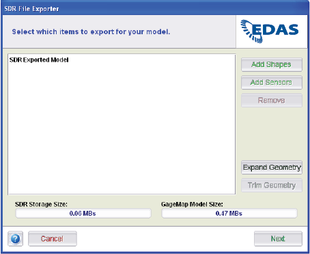

> [!NOTE]
> **Expand Geometry** is enabled only for cyclic-symmetric models. **Trim Geometry** is enabled only when one or more `.grp` files are loaded.

### Export Workflow

1. Load base geometry (or base `.sdr` project), any secondary shapes, sensors, and `.grp` groups.
2. Open **Edit > SDR Editor** (**File > Export Model**).
3. Use **Add Shapes**, **Add Sensors**, and **Trim Geometry** (or **Expand Geometry**) in any order.
4. Monitor **SDR Storage Size** and **GageMap Model Size** at the bottom of the exporter window. Remove items if the projected RAM footprint exceeds workstation capacity.

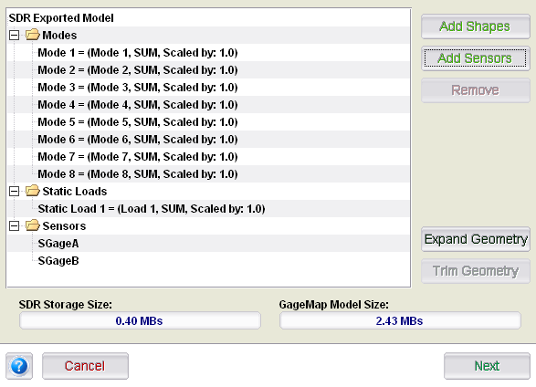

5. Click **Next**, specify a new output `.sdr` filename (cannot overwrite currently loaded files), and click **Export**.

---

## Adding, Scaling, and Combining Shapes

Click **Add Shapes** in the exporter window to open the **Shape Selection Wizard**:

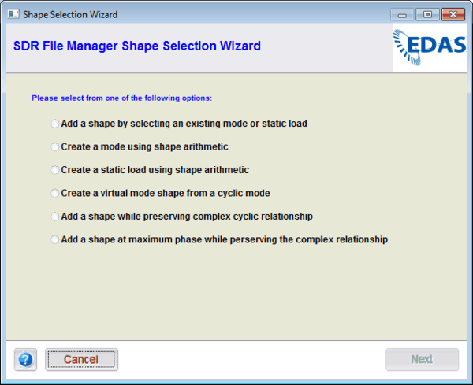

### 1. Select Existing Modes or Static Loads (with Scaling)

Select a subset of modes or static load cases in the left tree (using `<Shift>` / `<Ctrl>`) and apply an optional real scalar multiplier (or complex scalar $a + ib$ for modes). Shapes are exported in the exact sequence they are added.

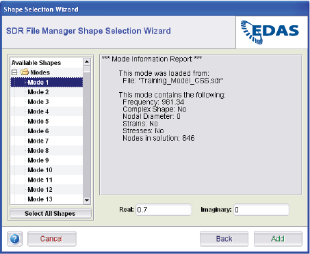

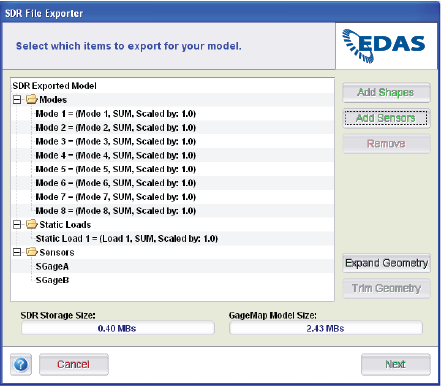

### 2. Mode Shape Arithmetic (Linear Summation)

Combine multiple modes into a single synthesized mode using real and/or imaginary scalar weights:

1. Select a mode from the dropdown, confirm the `+` (sum) operation, enter real/imaginary coefficients, and click **Add Step**.
2. Repeat for each mode to include in the linear combination, then click **Create**.

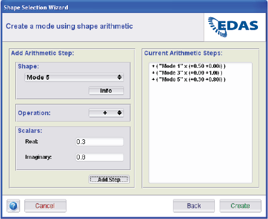

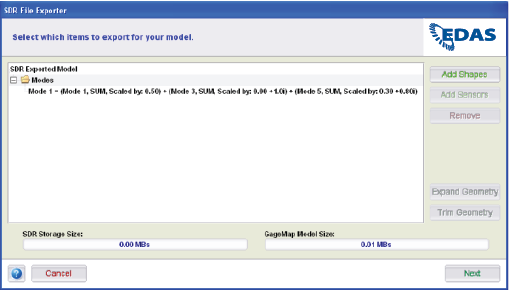

### 3. Static Load Case Arithmetic (Linear Summation)

Combine multiple static load cases using real-valued scalar multipliers:

1. Select each static load case, apply a real scalar multiplier, and click **Add Step**.
2. Repeat as required and click **Create**.

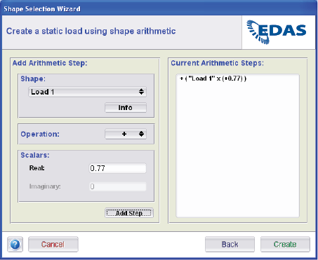

### 4. Create a Virtual Mode Shape (Cyclic Symmetry)

A **virtual mode shape (VMS)** performs a node-by-node phase search across $[0^\circ, 360^\circ)$ for each non-zero, non-$N/2$ nodal-diameter cyclic mode pair to compute the peak magnitude of a chosen variable:

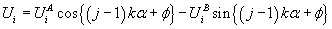

where:
- $i$ = node index, $j = 1$ (sector 1), $k$ = harmonic index / nodal diameter, $\alpha$ = sector angle, $\phi$ = phase angle ($0^\circ \dots 360^\circ$)
- $U^A$ = real (cosine / basic sector) shape, $U^B$ = imaginary (sine / duplicate sector) shape

Available phase-search variables:
- **Displacements**: `Ux`, `Uy`, `Uz`, `Usum`
- **Rotations**: `Rx`, `Ry`, `Rz`, `Rsum`
- **Strains** *(requires imported strains in SDR)*: `Eeqv`, Max Principals, `ex`, `ey`, `ez`, `gxy`, `gyz`, `gzx`
- **Stresses** *(requires imported stresses in SDR)*: `VonMises`, Max Principals, `sx`, `sy`, `sz`, `txy`, `tyz`, `tzx`

Wizard options:
- **Compute Max Phase by**: Target variable and identification criterion (*Absolute Value First Found*, *Absolute Value Last Found*, *Maximum Value*, or *Minimum Value*).
- **Phase angle increment (degrees)**: Search step size (`0.1` to `15.0` degrees).
- **Mass Normalize Output Mode**: Multiplies all nodal output quantities by $1 / \sqrt{N/2}$ (where $N$ is the sector count).
- **Output Additional Information Mode**: Emits a companion mode at the same frequency storing the peak magnitude in `Ux` and the corresponding critical phase angle in `Uy` (all other fields zero).

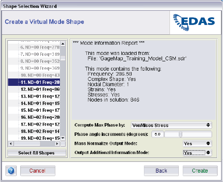

### 5. Expand Cyclic Symmetry While Preserving Complex Relationship

Expand cyclic-symmetric mode pairs across arbitrary sectors and phase angles $\phi$:

1. Select modes sharing common phase-angle and normalization settings (`Mass Normalize` by $1/\sqrt{N/2}$, and optional **Output Complementary / Imaginary Mode** shifted by $90^\circ$ for traveling-wave studies).

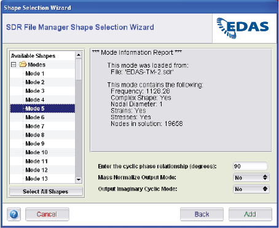

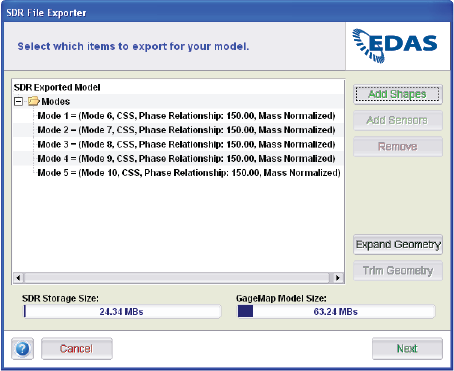

2. Click **Expand Geometry** to launch the 4-step expansion wizard:
   - **Step 1**: Review expansion start screen.
   - **Step 2**: Toggle target sectors On/Off.
   - **Step 3**: Specify the axis of rotational symmetry.
   - **Step 4**: Review summary and click **Finish**.

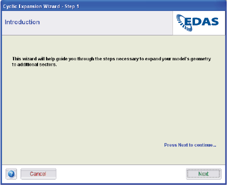

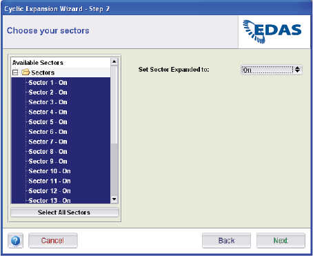

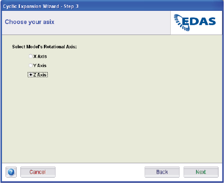

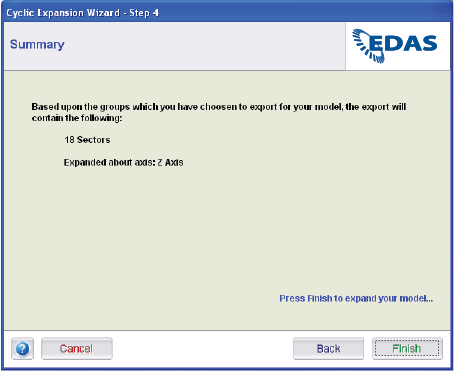

### 6. Expand at Maximum Phase Angle Preserving Complex Relationship

Produces results analogous to GageMap's [Cyclic Symmetry Solutions](../GM/task_cssPhaseSearch.md) phase search while optionally retaining the $90^\circ$-shifted imaginary cyclic mode (for non-zero, non-$N/2$ modes):

1. Select one or more eligible cyclic modes (`FM_VMode_Browser`).
2. Select the target nodal variable (only variables stored in the `.sdr` file are active).
3. Choose the phase angle increment slider.
4. Enable **Mass Normalization** ($1 / \sqrt{N/2}$) if desired.
5. Enable **Output Imaginary Cyclic Mode** if exporting a complex pair for subsequent expansion.
6. Click **Add**.

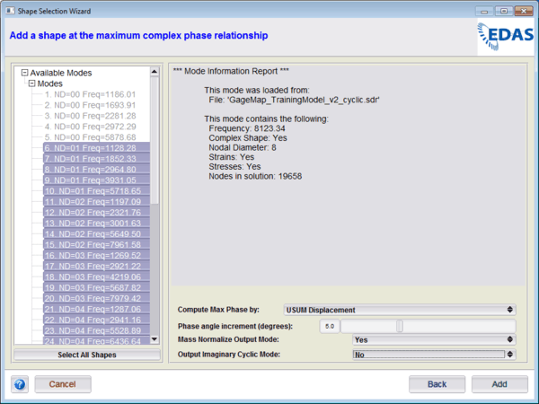

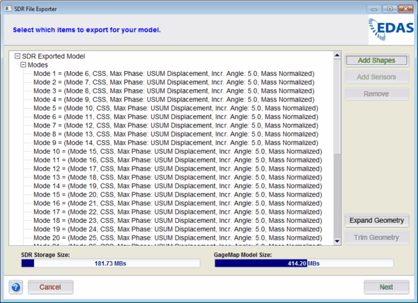

---

## Adding Sensors & Trimming Geometry

### Adding Sensors

Click **Add Sensors** in the exporter window, select individual sensors (or click **Select All Sensors**), and click **Add Sensor(s)**.

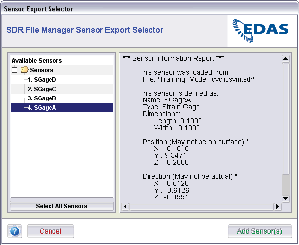

### Trimming Geometry

Click **Trim Geometry** (enabled when `.grp` groups are loaded) to open the 3-step **Trim Wizard**:

1. Select groups and assign Boolean operations (`And`, `Or`, `Not`, `Disabled`).
2. Click **Next** to preview kept nodes, elements, and external surface faces.
3. Confirm trimming in the exporter summary.

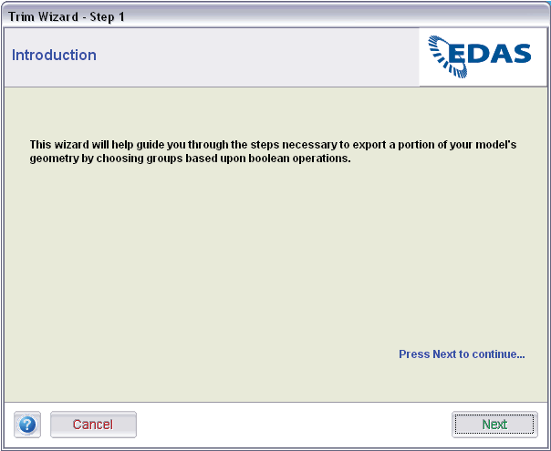

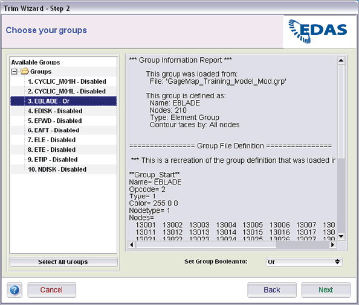

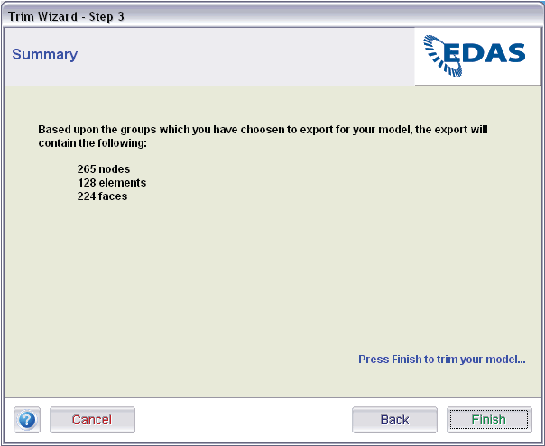

---

## Normalization and Unit Handling

- **Eigenvalue / Eigenvector Scaling**:
  - Direct shape export and shape arithmetic allow multiplying displacements, rotations, strains, and stresses by arbitrary real or complex scalars (for unit-system scale conversions or modal participation weighting).
  - Cyclic virtual-mode and cyclic-expansion exports provide built-in **Mass Normalization** ($1 / \sqrt{N/2}$ scaling across all output nodal fields).
  - For NASTRAN `.op2` conversions, eigenvector normalization can also be specified directly during conversion (see [NASTRAN Converter Guide](../SDR%20Converter/nastran.md)).
- **Consistent Model Units**: `.sdr` files store coordinates, temperatures, elastic moduli, strains, and stresses in the exact unit system produced by the upstream FE solver (e.g., `in`/`lbf`/`psi`/`°F` or `m`/`N`/`Pa`/`°C`). `SDRFM` does not perform automatic unit-tag rewriting; when merging shapes from multiple `.sdr` files or loading `.sga`/`.gmf` files, ensure all inputs share consistent length, force, stress, and temperature units.
