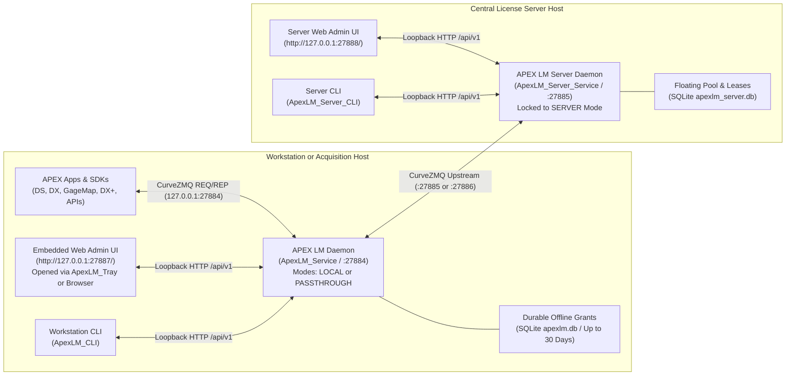

# APEX License Manager (`ApexLM`)

**APEX License Manager (`ApexLM`)** is the unified licensing runtime and administration platform for **APEX** desktop applications, acquisition daemons, industrial bridges, and custom developer SDKs across **Windows** and **Linux**.

> [!WARNING]
> **Legacy FLEXlm / `lmgrd` Discontinuation Notice (Effective October 2027)**
>
> The legacy licensing mechanism based on **FLEXlm / FlexNet Publisher (`lmgrd` license server, `lmtools`, `lmutil`, `.lic` license files, `27000@host`, and OpenCode Trusted Storage)** will be **permanently discontinued as of October 2027**. All **APEX** product versions going forward use the modern **APEX License Manager (`ApexLM`)** architecture (**APEX LM Daemon**, **APEX LM Server Daemon**, embedded Web Admin UI, and `ApexLM_CLI` / `ApexLM_Server_CLI`). Plan migrations from `lmgrd` ahead of October 2027.

---

## Architecture Overview

`ApexLM` separates encrypted application licensing traffic (**ZeroMQ `REQ/REP` with CurveZMQ**) from local administrative controls (**loopback-only HTTP Management API and Web Admin UI**).



### Key Capabilities

- **Two-Tier Network Security**: Client applications connect strictly to `127.0.0.1:27884` over **CurveZMQ**. In network deployments, only workstation **APEX LM Daemons** connect across the LAN/VPN to the central **APEX LM Server Daemon** (`SERVER` mode rejects direct remote application connections).
- **Cryptographic Document Verification**: Whole-document **Ed25519** digital signatures (`format_version: 2`) protect entitlements against modification, paired with host MAC binding.
- **Flexible License Models**: Supports **Node-Locked (`LOCAL`)**, **Floating Network (`SERVER` / `PASSTHROUGH`)**, **Counted**, **Uncounted (`-1`)**, **Included**, **Accrual**, **Shared Token Pools** (`ANALYSIS` pool with per-feature costs), and **Hardware Serial Whitelisting / Counted Hardware Pools**.
- **Durable Offline Reservations**: Engineers in `PASSTHROUGH` mode can reserve counted features, token pools, and hardware entitlements for disconnected field use for up to **30 days**, with automatic offline failover and pool lease accounting.
- **Version Ceiling & Session Reaper**: Validates client `YYYY.MM` versions against the installed license and automatically reclaims orphaned seats if an application becomes inactive for more than **120 seconds**.

---

## Shipped Packages & Executables

`ApexLM` is distributed through official **APEX** channels in two deployment packages tailored for workstations and central license servers:

| Package | Executable (`Windows` / `Linux`) | Service Name / `systemd` Unit | Role |
| :--- | :--- | :--- | :--- |
| **Standard Workstation** | `ApexLM_Service.exe` / `ApexLM_Service` | `ApexLMService` / `apexlm.service` | **APEX LM Daemon**: serves local `127.0.0.1:27884` ZeroMQ checkouts (`LOCAL` or `PASSTHROUGH`) and hosts the loopback Web Admin UI on port `27887`. |
| **Standard Workstation** | `ApexLM_Tray.exe` / `ApexLM_Tray` | *Desktop user process* | System tray status indicator and one-click launcher for the Web Admin UI (**Open Configuration** / **Start Service** / **Restart Service**). |
| **Standard Workstation** | `ApexLM_CLI.exe` / `ApexLM_CLI` | *Administrative CLI* | Interactive and one-shot management shell for workstation daemons and Windows/`systemd` service lifecycle commands. |
| **Floating Server** | `ApexLM_Server_Service.exe` / `ApexLM_Server_Service` | `ApexLMServerService` / `apexlm-server.service` | **APEX LM Server Daemon**: headless floating license server locked strictly to `SERVER` mode on `0.0.0.0:27885` with loopback Web Admin UI on port `27888`. |
| **Floating Server** | `ApexLM_Server_CLI.exe` / `ApexLM_Server_CLI` | *Administrative CLI* | Interactive and one-shot management shell dedicated to `ApexLM_Server_Service`. |

> [!NOTE]
> Both **APEX LM Daemon** and **APEX LM Server Daemon** use independent ports, environment variables, OS service names, and SQLite databases, so both can be installed and operated side-by-side on the same host (for example, a license server that also runs local APEX engineering software).

---

## Network Ports, Environment Variables & State Paths

Ports and discovery parameters can be configured via OS environment variables or a local `.env` / `.env.apexlm` file in the service directory:

| Component / Setting | Environment Variable | Default Value | Transport / Scope |
| :--- | :--- | :--- | :--- |
| **Standard Daemon Licensing** | `APEXLM_PORT` | `27884` | TCP CurveZMQ on `127.0.0.1` (`APEXLM_HOST` overrides client target host). |
| **Server Daemon Licensing** | `APEXLM_SERVER_PORT` | `27885` | TCP CurveZMQ listening on `0.0.0.0` for `PASSTHROUGH` daemons. |
| **Server External Listen** | `APEXLM_SERVER_LISTEN` | `27886` | Optional external server CurveZMQ listen port. |
| **Standard Web Admin UI / API** | `APEXLM_MANAGEMENT_PORT` (`APEXLM_ADMIN_PORT`) | `27887` | Loopback HTTP (`http://127.0.0.1:27887/`) discovered via `management.endpoint`. |
| **Server Web Admin UI / API** | `APEXLM_SERVER_MANAGEMENT_PORT` (`APEXLM_SERVER_ADMIN_PORT`) | `27888` | Loopback HTTP (`http://127.0.0.1:27888/`) discovered via `management.endpoint`. |
| **Client Request Timeout** | `APEXLM_TIMEOUT` | `5000` | ZeroMQ client request timeout in milliseconds. |

### SQLite State & Configuration Databases

Configuration, active license documents, checkouts, reservation leases/grants, and compliance audit trails are persisted locally in SQLite:

| Daemon | Operating System | Primary System Path (Service) | User-Mode Fallback Path |
| :--- | :--- | :--- | :--- |
| **APEX LM Daemon** | Windows | `C:\ProgramData\APEX\APEXLM\apexlm.db` | `%APPDATA%\APEX\APEXLM\apexlm.db` |
| **APEX LM Daemon** | Linux | `/var/lib/apexlm/apexlm.db` | `~/.local/share/apexlm/apexlm.db` |
| **APEX LM Server Daemon** | Windows | `C:\ProgramData\APEX\APEXLM_Server\apexlm_server.db` | `%APPDATA%\APEX\APEXLM_Server\apexlm_server.db` |
| **APEX LM Server Daemon** | Linux | `/var/lib/apexlm-server/apexlm_server.db` | `~/.local/share/apexlm-server/apexlm_server.db` |

---

## License Format Version 2 & Entitlement Models

All `ApexLM` deployments require **Format Version 2** (`.json` / `.lic`) licenses signed across the entire canonical JSON document with an **Ed25519** signature. **Format Version 1** keys and legacy FLEXlm `.lic` files are rejected without fallback.

- **Host MAC Binding (`host`)**: List of uppercase 12-character hexadecimal MAC addresses without separators (e.g., `"001122334455"`), or `"*"` / `"demo"` for evaluation licenses. You can export your host fingerprint directly from the Web Admin UI (**Download license request** -> `license-request.json`) when ordering a license from **APEX**.
- **Server Authorization (`"server": true`)**: Required for any license loaded into **APEX LM Server Daemon**. Installing a non-server workstation license onto `ApexLM_Server_Service` is rejected.
- **Version Ceilings (`version`)**: Each application block enforces a `YYYY.MM` maximum version ceiling. Running a newer software build than permitted by your license requires renewing Software Maintenance (see [Software Release Policies & 18-Month Lifecycle](../Release%20Policies/README.md)).
- **Feature Accounting Types**:
  - **Counted**: Fixed seat pool decremented while checked out.
  - **Uncounted (`-1`)**: Unlimited usage (`uncounted` / `Unlimited` in tables).
  - **Included**: Automatically granted locally without consuming floating seats.
  - **Accrual (`accrual: true`)**: Repeated checkouts from the same process accumulate counts (for example, `10` + `20` hardware channels), whereas non-accrual (`accrual: false`) deduplicates per process instance using `max(existing, requested)`.
  - **Token Pools (`type: "token"`)**: Shared credit balance (such as the `ANALYSIS` pool) consumed according to each governed feature's token `cost` and `accrual` rule.
- **Hardware Entitlements (`hardware`)**: Authorizes physical acquisition chassis/devices by `vendor` (`mecalc`, `ni`, `vti`, `scanivalve`, `datatel`, `pacific`, `hgl`, `dewesoft`, `ps9016`, etc.) using permitted serial numbers (or `"*"` wildcard) and optional counted hardware pools.

### Sanitized Format Version 2 Example

```json
{
  "format_version": 2,
  "license_id": "<license-id>",
  "username": "End User Engineer",
  "company": "Example Organization",
  "license_date": "2026-11-01",
  "expires": "2027-11-01",
  "server": true,
  "host": ["001122334455"],
  "licenses": [
    {
      "appname": "any",
      "version": "2027.12",
      "features": [
        { "name": "analysis", "count": 50, "accrual": true },
        { "name": "APEX-FILE-STANDARD", "count": -1, "accrual": false }
      ],
      "token_pools": [
        {
          "name": "ANALYSIS",
          "count": 100,
          "features": {
            "BASIC-PROCESSING": { "cost": 5, "accrual": false },
            "AEROMECHANICS-PROCESSING": { "cost": 15, "accrual": false }
          }
        }
      ]
    },
    {
      "appname": "DS",
      "version": "2027.12",
      "features": [
        { "name": "NI_CHANNELS", "count": 32, "accrual": true },
        { "name": "AEROPLOTS", "count": 2, "accrual": false }
      ],
      "hardware": [
        { "vendor": "ni", "type": "hardware-id", "serials": ["NI-0001", "NI-0002"] }
      ]
    }
  ],
  "signature": "<ed25519-document-signature>"
}
```

> [!NOTE]
> Legacy FlexNet `lmgrd` licenses do not convert in place. When transitioning to **APEX License Manager** before **October 2027**, request a signed Format Version 2 license file via the [APEX User Portal](https://users.apexturbine.com/).

---

## Documentation Guides

- **[Quick Start Guide](quick-start.md)** — Fast workstation (`LOCAL`) activation and floating (`SERVER` + `PASSTHROUGH`) setup workflows.
- **[Workstation Daemon & Floating License Server Setup](setup-and-server.md)** — Installing Windows/`systemd` services, configuring modes, hot-reloading server licenses safely, heartbeats, and crash diagnostics.
- **[CLI Tools Reference](cli-reference.md)** — Complete command reference for `ApexLM_CLI`, `ApexLM_Server_CLI`, `ApexLM_Service`, `ApexLM_Server_Service`, and `ApexLM_Tray`.
- **[Web Admin UI, Configuration & Reservation System](web-ui-and-reservations.md)** — Detailed guide to every Web UI tab, configuration settings, online license requests, and the 30-day offline **Reserve** system.
- **[Software Release Policies & End-User SLA](../Release%20Policies/README.md)** — Official distribution, 18-month maintenance rule, `AVX2` hardware requirements, support SLA, and API/format commercial restrictions.
