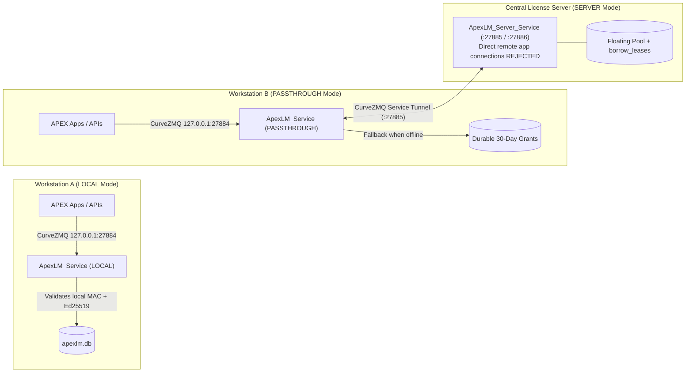

# Workstation Daemon & Floating License Server Setup

This guide details deploying, hardening, operating, and troubleshooting both **APEX License Manager** daemons on Windows and Linux.

> [!NOTE]
> **Two Distinct System Services**
>
> **APEX LM Daemon (`ApexLM_Service`)** and **APEX LM Server Daemon (`ApexLM_Server_Service`)** are separate services with independent TCP ports, environment namespaces, OS service names, and SQLite databases. A license server host can simultaneously run `ApexLM_Server_Service` (serving floating seats to your organization) and `ApexLM_Service` (serving local APEX applications on that same machine).

---

## 1. Comparison: Workstation Daemon vs. Server Daemon

| Attribute | APEX LM Daemon (`ApexLM_Service`) | APEX LM Server Daemon (`ApexLM_Server_Service`) |
| :--- | :--- | :--- |
| **Supported Modes** | `LOCAL` (node-locked) or `PASSTHROUGH` (forwards to server & caches offline reservations) | **Locked to `SERVER`** (`LOCAL` and `PASSTHROUGH` disabled) |
| **License Requirement** | Standard Format v2 license (in `LOCAL` mode) or upstream server (in `PASSTHROUGH` mode) | Format v2 license with `"server": true` matching server MAC address |
| **ZeroMQ Bind Address & Port** | `127.0.0.1:27884` (`APEXLM_PORT`) | `0.0.0.0:27885` (`APEXLM_SERVER_PORT`), optional `27886` (`APEXLM_SERVER_LISTEN`) |
| **Loopback Admin UI / API** | `http://127.0.0.1:27887/` (`APEXLM_MANAGEMENT_PORT`) | `http://127.0.0.1:27888/` (`APEXLM_SERVER_MANAGEMENT_PORT`) |
| **CLI Tool** | `ApexLM_CLI` (`ApexLM> `) | `ApexLM_Server_CLI` (`ApexLM-Server> `) |
| **Windows Service Name** | `ApexLMService` | `ApexLMServerService` |
| **Linux `systemd` Unit** | `/etc/systemd/system/apexlm.service` | `/etc/systemd/system/apexlm-server.service` |
| **SQLite State Database** | Windows: `C:\ProgramData\APEX\APEXLM\apexlm.db`<br>Linux: `/var/lib/apexlm/apexlm.db` | Windows: `C:\ProgramData\APEX\APEXLM_Server\apexlm_server.db`<br>Linux: `/var/lib/apexlm-server/apexlm_server.db` |

---

## 2. Operating Modes & Connection Rules



- **Why Client Applications Never Target Port `27885` Directly**: `ApexLM_Server_Service` explicitly rejects remote ZeroMQ checkouts from ordinary client applications with *"App connections in SERVER mode must be made through a local License Manager Service."* Always run a local **APEX LM Daemon** in `PASSTHROUGH` mode on every client workstation so heartbeats, seat reconciliation, proxy settings, and offline reservations operate transparently on `127.0.0.1:27884`.
- **Same-Machine Dual Deployment**: When engineering applications run directly on the license server host, configure the local `ApexLM_Service` in `PASSTHROUGH` mode pointing to `PT_HOST = 127.0.0.1` and `PT_PORT = 27885`.

---

## 3. Windows Service Setup

Installing or managing Windows system services requires an **elevated (Administrator)** PowerShell or Command Prompt.

### Workstation Daemon (`ApexLMService`)

```powershell
# Install native Windows service (auto-start at boot) and start it
ApexLM_Service.exe --install-service
ApexLM_Service.exe --start-service

# Check status, restart, stop, or remove
ApexLM_Service.exe --service-status
ApexLM_Service.exe --restart-service
ApexLM_Service.exe --stop-service
ApexLM_Service.exe --uninstall-service
```

*(Equivalent lifecycle commands are also available inside an elevated `ApexLM_CLI.exe` prompt via `service install`, `service start`, `service stop`, `service restart`, `service status`, and `service uninstall`, or via standard Windows `sc.exe` against `ApexLMService`.)*

### Floating Server Daemon (`ApexLMServerService`)

```powershell
# 1. Validate & stage a server license ("server": true)
ApexLM_Server_Service.exe install-license "C:\Licenses\server-license.json"

# 2. Install & start the Windows Server Service
ApexLM_Server_Service.exe install
ApexLM_Server_Service.exe start-service

# 3. Verify running status and license validation
ApexLM_Server_Service.exe service-status
ApexLM_Server_Service.exe status
```

---

## 4. Linux `systemd` Service Setup & Hardening

There are no static `.service` files to copy manually; running the installer command as `root` generates hardened **`systemd`** unit definitions automatically, creates the `/var/lib/...` state directory, reloads `systemd`, and enables boot autostart.

### Installing & Managing Daemons on Linux

```bash
# Install workstation daemon -> /etc/systemd/system/apexlm.service (StateDirectory: /var/lib/apexlm)
sudo ./ApexLM_Service --install-service
sudo ./ApexLM_Service --start-service
sudo ./ApexLM_Service --service-status

# Install central floating server daemon -> /etc/systemd/system/apexlm-server.service (StateDirectory: /var/lib/apexlm-server)
sudo ./ApexLM_Server_Service install-license /etc/apexlm/server-license.json
sudo ./ApexLM_Server_Service install
sudo ./ApexLM_Server_Service start-service
sudo ./ApexLM_Server_Service service-status
```

### Generated `systemd` Hardening & Diagnostics

- **Environment & Storage**: Generated units export `APEXLM_DB_PATH` inside `/var/lib/apexlm/apexlm.db` (or `/var/lib/apexlm-server/apexlm_server.db`), ensuring system-wide state persists across reboots and headless 24/7 operation.
- **Kernel/FS Sandboxing**: Units enable `NoNewPrivileges=true`, `PrivateTmp=true`, `ProtectSystem=strict`, `ProtectHome=true`, `ReadWritePaths=<state_dir>`, `ProtectKernelTunables=true`, `ProtectKernelModules=true`, `ProtectControlGroups=true`, `RestrictRealtime=true`, and `LockPersonality=true`.
- **Inspecting Service Logs**:
  ```bash
  sudo systemctl status apexlm apexlm-server
  sudo journalctl -u apexlm -u apexlm-server -f
  ```

---

## 5. Server License Validation, Hot-Reload & Security Behavior

### Startup Validation (`SERVER` Mode)

Before `ApexLM_Server_Service` starts:
1. It parses the license JSON cleanly through Format Version 2 structural checks.
2. It verifies the whole-document **Ed25519** cryptographic signature.
3. It verifies `"server": true` is present in the signed document *(tampering with `"server": true` invalidates the Ed25519 signature immediately and is rejected)*.
4. It verifies the host system MAC addresses match the `host` allow-list (`001122334455`, `*`, or `demo`).

### Safe Live License Changeover (Hot-Reload)

You can install an updated or expanded license through **`http://127.0.0.1:27888/#config`**, **`ApexLM_CLI loadlic`**, or **`ApexLM_Server_CLI loadlic`** without restarting the service:

- **Zero Active Checkouts**: The new license is validated atomically (JSON structure, Ed25519 signature, `server` flag, and host MAC binding), stored in SQLite, merged with any active `borrow_leases`, and activated immediately.
- **Active Checkouts Present on Server**: If **any** features, token seats, or hardware licenses are currently checked out by connected clients, the server **safely rejects the live changeover** and reports a summary of the active checkouts so running test acquisitions are never invalidated mid-run. Have clients exit or check in seats before applying the replacement server license.
- **Atomic Rollback**: If a replacement license fails signature or host verification, the service logs an audit entry (`LICENSE_SERVER_MODE_INVALID` or `LICENSE_HOST_INVALID`) and rolls back cleanly to the previously valid license.

---

## 6. Heartbeats, Session Reaper, Endpoint Security & Crash Dumps

- **Heartbeat & Stale-Session Reaper (`120 s`)**: Connected applications send periodic keepalive heartbeats (every `30 s` in standard SDKs / `5 s` in DX+ desktop applications). Any client connection showing no activity for **120 seconds** is automatically evicted by the server reaper, reclaiming its checked-out seats back into the shared pool.
- **Instance-Aware Non-Accrual Deduplication**: Non-accrual features checked out multiple times within the same registered application `instance_id` are deduplicated using `max(existing, requested)` so multi-module applications never consume duplicate seats.
- **Single-Instance Guard**: Only one instance of `ApexLM_Service` (or `ApexLM_Server_Service`) can run per variant at a time; launching a duplicate prints the active process ID and username and exits.
- **Loopback State Protection (`management.endpoint`)**: When a service starts, it writes its bound HTTP management URL to `management.endpoint` next to its SQLite database, restricts file permissions (`icacls` on Windows to SYSTEM, Administrators, and owner; `0600` on Linux), and removes the file on clean shutdown. If the configured HTTP port is already in use, it automatically binds a free ephemeral port and advertises that live URL via `management.endpoint`.
- **Crash Diagnostic Dumps (`apexlm.crash.dmp`)**: Unhandled fatal daemon exceptions automatically write a diagnostic dump file (`apexlm.crash.dmp`) beside the database, inspectable from either the **Log** tab of the Web Admin UI or `ApexLM_CLI crash-dump` even while the service is stopped.

> [!WARNING]
> **Deprecation Timeline for `lmgrd`**
>
> All legacy FlexNet Publisher (`lmgrd`, `27000@host`, OpenCode) server workflows will be retired in **October 2027**. New test cells and server hosts should standardize directly on **APEX LM Server Daemon** (`ApexLM_Server_Service`) and workstation `PASSTHROUGH` daemons.

See also: [CLI Tools Reference](cli-reference.md) · [Web Admin UI, Configuration & Reservations](web-ui-and-reservations.md) · [Release Policies & System Requirements](../Release%20Policies/system-requirements.md)
