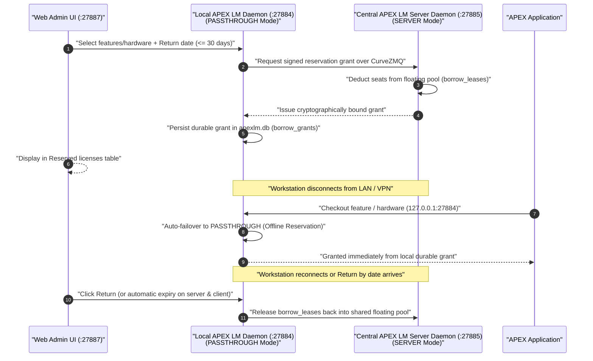

# Web Admin UI, Configuration & Reservation System

Both **APEX LM Daemon** and **APEX LM Server Daemon** host an embedded, loopback-only **Web Administration UI** for zero-install browser management, configuration, live seat monitoring, offline license reservations, log inspection, and compliance auditing.

---

## 1. Accessing & Securing the Web Admin UI

### Opening the Web UI

- **Workstation Daemon (Default `http://127.0.0.1:27887/`)**:
  - Right-click **ApexLM Tray** -> **Open Configuration** (or run `ApexLM_Tray.exe --open-browser`),
  - Click **Configure** on the Splash/About dialog of an **APEX** application (`DS`, `DR`, `DX+`, etc.), or
  - Navigate directly in a browser on the local host to `http://127.0.0.1:27887/` *(aliases `/index.html` and `/api/v1/ui` are also served)*.
- **Central License Server Daemon (Default `http://127.0.0.1:27888/`)**:
  - Open `http://127.0.0.1:27888/` locally on the license server host.
  - **Remote Administration via SSH Tunnel**: Because remote HTTP access is intentionally blocked, administrators managing a headless Linux/Windows license server remotely can forward loopback port `27888` over SSH:
    ```bash
    ssh -L 27888:127.0.0.1:27888 admin@license-server.corp.local
    # Then open http://127.0.0.1:27888/ in your local browser
    ```

### Loopback Security Model

- **Loopback Binding Only**: The HTTP server strictly binds `127.0.0.1` (`APEXLM_MANAGEMENT_PORT` / `APEXLM_SERVER_MANAGEMENT_PORT`). Any off-box direct HTTP attempt is refused at the socket layer.
- **Anti-Rebinding & Framing Protection**: Requests with a non-loopback `Host` header (`127.0.0.1`, `localhost`, `::1`, `[::1]`) or cross-origin `Origin` header are rejected with **HTTP `403`**. No CORS headers are emitted and `X-Frame-Options: DENY` / `frame-ancestors 'none'` prevent clickjacking.
- **No Separate Login Cookie**: Reachability on loopback authorizes workstation administration (no bearer token, session cookie, or password prompt).
- **Action Allow-List**: Over HTTP, administrators can inspect state, update configuration, install licenses, and manage reservations, while application checkout/checkin operations remain exclusively on the authenticated CurveZMQ licensing channel (`27884` / `27885`). The UI auto-refreshes every **30 seconds**, when clicking **Refresh**, or upon window focus.

---

## 2. Tab-by-Tab Interface Walkthrough

The Web Admin UI organizes all diagnostics and controls into **8 tabs**:

### `Overview` Tab (`#overview`)
- **Header Status Pill & Summary Banner**:
  - Shows operating state (`LOCAL`, `PASSTHROUGH` green when server reachable, `PASSTHROUGH (Offline Reservation)` amber warning when server is offline with active local reservations, `PASSTHROUGH (Offline)` red when server is unreachable with no active reservations, or `SERVER`).
- **Service Card**: Running status, active `server_mode`, ZeroMQ `licensing_port` (`27884`/`27885`), `bind_address`, `license_loaded`, `signature_verified`, `expiry`, and `passthru_online` state.
- **License Card**: Loaded licensee `username`, `company`, `license_date`, `expiration_date` (`Perpetual` if null), and `license_id`.
- **Host Card & License Requests**: Displays the machine **`Host ID`** MAC address and service `build_date`. Click **Download license request** (`GET /api/v1/license-request`) to export `license-request.json` containing the host's hardware fingerprint for submitting a node-locked or server license request to **APEX**.

### `Usage` Tab (`#usage`)
- **Reserved / Borrowed Entitlements Card** *(shown automatically whenever offline reservations exist)*: Table listing `Application`, `Feature`, `Borrowed` ceiling, `In Use`, and remaining `Available` offline seats.
- **Feature usage Card**: Live sorted table across every licensed application and hardware pool displaying `Application`, `Feature` *(including `Hardware: <vendor>` entries)*, `Total` (`Unlimited` when `-1`), `In Use`, and `Available` counts.

### `Clients` Tab (`#clients`)
- Lists every currently connected local application or downstream workstation proxy daemon (`PASSTHROUGH` peer), displaying registered `app_name`, version, `instance_id`, connection ID, source IP, and heartbeat timestamps.

### `Reserve` Tab (`#borrow`)
- Interactive **Offline License Reservation** workspace for workstations in **`PASSTHROUGH`** mode *(covered in detail in [Section 4](#4-offline-reservation-system-reserve-tab) below)*.

### `Configuration` Tab (`#config`)
Form fields are dynamically generated from `GET /api/v1/config/schema` so only settings honored by the running daemon mode appear:

- **Settings Card** *(only modified values are saved via `PUT /api/v1/config`; **Revert** discards unsaved edits)*:
  - *Workstation Daemon (`ApexLM_Service`)*:
    - **`SERVER_MODE`** *(Service mode)*: **`Local`** *(local file)* or **`Passthrough`** *(forwards checkouts to central server and enables reservations)*.
    - **`PT_HOST`** *(License server host)* & **`PT_PORT`** *(License server port, default `27885`)* *(shown when `Passthrough` is selected)*.
    - **`PROXY_IP`** *(Proxy address)* & **`PROXY_PORT`** *(Proxy port)* *(optional outbound proxy, shown when `Passthrough` is selected)*.
  - *Floating Server Daemon (`ApexLM_Server_Service`)*:
    - **`PROXY_IP`**, **`PROXY_PORT`**, and **`USER_PORT`** *(Use a user-specified port; bind port itself is configured via `APEXLM_SERVER_PORT`, default `27885`)*.
- **Other settings Card**: Read-only environment and discovery settings managed by the daemon.
- **Control Card**: Click **Restart service** (`POST /api/v1/service/restart`) to schedule a clean in-place restart after modifying **`SERVER_MODE`**, **`PT_HOST`**, or **`PT_PORT`**.
- **Install license Card**: Click **Browse license file...** (supporting `.json`, `.lic`, `.txt`), drag and drop a signed license file into the text box, or paste license JSON directly, then click **Install**.

### `Records` Tab (`#records`)
Full entitlement breakdown grouped by licensed application:
- **`Application` & `Max Allowed Version` (`YYYY.MM`)** pill.
- **Features & Allowed Counts**: Feature name, description, allowed count (`Unlimited` if `-1`), and policy (`Standard` vs. `Accrual`).
- **Token Pools**: Pool name, total token balance pill, and governed features table showing per-feature **Token Cost** and **Policy**.
- **Hardware Items**: Hardware vendor, license type (`hardware-id` vs. counted pool), max/used/available counts, and list of permitted **Allowed Hardware IDs (Serials)**.
- **Included Features**: Green status badges for bundled zero-cost included features.

### `Log` Tab (`#logs`) & `Audit` Tab (`#audit`)
- **Service log Card**: Toggle **Follow** to stream live daemon logs during refreshes, or **Load**, **Download** (`apexlm-log.txt`), and **Clear** logs (`DELETE /api/v1/logs`).
- **Crash Diagnostic Dump (`apexlm.crash.dmp`) Card**: **Load Crash Dump**, **Download** (`apexlm.crash.dmp`), or **Clear** crash diagnostics captured after unexpected termination.
- **Audit Tab**: Chronological compliance audit table (`audit_log`, up to `100` most recent mutating API calls, license installs, checkouts, and reservation events).

---

## 3. Loopback HTTP Management API Reference

Automation tooling on the local machine can also query or script management actions directly against the daemon's `http://127.0.0.1:27887/api/v1` (workstation) or `http://127.0.0.1:27888/api/v1` (server) endpoints:

| Method & Path | Category | Purpose |
| :--- | :--- | :--- |
| `GET /`, `/index.html`, `/api/v1/ui` | UI | Serves the embedded Web Admin UI HTML page. |
| `GET /api/v1/health` | Health | Liveness & API version check. |
| `GET /api/v1/status`, `/license`, `/usage`, `/connections`, `/records`, `/hostid`, `/buildinfo`, `/license-request` | Read | Runtime status, license document summary, seat usage, connected clients, full records, host ID, build date, and downloadable request payload. |
| `GET /api/v1/config`, `/config/schema` | Config | Read configuration and form schema. |
| `PUT /api/v1/config` | Write | Persist changed configuration fields (`SERVER_MODE`, `PT_HOST`, `PT_PORT`, etc.). |
| `POST /api/v1/license` | Write | Validate & hot-install Format v2 license text. |
| `GET /api/v1/borrows`, `/borrows/available` | Reserve | List active workstation grants/reservations and query reservable server features/hardware. |
| `POST /api/v1/borrows`, `/borrows/return` | Reserve | Create a new 1–30 day offline reservation (`{features, expires}`) or return an active reservation early (`{borrow_id}`). |
| `POST /api/v1/service/restart` | Control | Schedule an in-place daemon restart. |
| `GET /api/v1/logs`, `/crash-dump`, `/audit?limit=N` & `DELETE /logs`, `/crash-dump` | Diagnostics | Read/clear logs, crash dumps, and compliance audit entries. |

---

## 4. Offline Reservation System (`Reserve` Tab)

The reservation system allows engineers to check out a temporary, cryptographically authenticated allotment of floating features, shared token pools, and hardware serials onto a field workstation or test-cell laptop for up to **30 days** (`MAX_BORROW_DAYS = 30`).



### Step-by-Step: Reserving Licenses

1. **Verify Prerequisites**: Your local **APEX LM Daemon** must be in **`PASSTHROUGH`** mode and online with your central **APEX LM Server Daemon** *(the server daemon itself lends licenses and cannot borrow)*.
2. Open **`http://127.0.0.1:27887/#borrow`** (the **Reserve** tab).
3. **Select Features & Token Counts**:
   - Check each needed application feature under **Features** and enter the seat **Count**.
   - **Token Pool Behavior**: When you reserve tokens or token-backed capabilities from a pool (such as `ANALYSIS`), the server copies the token pool definition and all governed feature multipliers (`cost` and `accrual`) into your local cryptographically bound reservation grant, allowing token-backed analytics apps (`APEX DX`, `DX+`, `GageMap`) to check out features identically offline.
4. **Select Hardware Vendors**:
   - Under **Hardware**, check the required vendor entries.
   - `hardware-id` entries reserve **`All`** permitted serials for that vendor (`Serials` column); counted hardware pools let you reserve a specific hardware seat **Count**.
5. **Choose Return Date & Submit**:
   - Set **Return by** (defaults to `7` days from today; maximum enforced by server policy is **30 days**).
   - Click **Reserve selected**.

### Runtime Failover, Persistence & Returning Reservations

- **Zero Client Code Changes**: **APEX** applications continue connecting normally to `127.0.0.1:27884`. While online, checkouts proxy through to the server as usual; as soon as the central server becomes unreachable, the local daemon automatically switches into **`PASSTHROUGH (Offline Reservation)`** mode, shows an amber status banner in the Web UI, and serves checkouts immediately from `borrow_grants` in SQLite without waiting for network timeouts.
- **Survives Reboots**: Unlike transient live checkouts, active reservations are stored in `borrow_grants` (workstation) and `borrow_leases` (server) and survive OS restarts on both hosts.
- **Preventing Stranded Server Seats**: While a reservation is active, the central server deducts those seats from its floating pool (`Available` drops accordingly) so other users cannot over-subscribe them.
- **Returning Early vs. Auto-Expiration**:
  - **Early Return**: Reconnect to the corporate network/VPN, open **Reserve**, and click **Return** next to the active entry in **Reserved licenses** *(prompts for confirmation)* to release seats back into the central pool immediately.
  - **Automatic Expiry**: Both the local grant and the server's `borrow_lease` automatically expire at the end of the **Return by** date — even if a field laptop is never reconnected or is decommissioned — preventing permanently stranded seats.

See also: [Overview & Format v2 Architecture](README.md) · [Workstation & Server Setup](setup-and-server.md) · [CLI Tools Reference](cli-reference.md)
