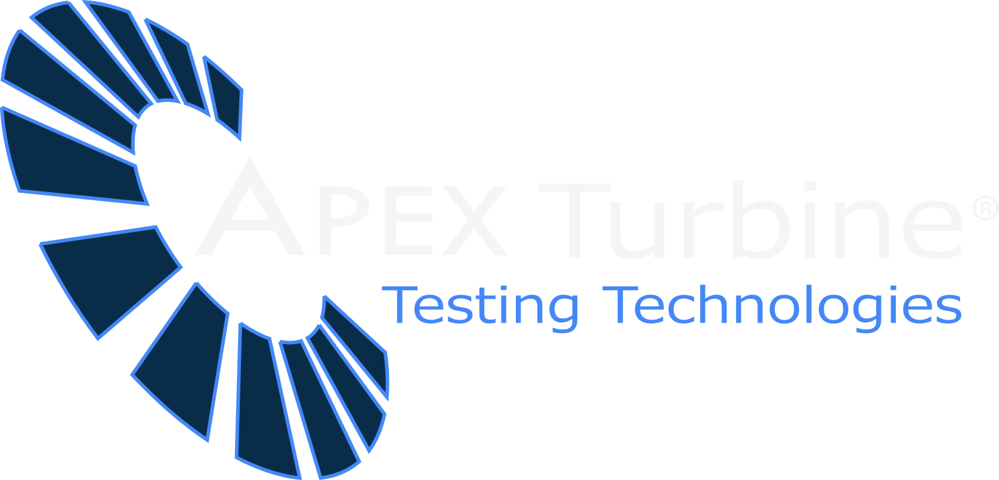
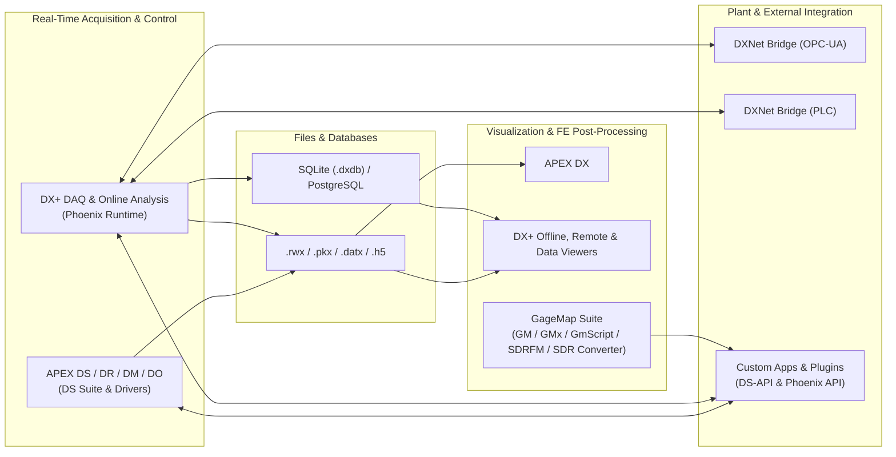

# Overview

Welcome to the unified user and developer documentation portal for **APEX** (`APEX Testing Technologies`) acquisition systems, dynamic signal analysis suites, finite-element sensor optimization tools, and software developer kits.

Browse the full documentation tree in the **[Index](DOC_INDEX.md)**, or jump directly to any product Quick Start Guide and Master Documentation below.

---

## Ecosystem Overview

---

## DS — Data Acquisition & Telemetry Suite

The **APEX DS** family provides synchronized multi-chassis dynamic data acquisition (`DS`), remote engineering display stations (`DR`), distributed `N:M` cluster and batch CLI automation (`DM`), real-time digital-to-analog waveform output (`DO`), and `30+` hardware driver modules (`Drivers`).

- **[DS Quick Start Guide](DS/quick-start.md)** · **[DS Master Documentation](DS/README.md)**
- **Applications & Drivers**: [APEX DS](DS/DS/README.md) · [APEX DR](DS/DR/README.md) · [APEX DM](DS/DM/README.md) · [APEX DO](DS/DO/README.md) · [Hardware Drivers](DS/Drivers/README.md)

---

## DX — Data Explorer

**APEX DX** is the high-speed post-test dynamic signal explorer and workflow designer for aeromechanics, rotating machinery, FFT/order tracking, parameter merging, and scope-limit evaluation over `.rwx`, `.pkx`, `.datx`, `.raw`, and `.pks` runs.

- **[DX Quick Start Guide](DX/quickstart.md)** · **[DX Master Documentation](DX/README.md)**
- **Core References**: [Overview](DX/overview.md) · [Licensing (`ApexLM` & FlexNet)](DX/licensing.md) · [DX Designer](DX/design.md) · [DX Viewer](DX/view.md) · [Data Formats](DX/formats.md)

---

## GageMap — Finite-Element Sensor & Fatigue Suite

**APEX GageMap** converts ANSYS, ABAQUS, and NASTRAN finite-element models into reduced `.sdr` representations (`SDR Converter`), inspects and trims reduced models (`SDRFM`), optimizes sensor placement and evaluates HCF fatigue margins (`GM` / `GMx`), and automates workflows in Lua (`GmScript`), backed by the `GM Theory` reference manual.

- **[GageMap Quick Start Guide](GageMap/quick-start.md)** · **[GageMap Master Documentation](GageMap/README.md)**
- **Suite Manuals**: [GageMap Classic (`GM`)](GageMap/GM/README.md) · [GageMap Next Gen (`GMx`)](GageMap/GMx/README.md) · [GmScript](GageMap/GmScript/README.md) · [GM Theory](GageMap/GM%20Theory/README.md) · [SDRFM](GageMap/SDRFM/README.md) · [SDR Converter](GageMap/SDR%20Converter/README.md)

---

## DX+ — Modern Acquisition, Streaming & Analytics Platform

**APEX DX+** is the next-generation Qt 6 and Phoenix-powered acquisition and analytics suite backed by open SQLite (`.dxdb`), PostgreSQL, and `.h5`/`.datx`/`.rwx` storage. It encompasses `DX+DAQ`, `DX+OnlineAnalysis`, `DX+OfflineAnalysis`, `DX+RemoteViewer`, `DX+DataViewer`, `DB Manager`, and `DXNet` OPC-UA & PLC industrial bridges. *(Maintained via the `dxplus-doc` Git submodule.)*

- **[DX+ Quick Start Guide](DX+/quick-start.md)** · **[DX+ Master Documentation](DX+/README.md)**
- **Applications**: [DX+DAQ](DX+/DX+DAQ/README.md) · [DX+OnlineAnalysis](DX+/DX+OnlineAnalysis/README.md) · [DX+OfflineAnalysis](DX+/DX+OfflineAnalysis/README.md) · [DX+RemoteViewer](DX+/DX+RemoteViewer/README.md) · [DX+DataViewer](DX+/DX+DataViewer/README.md)
- **Tools & Services**: [DB Manager](DX+/Tools/DB%20Manager/README.md) · [DXNet Bridge (OPCUA)](DX+/Services/DXNet%20Bridge%20%28OPCUA%29/README.md) · [DXNet Bridge (PLC)](DX+/Services/DXNet%20Bridge%20%28PLC%29/README.md) · [Installation & Licensing](DX+/introduction/installing-and-licensing.md)

---

## Custom Development — Developer APIs & SDKs

Build custom file converters, live acquisition clients, automated test-stand controllers, composable streaming pipelines, database readers/writers, and C++ plugins using **DS-API** (C/C++, 64-bit MATLAB, Python) and **Phoenix API** (C++20, `phoenixpy` Python, maintained via the `phoenix-doc` Git submodule), including complete developer licensing details.

- **[Custom Development Quick Start Guide](Custom%20Development/quick-start.md)** · **[Custom Development Master Documentation](Custom%20Development/README.md)**
- **SDKs**: [DS-API (`C++`, `MATLAB`, `Python`)](Custom%20Development/DS-API/README.md) · [Phoenix API (`C++`, `Python`)](Custom%20Development/Phoenix%20API/README.md)
